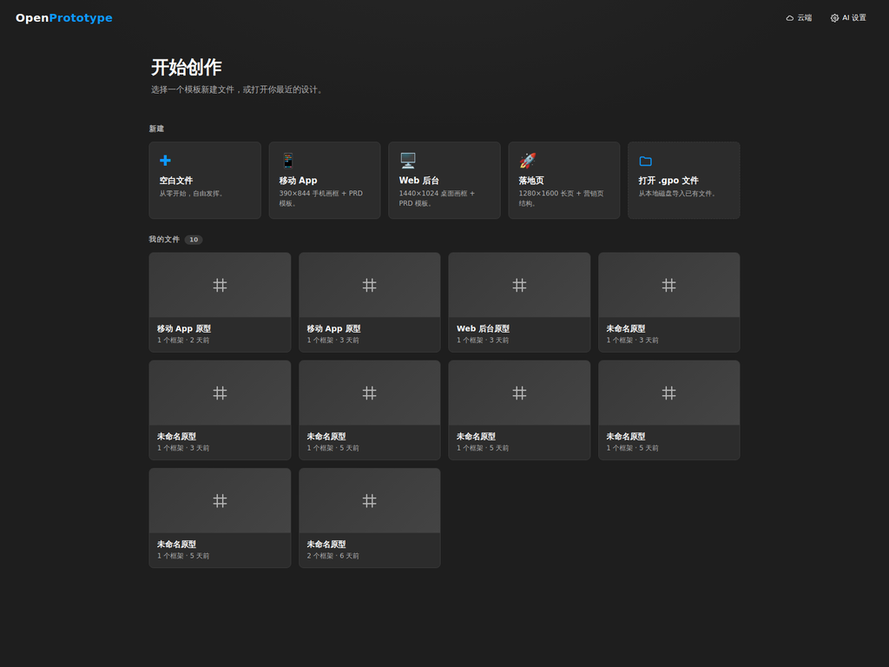
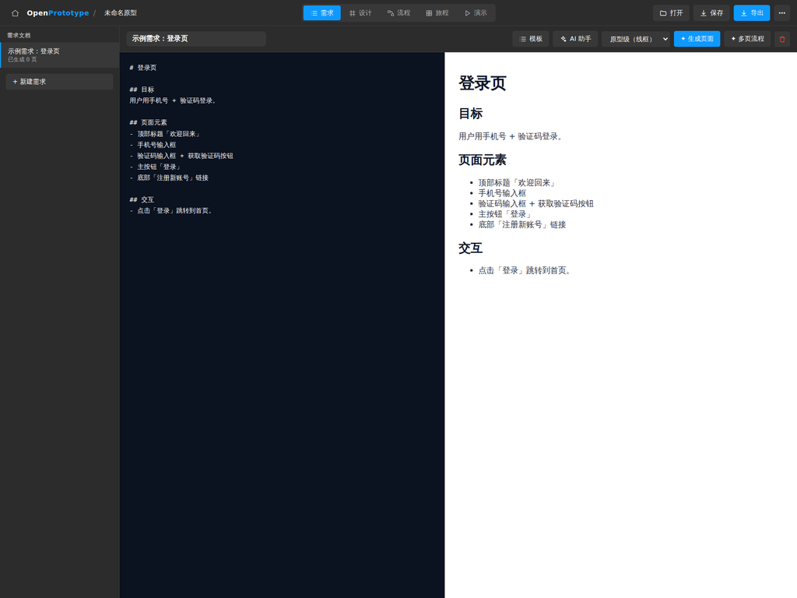
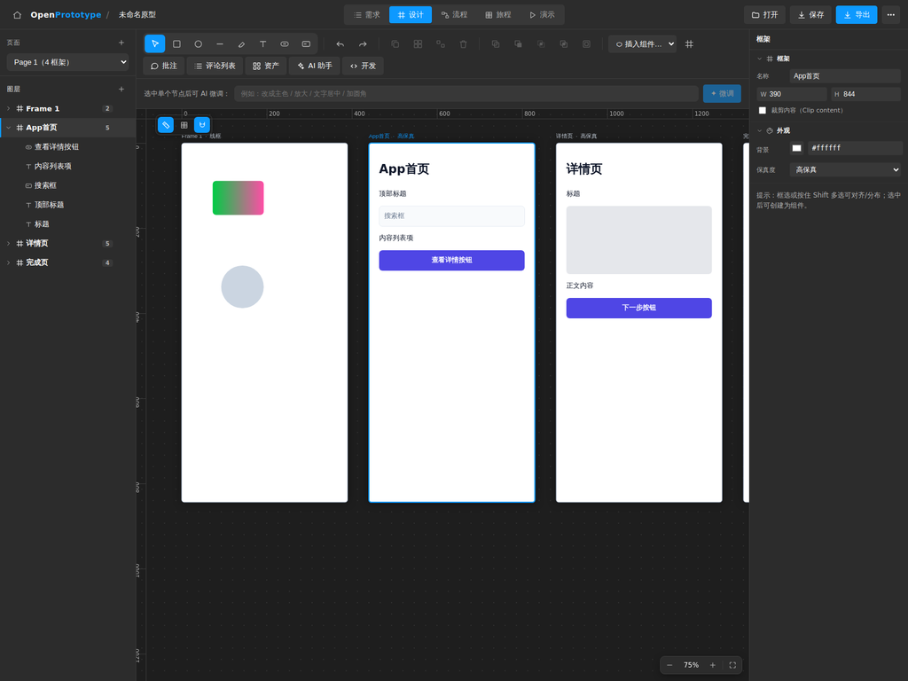
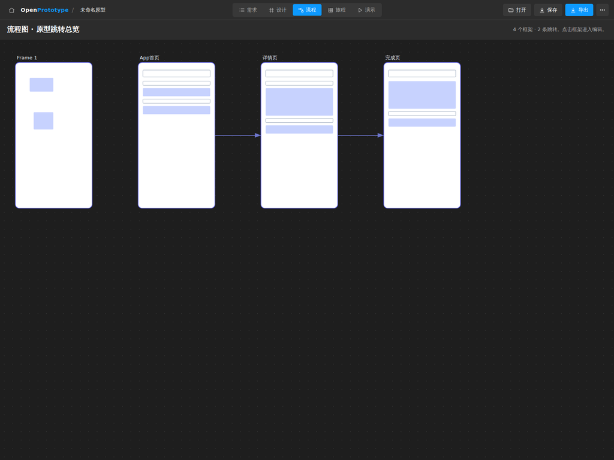
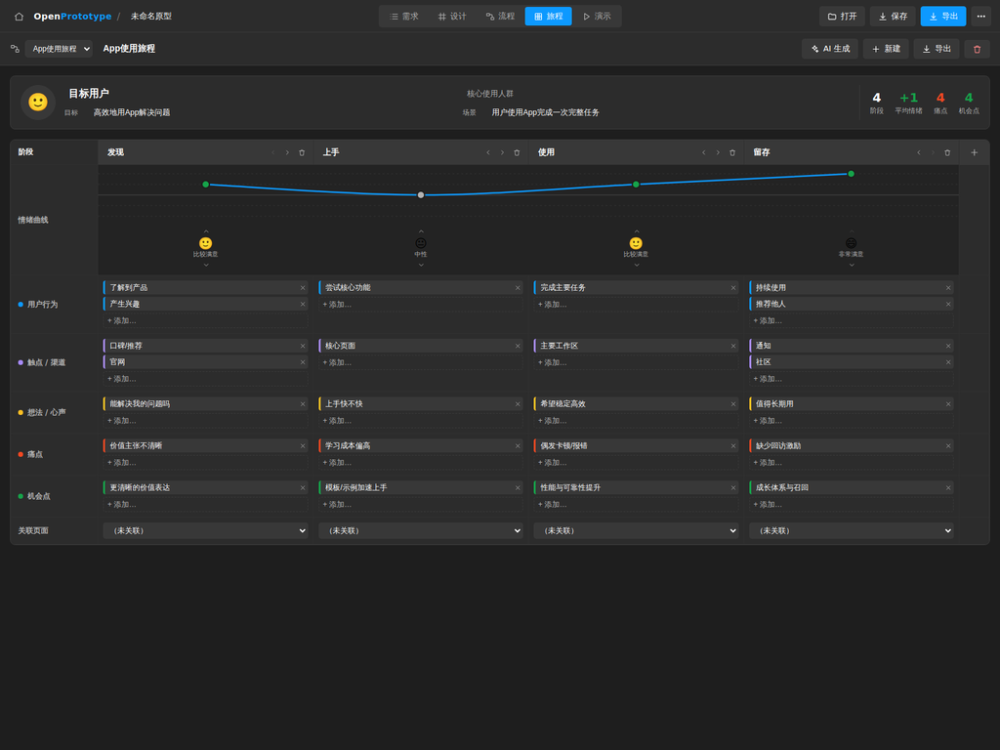
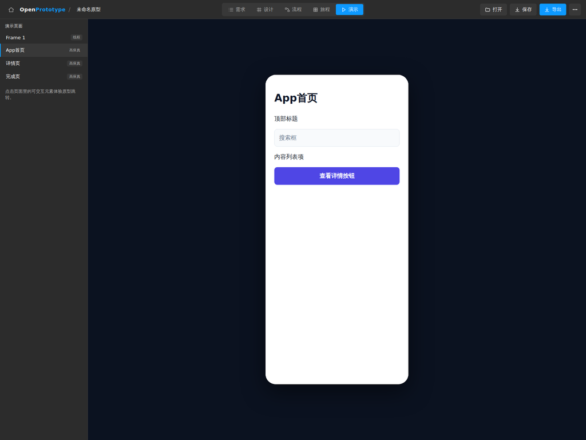
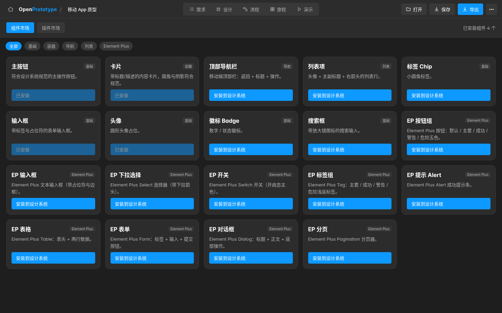
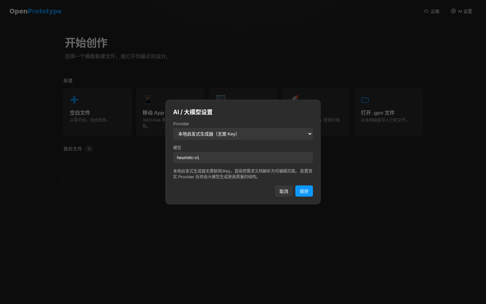

# OpenPrototype

[简体中文](README.md) · **English**

An AI-driven product prototyping tool. **Requirements-doc first**: write and manage requirement docs in Markdown, then let AI generate structured pages (not images) that you can keep editing by hand. Fine-tune them on a free-form canvas, wire up navigation links, and export a static prototype you can demo.

> File extension: `.gpo` (Generative Prototype Object).

## Screenshots

> These are screenshots of the real app (dark grey, Figma-style theme). The UI is currently Chinese only.

### Home · file library
Create a file from a template, or open a recent `.gpo` design.



### Requirements · Markdown editor + live preview
Edit Markdown on the left (type `/` for slash commands that insert section templates), live rendering on the right. Generate a page or a multi-page flow straight from the doc.



### Design canvas · infinite canvas + Figma-style inspector
Layer tree on the left, a multi-frame infinite canvas in the middle, and a Figma-style inspector on the right (position / layout / appearance / fill / stroke / effects / constraints / export). The image shows an "App home → detail → done" set of high-fidelity pages generated by AI in one click.



### Flow · navigation overview
Collects the navigation links between frames so you can see the whole prototype's navigation structure at a glance.



### User journey map
Persona + stage matrix (actions / touchpoints / thoughts / pain points / opportunities) + an emotion curve recomputed live per stage. Supports one-click AI generation, editing, and Markdown/CSV export.



### Preview mode · interactive prototype player
Device-frame preview; click interactive elements to follow the prototype's navigation.



### Component / plugin market
Built-in basic components and Element Plus components, installable into the design system in one click, plus a plugin market (see [`docs/PLUGIN_SPEC.md`](docs/PLUGIN_SPEC.md), in Chinese).



### AI settings
Pick a provider (local heuristic generator / OpenAI / Anthropic / DeepSeek) and model. The key is stored only in your local browser.



> The market and AI settings screenshots were taken in headless Chromium against `vite preview` after `pnpm build`.

## What's implemented (MVP core loop)

```
Requirements Markdown → AI-generated pages (structured metadata) → manual canvas tweaks → flow links → export demo HTML
```

- **Requirements**: Markdown editor + live preview, the entry point of the product (requirements → prototype).
- **AI generation**: multi-provider gateway (OpenAI / Anthropic / DeepSeek, bring your own key) plus a **local heuristic generator** that works without any key. Page-level generation and node-level refinement; wireframe and high-fidelity modes.
- **Canvas engine** (react-konva): infinite canvas, zoom/pan, rectangles/text, select/move/resize, layer tree, inspector.
- **Design system**: color/font/radius/spacing tokens, system-level prompts, machine-checkable design rules (checked and auto-fixed after generation).
- **Flow links**: click a node → navigate to the target frame (with transitions).
- **Preview mode**: built-in interactive prototype player.
- **Export**: single-file demo HTML (with a navigation runtime).
- **Files**: `.gpo` zip container (open `document.json` schema + `INTEROP.md` interop spec); open/save in the browser, Tauri file dialogs on desktop.

Later batches added (from the "⋯" menu at the top right of the editor):

- **User journey map** and **flow overview** (see screenshots above).
- **Component / plugin market** (`src/market/`, plugin spec in [`docs/PLUGIN_SPEC.md`](docs/PLUGIN_SPEC.md)).
- **Version history / branches**: local versions, branches, and diffs (`src/version/`).
- **Figma / Sketch import** (components / artboards / tokens, `src/interop/importDesign.ts`).
- **Cloud collaboration**: accounts, cloud projects, version history, and member roles, backed by the FastAPI server in [`server/`](server/README.md).

## Tech stack

React 18 + TypeScript + Vite + Zustand + react-konva. Desktop shell: Tauri 2 (see `src-tauri/`). Optional backend: FastAPI + PostgreSQL + SQLAlchemy + JWT (`server/`).

## Development

```bash
pnpm install
pnpm dev         # http://localhost:5173
pnpm typecheck
pnpm lint
pnpm test
pnpm build       # outputs dist/ (static site)
```

## Cloud backend (optional)

`server/` is a FastAPI + PostgreSQL + JWT backend that powers "cloud collaboration": accounts, project storage, version history, and team members. See [`server/README.md`](server/README.md) for setup and endpoints. Its tests run on in-memory SQLite, so no database is needed (`python -m pytest`). The frontend calls `http://localhost:8008/api` by default.

## Desktop (Tauri)

```bash
pnpm tauri dev      # requires Rust and the system WebView dependencies
pnpm tauri build    # build Windows/macOS/Linux installers
```

The repo's [`installers/`](installers/README.md) directory contains committed v0.1.0 installers for Linux (deb / rpm / AppImage) and Windows (NSIS / portable), plus `SHA256SUMS.txt`. macOS builds come from CI: push a `v*` tag to run `.github/workflows/desktop-release.yml`.

## `.gpo` file format

A ZIP container:

```
/manifest.json    format and schema version
/document.json    full document tree (open JSON Schema)
/INTEROP.md       field mapping to Figma/Sketch (interop spec)
/assets/*         images/fonts
```

See `src/schema/types.ts` (schema) and `src/schema/gpoFile.ts` (container + interop spec).

## Project structure

```
src/
  schema/        .gpo document schema, defaults, zip serialization
  store/         Zustand state (document / selection / UI / AI settings)
  ai/            provider gateway, local generator, generation/refinement orchestration
  designsystem/  design rule engine
  render/        token → color resolution
  export/        static HTML export
  file/          .gpo open/save (Tauri + browser)
  views/         requirements / design (canvas) / flows / journey / preview / market / home views
  components/    AI settings, design system, cloud, version history modals
  market/ version/ interop/ journey/ prototype/ cloud/   feature modules
server/          optional FastAPI cloud backend (with pytest suite)
src-tauri/       Tauri 2 desktop shell
installers/      prebuilt v0.1.0 installers
wiki/            static project wiki
```

## Configuration

The frontend needs no config file; all settings live in browser localStorage:

| Key | Contents |
|---|---|
| `gpo.ai.settings` | AI provider, API key, model (defaults to the local heuristic generator, no key needed) |
| `gpo.autosave.v1` / `gpo.recents.v1` / `gpo.library.v1` | autosaved document, recent files, file library |
| `gpo.versions.<docId>` | local version history |
| `op_cloud_token` | cloud login token |

The build-time env var `VITE_CLOUD_API` changes the cloud API URL (default `http://localhost:8008/api`). Backend settings are in `server/.env.example` (`DATABASE_URL`, `JWT_SECRET`, `CORS_ORIGINS`, …).

## Roadmap (later phases)

- Better high-fidelity generation, real Figma/Sketch import, component instances/overrides, auto layout.
- SaaS: multi-tenancy, accounts/billing, CRDT real-time collaboration, cloud files.
- Plugin market + component market.

## More docs

- [`wiki/`](wiki/README.md): static project wiki (40 pages, open `wiki/index.html`; Chinese).
- [`docs/PLUGIN_SPEC.md`](docs/PLUGIN_SPEC.md): plugin spec.
- `PHASE2_TEST_REPORT.md`, `PHASE3_TEST_REPORT.md`, `BATCH2_STYLE_CONSTRAINTS_TEST_REPORT.md`: per-phase test reports.

## Contributing

Issues and pull requests are welcome. Before submitting, make sure `pnpm typecheck`, `pnpm lint`, and `pnpm test` pass; if you change `server/`, run its pytest suite too.
