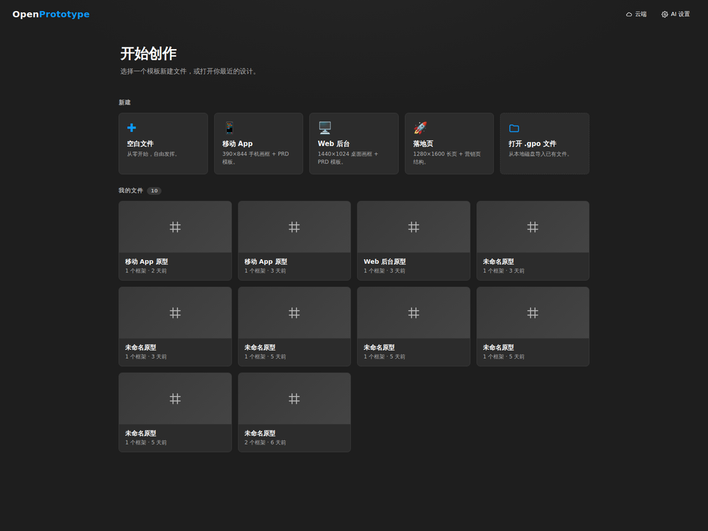
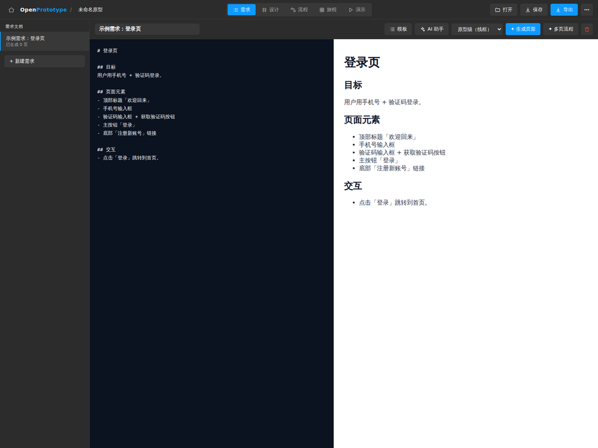
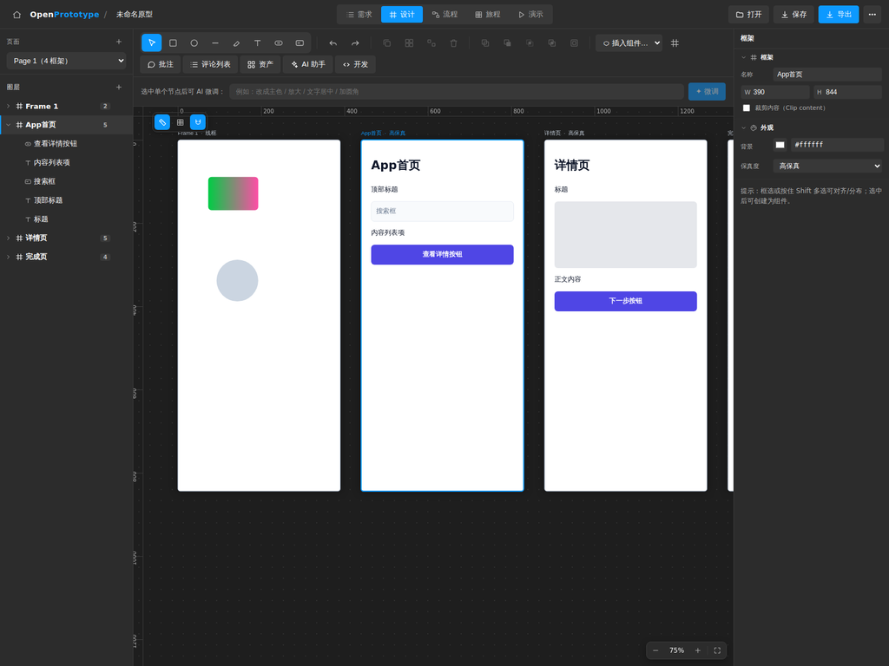
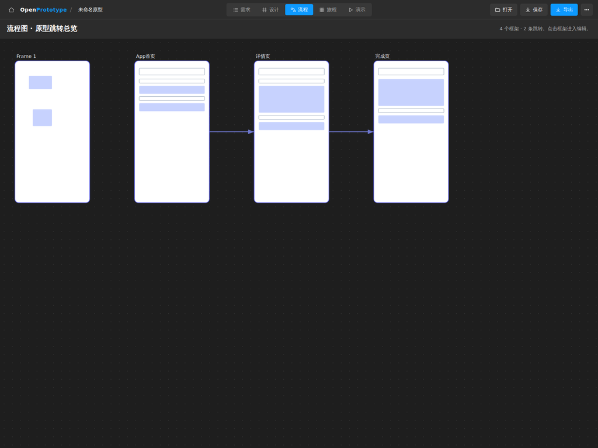
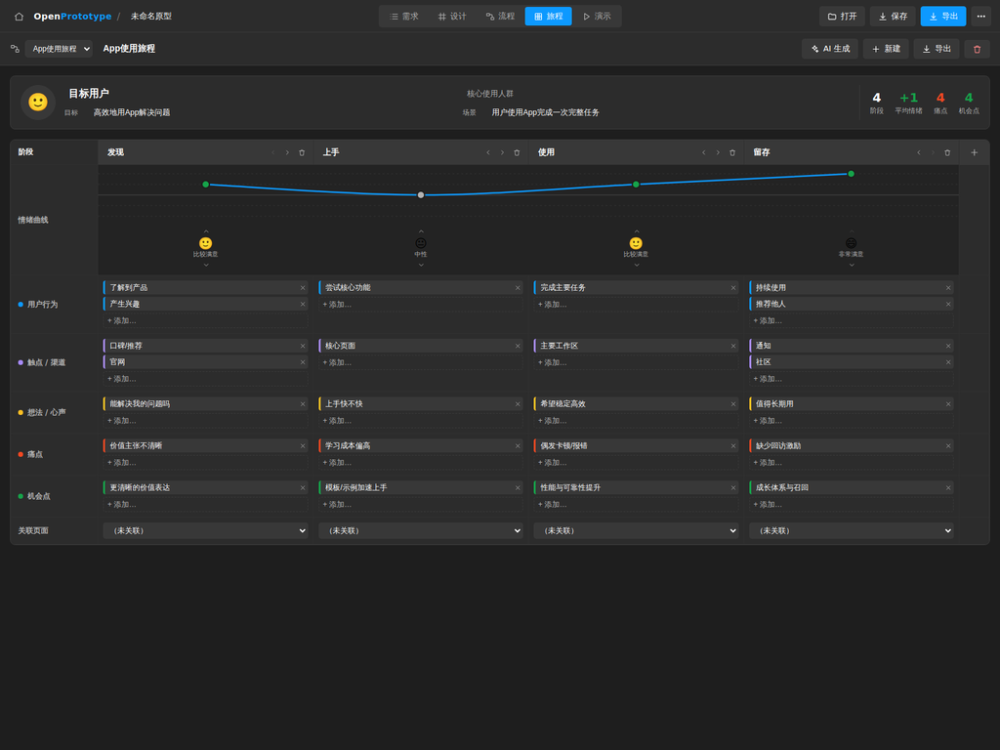
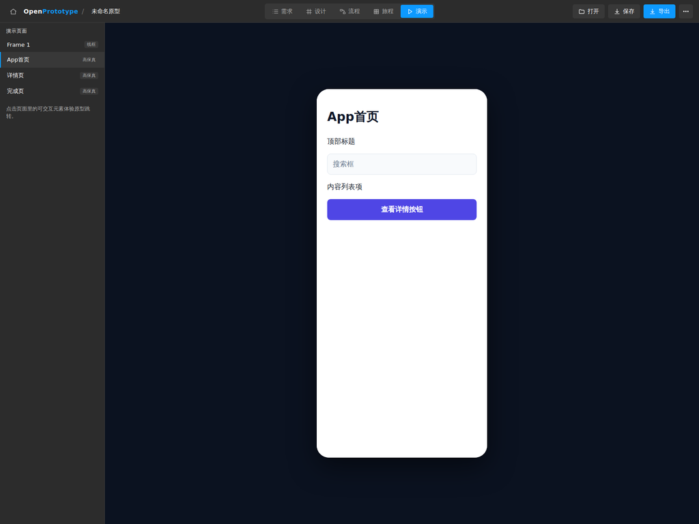
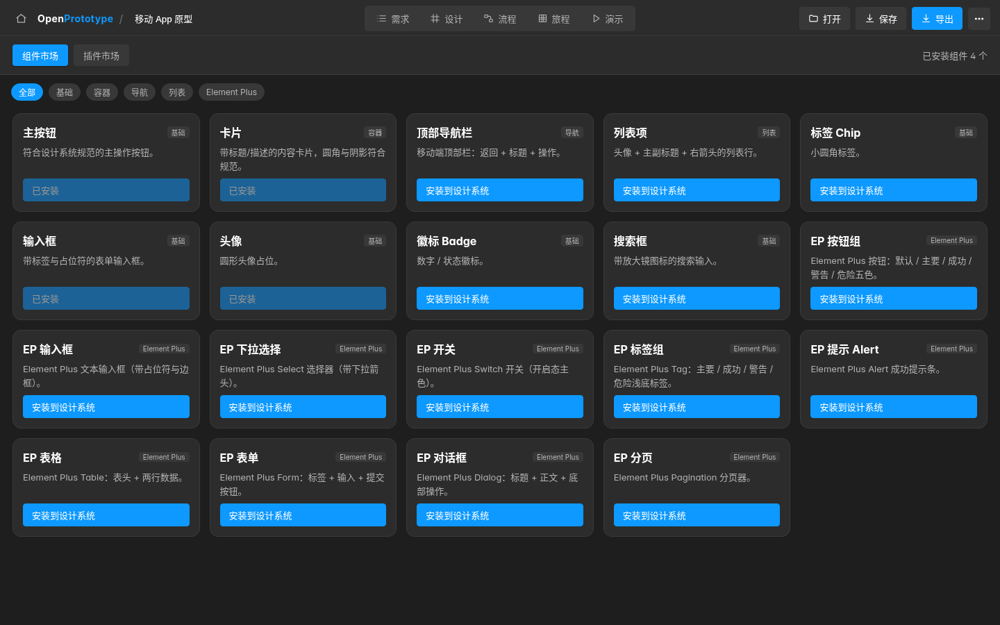
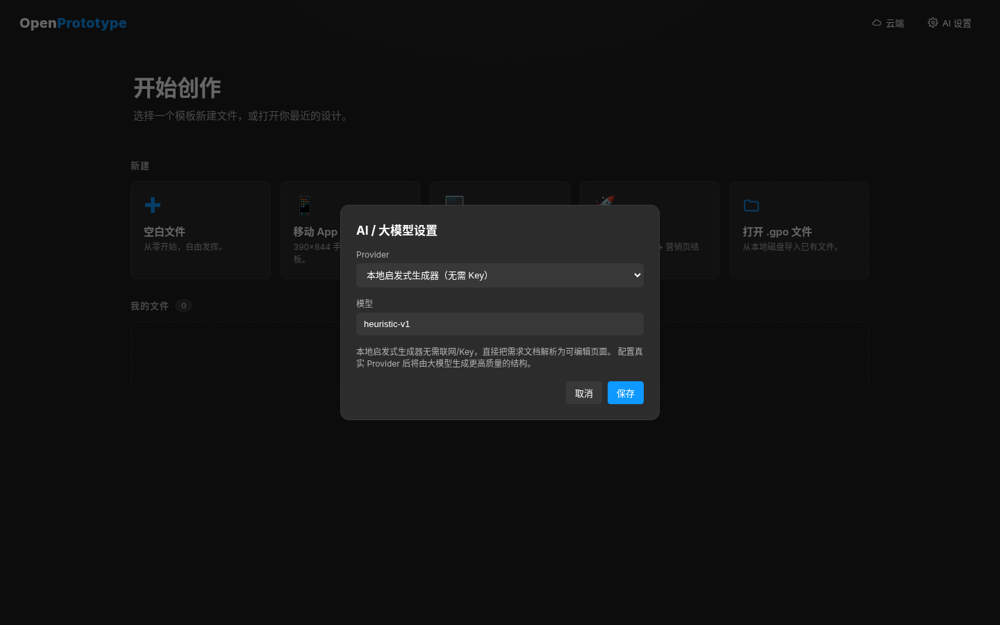

# OpenPrototype

**简体中文** · [English](README.en.md)

AI 驱动的产品原型工具。**需求文档驱动**：先写/管理需求 Markdown，再由 AI 生成可继续手动编辑的结构化页面（不是图片），在自由画布上微调、连线跳转，并导出可演示的静态原型。

> 文件后缀：`.gpo`（Generative Prototype Object）。

## 界面截图

> 以下截图为软件实际运行界面（深灰 Figma 风格主题）。

### 首页 · 文件库
从模板新建文件，或打开最近的 `.gpo` 设计。



### 需求文档 · Markdown 编辑 + 实时预览
左侧 Markdown 编辑（支持 `/` 斜杠命令插入章节模板），右侧实时渲染；可直接「✦ 生成页面 / 多页流程」。



### 设计画布 · 无限画布 + Figma 式属性面板
左侧图层树、中间多框架无限画布、右侧 Figma 风格属性面板（位置 / 布局 / 外观 / 填充 / 描边 / 效果 / 约束 / 导出）。下图为 AI 一键生成的「App 首页 → 详情页 → 完成页」高保真页面。



### 流程图 · 原型跳转总览
自动汇总各框架之间的跳转连线，俯瞰整套原型的导航结构。



### 用户旅程地图 · 完整可用
人物画像 + 阶段矩阵（用户行为 / 触点 / 心声 / 痛点 / 机会点）+ 情绪曲线（随各阶段情绪实时重算），支持 AI 一键生成、增删改、Markdown/CSV 导出。



### 演示模式 · 可交互原型播放
设备外壳预览，点击页面内可交互元素体验原型跳转。



### 组件 / 插件市场
内置基础组件与 Element Plus 组件，可一键安装到设计系统；另有插件市场（插件规范见 [`docs/PLUGIN_SPEC.md`](docs/PLUGIN_SPEC.md)）。



### AI 设置
选择 Provider（本地启发式生成器 / OpenAI / Anthropic / DeepSeek）与模型，Key 仅保存在本地浏览器。



> 「组件市场」「AI 设置」两张截图为 `pnpm build` 后用 `vite preview` 在无头 Chromium 中实拍。界面目前只有中文。

## 已实现（MVP 主干闭环）

```
需求 Markdown  →  AI 生成页面(结构化元数据)  →  画布手动微调  →  Flow 跳转连线  →  导出可演示 HTML
```

- **需求模块**：Markdown 编辑 + 实时预览，作为产品入口（需求 → 原型）。
- **AI 生成**：多 Provider 网关（OpenAI / Anthropic / DeepSeek，用户自带 Key）+ **本地启发式生成器**（无需 Key 即可跑通）。支持页面级生成与节点级微调，原型级/高保真双保真度。
- **画布引擎**（react-konva）：无限画布、缩放/平移、矩形/文本、选择/移动/缩放、图层树、属性面板。
- **设计系统**：颜色/字体/圆角/间距 tokens、系统级提示词、可机检的设计规则（生成后自动校验+修正）。
- **Flow 连线**：节点点击 → 跳转到目标框架（含动效）。
- **演示模式**：内置可交互原型播放器。
- **导出**：单文件可演示 HTML（含跳转运行时）。
- **文件**：`.gpo` zip 容器（`document.json` 开放 Schema + `INTEROP.md` 互通规范），浏览器内打开/保存，桌面端走 Tauri 文件对话框。

后续批次在主干之上又加入了（入口在编辑界面顶栏右上角的「⋯」菜单）：

- **用户旅程地图**、**流程图总览**（见上方截图）。
- **组件 / 插件市场**（`src/market/`，插件规范 [`docs/PLUGIN_SPEC.md`](docs/PLUGIN_SPEC.md)）。
- **版本历史 / 分支**：本地保存版本、分支与差异对比（`src/version/`）。
- **导入 Figma / Sketch**（组件 / 画板 / Token，`src/interop/importDesign.ts`）。
- **云端协作**：账户、云端项目、版本历史与成员角色，对接 [`server/`](server/README.md) 中的 FastAPI 后端。

## 技术栈

React 18 + TypeScript + Vite + Zustand + react-konva。桌面壳：Tauri 2（见 `src-tauri/`）。

## 开发

```bash
pnpm install
pnpm dev         # http://localhost:5173
pnpm typecheck
pnpm lint
pnpm test
pnpm build       # 产出 dist/（静态站点）
```

## 云端后端（可选）

`server/` 是 FastAPI + PostgreSQL + JWT 后端，为「云端协作」提供账户、项目存储、版本历史和团队成员。启动与接口见 [`server/README.md`](server/README.md)；其测试使用内存 SQLite，无需数据库（`python -m pytest`）。前端默认请求 `http://localhost:8008/api`。

## 桌面端（Tauri）

```bash
pnpm tauri dev      # 需本地安装 Rust 与系统 WebView 依赖
pnpm tauri build    # 打包 Win/macOS/Linux 安装包
```

仓库的 [`installers/`](installers/README.md) 目录提交了 v0.1.0 的 Linux（deb / rpm / AppImage）与 Windows（NSIS / 便携版）安装包及 `SHA256SUMS.txt`。macOS 包需推送 `v*` tag，由 `.github/workflows/desktop-release.yml` 在 CI 上构建。

## `.gpo` 文件格式

ZIP 容器：

```
/manifest.json    格式与 schema 版本
/document.json    完整文档树（开放 JSON Schema）
/INTEROP.md       与 Figma/Sketch 的字段映射（互通规范）
/assets/*         图片/字体
```

详见 `src/schema/types.ts`（Schema）与 `src/schema/gpoFile.ts`（容器 + 互通规范）。

## 目录结构

```
src/
  schema/        .gpo 文档 Schema、默认值、zip 序列化
  store/         Zustand 状态（文档/选择/UI/AI 设置）
  ai/            Provider 网关、本地生成器、生成/微调编排
  designsystem/  设计规则引擎
  render/        token→颜色解析
  export/        静态 HTML 导出
  file/          .gpo 打开/保存（Tauri + 浏览器）
  views/         需求 / 设计(画布) / 流程 / 旅程 / 演示 / 市场 / 首页 视图
  components/    AI 设置、设计系统、云端、版本历史弹窗
  market/ version/ interop/ journey/ prototype/ cloud/   各功能模块
server/          可选的 FastAPI 云端后端（含 pytest）
src-tauri/       Tauri 2 桌面壳
installers/      v0.1.0 预构建安装包
wiki/            静态化项目 Wiki
```

## 路线图（后续阶段）

- 高保真生成增强、Figma/Sketch 真实导入、组件实例/覆盖、自动布局。
- SaaS：多租户、账户/计费、CRDT 实时协作、云端文件。
- 插件市场 + 组件市场。

详见规划文档（随会话附件 `prototype_ai_plan.md`）。

## 配置

前端无需配置文件，所有设置保存在浏览器 localStorage：

| 键 | 内容 |
|---|---|
| `gpo.ai.settings` | AI Provider、API Key、模型（默认本地启发式生成器，无需 Key） |
| `gpo.autosave.v1` / `gpo.recents.v1` / `gpo.library.v1` | 自动保存的文档、最近文件、文件库 |
| `gpo.versions.<docId>` | 本地版本历史 |
| `op_cloud_token` | 云端登录令牌 |

构建时环境变量 `VITE_CLOUD_API` 可修改云端 API 地址（默认 `http://localhost:8008/api`）。后端配置见 `server/.env.example`（`DATABASE_URL`、`JWT_SECRET`、`CORS_ORIGINS` 等）。

## 其他文档

- [`wiki/`](wiki/README.md)：静态化项目 Wiki（40 页，打开 `wiki/index.html`）。
- [`docs/PLUGIN_SPEC.md`](docs/PLUGIN_SPEC.md)：插件规范。
- `PHASE2_TEST_REPORT.md`、`PHASE3_TEST_REPORT.md`、`BATCH2_STYLE_CONSTRAINTS_TEST_REPORT.md`：各阶段测试报告。

## 参与贡献

欢迎 Issue 和 PR。提交前请确认 `pnpm typecheck`、`pnpm lint`、`pnpm test` 通过；修改 `server/` 时请运行其 pytest。
