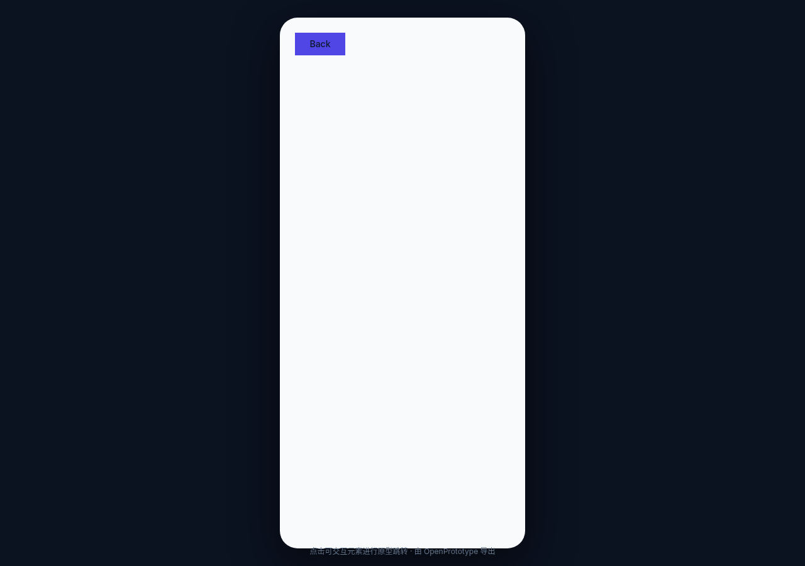

# OpenPrototype

[English](./README.md) | **简体中文**

用 `.gpo`（Generative Prototype Object）文件做可交互原型的设计工具。

## 0.2.0 更新

可以把示例 `.gpo` 导出为静态站点（`index.html` + `manifest.json`），用浏览器直接打开，不必启动应用。带点击交互的画板会写入页面跳转。

验证：

```bash
npx vitest run src/__tests__/export-site.test.ts
```

## 界面预览

把样例 `.gpo` 导出为静态站后在浏览器打开，并可跳转到结算页。




