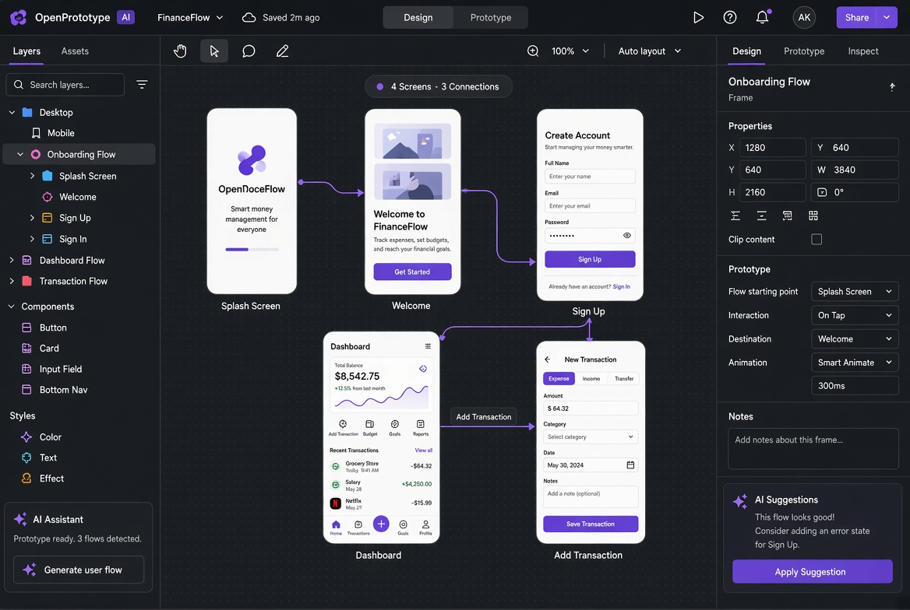

# OpenPrototype 文档

AI 驱动的产品原型工具。需求文档驱动：先管理需求 Markdown，再由 AI 生成可继续手动编辑的结构化页面，在自由画布上微调、连线跳转，并导出可演示的静态原型。

文件后缀：`.gpo`（Generative Prototype Object）。

## 界面预览

## 核心流程

1. 编写/管理需求 Markdown
2. AI 生成结构化页面
3. 无限画布微调与连线
4. 导出静态原型

## 主要视图

- 首页文件库
- 需求文档编辑 + 实时预览
- 设计画布（Figma 风格）
- 流程图总览
