# Page: OpenPrototype Overview

# OpenPrototype Overview

<details>
<summary>Relevant source files</summary>

The following files were used as context for generating this wiki page:

- [README.md](README.md)
- [index.html](index.html)
- [package.json](package.json)
- [src-tauri/Cargo.toml](src-tauri/Cargo.toml)
- [src/App.tsx](src/App.tsx)
- [src/main.tsx](src/main.tsx)
- [src/views/HomeView.tsx](src/views/HomeView.tsx)

</details>


OpenPrototype is an AI-driven product prototyping studio that bridges the gap between natural language requirements and structured design entities. Unlike tools that generate static images, OpenPrototype produces editable, structured metadata that resides on an infinite canvas, allowing for manual refinement, interaction wiring, and production-ready code export.

## Core Workflow

The system follows a linear progression from abstract concepts to interactive prototypes:

1.  **Requirements**: Users draft or manage product requirements in Markdown. AI assistance can polish, expand, or summarize these drafts [README.md:13-14]().
2.  **AI Generation**: The AI interprets requirements to generate structured page metadata (frames, nodes, and auto-layout settings) [README.md:10-11]().
3.  **Canvas Editing**: Users refine the generated UI on a `react-konva` powered canvas, adjusting properties, layers, and design tokens [README.md:15-16]().
4.  **Flow & Export**: Screens are linked via interactions to create a "Flow," which can then be exported as a self-contained HTML prototype or individual code components (React, Vue, Tailwind) [README.md:17-19]().

### Workflow Logic to Code Mapping

The following diagram illustrates how the conceptual workflow is mapped to specific subsystems and files within the codebase.

**System Workflow Mapping**
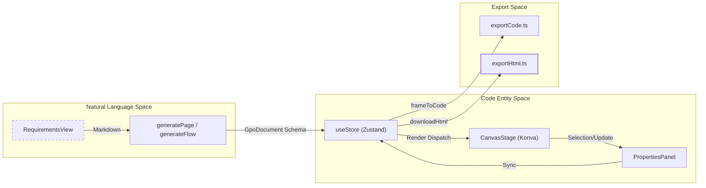
**Sources:** [README.md:10-20](), [src/App.tsx:25-31](), [src/store/useStore.ts:1-10]()

---

## Technology Stack

OpenPrototype is built as a modern web application with a desktop-first capability via Tauri.

*   **Frontend Framework**: React 18 + TypeScript [package.json:24-30]().
*   **Rendering Engine**: `react-konva` for high-performance 2D canvas operations [package.json:26]().
*   **State Management**: `zustand` with `zundo` for temporal (undo/redo) document state [package.json:29-30]().
*   **Desktop Shell**: Tauri 2 (Rust) providing native file system access and dialogs [src-tauri/Cargo.toml:14-17]().
*   **Persistence**: `.gpo` file format, a ZIP container containing `document.json` and assets [README.md:44-53]().

**Architecture Hierarchy**
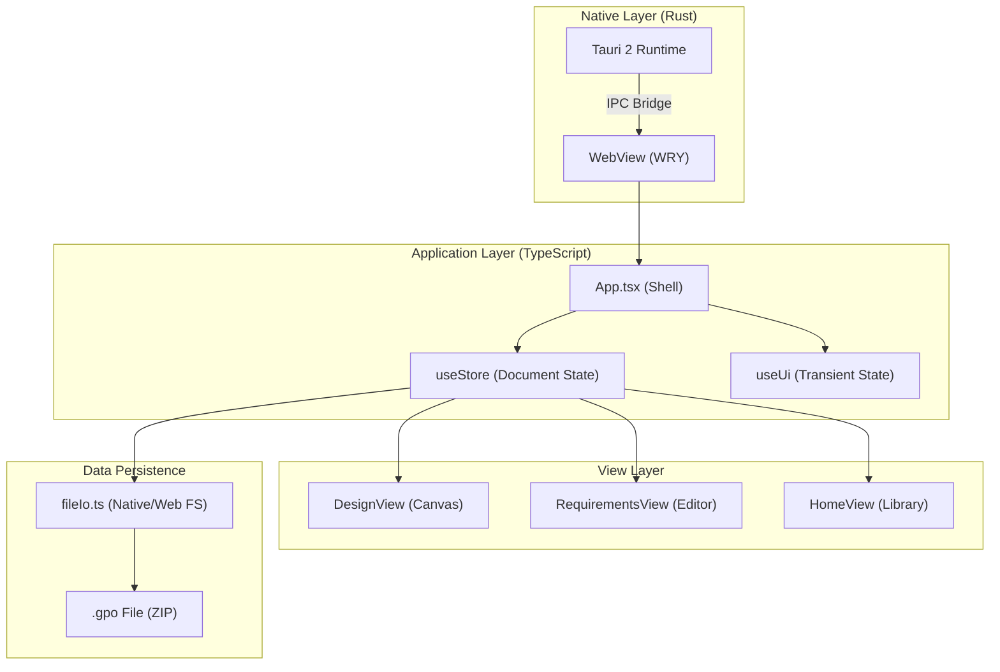
**Sources:** [package.json:7-15](), [src-tauri/Cargo.toml:1-20](), [src/App.tsx:1-35](), [src/file/fileIo.ts:1-10]()

---

## Major Subsystems

### 1. Application Shell & View Routing
The `App.tsx` component acts as the primary orchestrator, managing the top-level layout and the `ViewMode` state machine [src/App.tsx:2-3](). It handles navigation between the Home screen, Requirements editor, and the Design canvas.
*   For details, see [Application Shell & View Routing](#1.2).

### 2. Document State & Storage
State is centralized in `useStore.ts`, which manages the `GpoDocument` object—the source of truth for all pages, frames, and nodes [src/App.tsx:51-53](). Persistence is handled by `fileIo.ts` (platform-adaptive for Tauri or Browser) and a local `library.ts` for recent files [src/App.tsx:4-21]().
*   For details, see [Getting Started & Project Setup](#1.1).

### 3. Canvas & Properties
The design environment consists of the `CanvasStage` (rendering), `LayersPanel` (hierarchy), and `PropertiesPanel` (node attributes) [README.md:15-16](). It supports vector editing, auto-layout, and design system token application.

### 4. AI & Requirements
The AI subsystem integrates with various LLM providers (OpenAI, Anthropic, DeepSeek) and includes local heuristic fallbacks [README.md:14](). It transforms Markdown from `RequirementsView` into structured UI components within the document.

### 5. Export Engine
OpenPrototype provides extensive export options via the `ExportMenu` in `App.tsx`, including interactive HTML prototypes, PNG/SVG/PDF assets, and production-ready React/Vue/Tailwind code [src/App.tsx:49-143]().

**Sources:** [src/App.tsx:1-35](), [src/views/HomeView.tsx:36-49](), [README.md:57-70](), [package.json:1-31]()

---

# Page: Getting Started & Project Setup

# Getting Started & Project Setup

<details>
<summary>Relevant source files</summary>

The following files were used as context for generating this wiki page:

- [.eslintrc.cjs](.eslintrc.cjs)
- [README.md](README.md)
- [index.html](index.html)
- [package.json](package.json)
- [src-tauri/Cargo.toml](src-tauri/Cargo.toml)
- [src/main.tsx](src/main.tsx)
- [src/vite-env.d.ts](src/vite-env.d.ts)
- [tsconfig.json](tsconfig.json)
- [vite.config.ts](vite.config.ts)

</details>


This page provides a technical overview of the development environment, build processes, and the structural foundation of the OpenPrototype codebase. It covers the transition from source code to executable artifacts (web and desktop) and introduces the `.gpo` file format used for persistence.

## Development Environment & Build Commands

OpenPrototype is built using **React 18**, **TypeScript**, and **Vite** [README.md:24-24](). It utilizes `pnpm` as the primary package manager. The project supports both a browser-based execution environment and a native desktop experience via **Tauri 2** [README.md:24-24]().

### Standard Scripts
The following commands are defined in the `package.json` for standard development tasks:

| Command | Action | File Reference |
| :--- | :--- | :--- |
| `pnpm dev` | Starts the Vite development server at `http://localhost:5173` | [package.json:8-8]() |
| `pnpm build` | Compiles TypeScript and builds the production-ready static site in `dist/` | [package.json:9-9]() |
| `pnpm typecheck` | Runs the TypeScript compiler (`tsc`) in `noEmit` mode to verify types | [package.json:11-11]() |
| `pnpm lint` | Executes ESLint across `.ts` and `.tsx` files | [package.json:12-12]() |
| `pnpm test` | Runs unit tests using Vitest | [package.json:13-13]() |

### Desktop (Tauri) Commands
For desktop development, the project leverages the `@tauri-apps/cli` [package.json:33-33]().

*   **Development**: `pnpm tauri dev` starts the application in a native window with hot-reloading [README.md:40-40]().
*   **Production**: `pnpm tauri build` packages the application into native installers for Windows, macOS, or Linux [README.md:41-41]().

**Sources:** [README.md:24-42](), [package.json:7-15](), [vite.config.ts:1-21]()

---

## Project Directory Structure

The source code is organized by functional domain to separate concerns between data modeling, AI logic, and rendering.

```mermaid
graph TD
    subgraph "Root"
        "src/"["src/"]
        "src-tauri/"["src-tauri/"]
    end

    subgraph "src/ Directory Structure"
        "src/" --> "schema/"["schema/ (.gpo Schema & Serialization)"]
        "src/" --> "store/"["store/ (Zustand State Management)"]
        "src/" --> "ai/"["ai/ (LLM Providers & Heuristics)"]
        "src/" --> "render/"["render/ (Token Parsing & Visuals)"]
        "src/" --> "views/"["views/ (Canvas, Requirements, Preview)"]
        "src/" --> "file/"["file/ (Platform I/O: Tauri vs Browser)"]
    end

    subgraph "Desktop Shell"
        "src-tauri/" --> "Cargo.toml"["Cargo.toml (Rust Dependencies)"]
        "src-tauri/" --> "tauri.conf.json"["tauri.conf.json (App Config)"]
    end
```

### Key Directories
*   `src/schema/`: Defines the `GpoDocument` structure and handles ZIP serialization [README.md:61-61]().
*   `src/store/`: Contains Zustand stores for document state, selection, and UI settings [README.md:62-62]().
*   `src/ai/`: Manages the AI gateway (OpenAI/Anthropic) and local generation logic [README.md:63-63]().
*   `src/views/`: Contains the primary application views: Requirements, Design (Canvas), and Prototype [README.md:68-68]().
*   `src/file/`: Abstracts file system operations, switching between the browser File System Access API and Tauri's native `tauri-plugin-fs` [README.md:67-67]().

**Sources:** [README.md:57-70](), [src-tauri/Cargo.toml:1-20]()

---

## The .gpo File Format

The `.gpo` (Generative Prototype Object) file is the native persistence format for OpenPrototype [README.md:5-5](). It is a **ZIP container** designed for both human readability and interoperability with other design tools [README.md:44-46]().

### Container Structure
A `.gpo` file contains the following internal structure:

| File | Description |
| :--- | :--- |
| `manifest.json` | Metadata including the schema version [README.md:49-49](). |
| `document.json` | The full document tree, including pages, frames, and nodes [README.md:50-50](). |
| `INTEROP.md` | Mapping specifications for fields compatible with Figma/Sketch [README.md:51-51](). |
| `assets/` | Directory containing binary assets like images and embedded fonts [README.md:52-52](). |

### Implementation Flow: Code to Disk
The following diagram illustrates how the system transitions from the in-memory `useStore` to the `.gpo` file on disk.

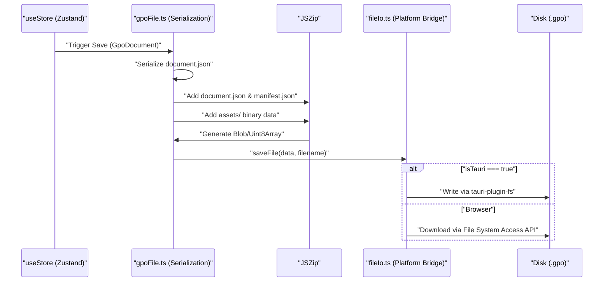

**Sources:** [README.md:44-55](), [package.json:20-20](), [src/main.tsx:1-10]()

---

## System Initialization & Entry Point

The application initializes through `src/main.tsx`, which mounts the `App` component within a `React.StrictMode` wrapper [src/main.tsx:6-10]().

### Configuration & Environment
*   **Vite Configuration**: Defines the `@` alias for the `src/` directory to simplify imports [vite.config.ts:9-11]().
*   **TypeScript Configuration**: Uses `Bundler` module resolution and targets `ES2020` [tsconfig.json:3-8]().
*   **Environment Variables**: The `VITE_CLOUD_API` variable is used to configure the optional SaaS backend endpoint [src/vite-env.d.ts:3-5]().

**Sources:** [src/main.tsx:1-11](), [vite.config.ts:1-21](), [tsconfig.json:1-25](), [src/vite-env.d.ts:1-10]()

---

# Page: Application Shell & View Routing

# Application Shell & View Routing

<details>
<summary>Relevant source files</summary>

The following files were used as context for generating this wiki page:

- [src/App.tsx](src/App.tsx)
- [src/ai/chat.ts](src/ai/chat.ts)
- [src/ai/settings.ts](src/ai/settings.ts)
- [src/components/AiSettingsModal.tsx](src/components/AiSettingsModal.tsx)
- [src/hooks/useShortcuts.ts](src/hooks/useShortcuts.ts)
- [src/store/useStore.ts](src/store/useStore.ts)
- [src/store/useUi.ts](src/store/useUi.ts)
- [src/views/HomeView.tsx](src/views/HomeView.tsx)

</details>


The Application Shell acts as the root orchestrator for OpenPrototype, managing the top-level layout, navigation between distinct product lifecycle views, global event handling, and persistence lifecycles.

## View Orchestration & State Machine

The application's navigation is governed by the `ViewMode` state machine, managed within the `useStore` Zustand store [src/store/useStore.ts:31-38](). The `App.tsx` component serves as the primary router, conditionally rendering views based on the `view` state [src/App.tsx:210-230]().

### View Modes
| Mode | Component | Purpose |
| :--- | :--- | :--- |
| `home` | `HomeView` | File management, templates, and library browsing [src/views/HomeView.tsx:29-169](). |
| `requirements` | `RequirementsView` | Markdown-based PRD editing and AI-assisted drafting. |
| `design` | `DesignView` | Core canvas editor for frames, nodes, and components. |
| `flows` | `FlowsView` | Visual graph of prototype interactions and screen connections. |
| `journey` | `JourneyView` | User journey mapping and emotional curve tracking. |
| `preview` | `PreviewView` | Interactive prototype player for testing flows. |
| `market` | `MarketView` | Component package and plugin installation. |

### Data Flow: View Routing
The following diagram illustrates how the `useStore` state drives the UI composition in `App.tsx`.

**View Routing Architecture**
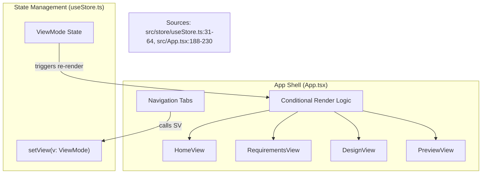

## Persistence & Auto-Save Lifecycle

OpenPrototype implements a multi-tier persistence strategy to ensure data integrity across sessions.

1.  **Memory Store**: Active document state is held in the `useStore` [src/store/useStore.ts:203]().
2.  **Local Library (IndexedDB/Storage)**: Files are listed and loaded from a local library via `listLibrary` and `loadFromLibrary` [src/views/HomeView.tsx:39-56]().
3.  **Auto-Save**: The `App` component triggers a background save to local storage whenever the document is marked as `dirty` [src/App.tsx:203-207]().
4.  **Manual Export**: Users can export the document as a `.gpo` file (a zipped JSON bundle) using `saveGpo` [src/App.tsx:4-4]().

**Persistence Data Flow**
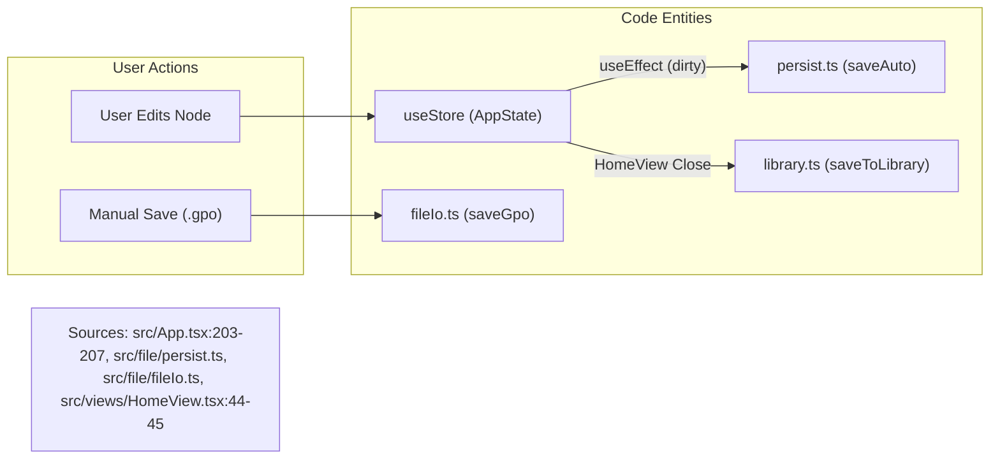

## Keyboard Shortcuts

Global keyboard interaction is handled by the `useShortcuts` hook [src/hooks/useShortcuts.ts:17-111](). This hook listens for keydown events and dispatches actions to `useStore` or `useUi`.

*   **Standard Modifiers**: `Cmd/Ctrl` is detected via `e.metaKey || e.ctrlKey` [src/hooks/useShortcuts.ts:27]().
*   **Tool Switching**: Keys `v`, `r`, `o`, `l`, `t`, `b`, `i` map to specific canvas tools in `useUi` [src/hooks/useShortcuts.ts:6-14]().
*   **Selection & History**: 
    *   `Cmd+Z` / `Cmd+Shift+Z`: Undo/Redo via `zundo` temporal middleware [src/hooks/useShortcuts.ts:29-34]().
    *   `Cmd+D`: Duplicate selection [src/hooks/useShortcuts.ts:45-49]().
    *   `Cmd+G`: Group/Ungroup selection [src/hooks/useShortcuts.ts:58-63]().
*   **Z-Order**: `Cmd + ]` (forward) and `Cmd + [` (backward) manage node layering [src/hooks/useShortcuts.ts:66-75]().

## Modal & Menu Management

The Application Shell manages several global modals and context-sensitive menus:

### Global Modals
*   **AI Settings**: `AiSettingsModal` allows configuration of LLM providers (OpenAI, Anthropic, DeepSeek, or Local Heuristic) [src/components/AiSettingsModal.tsx:25-74](). Settings are persisted to `localStorage` via `saveAiSettings` [src/ai/settings.ts:50-52]().
*   **Design System**: `DesignSystemModal` for editing global tokens and variables [src/App.tsx:33]().
*   **Cloud Collaboration**: `CloudModal` for remote project management [src/App.tsx:34]().

### Export Menu
The `ExportMenu` in `App.tsx` provides access to various code and asset generators [src/App.tsx:49-144]():
*   **Prototypes**: `downloadHtml` for self-contained interactive prototypes [src/App.tsx:81-84]().
*   **Assets**: `downloadFramePng`, `frameToSvg`, and `downloadFramePdf` [src/App.tsx:85-99]().
*   **Code Components**: Generators for React, Vue, and Tailwind [src/App.tsx:115-129]().

Sources: `src/App.tsx`, `src/store/useStore.ts`, `src/hooks/useShortcuts.ts`, `src/ai/settings.ts`, `src/views/HomeView.tsx`.

---

# Page: Core Data Model & Schema

# Core Data Model & Schema

<details>
<summary>Relevant source files</summary>

The following files were used as context for generating this wiki page:

- [src/__tests__/core.test.ts](src/__tests__/core.test.ts)
- [src/interop/importDesign.ts](src/interop/importDesign.ts)
- [src/journey/journey.ts](src/journey/journey.ts)
- [src/schema/layout.ts](src/schema/layout.ts)
- [src/schema/types.ts](src/schema/types.ts)
- [src/views/JourneyView.tsx](src/views/JourneyView.tsx)

</details>


The OpenPrototype data model is designed to bridge the gap between structured design data and AI-driven generation. The core philosophy is that every entity—from a high-level product requirement to a low-level vector anchor—is represented in a single, unified TypeScript schema called `GpoDocument`. This structure ensures that AI-generated content remains fully editable on the canvas and can be exported to production-ready code.

## The GpoDocument Hierarchy

The `GpoDocument` is the root container for all project data. It follows a hierarchical tree structure where pages contain frames, and frames contain a recursive tree of nodes.

### Document Composition
- **Metadata**: Tracks app version (`GPO_SCHEMA_VERSION`), project name, and creation timestamps [src/schema/types.ts:11-12]().
- **Requirements**: Markdown-based `RequirementDoc` objects that serve as the source of truth for AI generation [src/schema/types.ts:192-199]().
- **Pages & Frames**: A document contains multiple `Page` objects, each hosting a collection of `Frame` objects (screens/artboards) [src/schema/types.ts:170-189]().
- **Design System**: Centralized `DesignTokens`, `ComponentDef` library, and `DesignRule` sets that govern the look and feel [src/schema/types.ts:202-226]().

### Visual & Logical Entities

The following diagram illustrates how natural language concepts map to specific code entities within the `GpoDocument` schema.

**Diagram: Conceptual Mapping to Code Entities**
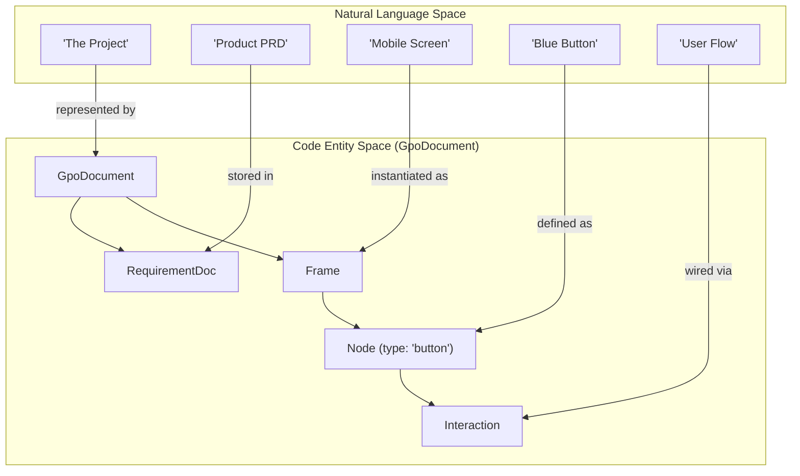
Sources: [src/schema/types.ts:1-240]()

## Key Data Structures

### Node & NodeStyle
The `Node` is the fundamental unit of the canvas. It can represent primitive shapes (`rect`, `ellipse`), complex types (`vector`, `text`), or UI components (`button`, `input`) [src/schema/types.ts:69-80](). 
- **Style**: Every node has a `NodeStyle` containing `Fill`, `Stroke`, `Shadow`, and `BlendMode` [src/schema/types.ts:117-127]().
- **Fills**: Fills can be solid colors, gradients, images, or references to design system `token` or `variable` IDs [src/schema/types.ts:19-25]().

### User Journey Mapping
The `JourneyMap` structure captures the user experience over time. It consists of `JourneyStage` objects, each tracking user actions, thoughts, and an emotion score (-2 to 2) [src/journey/journey.ts:5-11](). The `emotionCurvePath` function uses these scores to generate SVG paths for visualization [src/journey/journey.ts:89-111]().

**Diagram: Journey Data Flow**
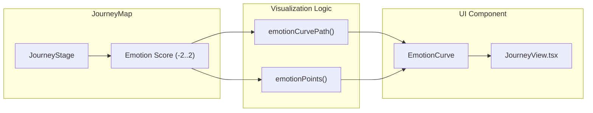
Sources: [src/journey/journey.ts:1-131](), [src/views/JourneyView.tsx:126-172]()

## Subsystem Overviews

### GpoDocument Schema & Types
The schema defines the strict contract for all data. It includes support for Figma-style constraints (`HConstraint`, `VConstraint`) and advanced properties like `clipContent` for frames.
For details, see [GpoDocument Schema & Types](#2.1).

### Auto Layout & Constraints Engine
The layout engine implements a flexbox-like system. The `applyAutoLayout` function recomputes child positions based on `gap`, `padding`, and `align` settings, supporting both "vertical" and "horizontal" stacks [src/schema/layout.ts:21-86]().
For details, see [Auto Layout & Constraints Engine](#2.2).

### File Persistence & .gpo Format
The `.gpo` file is a ZIP container. It uses `serializeGpo` and `deserializeGpo` to handle the transition between the in-memory `GpoDocument` and the disk format, which includes a `document.json` and an `assets/` folder [src/__tests__/core.test.ts:150-167]().
For details, see [File Persistence & .gpo Format](#2.3).

### Design Interop
The `importDesignJson` and `parseTokens` utilities allow the system to ingest external formats like W3C Design Tokens or Figma REST API exports, mapping them into the native `GpoDocument` structure [src/interop/importDesign.ts:101-191]().
Sources: [src/interop/importDesign.ts:1-191](), [src/__tests__/core.test.ts:180-207]()

---

# Page: GpoDocument Schema & Types

# GpoDocument Schema & Types

<details>
<summary>Relevant source files</summary>

The following files were used as context for generating this wiki page:

- [src/__tests__/core.test.ts](src/__tests__/core.test.ts)
- [src/interop/importDesign.ts](src/interop/importDesign.ts)
- [src/journey/journey.ts](src/journey/journey.ts)
- [src/schema/layout.ts](src/schema/layout.ts)
- [src/schema/nodeOps.ts](src/schema/nodeOps.ts)
- [src/schema/types.ts](src/schema/types.ts)
- [src/views/JourneyView.tsx](src/views/JourneyView.tsx)

</details>


This page provides a detailed technical reference for the **OpenPrototype** data model. The entire application — including the AI generation engine, the canvas renderer, and the persistence layer — operates on a unified, structured tree defined by the `GpoDocument` schema.

## Overview & Versioning

The core schema is designed to be fully editable. Unlike tools that generate static images, OpenPrototype's AI emits structured JSON that maps directly to canvas entities.

*   **Schema Version**: The current contract is defined as `GPO_SCHEMA_VERSION = "1.0.0"` [src/schema/types.ts:11-11]().
*   **Data Flow**: State is managed in a centralized Zustand store. When the document is saved, it is serialized into a `.gpo` zip container containing `document.json` [src/schema/types.ts:8-9]().

### Document Hierarchy
The following diagram illustrates the relationship between the high-level document structure and the code entities defined in `src/schema/types.ts`.

**Entity Relationship Diagram**
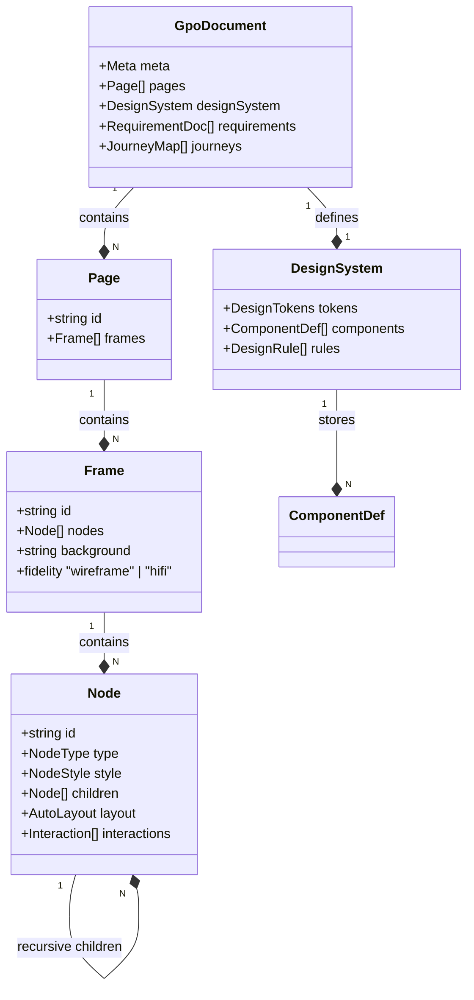
Sources: [src/schema/types.ts:140-237](), [src/schema/types.ts:245-255]()

---

## Core Node Schema

The `Node` is the atomic unit of the design canvas. It represents everything from a simple rectangle to a complex AI-generated component instance.

### Node Definition
A `Node` [src/schema/types.ts:140-167]() contains spatial properties (`x`, `y`, `width`, `height`, `rotation`), visual styles, and structural metadata.

| Property | Type | Description |
| :--- | :--- | :--- |
| `type` | `NodeType` | `rect`, `ellipse`, `text`, `button`, `input`, `vector`, etc. [src/schema/types.ts:69-80]() |
| `style` | `NodeStyle` | Fill, stroke, radius, shadow, and blend modes. [src/schema/types.ts:117-127]() |
| `layout` | `AutoLayout` | Flexbox-like positioning for children. [src/schema/types.ts:99-104]() |
| `constraints`| `Constraints`| Resize behavior (e.g., "left-right", "scale"). [src/schema/types.ts:135-138]() |
| `componentRef`| `string` | ID of a `ComponentDef` if this is an instance. [src/schema/types.ts:160-160]() |

### Vector Geometry
For nodes of type `vector`, the `path` property defines complex shapes using a list of `VectorAnchor` points [src/schema/types.ts:83-96](). Each anchor supports Bézier handles (`hIn`, `hOut`) for curved segments.

Sources: [src/schema/types.ts:69-96](), [src/schema/types.ts:140-167]()

---

## Styling & Fills

The `Fill` type supports various modes, enabling the transition from low-fidelity wireframes to high-fidelity designs.

*   **Solid**: Simple hex color [src/schema/types.ts:20-20]().
*   **Gradients**: Linear and radial stops [src/schema/types.ts:21-22]().
*   **Image**: External or embedded asset references [src/schema/types.ts:23-23]().
*   **Token/Variable**: Semantic references to the Design System [src/schema/types.ts:24-25]().

### Visual Compositing
Nodes support `BlendMode` values that map directly to standard Canvas `globalCompositeOperation` types, such as `multiply`, `screen`, and `overlay` [src/schema/types.ts:31-43]().

Sources: [src/schema/types.ts:19-57]()

---

## Design System & Tokens

The `DesignSystem` object [src/schema/types.ts:245-255]() acts as the "source of truth" for the AI and the UI.

### DesignTokens
Tokens define the primitive values used across the document [src/schema/types.ts:202-209]():
*   **Colors**: Named hex strings (e.g., `primary`, `surface`).
*   **Radii & Spacing**: Pixel values for layout consistency.
*   **Typography**: Font families and size scales.

### Design Rules
The `DesignRule` [src/schema/types.ts:220-226]() interface allows the system to enforce constraints on AI output. For example, a `min-tap-target` rule ensures that buttons are at least 40px tall [src/__tests__/core.test.ts:99-99]().

### Variables
`Variable` objects [src/schema/types.ts:233-237]() function similarly to Figma Variables, allowing properties to be bound to named values that can be updated globally.

Sources: [src/schema/types.ts:201-237](), [src/designsystem/rules.ts:1-17]()

---

## Layout & Prototyping

### AutoLayout Engine
The `AutoLayout` system [src/schema/types.ts:99-104]() implements a subset of Flexbox. The function `applyAutoLayout` [src/schema/layout.ts:21-86]() recomputes child positions based on:
1.  **Mode**: `vertical` or `horizontal`.
2.  **Gap**: Space between elements.
3.  **Padding**: Internal offsets.
4.  **Align**: `start`, `center`, `end`, or `stretch`.

### Interactions
The `Interaction` type [src/schema/types.ts:109-115]() defines the prototype's behavior. It links a trigger (`click`, `hover`) to a `targetFrameId`, enabling multi-screen flow navigation.

Sources: [src/schema/layout.ts:21-86](), [src/schema/types.ts:99-115]()

---

## User Journey Schema

OpenPrototype treats User Journeys as first-class data entities rather than just drawings.

### JourneyMap Structure
A `JourneyMap` [src/schema/types.ts:257-265]() consists of a `persona` and a sequence of `JourneyStage` objects. Each stage tracks:
*   **Emotion**: A score from -2 to 2 [src/journey/journey.ts:36-50]().
*   **Lists**: Actions, touchpoints, thoughts, pains, and opportunities [src/journey/journey.ts:14-22]().

### Logic & Visualization
The `emotionCurvePath` function [src/journey/journey.ts:89-111]() calculates a smooth Catmull-Rom spline to render the emotional arc in the `JourneyView` [src/views/JourneyView.tsx:126-172]().

**Journey Data Flow**
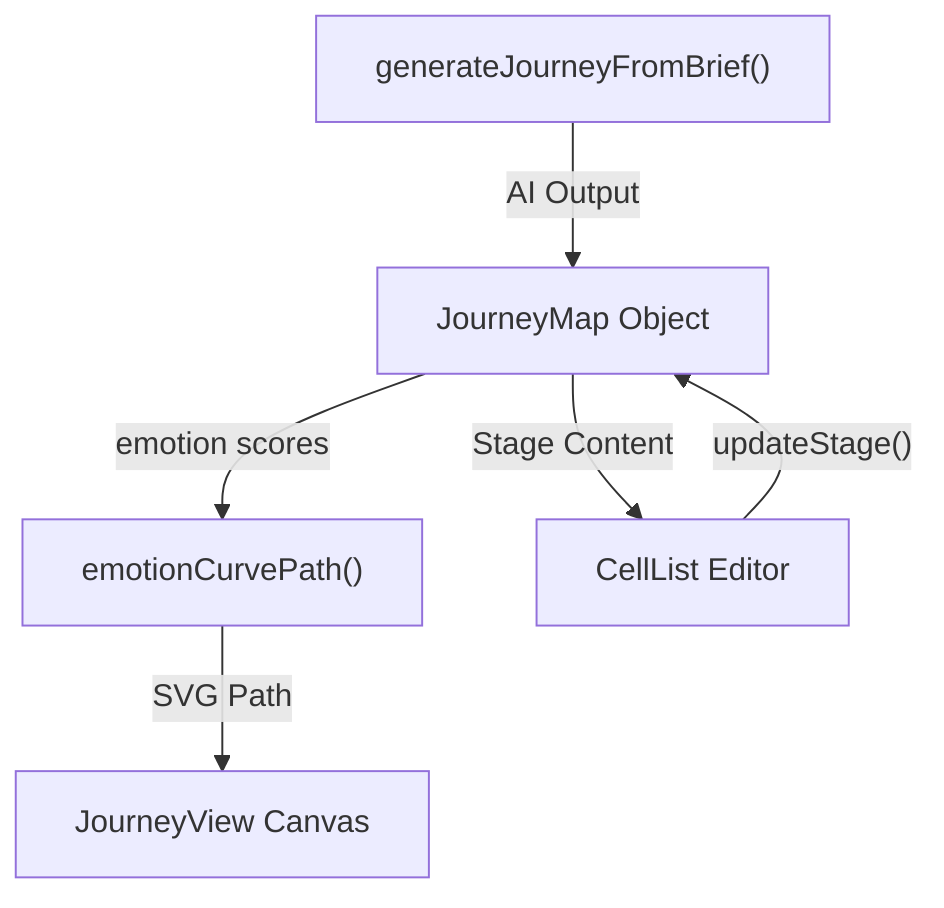
Sources: [src/journey/journey.ts:1-111](), [src/views/JourneyView.tsx:126-172]()

---

## Interoperability & Import

The system includes a dedicated interop layer in `src/interop/importDesign.ts` to convert external formats into the `GpoDocument` schema.

*   **Token Parsing**: `parseTokens` [src/interop/importDesign.ts:101-191]() handles W3C Design Tokens (`$value`), Tokens Studio, and Figma Tokens.
*   **Normalization**: It includes utilities like `figmaColorToHex` [src/interop/importDesign.ts:41-48]() and `toPx` [src/interop/importDesign.ts:51-62]() to ensure unit consistency (e.g., converting `rem` to `px`).

Sources: [src/interop/importDesign.ts:1-191]()

---

# Page: Auto Layout & Constraints Engine

# Auto Layout & Constraints Engine

<details>
<summary>Relevant source files</summary>

The following files were used as context for generating this wiki page:

- [src/__tests__/core.test.ts](src/__tests__/core.test.ts)
- [src/interop/importDesign.ts](src/interop/importDesign.ts)
- [src/schema/constraints.test.ts](src/schema/constraints.test.ts)
- [src/schema/constraints.ts](src/schema/constraints.ts)
- [src/schema/layout.ts](src/schema/layout.ts)

</details>


The Auto Layout and Constraints engines are responsible for the spatial orchestration of nodes within the OpenPrototype canvas. They implement a Figma-like layout model that allows for both content-driven stacking (Auto Layout) and container-driven responsive resizing (Constraints).

## Auto Layout Engine

The Auto Layout engine, implemented in `applyAutoLayout`, provides a flexbox-like system for arranging child nodes within a container. It supports vertical and horizontal stacking, configurable gaps, internal padding, and alignment strategies (including "stretch").

### Core Implementation
The engine operates as a pure function that takes a `Node` and returns a new `Node` with recalculated child positions and container dimensions [src/schema/layout.ts:21-25]().

1.  **Axis Determination**: The engine identifies the primary axis (main-axis) and cross-axis based on the `layout.mode` ("vertical" or "horizontal") [src/schema/layout.ts:26-28]().
2.  **Cross-Axis Extent**: It calculates the maximum dimension of children on the cross-axis to determine the container's cross-size or to align children [src/schema/layout.ts:31-34]().
3.  **Cursor-Based Positioning**: A `cursor` tracks the current position along the main-axis, starting from the padding (top for vertical, left for horizontal) [src/schema/layout.ts:36-36]().
4.  **Alignment & Stretching**:
    *   **Start/Center/End**: Positions children relative to the padding and available cross-axis space [src/schema/layout.ts:44-46]().
    *   **Stretch**: If alignment is not start/center/end, the child is forced to match the `crossMax` dimension [src/schema/layout.ts:49-49]().
5.  **Hugging (Sizing)**: The container's width and height are recalculated to "hug" the content main-axis (total children size + gaps) and cross-axis (max child size + padding) [src/schema/layout.ts:72-78]().

### Auto Layout Data Flow
The following diagram illustrates how the `applyAutoLayout` function transforms node properties.

**Auto Layout Transformation Logic**
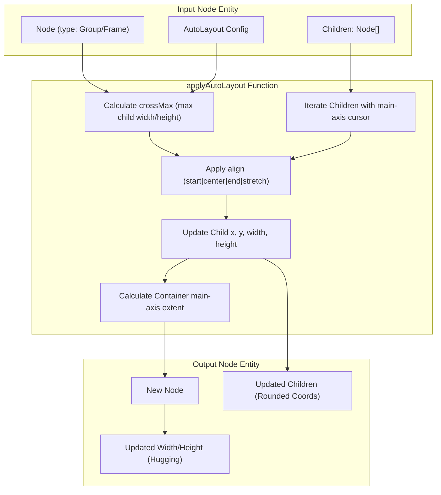
Sources: [src/schema/layout.ts:21-86](), [src/schema/types.ts:1-10]()

### Configuration Defaults
When a container is first enabled for auto-layout, it uses `DEFAULT_AUTOLAYOUT`:
*   **Mode**: `vertical`
*   **Gap**: `12px`
*   **Padding**: `16px` (all sides)
*   **Align**: `start`
Sources: [src/schema/layout.ts:4-9]()

---

## Constraints Engine

The Constraints engine handles how nodes behave when their parent frame is manually resized. This allows for responsive behaviors like pinning elements to corners, centering them, or scaling them proportionally.

### Constraint Modes
The engine supports horizontal (`HConstraint`) and vertical (`VConstraint`) settings [src/schema/types.ts:1-10]().

| Mode | Behavior | Implementation Logic |
| :--- | :--- | :--- |
| `left` / `top` | Pin to near edge | Maintains original `x` or `y` [src/schema/constraints.ts:37-39]() |
| `right` / `bottom` | Pin to far edge | Maintains constant distance from parent's `prev` edge [src/schema/constraints.ts:22-24]() |
| `left-right` / `top-bottom` | Stretch | Maintains distance from both edges, changing `size` [src/schema/constraints.ts:25-27]() |
| `center` | Maintain relative center | Offsets the node center based on the parent's center change [src/schema/constraints.ts:28-31]() |
| `scale` | Proportional resize | Multiplies `start` and `size` by the parent's growth ratio [src/schema/constraints.ts:32-35]() |

### Implementation: applyConstraints
The function `applyConstraints` is called when a parent's dimensions change from `prev` to `next` [src/schema/constraints.ts:47-51](). It delegates the calculation to `resolveAxis`, which computes the new `start` (coordinate) and `size` (dimension) for a single axis [src/schema/constraints.ts:13-19]().

### Constraints Logic Mapping
This diagram maps the logical constraints to the code entities that execute the resizing.

**Constraint Execution Pipeline**
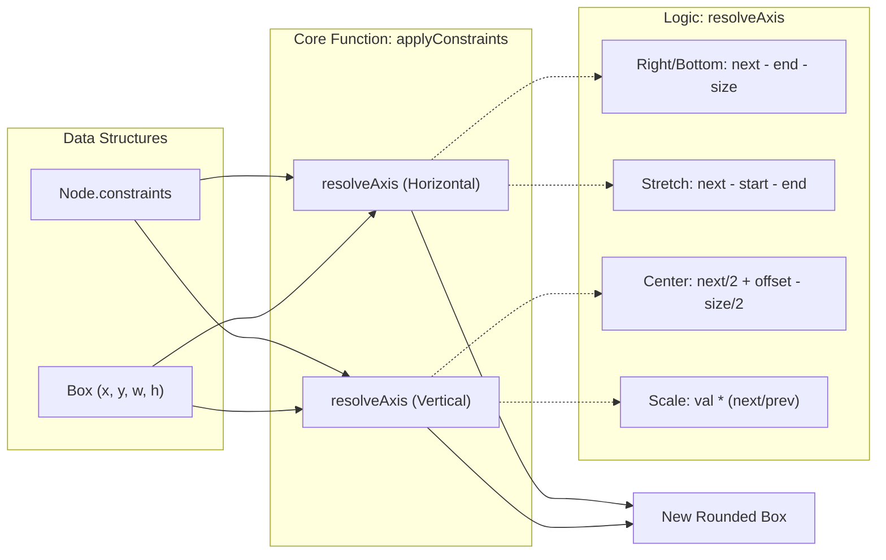
Sources: [src/schema/constraints.ts:13-61](), [src/schema/constraints.test.ts:7-49]()

### Pure Function Characteristics
*   **Rounding**: Both engines use `Math.round` on all final coordinates and dimensions to ensure nodes stay on the pixel grid [src/schema/layout.ts:65-84](), [src/schema/constraints.ts:56-59]().
*   **Immutability**: Neither engine mutates the original node; they return new objects with updated properties [src/schema/layout.ts:13-14](), [src/schema/constraints.ts:44-46]().
*   **Default Behavior**: If no constraints are provided, the system defaults to `left/top` pinning, which matches industry standards like Figma [src/schema/constraints.ts:10-10](), [src/schema/constraints.ts:52-52]().

---

# Page: File Persistence & .gpo Format

# File Persistence & .gpo Format

<details>
<summary>Relevant source files</summary>

The following files were used as context for generating this wiki page:

- [src/__tests__/core.test.ts](src/__tests__/core.test.ts)
- [src/file/fileIo.ts](src/file/fileIo.ts)
- [src/file/library.ts](src/file/library.ts)
- [src/file/persist.ts](src/file/persist.ts)
- [src/interop/importDesign.ts](src/interop/importDesign.ts)
- [src/schema/gpoFile.ts](src/schema/gpoFile.ts)
- [src/schema/layout.ts](src/schema/layout.ts)

</details>


OpenPrototype utilizes a structured ZIP container format for project storage, ensuring that generative design data remains portable, inspectable, and interoperable with industry-standard tools. The persistence layer abstracts platform-specific I/O to provide a seamless experience across web browsers and the Tauri-powered desktop application.

## The .gpo Container Format

The `.gpo` (Generative Prototype Object) format is a ZIP-compressed archive [src/schema/gpoFile.ts:6-10](). This approach provides a "diff-friendly" structure where assets and document state are decoupled, mirroring the architecture used by modern design tools like Sketch.

### Container Layout
A valid `.gpo` file contains the following internal structure:

| File | Description |
| :--- | :--- |
| `manifest.json` | Metadata including `format` (`gpo-container`), `schemaVersion`, and `generator` [src/schema/gpoFile.ts:54-61](). |
| `document.json` | The serialized `GpoDocument` tree, containing all pages, frames, nodes, and design system tokens [src/schema/gpoFile.ts:62-62](). |
| `INTEROP.md` | An embedded markdown specification detailing field mappings for third-party tool developers [src/schema/gpoFile.ts:25-47](). |
| `thumbnail.txt` | (Optional) A base64-encoded data URL of the document preview [src/schema/gpoFile.ts:64-64](). |
| `assets/` | (Planned) Directory for binary blobs such as images and custom fonts. |

### Interoperability Mapping
The `INTEROP.md` file defines how `GpoDocument` entities map to Figma and Sketch models to facilitate cross-tool workflows [src/schema/gpoFile.ts:31-43]().

**Sources:** [src/schema/gpoFile.ts:1-79]()

---

## Serialization Pipeline

The serialization process transforms the in-memory Zustand store state into the compressed `.gpo` blob. Deserialization performs the inverse, including a critical **normalization** step to ensure backward compatibility with older schema versions.

### Data Flow: Serialization & Deserialization

Title: Serialization and Deserialization Pipeline
```mermaid
graph TD
  subgraph "Memory Space"
    "useStore[Zustand Store]" --> |"GpoDocument"| "serializeGpo[serializeGpo]"
  end

  subgraph "Serialization (JSZip)"
    "serializeGpo[serializeGpo]" --> "Manifest[manifest.json]"
    "serializeGpo[serializeGpo]" --> "DocJSON[document.json]"
    "serializeGpo[serializeGpo]" --> "InteropMD[INTEROP.md]"
    "Manifest[Manifest]" & "DocJSON[DocJSON]" & "InteropMD[InteropMD]" --> "ZipBlob[.gpo Blob]"
  end

  subgraph "Deserialization"
    "ZipBlob[.gpo Blob]" --> "deserializeGpo[deserializeGpo]"
    "deserializeGpo[deserializeGpo]" --> "JSONParse[JSON.parse]"
    "JSONParse[JSON.parse]" --> "normalizeDoc[normalizeDoc]"
    "normalizeDoc[normalizeDoc]" --> |"Backfilled GpoDocument"| "useStore[Zustand Store]"
  end
```
**Sources:** [src/schema/gpoFile.ts:49-79](), [src/schema/defaults.ts:1-10]() (referenced via `normalizeDoc`)

---

## Platform-Adaptive I/O

The application detects its environment via `window.__TAURI__` to determine whether to use native OS file system APIs or browser-based downloads [src/file/fileIo.ts:10-10]().

### I/O Implementation Details
*   **Tauri Desktop**: Uses `@tauri-apps/plugin-dialog` for native "Save As" and "Open" dialogs and `@tauri-apps/plugin-fs` for direct disk access [src/file/fileIo.ts:22-32]().
*   **Web Browser**: Uses `URL.createObjectURL` and a hidden `<a>` element for downloads; uses a hidden `<input type="file">` for opening files [src/file/fileIo.ts:35-41](), [src/file/fileIo.ts:57-72]().

### Code Entity Association: File I/O

Title: Platform-Adaptive I/O Routing
```mermaid
graph LR
  "UI_Trigger[User Click Save]" --> "saveGpo[saveGpo (fileIo.ts)]"
  
  "saveGpo[saveGpo]" --> "isTauri[isTauri Check]"
  
  "isTauri[isTauri Check]" -- "True" --> "TauriFS[Tauri Native API]"
  "isTauri[isTauri Check]" -- "False" --> "BrowserDL[Browser Download Blob]"

  "TauriFS[Tauri Native API]" --> "TauriDialog[plugin-dialog: save]"
  "TauriFS[Tauri Native API]" --> "TauriWrite[plugin-fs: writeFile]"

  "BrowserDL[Browser Download Blob]" --> "CreateURL[URL.createObjectURL]"
  "CreateURL[URL.createObjectURL]" --> "AnchorClick[HTMLAnchorElement.click]"
```
**Sources:** [src/file/fileIo.ts:1-74]()

---

## Local Library & Persistence

Beyond explicit file exports, OpenPrototype maintains a local persistence layer in `localStorage` to prevent data loss and provide a "Project Home" experience.

### Local Library (`LibraryMap`)
The library acts as a local database for projects. Every document is keyed by its `meta.id` [src/file/library.ts:7-9]().
*   **`saveToLibrary(doc)`**: Upserts the full document into the `gpo.library.v1` key [src/file/library.ts:53-57]().
*   **`listLibrary()`**: Returns a `LibrarySummary` array (ID, name, counts) sorted by `updatedAt` for the Home screen [src/file/library.ts:60-64]().

### Autosave Mechanism
The `saveAuto(doc)` function persists the current working document to a dedicated `gpo.autosave.v1` slot [src/file/persist.ts:12-18](). This is triggered by the application lifecycle (managed in `App.tsx`) to ensure that even if the tab is closed, the state is recoverable via `loadAuto()` [src/file/persist.ts:20-28]().

### Recent Files
The system tracks the 10 most recently modified filenames in `gpo.recents.v1` to populate "Recent" lists in the UI [src/file/persist.ts:38-46]().

| Feature | Key | Function |
| :--- | :--- | :--- |
| **Full Library** | `gpo.library.v1` | `saveToLibrary`, `loadFromLibrary` |
| **Autosave** | `gpo.autosave.v1` | `saveAuto`, `loadAuto` |
| **Recents** | `gpo.recents.v1` | `pushRecent`, `getRecents` |

**Sources:** [src/file/library.ts:1-84](), [src/file/persist.ts:1-55]()

---

## Interop Import Layer

The interop layer (located in `src/interop/importDesign.ts`) is responsible for parsing external formats into the GPO model.

### Token Parsing Pipeline
The `parseTokens` function recursively walks design token trees (supporting W3C, Tokens Studio, and Figma formats) and buckets them into GPO categories [src/interop/importDesign.ts:101-191]().

1.  **Category Detection**: Uses `categoryFromType` (e.g., "color", "spacing") or `categoryFromPath` (regex matching on keys like "radius" or "gap") [src/interop/importDesign.ts:64-82]().
2.  **Unit Conversion**: The `toPx` utility normalizes `rem`, `em`, and `pt` units into pixels (using a 16px base) [src/interop/importDesign.ts:51-62]().
3.  **Color Normalization**: `figmaColorToHex` converts 0..1 RGB(A) objects into standard hex strings [src/interop/importDesign.ts:41-48]().

**Sources:** [src/interop/importDesign.ts:1-191]()

---

# Page: State Management

# State Management

<details>
<summary>Relevant source files</summary>

The following files were used as context for generating this wiki page:

- [src/store/history.ts](src/store/history.ts)
- [src/store/useStore.ts](src/store/useStore.ts)

</details>


OpenPrototype utilizes a centralized state management architecture based on **Zustand**. The system maintains a strict separation between the persistent document data (the project being edited) and transient UI state (editor settings, active tools, and ephemeral interface flags). 

The primary state container, `useStore`, is wrapped with the `zundo` middleware to provide a robust undo/redo history system for all document-level modifications.

## Store Architecture

The application state is split into two primary stores to optimize for performance and persistence logic. 

| Store | Purpose | Persistence | History (Undo/Redo) |
| :--- | :--- | :--- | :--- |
| `useStore` | Holds the `GpoDocument`, selection state, and active navigation IDs. | Saved to `.gpo` files. | Enabled via `temporal` middleware. |
| `useUi` | Holds ephemeral state like `activeTool`, `zoom`, `showGrid`, and `devMode`. | Partially synced to `localStorage`. | Disabled. |

### System Mapping: Store to Entity

The following diagram illustrates how the Zustand stores interact with the core application logic and the document schema.

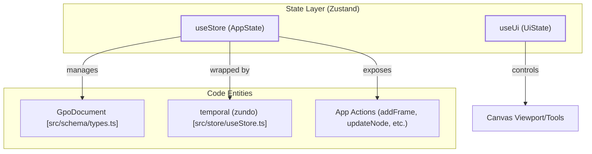

**Sources:** [src/store/useStore.ts:49-153](), [src/store/useStore.ts:203-206]()

---

## Document & Selection State (useStore)

`useStore` is the "Source of Truth" for the design project. It manages the `GpoDocument` object [src/store/useStore.ts:50](), which contains all pages, frames, nodes, and design system tokens. 

Key responsibilities include:
*   **Document CRUD:** Actions for manipulating the node tree, such as `addFrame` [src/store/useStore.ts:78](), `updateNode` [src/store/useStore.ts:85](), and `deleteSelection` [src/store/useStore.ts:89]().
*   **Selection Management:** Tracking which nodes are currently active via `selectedNodeIds` [src/store/useStore.ts:54]().
*   **Complex Operations:** High-level design logic including `groupSelection` [src/store/useStore.ts:98](), `booleanSelection` [src/store/useStore.ts:109](), and component instantiation [src/store/useStore.ts:116]().

For a deep dive into document actions and the component system, see **[useStore: Document & Selection State](#3.1)**.

**Sources:** [src/store/useStore.ts:49-153]()

---

## Transient UI State (useUi)

The `useUi` store handles state that does not belong in the saved project file. This includes the state of the editor interface itself, such as:
*   **Editor Configuration:** `showGrid`, `snapEnabled`, and `devMode`.
*   **Active Interaction:** The currently selected drawing tool (e.g., rect, ellipse, pen).
*   **Notifications:** Managing the toast notification queue.
*   **AI Settings:** API keys and provider configurations (persisted to `localStorage`).

For details on ephemeral interface state, see **[useUi: Transient UI State](#3.2)**.

---

## Undo/Redo History System

OpenPrototype implements a temporal state history using the `zundo` middleware for `useStore`. This tracks changes to the `doc` and other design-related fields, allowing users to revert mistakes.

The history system is exposed via a simplified API in `src/store/history.ts`:
*   `undo()`: Reverts the store to the previous state [src/store/history.ts:3]().
*   `redo()`: Advances the store to the next state in the history stack [src/store/history.ts:4]().
*   `clearHistory()`: Wipes the temporal stack, typically called when loading a new document [src/store/history.ts:5]().

### History Flow

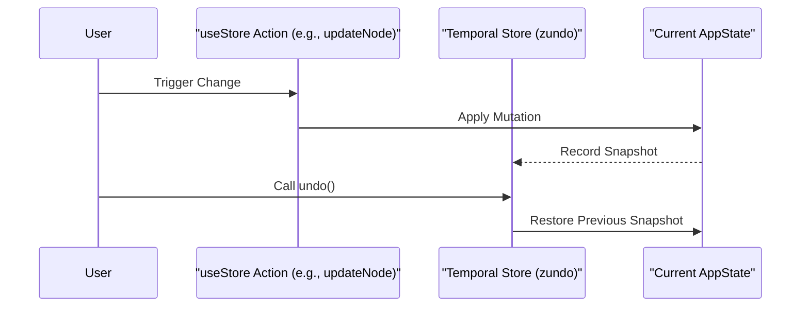

**Sources:** [src/store/useStore.ts:204](), [src/store/history.ts:1-6]()

---

# Page: useStore: Document & Selection State

# useStore: Document & Selection State

<details>
<summary>Relevant source files</summary>

The following files were used as context for generating this wiki page:

- [src/schema/nodeOps.ts](src/schema/nodeOps.ts)
- [src/store/useStore.ts](src/store/useStore.ts)

</details>


The `useStore` hook is the central state management hub for OpenPrototype, built using **Zustand** and augmented with the **zundo** temporal middleware for undo/redo history [src/store/useStore.ts:1-203](). It manages the `GpoDocument` schema, selection state, viewport navigation, and complex design operations like component instantiation and vector path manipulation.

## Store Architecture & Middleware

The store is defined as an `AppState` interface [src/store/useStore.ts:49-153](). It separates persistent document data (`doc`) from transient session state such as `selectedNodeIds`, `view` mode, and `clipboard` [src/store/useStore.ts:50-59]().

### Temporal State (Undo/Redo)
By wrapping the store in `temporal()`, the system automatically tracks changes to the document. This allows for standard design tool shortcuts (Cmd+Z / Cmd+Shift+Z) to traverse the history of `GpoDocument` mutations.

### Document Mutation Pattern
The store utilizes helper functions like `touch` to update the `meta.updatedAt` timestamp on every change [src/store/useStore.ts:159-161]() and `mapPages` to immutably update nested page structures [src/store/useStore.ts:163-168]().

| State Key | Type | Description |
| :--- | :--- | :--- |
| `doc` | `GpoDocument` | The full serializable document tree. |
| `view` | `ViewMode` | The current application view (design, requirements, journey, etc.). |
| `selectedNodeIds`| `string[]` | IDs of nodes currently selected on the canvas. |
| `activeFrameId` | `string \| null` | The frame currently being edited. |
| `commentMode` | `boolean` | When true, canvas interactions drop `FrameComment` objects. |

**Sources:** [src/store/useStore.ts:49-62](), [src/store/useStore.ts:159-168](), [src/store/useStore.ts:203-206]()

---

## Document & Node CRUD

CRUD operations are performed via actions that modify the `doc` object. Many of these actions delegate logic to `src/schema/nodeOps.ts` for structural changes.

### Frame and Node Lifecycle
- **`addFrame`**: Creates a new `Frame` using `emptyFrame()` and appends it to the active page [src/store/useStore.ts:78]().
- **`updateNode`**: Applies a partial patch to a specific node within a frame. If the node has constraints, `applyConstraints` is triggered [src/store/useStore.ts:85]().
- **`deleteSelection`**: Filters the `nodes` array of the active frame to remove all IDs present in `selectedNodeIds` [src/store/useStore.ts:89]().

### Grouping and Z-Index
Grouping is handled by `makeGroup`, which calculates a bounding box (`bbox`) for selected nodes, creates a new `group` type node, and transforms child coordinates to be relative to the group's top-left [src/schema/nodeOps.ts:25-42]().

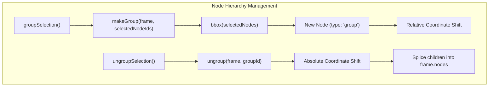

**Sources:** [src/store/useStore.ts:78-100](), [src/schema/nodeOps.ts:5-42](), [src/schema/nodeOps.ts:89-100]()

---

## Component System

The component system allows users to create reusable `ComponentDef` templates and instantiate them across the document.

### Creation and Instantiation
- **`createComponentFromSelection`**: Takes selected nodes, clones them into a `ComponentDef`, and adds it to `doc.designSystem.components` [src/store/useStore.ts:115]().
- **`instantiateComponent`**: Creates a `Node` where `componentRef` points to the `ComponentDef.id`. It clones the master template's children into the instance [src/store/useStore.ts:116]().

### Overrides and Syncing
- **`pushInstanceToComponent`**: Takes the current state of an instance (including overrides) and updates the master `ComponentDef`. It then iterates through all other instances in the document to sync their structures while preserving their unique IDs and positions [src/store/useStore.ts:121]().
- **`resetInstance`**: Reverts an instance to the master template by re-cloning the `ComponentDef` children [src/store/useStore.ts:119]().
- **`isInstanceModified`**: A utility that compares a normalized version of an instance (stripping IDs/positions) against the template to detect local overrides [src/schema/nodeOps.ts:82-87]().

**Sources:** [src/store/useStore.ts:113-124](), [src/schema/nodeOps.ts:65-87]()

---

## Vector Operations & Geometry

The store manages complex vector paths and boolean operations using utility functions from `src/vector/geometry.ts`.

### Boolean Operations
The `booleanSelection` action combines multiple nodes into a single vector node using operations like `union`, `subtract`, `intersect`, or `exclude` [src/store/useStore.ts:108-109]().
1. Nodes are converted to `VectorPath` objects in frame coordinates via `nodeToFramePath` [src/store/useStore.ts:181-191]().
2. The `booleanPaths` utility processes the paths [src/vector/geometry.ts:24]().
3. A new `vector` node is created, and its bounds are normalized using `pathBounds` [src/vector/geometry.ts:26]().

### Outline Stroke
`outlineStroke` converts a node's stroke property into a filled vector shape [src/store/useStore.ts:111](). This is essential for creating complex icons or preparing shapes for boolean operations.

**Sources:** [src/store/useStore.ts:106-111](), [src/store/useStore.ts:171-191](), [src/vector/geometry.ts:22-29]()

---

## Journey & Requirement Management

Beyond canvas nodes, `useStore` manages high-level product artifacts.

### Requirements CRUD
The store manages a collection of `RequirementDoc` objects [src/store/useStore.ts:130-132](). These documents drive the AI generation engine.
- `addRequirement`: Initializes a new doc with a default template [src/store/useStore.ts:130]().
- `updateRequirement`: Patches the markdown content or metadata [src/store/useStore.ts:131]().

### Journey Mapping
The Journey Map is a matrix of `JourneyStage` objects [src/store/useStore.ts:145-152]().
- **`addStage`**: Inserts a new stage (column) into the journey map [src/store/useStore.ts:149]().
- **`updateStage`**: Modifies stage properties like `emotion` (-2 to 2 scale) or `description` [src/store/useStore.ts:150]().
- **`moveStage`**: Changes the order of stages within the `JourneyMap` array [src/store/useStore.ts:152]().

**Sources:** [src/store/useStore.ts:130-132](), [src/store/useStore.ts:145-152](), [src/schema/types.ts:9-13]()

---

## System Integration Diagram

This diagram maps the natural language actions used in the UI to the underlying code entities in the `useStore` and `nodeOps` systems.

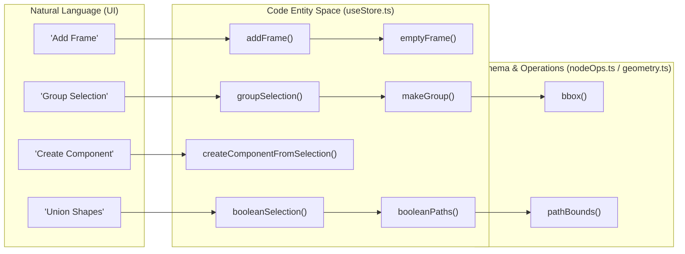

**Sources:** [src/store/useStore.ts:78](), [src/store/useStore.ts:98](), [src/store/useStore.ts:109](), [src/store/useStore.ts:115](), [src/schema/nodeOps.ts:5-42](), [src/vector/geometry.ts:24-26]()

---

# Page: useUi: Transient UI State

# useUi: Transient UI State

<details>
<summary>Relevant source files</summary>

The following files were used as context for generating this wiki page:

- [src/ai/chat.ts](src/ai/chat.ts)
- [src/ai/settings.ts](src/ai/settings.ts)
- [src/components/AiSettingsModal.tsx](src/components/AiSettingsModal.tsx)
- [src/store/history.ts](src/store/history.ts)
- [src/store/useUi.ts](src/store/useUi.ts)

</details>


The `useUi` store manages ephemeral interface state that does not persist within the `.gpo` document file. This includes active editor tools, canvas visibility toggles (grids, rulers), developer inspection modes, and global notification (toast) states. Additionally, it serves as the bridge for persisting AI configuration to the browser's `localStorage`.

### Store Definition and Purpose

Unlike `useStore`, which handles the document's structural data and selection state, `useUi` is built using a standard Zustand `create` call without temporal (undo/redo) middleware [src/store/useUi.ts:26-48](). This ensures that UI actions—like toggling the grid or showing a notification—do not clutter the document's history stack [src/store/history.ts:1-6]().

**Transient State Flow**

The following diagram illustrates how the `useUi` store interacts with UI components and external storage.

Title: useUi State Interaction Diagram
```mermaid
graph TD
    subgraph "Local Storage Space"
        ["gpo.ai.settings"]
    end

    subgraph "useUi Zustand Store"
        ["UiState"]
        ["setAi()"]
        ["showToast()"]
        ["setTool()"]
    end

    subgraph "UI Components"
        ["AiSettingsModal"]
        ["CanvasStage"]
        ["AppShell"]
    end

    ["AiSettingsModal"] -- "Calls setAi()" --> ["setAi()"]
    ["setAi()"] -- "Saves to" --> ["gpo.ai.settings"]
    ["gpo.ai.settings"] -- "loadAiSettings()" --> ["UiState"]
    
    ["CanvasStage"] -- "Reads tool/showGrid" --> ["UiState"]
    ["AppShell"] -- "Subscribes to toast" --> ["UiState"]
```

**Sources:** [src/store/useUi.ts:26-48](), [src/ai/settings.ts:38-52]().

---

### AI Settings Persistence

The `ai` state within `useUi` stores the current LLM provider, API keys, and model selections [src/store/useUi.ts:5-6](). Because these settings are user-specific and sensitive, they are persisted via `localStorage` rather than the document JSON [src/ai/settings.ts:38-52]().

#### Data Structures

The `AiSettings` interface and `PROVIDERS` registry define the available generation engines:

| Provider ID | Label | Default Model | Needs Key |
| :--- | :--- | :--- | :--- |
| `local` | 本地启发式生成器 | `heuristic-v1` | No |
| `openai` | OpenAI | `gpt-4o-mini` | Yes |
| `anthropic` | Anthropic (Claude) | `claude-3-5-sonnet-latest` | Yes |
| `deepseek` | DeepSeek | `deepseek-chat` | Yes |

**Sources:** [src/ai/settings.ts:1-36]().

#### Implementation Details

1.  **Initialization**: Upon store creation, `useUi` calls `loadAiSettings()`, which attempts to parse the `gpo.ai.settings` key from `localStorage`. If missing, it defaults to the `local` heuristic provider [src/ai/settings.ts:40-48]().
2.  **Updating**: The `setAi` action in `useUi` performs a dual-write: it updates the in-memory Zustand state and triggers `saveAiSettings()` to sync with `localStorage` [src/store/useUi.ts:28-31]().
3.  **Consumption**: The `chatComplete` utility reads these settings to determine the correct API endpoint and authorization headers (e.g., `x-api-key` for Anthropic or `Authorization: Bearer` for OpenAI) [src/ai/chat.ts:14-54]().

**Sources:** [src/store/useUi.ts:26-31](), [src/ai/settings.ts:40-52](), [src/ai/chat.ts:9-54]().

---

### Canvas and Tool Management

The store manages the active interaction mode and canvas visibility helpers.

*   **Active Tool**: Managed via `tool` (string). Common values include `select`, `rect`, `text`, `frame`, and `flow` [src/store/useUi.ts:9-11]().
*   **Visibility Toggles**: Boolean flags for `showRulers`, `showGrid`, and `snapEnabled`. These are toggled via dedicated functions that flip the current boolean state [src/store/useUi.ts:13-18]().
*   **Dev Mode**: The `devMode` flag toggles a read-only inspector mode used for developer handoff, measurements, and code generation [src/store/useUi.ts:20-21]().

Title: UI State Logic Mapping
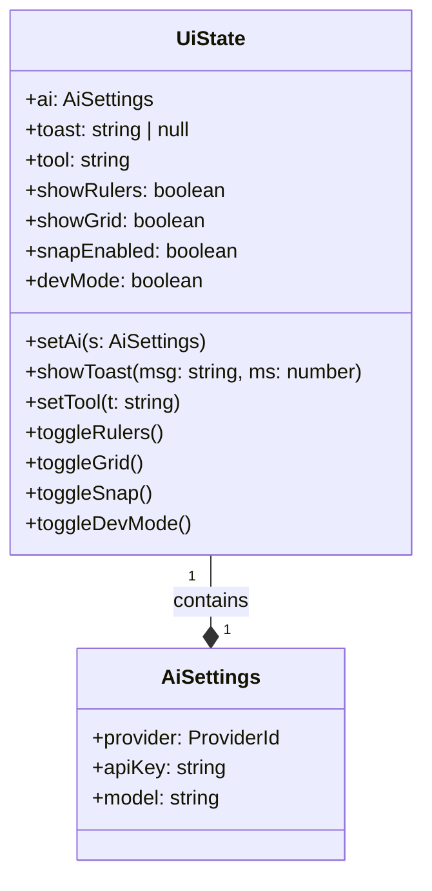

**Sources:** [src/store/useUi.ts:4-22]().

---

### Toast Notification System

The `showToast` function provides a global mechanism for non-blocking user feedback.

1.  **Trigger**: When `showToast(msg, ms)` is called, it sets the `toast` string [src/store/useUi.ts:33-34]().
2.  **Auto-Dismiss**: It utilizes a module-level variable `toastTimer` to manage the lifecycle of the notification. If a new toast is triggered before the previous one expires, the existing timer is cleared (`clearTimeout`) to prevent premature dismissal [src/store/useUi.ts:24-37]().
3.  **Cleanup**: After the specified duration (defaulting to 3200ms), the `toast` state is set back to `null` [src/store/useUi.ts:36]().

**Sources:** [src/store/useUi.ts:24-37]().

---

### UI Integration: AiSettingsModal

The `AiSettingsModal` component provides the interface for modifying the `ai` state. It uses local React state to track changes before they are committed to the `useUi` store.

*   **Provider Change**: When a user selects a different provider, the `onProviderChange` handler automatically updates the `model` field to the provider's `defaultModel` [src/components/AiSettingsModal.tsx:14-17]().
*   **Commitment**: Clicking "Save" triggers `setAi`, which updates both the store and `localStorage`, followed by a success toast [src/components/AiSettingsModal.tsx:19-23]().
*   **Security**: API keys are rendered using `type="password"` and are explicitly documented as being stored only in the local browser [src/components/AiSettingsModal.tsx:48-55]().

**Sources:** [src/components/AiSettingsModal.tsx:5-74]().

---

# Page: Canvas & Design Editor

# Canvas & Design Editor

<details>
<summary>Relevant source files</summary>

The following files were used as context for generating this wiki page:

- [src/views/DesignView.tsx](src/views/DesignView.tsx)
- [src/views/canvas/CanvasStage.tsx](src/views/canvas/CanvasStage.tsx)

</details>


The **Canvas & Design Editor** is the central visual workspace of OpenPrototype. It provides a multi-panel environment for layout, vector editing, and component management, powered by a high-performance 2D rendering engine.

## Overview

The design editor is orchestrated by the `DesignView` component [src/views/DesignView.tsx:35-95](), which manages the layout of the toolbars and sidebars. The workspace is divided into several specialized regions that interact via the centralized `useStore` and `useUi` Zustand stores.

### Editor Layout & Panel Orchestration

The editor uses a classic three-column layout:
*   **Left Sidebar**: Contains the `LayersPanel` for hierarchy navigation and the `AssetsPanel` for component library access [src/views/DesignView.tsx:97-175]().
*   **Center Workspace**: The `CanvasStage` acts as the primary viewport for direct manipulation [src/views/DesignView.tsx:185-187]().
*   **Right Sidebar**: Switches between the `PropertiesPanel` for visual styling and the `DevModePanel` for inspection and code export [src/views/DesignView.tsx:189-191]().

### System Architecture: Code to UI Mapping

The following diagram shows how UI components in the Design View map to their respective logic in the codebase.

**Design View Component Map**
```mermaid
graph TD
    subgraph "DesignView (src/views/DesignView.tsx)"
        Toolbar["Toolbar (TOOLS/BOOL_OPS)"]
        Center["CanvasStage (src/views/canvas/CanvasStage.tsx)"]
        Left["LayersPanel (src/views/canvas/LayersPanel.tsx)"]
        Right["PropertiesPanel (src/views/canvas/PropertiesPanel.tsx)"]
        Dev["DevModePanel (src/views/canvas/DevModePanel.tsx)"]
    end

    Toolbar --> |"setTool()"| UI_Store["useUi Store"]
    Center --> |"selectNodes()"| Doc_Store["useStore (Document)"]
    Right --> |"updateNode()"| Doc_Store
    Left --> |"reorderNodes()"| Doc_Store
    
    Center -.-> |"Konva Layer"| Konva["react-konva Stage"]
```
Sources: [src/views/DesignView.tsx:8-14](), [src/views/DesignView.tsx:97-192]()

---

## Core Subsystems

### [CanvasStage: Konva Rendering Engine](#4.1)
The `CanvasStage` component [src/views/canvas/CanvasStage.tsx:90]() utilizes `react-konva` to render the `GpoDocument` schema. It handles the complex math of viewport management (zoom/pan), coordinate transforms between screen and world space, and provides the visual feedback for snapping and distance guides [src/views/canvas/CanvasStage.tsx:15-26]().

*   **Key Function**: `strokeRectGeometry` [src/views/canvas/CanvasStage.tsx:36-55]() handles Figma-style inside/outside stroke alignment.
*   **Interaction**: Manages the `Transformer` for resizing and the marquee selection logic [src/views/canvas/CanvasStage.tsx:159-162]().

For details, see [CanvasStage: Konva Rendering Engine](#4.1).

### [Vector Editing & Boolean Operations](#4.2)
OpenPrototype supports advanced vector workflows including a Pen tool for Bézier path creation and boolean operations (Union, Subtract, Intersect, Exclude) [src/views/DesignView.tsx:28-33](). 

*   **Logic**: Vector math is handled in `@/vector/geometry`, while `setNodePath` and `booleanSelection` actions in `useStore` persist the changes [src/views/DesignView.tsx:59-60]().
*   **Modes**: The editor supports a dedicated `vecEdit` mode for anchor manipulation [src/views/canvas/CanvasStage.tsx:110]().

For details, see [Vector Editing & Boolean Operations](#4.2).

### [Properties Panel & Node Inspection](#4.3)
The `PropertiesPanel` [src/views/canvas/PropertiesPanel.tsx]() allows users to modify the `Node` schema directly. This includes styling (fills, strokes, shadows), Auto Layout settings, and Interaction wiring. When `devMode` is toggled [src/views/DesignView.tsx:40-41](), the panel switches to `DevModePanel`, providing CSS/React code snippets and precise measurement tools for developers.

For details, see [Properties Panel & Node Inspection](#4.3).

### [Canvas Panels: Layers, Assets, Comments & Context Menu](#4.4)
The workspace includes several auxiliary panels to manage document complexity:
*   **LayersPanel**: A tree view of the `Page` and `Frame` hierarchy [src/views/canvas/LayersPanel.tsx]().
*   **AssetsPanel**: Browsing and dragging components from the `DesignSystem` [src/views/canvas/AssetsPanel.tsx]().
*   **CommentsPanel**: Managing feedback threads via `commentMode` [src/views/DesignView.tsx:159-168]().
*   **ContextMenu**: Right-click actions like Group (Ctrl+G), Ungroup, and Reordering [src/views/canvas/ContextMenu.tsx]().

For details, see [Canvas Panels: Layers, Assets, Comments & Context Menu](#4.4).

---

## Editor State Flow

The Design Editor bridges user input on the Canvas with the underlying `GpoDocument` data structure.

**Input Handling Flow**
```mermaid
sequenceDiagram
    participant User
    participant CS as CanvasStage (Konva)
    participant Store as useStore (Zustand)
    participant Hist as History (zundo)

    User->>CS: Drag Node
    CS->>CS: calculateSnapping()
    CS->>Store: updateNode(frameId, nodeId, {x, y})
    Store->>Hist: pushState()
    Store-->>CS: Render updated doc
    CS-->>User: Visual Update
```
Sources: [src/views/canvas/CanvasStage.tsx:121-122](), [src/views/DesignView.tsx:5-6]()

### Summary Table: Tools & Actions

| Category | Tools / Actions | File Reference |
| :--- | :--- | :--- |
| **Creation** | Rect, Ellipse, Line, Text, Pen | [src/views/DesignView.tsx:17-26]() |
| **Arrangement** | Group, Ungroup, Reorder | [src/views/DesignView.tsx:117-118]() |
| **Boolean** | Union, Subtract, Intersect, Exclude | [src/views/DesignView.tsx:28-33]() |
| **Components** | Create Component, Instantiate | [src/views/DesignView.tsx:58-155]() |
| **Collaboration** | Comment Mode, Resolve Threads | [src/views/DesignView.tsx:159-168]() |

Sources: [src/views/DesignView.tsx:17-168](), [src/views/canvas/CanvasStage.tsx:102-135]()

---

# Page: CanvasStage: Konva Rendering Engine

# CanvasStage: Konva Rendering Engine

<details>
<summary>Relevant source files</summary>

The following files were used as context for generating this wiki page:

- [src/render/resolve.ts](src/render/resolve.ts)
- [src/styles.css](src/styles.css)
- [src/views/canvas/CanvasStage.tsx](src/views/canvas/CanvasStage.tsx)

</details>


The `CanvasStage` component is the primary 2D rendering engine of OpenPrototype. It leverages `react-konva` (a React wrapper for the Konva.js HTML5 Canvas library) to provide a high-performance, interactive design environment. It handles complex operations such as viewport manipulation, coordinate transformations between screen and world space, snapping logic, and specialized node rendering for various design primitives.

## Viewport & Coordinate Management

`CanvasStage` maintains its own viewport state, including `scale` (zoom level) and `pos` (panning offset) [src/views/canvas/CanvasStage.tsx:93-94]().

### Coordinate Systems
The engine manages two primary coordinate systems:
1.  **Screen Space**: The raw pixel coordinates relative to the browser window or the stage container.
2.  **World Space**: The document coordinates where frames and nodes are positioned.

To convert between these, `CanvasStage` uses the stage's transform matrix. For example, finding the world-space coordinate of the mouse cursor is achieved by applying the inverse of the stage's transformation to the pointer position [src/views/canvas/CanvasStage.tsx:327-331]().

### Viewport Operations
*   **Panning**: Handled via the middle mouse button or the Spacebar + Left Click drag [src/views/canvas/CanvasStage.tsx:342-351]().
*   **Zooming**: Implemented via the mouse wheel (with `Ctrl` modifier) or trackpad pinch gestures [src/views/canvas/CanvasStage.tsx:300-324]().
*   **Fit to Screen**: Calculated by comparing the bounding box of all frames against the current stage dimensions [src/views/canvas/CanvasStage.tsx:184-206]().

### Viewport State Flow
The following diagram illustrates how user interactions are transformed into viewport updates.

**Viewport Transformation Pipeline**
```mermaid
graph TD
    subgraph "User_Input"
        "Wheel_Event"["Wheel Event"]
        "Drag_Event"["Drag Event"]
    end

    subgraph "CanvasStage_Logic"
        "onWheel"["onWheel handler [300]"]
        "onMouseMove"["onMouseMove handler [339]"]
        "setPos"["setPos (State Update)"]
        "setScale"["setScale (State Update)"]
    end

    subgraph "Konva_Stage"
        "Stage_Node"["Stage Node"]
        "Layer_Node"["Layer Node"]
    end

    "Wheel_Event" --> "onWheel"
    "Drag_Event" --> "onMouseMove"
    "onWheel" --> "setScale"
    "onWheel" --> "setPos"
    "onMouseMove" --> "setPos"
    "setScale" --> "Stage_Node"
    "setPos" --> "Stage_Node"
    "Stage_Node" --> "Layer_Node"
```
Sources: [src/views/canvas/CanvasStage.tsx:90-351]()

## Rendering Pipeline

The rendering process is a recursive dispatch starting from the `Page` down to individual `Node` objects.

### renderFrame
The stage iterates through the frames of the active page. Each frame is rendered as a `Group` containing a background `Rect` and its child nodes [src/views/canvas/CanvasStage.tsx:550-578]().

### renderNode Dispatch
A dispatcher function maps the abstract `Node` schema to specific Konva components based on `node.type` [src/views/canvas/CanvasStage.tsx:430-538]().

| Node Type | Konva Implementation | Key Logic / Helper |
| :--- | :--- | :--- |
| `rect` | `Rect` | `strokeRectGeometry` for inside/outside stroke [src/views/canvas/CanvasStage.tsx:36-55]() |
| `ellipse` | `Ellipse` | Centered on width/height [src/views/canvas/CanvasStage.tsx:484-493]() |
| `text` | `Text` | Font resolution and vertical alignment [src/views/canvas/CanvasStage.tsx:455-475]() |
| `vector` | `Path` | Uses `pathToSvgData` for Bezier path strings [src/views/canvas/CanvasStage.tsx:501-512]() |
| `image` | `NodeImage` | Asynchronous `HTMLImageElement` loading and `fillPattern` scaling [src/views/canvas/CanvasStage.tsx:59-88]() |
| `group` | `Group` | Recursive call to `renderNode` for children [src/views/canvas/CanvasStage.tsx:527-537]() |

### Fill & Stroke Resolution
Fills are resolved via `nodeFill` and `resolveFill`, which check for solid colors, design system tokens, or variables [src/render/resolve.ts:3-35](). Stroke alignment (inside vs. outside) is simulated by adjusting the geometry because Konva only supports centered strokes natively [src/views/canvas/CanvasStage.tsx:36-55]().

**Node Rendering Architecture**
```mermaid
graph TD
    "Page_State"["Page State (useStore)"] --> "Frame_Map"["frames.map()"]
    "Frame_Map" --> "renderFrame"["renderFrame [550]"]
    "renderFrame" --> "Node_Map"["nodes.map()"]
    "Node_Map" --> "renderNode"["renderNode (Dispatcher) [430]"]

    subgraph "Primitive_Components"
        "renderNode" --> "NodeRect"["Rect Component"]
        "renderNode" --> "NodeText"["Text Component"]
        "renderNode" --> "NodeImage"["NodeImage Component [59]"]
        "renderNode" --> "NodeVector"["Path Component"]
    end

    subgraph "Style_Resolution"
        "NodeRect" --> "nodeFill"["nodeFill() [src/render/resolve.ts]"]
        "NodeRect" --> "strokeRectGeometry"["strokeRectGeometry() [36]"]
    end
```
Sources: [src/views/canvas/CanvasStage.tsx:430-578](), [src/render/resolve.ts:1-35]()

## Interaction Engine

### Selection & Marquee
*   **Single/Multi Select**: Clicking a node updates `selectedNodeIds` in the store. `Shift` key toggles selection [src/views/canvas/CanvasStage.tsx:360-376]().
*   **Marquee**: Dragging on the empty canvas creates a selection rectangle. On `mouseup`, the engine calculates which nodes' bounding boxes intersect the marquee area [src/views/canvas/CanvasStage.tsx:391-414]().

### Transformer
The `Transformer` is a special Konva component used to provide resize and rotation handles for selected nodes [src/views/canvas/CanvasStage.tsx:590-610]().
*   It attaches to nodes via `trRef.current.nodes()`.
*   On transform end, it calculates the new dimensions and positions, then calls `updateNode` in the store [src/views/canvas/CanvasStage.tsx:613-633]().

### Snapping & Guides
When a node is moved, `CanvasStage` calculates potential snap points against other nodes in the same frame or the frame boundaries.
*   **Guides**: Vertical or horizontal lines drawn when a node aligns with another [src/views/canvas/CanvasStage.tsx:15-17]().
*   **Distance Guides (Measures)**: Red labels showing the pixel distance between the dragged node and its neighbors [src/views/canvas/CanvasStage.tsx:21-26]().

### Snapping Logic Implementation
```mermaid
sequenceDiagram
    participant U as User (Mouse Drag)
    participant C as CanvasStage
    participant S as useStore
    participant K as Konva Transformer

    U->>C: onDragMove
    C->>C: Calculate bounds of dragged node
    C->>C: Find nearest edges in frame
    alt Snap Enabled
        C->>C: Adjust node position to match edge
        C->>C: Generate Guide lines
    end
    C->>C: Generate Distance Measures
    C->>K: Update visual handles
    U->>C: onDragEnd
    C->>S: updateNode(id, { x, y })
```
Sources: [src/views/canvas/CanvasStage.tsx:15-26](), [src/views/canvas/CanvasStage.tsx:154-157](), [src/views/canvas/CanvasStage.tsx:613-633]()

## Advanced Canvas Features

### Rulers & Grid
The canvas provides optional visual aids for precision:
*   **Rulers**: Drawn at the top and left of the stage, showing coordinates in world space. They update dynamically as the user pans and zooms [src/views/canvas/CanvasStage.tsx:152-155]().
*   **Grid**: A background pattern (defaulting to 8px increments) that facilitates visual alignment [src/views/canvas/CanvasStage.tsx:28]().

### Context Menu
A custom `ContextMenu` is triggered on right-click, providing access to operations like grouping, reordering, and component creation [src/views/canvas/CanvasStage.tsx:12-13](). It calculates its position in screen space to ensure it appears correctly over the canvas [src/views/canvas/CanvasStage.tsx:378-385]().

### Export Integration
`CanvasStage` registers its underlying Konva stage instance with the `exportPng` module using `registerStage`. This allows the application to capture high-resolution screenshots of the design directly from the rendering buffer [src/views/canvas/CanvasStage.tsx:11](), [src/views/canvas/CanvasStage.tsx:164-166]().

Sources: [src/views/canvas/CanvasStage.tsx:1-650](), [src/render/resolve.ts:1-36]()

---

# Page: Vector Editing & Boolean Operations

# Vector Editing & Boolean Operations

<details>
<summary>Relevant source files</summary>

The following files were used as context for generating this wiki page:

- [src/vector/geometry.test.ts](src/vector/geometry.test.ts)
- [src/vector/geometry.ts](src/vector/geometry.ts)
- [src/views/DesignView.tsx](src/views/DesignView.tsx)
- [src/views/canvas/CanvasStage.tsx](src/views/canvas/CanvasStage.tsx)

</details>


The vector engine in OpenPrototype provides a comprehensive suite for path manipulation, ranging from low-level Bézier anchor editing to high-level constructive solid geometry (CSG) operations. It supports a "vecEdit" mode for fine-grained control and a Pen tool for path creation.

## Vector Data Structures

The system represents vector data through a hierarchical structure defined in the schema. Paths are essentially collections of anchors, where each anchor can optionally define Bézier control points.

| Entity | Description |
| :--- | :--- |
| `VectorPath` | A collection of `VectorAnchor` objects and a `closed` boolean flag. [src/schema/types.ts:11-11]() |
| `VectorAnchor` | A point `(x, y)` with optional `hIn` and `hOut` (incoming/outgoing) Bézier handles. [src/schema/types.ts:11-11]() |
| `hIn` / `hOut` | Relative offsets from the anchor's `(x, y)` position representing Bézier control points. [src/vector/geometry.ts:37-38]() |

### Coordinate Mapping
Vector anchors are stored in **node-local coordinates**. When rendering or performing boolean operations, these are often transformed to a shared coordinate space (e.g., frame-local) to ensure spatial consistency. [src/vector/geometry.ts:5-8]()

Sources: [src/schema/types.ts:1-100](), [src/vector/geometry.ts:1-40]()

## Path Serialization & Geometry

The `geometry.ts` utility handles the conversion between internal data structures and renderable formats like SVG or polylines.

### Key Functions
*   **`pathToSvgData(path)`**: Serializes a `VectorPath` into an SVG `d` string. It uses `M` (MoveTo), `L` (LineTo), and `C` (Cubic Bézier) commands based on the presence of `hIn`/`hOut` handles. [src/vector/geometry.ts:29-49]()
*   **`flattenPath(path, samples)`**: Converts a curved path into a polyline (array of points). It samples Bézier curves at a default rate (usually 16 samples per segment) using the `cubicPoint` helper. [src/vector/geometry.ts:64-84]()
*   **`pathBounds(path)`**: Calculates the bounding box of a path by first flattening it and then finding the min/max extents of the resulting points. [src/vector/geometry.ts:86-89]()

### Geometry Data Flow
The following diagram illustrates how a `VectorPath` is transformed for different system requirements:

**Path Transformation Pipeline**
```mermaid
graph TD
    subgraph "Data Store"
        VP["VectorPath (Anchors + Handles)"]
    end

    VP -->|"pathToSvgData"| SVG["SVG 'd' string"]
    VP -->|"flattenPath"| PL["Polyline (Pt[])"]

    SVG -->|"Path component"| KONVA["react-konva Path Render"]
    PL -->|"pointsBounds"| BB["Bounding Box (x, y, w, h)"]
    PL -->|"pathToRing"| PC["polygon-clipping Ring"]
```
Sources: [src/vector/geometry.ts:29-109](), [src/views/canvas/CanvasStage.tsx:2-7]()

## Vector Editing (vecEdit) & Pen Tool

Vector editing is managed through two primary modes in `CanvasStage`: a creation mode (Pen tool) and a modification mode (`vecEdit`).

### Pen Tool Workflow
1.  **Activation**: Triggered when `tool === 'pen'`. [src/views/canvas/CanvasStage.tsx:103-107]()
2.  **Anchor Placement**: On `mousedown`, a new `VectorAnchor` is added to the active frame's local coordinates.
3.  **Real-time Preview**: The `pen` state stores the current anchors and the cursor position to draw a "live" segment before the next click. [src/views/canvas/CanvasStage.tsx:103-107]()

### vecEdit Mode
This mode allows users to select and move individual anchors or handles of an existing `VectorNode`.
*   **State**: Tracked via `vecEdit` which stores the `frameId` and `nodeId`. [src/views/canvas/CanvasStage.tsx:110-110]()
*   **Interactions**: Users can drag `(x, y)` anchors or adjust the relative `hIn`/`hOut` offsets to change curve curvature.

Sources: [src/views/canvas/CanvasStage.tsx:90-160](), [src/views/DesignView.tsx:22-22]()

## Boolean Operations

OpenPrototype supports constructive area geometry using the `polygon-clipping` library. These operations require paths to be closed and flattened into polygons.

### Operations Supported
The `booleanPaths` function acts as a dispatcher for the following operations:
*   **Union**: Merges multiple shapes into one. [src/vector/geometry.ts:139-141]()
*   **Subtract**: Removes the area of overlapping "clip" shapes from the "base" shape. [src/vector/geometry.ts:142-144]()
*   **Intersect**: Keeps only the area where all shapes overlap. [src/vector/geometry.ts:145-147]()
*   **Exclude (XOR)**: Keeps areas that do not overlap. [src/vector/geometry.ts:148-150]()

### Implementation Detail
Since `polygon-clipping` operates on discrete points, the system flattens all curves before processing. The resulting rings are then converted back into `VectorAnchor` sets. Note that in the current implementation, internal holes in polygons are ignored during the conversion back to `VectorPath`. [src/vector/geometry.ts:153-156]()

Sources: [src/vector/geometry.ts:122-165](), [src/views/DesignView.tsx:28-33]()

## Stroke to Outline

The `strokeToOutline` feature converts a path with a stroke width into a filled shape representing the stroke's geometry.

1.  **Segment Generation**: For every segment in the path, it calculates the normal vector. [src/vector/geometry.ts:167-172]()
2.  **Quad Construction**: It creates a rectangular quad for each segment, offset by `width / 2` in both directions along the normal. [src/vector/geometry.ts:201-206]()
3.  **Joins and Caps**: It generates circular rings at anchor points to simulate round joins. [src/vector/geometry.ts:174-181]()
4.  **Union**: All generated quads and join-circles are unioned together using `polygonClipping.union` to produce the final outline. [src/vector/geometry.ts:188-195]()

**Stroke to Outline Logic**
```mermaid
graph LR
    P["VectorPath (Stroke)"] --> F["flattenPath"]
    F --> S["Segment Normals"]
    S --> Q["Construct Quads"]
    S --> J["Construct Round Joins"]
    Q & J --> U["polygonClipping.union"]
    U --> O["VectorPath (Fill)"]
```
Sources: [src/vector/geometry.ts:188-210](), [src/store/useStore.ts:1-100]() (implied by `outlineStroke` action)

## Integration with Canvas Stage

The `CanvasStage` component acts as the bridge between the geometry logic and the Konva rendering engine.

| Function | Role in Vector Operations |
| :--- | :--- |
| `strokeRectGeometry` | Adjusts rectangle bounds to simulate "inside" or "outside" stroke alignment, as Konva default strokes are centered. [src/views/canvas/CanvasStage.tsx:36-55]() |
| `registerStage` | Captures the stage for SVG/PNG export, ensuring vector paths are correctly serialized. [src/views/canvas/CanvasStage.tsx:164-166]() |
| `updateNode` | Used by vector tools to persist anchor changes back to the Zustand store. [src/views/canvas/CanvasStage.tsx:121-121]() |

Sources: [src/views/canvas/CanvasStage.tsx:36-166](), [src/vector/geometry.ts:1-100]()

---

# Page: Properties Panel & Node Inspection

# Properties Panel & Node Inspection

<details>
<summary>Relevant source files</summary>

The following files were used as context for generating this wiki page:

- [src/components/CloudModal.tsx](src/components/CloudModal.tsx)
- [src/components/DesignSystemModal.tsx](src/components/DesignSystemModal.tsx)
- [src/views/canvas/DevModePanel.tsx](src/views/canvas/DevModePanel.tsx)
- [src/views/canvas/LayersPanel.tsx](src/views/canvas/LayersPanel.tsx)
- [src/views/canvas/PropertiesPanel.tsx](src/views/canvas/PropertiesPanel.tsx)

</details>


The **Properties Panel** and **DevMode Panel** serve as the primary interfaces for manipulating node attributes and inspecting design specifications for handoff. While the `PropertiesPanel` focuses on state modification (CRUD operations on nodes), the `DevModePanel` provides a read-only, measurement-centric view with automated code generation.

## Properties Panel Architecture

The `PropertiesPanel` is a reactive component that synchronizes with the `useStore` Zustand store. it dynamically adjusts its interface based on whether a frame, a single node, or multiple nodes are selected.

### Multi-Selection & Alignment
When multiple nodes are selected (`selectedNodeIds.length > 1`), the panel switches to a specialized view for bulk actions:
*   **Alignment & Distribution**: Triggers the `align` action in the store [src/views/canvas/PropertiesPanel.tsx:117-140]().
*   **Component Creation**: Allows grouping the selection into a new component via `createComponentFromSelection` [src/views/canvas/PropertiesPanel.tsx:142-150]().

### Node Property Editing
For a single selected node, the panel exposes granular controls for the `Node` schema:
*   **Layout & Constraints**: Editing `x`, `y`, `width`, `height`, and `rotation`. It also manages `Constraints` (Horizontal: Left/Right/Center/Scale; Vertical: Top/Bottom/Center/Scale) [src/views/canvas/PropertiesPanel.tsx:216-281]().
*   **Auto Layout**: Controls for `flex-direction` (direction), `gap`, `padding`, and alignment (`itemAlignment`) [src/views/canvas/PropertiesPanel.tsx:283-334]().
*   **Appearance**: Fill (solid/gradient/image), Stroke (width/color/position), Corner Radius, and Opacity [src/views/canvas/PropertiesPanel.tsx:355-460]().
*   **Interactions**: Management of `Interaction` objects, defining triggers (e.g., `onClick`) and actions (e.g., `navigate` to a specific `targetFrameId`) [src/views/canvas/PropertiesPanel.tsx:505-555]().

### Instance Override Management
The panel handles the lifecycle of component instances. It detects if an instance has diverged from its master template using `isInstanceModified` [src/views/canvas/PropertiesPanel.tsx:103-104]().
*   **Push to Component**: Merges local overrides back into the master `ComponentDef` using `pushInstanceToComponent` [src/views/canvas/PropertiesPanel.tsx:199-201]().
*   **Reset Instance**: Reverts all local overrides to match the master template via `resetInstance` [src/views/canvas/PropertiesPanel.tsx:202-204]().

**Data Flow: Selection to UI**
Title: Property Panel Selection Logic
```mermaid
graph TD
    subgraph "Zustand Store (useStore)"
        A["selectedNodeIds"] --> B{"Length?"}
    end

    subgraph "PropertiesPanel.tsx"
        B -- "0" --> C["Empty State"]
        B -- "1" --> D["Single Node View"]
        B -- ">1" --> E["Multi-Select View"]
        
        D --> F["isInstanceModified()"]
        F -- "true" --> G["Show 'Push' / 'Reset' Buttons"]
        
        D --> H["Section: Layout"]
        D --> I["Section: Fill/Stroke"]
        D --> J["Section: Interactions"]
    end
    
    E --> K["align() Action"]
    E --> L["createComponentFromSelection()"]
```
Sources: [src/views/canvas/PropertiesPanel.tsx:69-113](), [src/schema/nodeOps.ts:1-20]()

---

## DevMode & Handoff Inspection

The `DevModePanel` is toggled via `useUi().devMode` and provides a developer-centric view of the canvas [src/views/canvas/DevModePanel.tsx:23-30]().

### Measurements and Specs
The panel calculates and displays key CSS-like properties for the selected node:
*   **Dimensions**: Absolute position and size [src/views/canvas/DevModePanel.tsx:65-66]().
*   **Visuals**: Resolved fill colors via `nodeFill`, stroke details, and shadow parameters [src/views/canvas/DevModePanel.tsx:68-78]().
*   **Typography**: Font family, weight, size, and line height [src/views/canvas/DevModePanel.tsx:79-83]().

### Automated Code Generation
The panel uses a dispatcher to convert internal node structures into code snippets across multiple frameworks:
*   **Dispatchers**: `nodeToCode` and `frameToCode` handle the conversion [src/views/canvas/DevModePanel.tsx:46-49]().
*   **Supported Languages**: CSS, React (Tailwind/Inline), HTML, and Vue [src/export/exportCode.ts:1-10]().
*   **Design Token Integration**: Code generation references the `DesignSystem` tokens to ensure output matches the defined variables (e.g., using `var(--primary)` instead of hardcoded hex values) [src/views/canvas/DevModePanel.tsx:48]().

### Asset Export
Developers can export assets directly from the inspection panel:
*   **Single Node/Frame**: Export as SVG, PNG, or PDF [src/views/canvas/DevModePanel.tsx:135-162]().
*   **Batch Export**: `downloadFramesZip` generates a ZIP file containing all frames at @2x scale [src/views/canvas/DevModePanel.tsx:165-172]().

**Handoff Data Flow**
Title: DevMode Inspection and Code Generation
```mermaid
graph LR
    subgraph "Canvas Selection"
        Node["Node Object"]
    end

    subgraph "DevModePanel.tsx"
        Node --> Specs["Specs Calculation"]
        Node --> Dispatch["frameToCode / nodeToCode"]
    end

    subgraph "Export Utilities"
        Dispatch --> React["frameToReact()"]
        Dispatch --> Tailwind["frameToTailwind()"]
        Dispatch --> CSS["toCssText()"]
    end

    Specs --> UI["Spec Rows (Copyable)"]
    React --> Snippet["Code Preview"]
    Tailwind --> Snippet
    CSS --> Snippet
```
Sources: [src/views/canvas/DevModePanel.tsx:46-49](), [src/export/exportCode.ts:5-15]()

---

## Component Overrides and Design System Sync

The interaction between the `PropertiesPanel` and the `DesignSystem` is critical for maintaining consistency.

| Feature | Implementation Detail | Source |
| :--- | :--- | :--- |
| **Variable Binding** | Nodes can bind colors/numbers to `DesignSystem.variables`. | [src/components/DesignSystemModal.tsx:31-32]() |
| **Audit Integration** | The panel alerts if a node violates `DesignRule` (e.g., non-token color). | [src/designsystem/audit.ts:5-15]() |
| **Fill Resolution** | `resolveFill` converts internal `Fill` objects to canvas-ready strings. | [src/render/resolve.ts:5-10]() |
| **Instance Tracking** | `componentRef` links a node to its `ComponentDef` in the Design System. | [src/views/canvas/PropertiesPanel.tsx:100-102]() |

### Implementation of `isInstanceModified`
This function performs a deep comparison between the current `node` and its `template` from the `DesignSystem`. It checks for changes in:
1.  **Style**: Differences in fills, strokes, or effects.
2.  **Layout**: Changes in size or internal auto-layout settings.
3.  **Content**: Text content changes in text-type nodes.

If differences are detected, the `PropertiesPanel` displays the "Modified" status, enabling the "Push to Main" or "Reset" workflows [src/views/canvas/PropertiesPanel.tsx:103-104]().

Sources: [src/views/canvas/PropertiesPanel.tsx:1-113](), [src/views/canvas/DevModePanel.tsx:1-177](), [src/components/DesignSystemModal.tsx:1-54]()

---

# Page: Canvas Panels: Layers, Assets, Comments & Context Menu

# Canvas Panels: Layers, Assets, Comments & Context Menu

<details>
<summary>Relevant source files</summary>

The following files were used as context for generating this wiki page:

- [src/views/canvas/AssetsPanel.tsx](src/views/canvas/AssetsPanel.tsx)
- [src/views/canvas/CommentsPanel.tsx](src/views/canvas/CommentsPanel.tsx)
- [src/views/canvas/ContextMenu.tsx](src/views/canvas/ContextMenu.tsx)
- [src/views/canvas/LayersPanel.tsx](src/views/canvas/LayersPanel.tsx)

</details>


The Canvas View incorporates several specialized panels and overlays that facilitate document navigation, component management, and collaboration. These panels interact directly with the centralized `useStore` to manipulate the `GpoDocument` hierarchy and metadata.

## Layers Panel: Hierarchy & Navigation

The `LayersPanel` provides a structural tree view of the document. It allows users to manage pages, frames, and individual nodes within those frames.

### Page and Frame Management
*   **Page Switching**: Users select active pages via a dropdown, which updates `activePageId` in the store [src/views/canvas/LayersPanel.tsx:45-55]().
*   **Frame Controls**: Frames are listed as top-level collapsible containers. Clicking a frame sets it as the `activeFrameId` [src/views/canvas/LayersPanel.tsx:75-76]().
*   **Expansion State**: The panel maintains local state for collapsed/expanded frames, defaulting the active frame to an expanded state [src/views/canvas/LayersPanel.tsx:26-34]().

### Node Manipulation
The panel renders nodes in reverse order (top-most node first) to match the visual stacking on the canvas [src/views/canvas/LayersPanel.tsx:71]().
*   **Selection**: Supports single-click selection and Shift-click for multi-selection via `toggleSelect` [src/views/canvas/LayersPanel.tsx:158-160]().
*   **Visibility & Locking**: Nodes can be toggled between hidden/visible and locked/unlocked states [src/views/canvas/LayersPanel.tsx:19-20]().
*   **Reordering**: Implements drag-and-drop reordering. Dropping a node triggers `reorderNodeTo`, which modifies the node's index within its parent frame's `nodes` array [src/views/canvas/LayersPanel.tsx:136-153]().

### Layers Data Flow
Title: Layers Panel Interaction Flow
```mermaid
graph TD
    subgraph "LayersPanel Component"
        A["User Action (Click/Drag)"]
        B["Local State (renaming/collapsed)"]
    end

    subgraph "useStore (Zustand)"
        C["setActivePage(id)"]
        D["reorderNodeTo(id, index)"]
        E["updateNode(frameId, nodeId, data)"]
    end

    subgraph "Document Model"
        F["doc.pages"]
        G["page.frames"]
        H["frame.nodes"]
    end

    A --> B
    A --> C
    A --> D
    A --> E
    C --> F
    D --> H
    E --> H
    F --> G
    G --> H
```
Sources: [src/views/canvas/LayersPanel.tsx:5-36](), [src/views/canvas/LayersPanel.tsx:145-153]()

---

## Assets Panel: Component Library

The `AssetsPanel` serves as a catalog for components defined in the `DesignSystem`. It enables users to browse and instantiate reusable elements.

*   **De-duplication**: The panel groups components by name, showing a count if multiple definitions share the same name [src/views/canvas/AssetsPanel.tsx:18-28]().
*   **Instantiation**: Clicking an asset card calls `instantiateComponent(id)`, which creates a new node instance in the `activeFrameId` [src/views/canvas/AssetsPanel.tsx:30-37]().
*   **Management**: Provides inline actions to `renameComponent` or `deleteComponent` [src/views/canvas/AssetsPanel.tsx:68-87]().

Sources: [src/views/canvas/AssetsPanel.tsx:8-37](), [src/views/canvas/AssetsPanel.tsx:58-91]()

---

## Comments Panel: Review & Feedback

The `CommentsPanel` aggregates all review threads across the document into a searchable list. This is distinct from the `FrameComment` component which renders the actual pins on the canvas.

### Thread Management
*   **Filtering**: Users can filter comments by status: `all`, `open`, or `resolved` [src/views/canvas/CommentsPanel.tsx:45-49]().
*   **Search**: Supports full-text search across message content, authors, and frame names [src/views/canvas/CommentsPanel.tsx:27-38]().
*   **Navigation**: Clicking a comment item triggers `jump(frameId, commentId)`, which focuses the specific frame and opens the thread UI on the canvas [src/views/canvas/CommentsPanel.tsx:40-43]().
*   **Resolution**: Comments can be toggled between resolved and open states via `resolveComment` [src/views/canvas/CommentsPanel.tsx:102-111]().

### Comment System Architecture
Title: Comment System Entity Mapping
```mermaid
classDiagram
    class CommentsPanel {
        +Filter filter
        +string query
        +jump(frameId, commentId)
    }
    class CommentThread {
        +string id
        +string frameId
        +boolean resolved
        +Message[] thread
    }
    class Message {
        +string author
        +string text
        +number timestamp
    }
    class useStore {
        +doc.comments: CommentThread[]
        +resolveComment(id, status)
        +deleteComment(id)
    }

    CommentsPanel ..> useStore : selects comments
    useStore "1" *-- "many" CommentThread : contains
    CommentThread "1" *-- "many" Message : contains
```
Sources: [src/views/canvas/CommentsPanel.tsx:9-14](), [src/views/canvas/CommentsPanel.tsx:84-123]()

---

## Context Menu

The `ContextMenu` is a transient UI component that provides access to context-sensitive actions based on the current selection or click target.

*   **Positioning**: Accepts `x` and `y` coordinates (typically from a `onContextMenu` event) and renders an absolute-positioned overlay [src/views/canvas/ContextMenu.tsx:14-24]().
*   **Item Configuration**: Each `MenuItem` supports labels, icons, keyboard shortcuts, and a `danger` flag for destructive actions like deletion [src/views/canvas/ContextMenu.tsx:4-12]().
*   **Dismissal Logic**: Automatically closes when clicking outside the menu or pressing the `Escape` key [src/views/canvas/ContextMenu.tsx:27-42]().

### Context Menu Implementation
Title: Context Menu Lifecycle
```mermaid
sequenceDiagram
    participant U as User
    participant C as CanvasStage
    participant M as ContextMenu
    participant S as useStore

    U->>C: Right Click (onContextMenu)
    C->>M: Mount with items & (x, y)
    U->>M: Click MenuItem (e.g., "Delete")
    M->>S: Call item.onClick()
    S->>S: Update Document State
    M->>M: Call onClose()
    M-->>U: Unmount
```
Sources: [src/views/canvas/ContextMenu.tsx:47-70]()

---

# Page: AI Generation System

# AI Generation System

<details>
<summary>Relevant source files</summary>

The following files were used as context for generating this wiki page:

- [src/ai/chat.ts](src/ai/chat.ts)
- [src/ai/flow.ts](src/ai/flow.ts)
- [src/ai/generate.ts](src/ai/generate.ts)
- [src/ai/localGenerator.ts](src/ai/localGenerator.ts)
- [src/ai/settings.ts](src/ai/settings.ts)
- [src/components/AiSettingsModal.tsx](src/components/AiSettingsModal.tsx)
- [src/store/useUi.ts](src/store/useUi.ts)

</details>


The AI Generation System in OpenPrototype provides a seamless transition from natural language requirements to functional, editable design entities. It utilizes a **dual-path architecture** that balances sophisticated Large Language Model (LLM) capabilities with a zero-config, offline heuristic fallback. This system powers the generation of individual pages, multi-screen interactive prototypes, and the refinement of existing design nodes.

### System Architecture

The generation pipeline is designed to be provider-agnostic. It abstracts the complexities of different LLM APIs (OpenAI, Anthropic, DeepSeek) while maintaining a local path that requires no internet connection or API keys [src/ai/settings.ts:1-36]().

#### Logic Flow: Requirements to Canvas
The following diagram illustrates how the system bridges the gap between natural language descriptions and the internal `GpoDocument` schema.

**Natural Language to Code Entity Mapping**
```mermaid
graph TD
    subgraph "Natural Language Space"
        A["User Brief / Markdown"] --> B["generatePage / generateFlow"]
    end

    subgraph "Generation Logic"
        B --> C{"Has API Key?"}
        C -- "No" --> D["localGenerator.ts"]
        C -- "Yes" --> E["chatComplete (LLM)"]
        
        D --> F["generateFrameFromMarkdown"]
        E --> G["extractJson"]
        
        F --> H["coerceFrame"]
        G --> H
    end

    subgraph "Code Entity Space (schema/types.ts)"
        H --> I["Frame Object"]
        I --> J["Node[]"]
        J --> K["Interaction[]"]
    end

    style D stroke-dasharray: 5 5
    style F stroke-dasharray: 5 5
```
**Sources:** [src/ai/generate.ts:171-210](), [src/ai/localGenerator.ts:30-42](), [src/ai/flow.ts:151-176]()

---

### Core Generation Paths

The system categorizes generation into two primary modes based on the availability of external AI providers.

#### 1. LLM Path (Remote)
When a provider like OpenAI or Anthropic is configured, the system uses `buildSystemPrompt` to inject the current `DesignSystem` tokens and rules into the model's context [src/ai/generate.ts:18-28](). This ensures the generated JSON strictly follows the `Frame` and `Node` schema while adhering to brand-specific spacing and colors [src/ai/generate.ts:22-23]().

#### 2. Heuristic Path (Local)
The `localGenerator.ts` provides an offline fallback. It uses keyword classification (e.g., "button", "input") to map markdown lines to specific `NodeType` values [src/ai/localGenerator.ts:17-24](). While less "creative" than an LLM, it guarantees that users can always generate a starting point for their designs without a setup process.

**Provider Comparison**
| Feature | Local Heuristic | LLM (OpenAI/Anthropic) |
| :--- | :--- | :--- |
| **Connectivity** | Offline | Online |
| **Logic Source** | `classify()` regex [src/ai/localGenerator.ts:17-24]() | `chatComplete` [src/ai/chat.ts:9-13]() |
| **Design Fidelity** | Template-based | Prompt-driven `Fidelity` [src/ai/generate.ts:18-28]() |
| **Speed** | Instant | 2-10 seconds |

---

### Domain-Specific Generation

The generation system is segmented into three primary domains, each handled by specialized logic:

#### [Page & Flow Generation](#5.1)
Handles the creation of `Frame` objects. Single pages are generated via `generatePage`, while `generateFlowFromBrief` creates multiple frames and "auto-wires" them by injecting `Interaction` objects into buttons to create a clickable prototype [src/ai/flow.ts:151-174]().
*   **For details, see [Page & Flow Generation](#5.1)**

#### [Requirements AI Assistance](#5.2)
Focuses on the text-based phase of product development. It uses the `assistRequirement` function to polish, expand, or summarize markdown content within the Requirements View, utilizing `REQUIREMENT_TEMPLATES` for structure.
*   **For details, see [Requirements AI Assistance](#5.2)**

#### [AI Settings & LLM Provider Integration](#5.3)
Manages the configuration and execution of API calls. This includes the `AiSettings` interface, the `chatComplete` pipeline, and the `AiSettingsModal` UI for managing keys and model selection [src/ai/settings.ts:3-7]().
*   **For details, see [AI Settings & LLM Provider Integration](#5.3)**

---

### Post-Processing & Normalization

Regardless of the source (Local or LLM), all generated content passes through a normalization layer:

1.  **`coerceFrame`**: Ensures the raw JSON from an LLM matches the TypeScript `Frame` interface, providing defaults for missing dimensions or invalid types [src/ai/generate.ts:40-68]().
2.  **`applyRules`**: Runs the design system's rules engine against the generated frame to fix token violations or spacing inconsistencies [src/ai/generate.ts:181-182]().

**Generation Execution Flow**
```mermaid
sequenceDiagram
    participant U as UI (RequirementsView)
    participant G as generate.ts
    participant P as Provider (LLM/Local)
    participant R as Rules Engine (applyRules)
    participant S as useStore (Zustand)

    U->>G: generatePage(markdown, fidelity)
    G->>P: Request JSON Structure
    P-->>G: Raw JSON / Heuristic Frame
    G->>G: coerceFrame()
    G->>R: applyRules(frame, ds)
    R-->>G: Fixed Frame + Violations
    G-->>U: GenerateResult
    U->>S: addFrame(fixedFrame)
```
**Sources:** [src/ai/generate.ts:9-14](), [src/ai/generate.ts:171-191](), [src/designsystem/rules.ts:2-3]()

---

# Page: Page & Flow Generation

# Page & Flow Generation

<details>
<summary>Relevant source files</summary>

The following files were used as context for generating this wiki page:

- [src/ai/flow.ts](src/ai/flow.ts)
- [src/ai/frameName.ts](src/ai/frameName.ts)
- [src/ai/generate.ts](src/ai/generate.ts)
- [src/ai/localGenerator.ts](src/ai/localGenerator.ts)
- [src/views/canvas/AiAssistant.tsx](src/views/canvas/AiAssistant.tsx)

</details>


OpenPrototype features a dual-path generation system that converts natural language requirements into editable design frames. This system supports both single-page generation and multi-page interactive flows, utilizing either a remote Large Language Model (LLM) or a local heuristic engine for offline use.

## Generation Pipeline Overview

The generation process follows a structured pipeline that transforms a text brief into a normalized `Frame` object compatible with the canvas.

### Data Flow: Requirements to Canvas
The following diagram illustrates how natural language is processed through the generation system into the internal data model.

**Natural Language to Code Entity Mapping**
```mermaid
graph TD
    subgraph "Natural Language Space"
        Brief["User Brief / Markdown"]
        Instruction["Fine-tune Instruction"]
    end

    subgraph "Generation Logic (src/ai/)"
        GP["generatePage()"]
        GF["generateFlow()"]
        FT["fineTuneNode()"]
        LGM["generateFrameFromMarkdown()"]
        GFB["generateFlowFromBrief()"]
    end

    subgraph "Code Entity Space (src/schema/)"
        Frame["Frame Object"]
        Node["Node (button, input, etc.)"]
        Interaction["Interaction (targetFrameId)"]
    end

    Brief --> GP
    Brief --> GF
    Instruction --> FT
    
    GP -->|LLM Path| COERCE["coerceFrame()"]
    GP -->|Local Path| LGM
    GF -->|Local Path| GFB
    
    LGM --> Frame
    COERCE --> Frame
    GFB -->|Auto-wiring| Interaction
    Interaction --> Node
    Node --> Frame
```
Sources: [src/ai/generate.ts:171-180](), [src/ai/flow.ts:151-176](), [src/ai/localGenerator.ts:30-35]()

## Single Page Generation (`generatePage`)

The `generatePage` function in `src/ai/generate.ts` is the primary entry point for creating a single screen. It detects the availability of an AI provider and routes the request accordingly.

1.  **Local Path**: If no API key is provided or the provider is set to "local", it invokes `generateFrameFromMarkdown` [src/ai/generate.ts:179-180]().
2.  **LLM Path**: If a provider (OpenAI, Anthropic, etc.) is configured, it constructs a `systemPrompt` containing the `DesignSystem` tokens and rules [src/ai/generate.ts:19-27]().
3.  **Normalization**: Results from the LLM are passed through `coerceFrame` to ensure type safety and provide defaults for missing fields [src/ai/generate.ts:40-68]().
4.  **Post-processing**: The generated frame is passed through `applyRules` to ensure compliance with the active design system (e.g., primary buttons using the correct token) [src/ai/generate.ts:181]().

Sources: [src/ai/generate.ts:171-191](), [src/ai/generate.ts:40-68]()

## Multi-Screen Flow Generation (`generateFlow`)

Flow generation creates multiple screens and automatically links them with `Interaction` objects to create a functional prototype.

### Flow Planning
The `generateFlowFromBrief` function uses `planScreens` to select a `FlowPlan` based on keywords in the user's brief [src/ai/flow.ts:29-32](). 

| Flow Category | Keywords | Typical Screens |
| :--- | :--- | :--- |
| **E-Commerce** | shop, cart, commerce | List, Detail, Cart, Checkout |
| **Auth** | login, register, signin | Login, Home, Settings |
| **Social** | feed, chat, message | Feed, Detail |
| **Generic** | (fallback) | Home, Detail, Success |

Sources: [src/ai/flow.ts:33-119]()

### Prototype Auto-Wiring
After generating frames for each `ScreenSpec`, the system "wires" them together:
1.  It iterates through the generated frames [src/ai/flow.ts:162]().
2.  It identifies a "forward" node (usually the primary button) using `pickForwardNode` and an optional `forwardHint` [src/ai/flow.ts:127-136]().
3.  It injects an `Interaction` object into that node, setting the `targetFrameId` to the subsequent frame's ID [src/ai/flow.ts:165-171]().

Sources: [src/ai/flow.ts:151-176]()

## Local Heuristic Generator

The `localGenerator.ts` provides an offline fallback that parses Markdown via simple heuristics. It classifies lines into `NodeType` based on regex patterns:

*   **Classification**: Lines containing "button" or "提交" (submit) become `button` nodes; "input" or "输入框" become `input` nodes [src/ai/localGenerator.ts:17-24]().
*   **Layout**: It calculates a vertical stack (Y-axis) based on the design system's spacing tokens (`ds.tokens.spacing.lg`) [src/ai/localGenerator.ts:49-51]().
*   **Styling**: It applies different fills based on the requested `fidelity`. For "hifi", it maps nodes to specific tokens like `primary` for buttons [src/ai/localGenerator.ts:124]().

Sources: [src/ai/localGenerator.ts:30-191]()

## Implementation Details

### Frame Normalization (`coerceFrame`)
LLMs often return inconsistent JSON. `coerceFrame` serves as a validator that:
*   Ensures `width` and `height` are numbers [src/ai/generate.ts:47-48]().
*   Filters `type` against the valid `NodeType` enum [src/ai/generate.ts:53-57]().
*   Generates unique IDs using `id()` for every node to prevent collisions [src/ai/generate.ts:52]().

### AI Assistant Integration
The `AiAssistant` component provides the UI for these operations. It maintains a message history and triggers either `send` (single page/fine-tune) or `sendFlow` (multi-page) [src/views/canvas/AiAssistant.tsx:34-96]().

**Interaction Logic in AiAssistant**
```mermaid
sequenceDiagram
    participant UI as AiAssistant
    participant Store as useStore
    participant Gen as generate.ts
    participant Local as localGenerator.ts

    UI->>Gen: generatePage(text, ds, ai, fidelity)
    Gen->>Local: generateFrameFromMarkdown (if no key)
    Local-->>Gen: Frame
    Gen->>Gen: applyRules(Frame, ds)
    Gen-->>UI: GenerateResult
    UI->>Store: addFrameWithNodes(result.frame)
```
Sources: [src/views/canvas/AiAssistant.tsx:54-63](), [src/ai/generate.ts:171-191]()

### Fine-Tuning Nodes
When a single node is selected, the AI Assistant switches to "fine-tune" mode.
*   **Local Fine-tune**: Supports instructions like "make it bigger", "center it", or "use primary color" via regex mapping in `localFineTune` [src/ai/generate.ts:121-146]().
*   **LLM Fine-tune**: Sends the current node's JSON and the instruction to the model to return a patched JSON object [src/ai/generate.ts:157-160]().

Sources: [src/ai/generate.ts:148-169]()

---

# Page: Requirements AI Assistance

# Requirements AI Assistance

<details>
<summary>Relevant source files</summary>

The following files were used as context for generating this wiki page:

- [src/ai/assistDoc.ts](src/ai/assistDoc.ts)
- [src/ai/chat.ts](src/ai/chat.ts)
- [src/ai/settings.ts](src/ai/settings.ts)
- [src/components/AiSettingsModal.tsx](src/components/AiSettingsModal.tsx)
- [src/requirements/slashCommands.ts](src/requirements/slashCommands.ts)
- [src/store/useUi.ts](src/store/useUi.ts)
- [src/templates/requirementTemplates.ts](src/templates/requirementTemplates.ts)
- [src/templates/starters.ts](src/templates/starters.ts)

</details>


The Requirements AI Assistance system provides a comprehensive suite of tools for drafting, refining, and structured expansion of product documentation within the Requirements View. It utilizes a dual-path execution strategy, offering immediate **local heuristic fallbacks** for offline use and **LLM-powered completions** (via OpenAI, Anthropic, or DeepSeek) for high-fidelity document generation.

## AI Assistance Architecture

The core logic resides in the `assistRequirement` function, which acts as a dispatcher between local algorithms and remote Large Language Models.

### Execution Flow
The system evaluates the user's `AiSettings` to determine the execution path. If the provider is set to `local` or the `apiKey` is missing, it invokes heuristic functions; otherwise, it routes the request through the `chatComplete` pipeline.

1.  **Trigger**: User selects an `AssistAction` (Draft, Polish, Expand, Translate, Summarize).
2.  **Dispatch**: `assistRequirement` checks `settings.provider` [src/ai/assistDoc.ts:163-163]().
3.  **Path A (Local)**: Executes deterministic string manipulation (e.g., `localDraft`, `localPolish`) [src/ai/assistDoc.ts:164-171]().
4.  **Path B (LLM)**: Retrieves the system prompt for the action from `SYSTEMS` [src/ai/assistDoc.ts:140-156](), calls `chatComplete` [src/ai/chat.ts:9-54](), and cleans the resulting Markdown [src/ai/assistDoc.ts:178-181]().
5.  **Return**: Returns an `AssistResult` containing the new Markdown and the source flag [src/ai/assistDoc.ts:18-21]().

### Data Flow Diagram: Requirement Assistance
This diagram illustrates how a requirement document is processed from the UI through the AI dispatch logic.

```mermaid
graph TD
    subgraph "UI Space (RequirementsView)"
        UI_CMD["SlashCommand / Toolbar"]
    end

    subgraph "Logic Space (src/ai/assistDoc.ts)"
        DISPATCH["assistRequirement()"]
        LOCAL["Local Heuristics"]
        LLM_PATH["LLM Path"]
        
        subgraph "Local Functions"
            LD["localDraft"]
            LP["localPolish"]
            LE["localExpand"]
            LS["localSummarize"]
        end
    end

    subgraph "Provider Space (src/ai/chat.ts)"
        CHAT["chatComplete()"]
        API["External LLM API"]
    end

    UI_CMD -->|"action: AssistAction"| DISPATCH
    DISPATCH -->|"provider == 'local' or !apiKey"| LOCAL
    DISPATCH -->|"has apiKey"| LLM_PATH
    
    LOCAL --> LD & LP & LE & LS
    LLM_PATH -->|"SYSTEMS[action]"| CHAT
    CHAT --> API
    
    LD & LP & LE & LS & API -->|"AssistResult { markdown }"| UI_CMD
```
Sources: [src/ai/assistDoc.ts:158-182](), [src/ai/chat.ts:9-13](), [src/requirements/slashCommands.ts:15-26]()

## Assist Actions & Local Heuristics

Every AI action has a corresponding local fallback to ensure the application remains functional without an internet connection or API keys.

| Action | Local Implementation (`src/ai/assistDoc.ts`) | Description |
| :--- | :--- | :--- |
| `draft` | `localDraft(brief)` | Creates a full PRD scaffold from a short title or idea [41-78](). |
| `polish` | `localPolish(md)` | Normalizes bullet markers to `-`, trims whitespace, and collapses blank lines [81-95](). |
| `expand` | `localExpand(md)` | Appends missing standard sections defined in `STANDARD_SECTIONS` [127-138](). |
| `summarize`| `localSummarize(md)` | Extracts headings and the first line of each section to create a TL;DR [98-119](). |
| `translate`| `localTranslate(md)`| Returns a placeholder message stating that translation requires an LLM key [122-124](). |

Sources: [src/ai/assistDoc.ts:11-33](), [src/ai/assistDoc.ts:41-138]()

## Templates and Starters

OpenPrototype provides predefined structures to help users move from "blank page" to "structured requirement" quickly.

### Requirement Templates
Defined in `REQUIREMENT_TEMPLATES`, these are industry-standard Markdown structures used for initial document creation.
*   **PRD**: Comprehensive document including Background, User Stories, and Functional Requirements [src/templates/requirementTemplates.ts:16-59]().
*   **Feature Spec**: Focused on single-feature behaviors and boundary cases [src/templates/requirementTemplates.ts:61-86]().
*   **User Stories**: Agile-style stories with Given/When/Then acceptance criteria [src/templates/requirementTemplates.ts:88-105]().

### Starter Templates
Starters, found in `STARTER_TEMPLATES`, initialize an entire `GpoDocument`. They combine a `RequirementDoc` with a pre-configured Canvas `Frame` (e.g., Web 1440x1024 or Mobile 390x844) [src/templates/starters.ts:62-113]().

Sources: [src/templates/requirementTemplates.ts:15-128](), [src/templates/starters.ts:1-113]()

## Slash Commands

The requirements editor features a "slash command" palette (`/`) that allows users to insert Markdown blocks or trigger AI actions directly at the cursor position.

### Command Categories
Commands are organized into `SLASH_GROUPS` [src/requirements/slashCommands.ts:29-34]():
*   **basic**: Standard Markdown blocks like headings, lists, and code fences [38-145]().
*   **doc**: Product-specific sections like "User Story", "Acceptance Criteria", and "Milestones" [148-220]().
*   **data**: Structured data blocks like Tables, Data Models, and API definitions [223-261]().
*   **ai**: Triggers for the `AssistAction` suite [264-309]().

### Interaction with Code Entities
The `SlashCommand` interface bridges the UI selection to either a static string insertion (`insert` property) or a functional AI call (`action` property).

```mermaid
classDiagram
    class SlashCommand {
        +string key
        +string title
        +SlashGroup group
        +string kind
        +string insert
        +AssistAction action
    }
    class AssistAction {
        <<enumeration>>
        draft
        polish
        expand
        translate
        summarize
    }
    class RequirementView {
        +onSlashCommand(cmd)
    }

    RequirementView --> SlashCommand : "triggers"
    SlashCommand --> AssistAction : "references"
```
Sources: [src/requirements/slashCommands.ts:15-26](), [src/ai/assistDoc.ts:11-16]()

## LLM Integration & Settings

The system supports multiple providers via the `AiSettings` interface, managed by the `useUi` store.

### Provider Configuration
The `PROVIDERS` registry defines the capabilities and endpoints for each service:
*   **OpenAI**: `https://api.openai.com/v1/chat/completions` [src/ai/settings.ts:18-23]().
*   **Anthropic**: `https://api.anthropic.com/v1/messages` (Requires `anthropic-version` header) [src/ai/settings.ts:24-29]().
*   **DeepSeek**: `https://api.deepseek.com/v1/chat/completions` [src/ai/settings.ts:31-36]().

### State Management
*   **Persistence**: Settings are stored in `localStorage` under the key `gpo.ai.settings` [src/ai/settings.ts:38-52]().
*   **Store**: The `useUi` store provides `ai` state and the `setAi` action to update and persist settings across sessions [src/store/useUi.ts:27-31]().
*   **UI**: `AiSettingsModal` provides the interface for users to select providers and input API keys securely [src/components/AiSettingsModal.tsx:5-74]().

Sources: [src/ai/settings.ts:1-52](), [src/store/useUi.ts:4-31](), [src/components/AiSettingsModal.tsx:1-75]()

---

# Page: AI Settings & LLM Provider Integration

# AI Settings & LLM Provider Integration

<details>
<summary>Relevant source files</summary>

The following files were used as context for generating this wiki page:

- [src/ai/chat.ts](src/ai/chat.ts)
- [src/ai/flow.ts](src/ai/flow.ts)
- [src/ai/generate.ts](src/ai/generate.ts)
- [src/ai/localGenerator.ts](src/ai/localGenerator.ts)
- [src/ai/settings.ts](src/ai/settings.ts)
- [src/components/AiSettingsModal.tsx](src/components/AiSettingsModal.tsx)
- [src/store/useUi.ts](src/store/useUi.ts)

</details>


OpenPrototype utilizes a multi-provider AI architecture that bridges natural language requirements with structured design entities. The system supports major LLM providers (OpenAI, Anthropic, DeepSeek) alongside a robust local heuristic generator that functions without network connectivity or API keys.

## AI Configuration & Persistence

The `AiSettings` interface defines the configuration required for AI operations, including the active provider, authentication keys, and specific model identifiers [src/ai/settings.ts:3-7]().

### Supported Providers
The system maintains a registry of providers in the `PROVIDERS` constant [src/ai/settings.ts:9-36]():

| Provider | Label | Default Model | Endpoint Type |
| :--- | :--- | :--- | :--- |
| `local` | 本地启发式生成器 | `heuristic-v1` | N/A (Offline) |
| `openai` | OpenAI | `gpt-4o-mini` | OpenAI Compatible |
| `anthropic` | Anthropic (Claude) | `claude-3-5-sonnet-latest` | Anthropic Custom |
| `deepseek` | DeepSeek | `deepseek-chat` | OpenAI Compatible |

### Persistence Mechanism
Settings are persisted in the browser's `localStorage` under the key `gpo.ai.settings` [src/ai/settings.ts:38](). The `useUi` store initializes its `ai` state by calling `loadAiSettings()` and provides a `setAi` action that synchronizes updates back to `localStorage` [src/store/useUi.ts:27-31]().

## AI Execution Pipeline

The execution pipeline handles the transformation of user prompts into valid `Frame` and `Node` objects. It employs a "Local-First" strategy: if no API key is provided or the provider is set to `local`, the system falls back to `localGenerator.ts` [src/ai/generate.ts:179-191]().

### chatComplete Logic
The `chatComplete` function acts as a provider-agnostic wrapper for text generation [src/ai/chat.ts:9-13](). It branches logic based on the provider's API shape:
1.  **Anthropic Path**: Uses `x-api-key` headers and a top-level `system` field in the request body [src/ai/chat.ts:14-32]().
2.  **OpenAI/DeepSeek Path**: Uses `Authorization: Bearer` headers and a `messages` array containing both `system` and `user` roles [src/ai/chat.ts:34-53]().

### Prompt Engineering & Schema Enforcement
The system generates a strict system prompt via `buildSystemPrompt` [src/ai/generate.ts:18-28](). This prompt injects:
-   The current `DesignSystem` tokens (colors, spacing, etc.) [src/ai/generate.ts:22]().
-   Design rules/constraints [src/ai/generate.ts:23]().
-   A TypeScript-like JSON schema for the expected `Frame` object [src/ai/generate.ts:25]().

### Data Flow: Text to Code Entity
The following diagram illustrates how natural language requirements are transformed into code-level `Frame` and `Node` objects through the AI pipeline.

**AI Generation Data Flow**
```mermaid
graph TD
    subgraph "Natural Language Space"
        A["User Brief / Markdown"]
    end

    subgraph "AI Integration Layer"
        B["generatePage()"]
        C["buildSystemPrompt()"]
        D["chatComplete()"]
        E["extractJson()"]
    end

    subgraph "Code Entity Space"
        F["coerceFrame()"]
        G["applyRules()"]
        H["Frame Object"]
        I["Node[]"]
    end

    A --> B
    B --> C
    C --> D
    D --> E
    E --> F
    F --> G
    G --> H
    H --> I
```
Sources: [src/ai/generate.ts:171-205](), [src/ai/chat.ts:9-54](), [src/designsystem/rules.ts:2]().

## Local Heuristic Generator

When offline or unconfigured, `generateFrameFromMarkdown` implements a rule-based parser [src/ai/localGenerator.ts:30-35]().

1.  **Classification**: The `classify` function uses Regex to map line content to `NodeType` (e.g., "button", "input", "image") [src/ai/localGenerator.ts:17-24]().
2.  **Layout**: Elements are stacked vertically with Y-coordinate increments based on design system spacing tokens [src/ai/localGenerator.ts:112-185]().
3.  **Styling**: The generator applies tokens from the `DesignSystem` (e.g., `ds.tokens.colors.primary`) to ensure visual consistency even in heuristic mode [src/ai/localGenerator.ts:124-133]().

## Flow Generation & Auto-Wiring

For multi-screen generation, `generateFlowFromBrief` coordinates the creation of multiple linked frames [src/ai/flow.ts:151-155]().

1.  **Planning**: `planScreens` analyzes the brief for keywords (e.g., "ecommerce", "login") to select a `FlowPlan` [src/ai/flow.ts:29-120]().
2.  **Interaction Wiring**: The `pickForwardNode` function identifies the primary CTA in a generated frame [src/ai/flow.ts:127-136]().
3.  **Interaction Injection**: A new `Interaction` object is pushed to the node's `interactions` array, targeting the next `frame.id` [src/ai/flow.ts:165-171]().

**Flow Generation Architecture**
```mermaid
graph LR
    subgraph "Natural Language Space"
        Brief["Product Brief"]
    end

    subgraph "Logic & Heuristics"
        Plan["planScreens()"]
        Gen["generateFrameFromMarkdown()"]
        Pick["pickForwardNode()"]
    end

    subgraph "Code Entity Space"
        FR["Frame"]
        ND["Node"]
        IA["Interaction"]
    end

    Brief --> Plan
    Plan --> Gen
    Gen --> FR
    FR --> ND
    Pick --> ND
    ND --> IA
    IA -.->|"targetFrameId"| FR
```
Sources: [src/ai/flow.ts:151-176](), [src/schema/types.ts:1]().

## User Interface: AiSettingsModal

The `AiSettingsModal` provides the UI for managing these integrations [src/components/AiSettingsModal.tsx:5]().

-   **Provider Selection**: Updates the available model list and toggles the visibility of the API Key field [src/components/AiSettingsModal.tsx:14-17]().
-   **Security**: API Keys are handled via `type="password"` inputs and are never sent to the OpenPrototype backend; they reside only in the user's local browser storage [src/components/AiSettingsModal.tsx:48-55]().
-   **Validation**: The `save` function triggers a toast notification via `showToast` and updates the `useUi` store [src/components/AiSettingsModal.tsx:19-23]().

Sources: [src/components/AiSettingsModal.tsx:1-75](), [src/store/useUi.ts:28-37]().

---

# Page: Design System

# Design System

<details>
<summary>Relevant source files</summary>

The following files were used as context for generating this wiki page:

- [src/components/CloudModal.tsx](src/components/CloudModal.tsx)
- [src/components/DesignSystemModal.tsx](src/components/DesignSystemModal.tsx)
- [src/designsystem/presets.ts](src/designsystem/presets.ts)
- [src/market/elementPlus.ts](src/market/elementPlus.ts)
- [src/views/canvas/PropertiesPanel.tsx](src/views/canvas/PropertiesPanel.tsx)

</details>


The Design System subsystem in OpenPrototype provides a structured framework for managing visual consistency across prototypes. It moves beyond static styles by implementing a "Tokens-Variables-Rules" architecture, allowing the AI generation engine to adhere to specific brand guidelines and enabling automated quality audits.

The system is encapsulated within the `DesignSystem` object in the document schema [src/schema/types.ts:210-221](), which includes tokens, variables, components, and a set of automated design rules.

## System Architecture

The Design System acts as the "Source of Truth" for the canvas and the AI generation pipeline. It bridges the gap between abstract design tokens (like "primary color") and concrete node properties.

### Design System Data Flow
"This diagram illustrates how Design System entities interact with the Document and AI pipeline."

```mermaid
graph TD
    subgraph "Design System [DesignSystem]"
        DS_PRESET["Presets [DesignSystemPreset]"] -- "Hydrates" --> DS_TOKENS["Tokens [DesignTokens]"]
        DS_TOKENS -- "Defines" --> DS_VARS["Variables [Variable]"]
        DS_RULES["Rules [DesignRule]"] -- "Validates" --> DS_AUDIT["Audit [auditDesignSystem]"]
    end

    subgraph "Code Entity Space"
        STORE["useStore"] -- "updateDesignSystem" --> DS_TOKENS
        MODAL["DesignSystemModal"] -- "UI for" --> DS_TOKENS
        AI_GEN["generatePage"] -- "Reads" --> DS_TOKENS
        AI_GEN -- "Post-process" --> APPLY_RULES["applyRules"]
    end

    DS_TOKENS -.-> CANVAS["Canvas Nodes"]
    APPLY_RULES -- "Fixes" --> CANVAS
```
Sources: [src/schema/types.ts:210-221](), [src/components/DesignSystemModal.tsx:46-54](), [src/designsystem/presets.ts:11-18]()

## Core Components

### Design Tokens, Variables & Presets
Design Tokens represent the atomic values of the design system, such as color palettes, spacing scales, and typography [src/schema/types.ts:223-231](). Variables extend this by allowing Figma-style binding of named values (e.g., `brand/primary`) to specific properties [src/schema/types.ts:241-247]().

The system includes several industry-standard presets:
*   **Ant Design**: 2px radii and "Daybreak Blue" palette [src/designsystem/presets.ts:84-112]().
*   **Material 3**: Large 12px-24px radii and "Roboto" typography [src/designsystem/presets.ts:53-82]().
*   **Element Plus**: 4px radii and specialized component colors [src/designsystem/presets.ts:114-142]().

For details, see [Design Tokens, Variables & Presets](#6.1).

### Design Rules Engine & Audit
The Design System includes an active enforcement layer. `DesignRule` objects define constraints such as "primary buttons must use the primary token" or "minimum tap target must be 44px" [src/components/DesignSystemModal.tsx:8-13]().

The `auditDesignSystem` function performs a heuristic analysis of the current system, checking for:
*   **WCAG Contrast**: Ensuring text is readable against backgrounds [src/components/DesignSystemModal.tsx:116-125]().
*   **Semantic Completeness**: Verifying that all required tokens (success, danger, etc.) are defined.
*   **Scale Consistency**: Checking for outliers in spacing or font size increments.

For details, see [Design Rules Engine & Audit](#6.2).

## Design System UI

The `DesignSystemModal` provides a comprehensive interface for managing these concerns. It allows users to:
1.  **Switch Presets**: Instantly swap the entire visual identity of the project [src/components/DesignSystemModal.tsx:33-44]().
2.  **Edit Tokens**: Fine-tune specific hex codes, pixel values for radii, and spacing [src/components/DesignSystemModal.tsx:133-152]().
3.  **Manage Variables**: Create and bind custom variables to the document [src/components/DesignSystemModal.tsx:56-68]().
4.  **Configure AI Constraints**: Edit the `systemPrompt` which is injected into LLM requests to guide AI generation toward the specific design system [src/components/DesignSystemModal.tsx:160-166]().

### UI to Code Mapping
"This diagram maps the DesignSystemModal UI sections to their underlying code structures."

```mermaid
graph LR
    subgraph "DesignSystemModal UI"
        PRESET_UI["Preset Cards"]
        AUDIT_UI["Audit Findings"]
        COLOR_UI["Color Inputs"]
        RULE_UI["Rule Selectors"]
    end

    subgraph "Schema & Logic"
        PRESET_UI --> DS_PRESETS["DESIGN_SYSTEM_PRESETS [presets.ts]"]
        AUDIT_UI --> DS_AUDIT_FN["auditDesignSystem() [audit.ts]"]
        COLOR_UI --> DS_TOKENS_OBJ["doc.designSystem.tokens.colors"]
        RULE_UI --> DS_RULES_ARR["doc.designSystem.rules"]
    end
```
Sources: [src/components/DesignSystemModal.tsx:99-112](), [src/components/DesignSystemModal.tsx:116-125](), [src/components/DesignSystemModal.tsx:133-148](), [src/components/DesignSystemModal.tsx:168-198]()

## Integration with Marketplace
The Design System also serves as the host for installed components. When a package from the **Component Marketplace** (e.g., `EP` for Element Plus) is installed, its definitions are stored within `designSystem.components` [src/market/elementPlus.ts:12-27](), allowing them to be instantiated on the canvas while maintaining their original design system logic.

Sources: [src/market/elementPlus.ts:99-122](), [src/schema/types.ts:215]()

---

# Page: Design Tokens, Variables & Presets

# Design Tokens, Variables & Presets

<details>
<summary>Relevant source files</summary>

The following files were used as context for generating this wiki page:

- [src/components/CloudModal.tsx](src/components/CloudModal.tsx)
- [src/components/DesignSystemModal.tsx](src/components/DesignSystemModal.tsx)
- [src/designsystem/presets.ts](src/designsystem/presets.ts)
- [src/export/exportTokens.ts](src/export/exportTokens.ts)
- [src/market/elementPlus.ts](src/market/elementPlus.ts)
- [src/views/canvas/PropertiesPanel.tsx](src/views/canvas/PropertiesPanel.tsx)

</details>


OpenPrototype utilizes a multi-layered design system architecture that bridges high-level design tokens with low-level CSS/JSON exports and reusable UI presets. The system is designed to ensure visual consistency across AI-generated screens while providing Figma-like flexibility for manual overrides and variable binding.

## DesignTokens Structure

The `DesignTokens` interface defines the core visual constants of a project. These tokens are stored within the `DesignSystem` object of a `GpoDocument` [src/schema/types.ts]().

| Category | Description | Data Structure |
| :--- | :--- | :--- |
| **Colors** | Semantic color mappings (primary, bg, text, etc.) | `Record<string, string>` (Hex codes) |
| **Radii** | Corner radius scales (sm, md, lg, full) | `Record<string, number>` (Pixels) |
| **Spacing** | Layout padding and gap scales (xs, sm, md, lg, xl) | `Record<string, number>` (Pixels) |
| **Fonts** | Font family and type scale (sizes: xs to 2xl) | `{ family: string, sizes: Record<string, number> }` |
| **Elevation** | Box shadow definitions for depth | `Record<string, Shadow>` (x, y, blur, color) |

Sources: [src/designsystem/presets.ts:11-18](), [src/designsystem/presets.ts:27-47]()

## Named Variables

Beyond standard tokens, the system supports **Variables**. These are named entities that can be bound to node properties, similar to Figma Variables. Variables are categorized into `color` or `number` types and organized into collections.

### Variable Lifecycle
1.  **Creation**: Users add variables via the `DesignSystemModal` [src/components/DesignSystemModal.tsx:58-68]().
2.  **Storage**: Variables are stored in the `ds.variables` array [src/components/DesignSystemModal.tsx:31]().
3.  **Binding**: Variables can be applied to node styles (e.g., fill color or corner radius) to maintain global sync.

Sources: [src/components/DesignSystemModal.tsx:3-4](), [src/components/DesignSystemModal.tsx:56-68]()

## Design System Presets

OpenPrototype includes several built-in presets that allow users to jumpstart projects with industry-standard design languages. The `DESIGN_SYSTEM_PRESETS` registry contains configurations for:

*   **OpenPrototype Default**: A neutral, indigo-based system [src/designsystem/presets.ts:23-52]().
*   **Material 3**: Google's design language with large radii and purple primary colors [src/designsystem/presets.ts:53-82]().
*   **Ant Design**: Enterprise-focused with small radii and "Sunrise Blue" [src/designsystem/presets.ts:83-112]().
*   **Element Plus**: A Vue-ecosystem standard with 4px radii and "Vitality Blue" [src/designsystem/presets.ts:114-142]().

### Preset Implementation
Presets are applied using the `applyPreset` function in the UI, which updates the local state of the `DesignSystemModal` before committing to the global store [src/components/DesignSystemModal.tsx:33-44]().

### Component Marketplace Integration
Specific libraries like **Element Plus** also provide high-fidelity component packages (`EP`) that use fixed color palettes to ensure visual fidelity with the original framework [src/market/elementPlus.ts:12-27]().

Sources: [src/designsystem/presets.ts:22-143](), [src/market/elementPlus.ts:5-11]()

## Token Export Mechanisms

Design systems can be exported into developer-friendly formats using the `exportTokens.ts` utilities.

### CSS Custom Properties
The `tokensToCss` function iterates through colors, radii, spacing, and font sizes to generate a `:root` block [src/export/exportTokens.ts:4-18]().
*   **Prefixes**: `--color-`, `--radius-`, `--space-`, `--font-`.
*   **Units**: Numbers are automatically suffixed with `px` where appropriate [src/export/exportTokens.ts:9-15]().

### JSON (W3C Format)
The `tokensToJson` function serializes the tokens into a structured JSON object, following a format compatible with many design-to-code pipelines [src/export/exportTokens.ts:21-33]().

Sources: [src/export/exportTokens.ts:1-34]()

## System Architecture Diagrams

### Token Data Flow: From Preset to Export
This diagram illustrates how data flows from the static `DESIGN_SYSTEM_PRESETS` into the application state and eventually to external formats.

**Preset Data Flow**
```mermaid
graph TD
    subgraph "Natural Language & UI Space"
        A["DesignSystemModal UI"]
        B["applyPreset('preset_ant')"]
    end

    subgraph "Code Entity Space"
        C["DESIGN_SYSTEM_PRESETS"]
        D["useStore (Zustand)"]
        E["updateDesignSystem()"]
        F["tokensToCss(ds)"]
        G["tokensToJson(ds)"]
    end

    A --> B
    B -- "Finds preset in" --> C
    C -- "Returns DesignTokens" --> B
    B -- "Dispatches" --> E
    E -- "Updates doc.designSystem" --> D
    D -- "Input for" --> F
    D -- "Input for" --> G
    F -- "Returns" --> H[":root { --color-primary... }"]
    G -- "Returns" --> I["{ 'color': { ... } }"]
```
Sources: [src/components/DesignSystemModal.tsx:33-54](), [src/export/exportTokens.ts:4-33]()

### Variable and Component Mapping
This diagram bridges the conceptual "Design System" with the specific code entities that manage them.

**Design System Entity Mapping**
```mermaid
graph LR
    subgraph "Natural Language Concepts"
        Token["Visual Constants (Tokens)"]
        Var["Named Variables"]
        Preset["System Presets"]
        Comp["UI Components"]
    end

    subgraph "Code Entities (src/schema/types.ts)"
        DS["DesignSystem Object"]
        DT["DesignTokens Interface"]
        V["Variable Type"]
        CD["ComponentDef"]
    end

    subgraph "Logic & UI"
        DSM["DesignSystemModal.tsx"]
        PS["presets.ts"]
        EP["elementPlus.ts"]
    end

    Token --> DT
    Var --> V
    Preset --> PS
    Comp --> CD
    
    DT -- "part of" --> DS
    V -- "stored in" --> DS
    CD -- "stored in" --> DS
    
    PS -- "populates" --> DSM
    DSM -- "updates" --> DS
    EP -- "defines" --> CD
```
Sources: [src/schema/types.ts](), [src/components/DesignSystemModal.tsx:16-31](), [src/designsystem/presets.ts:11-18](), [src/market/elementPlus.ts:99-105]()

## DesignSystemModal UI

The `DesignSystemModal` provides a comprehensive interface for managing the design system [src/components/DesignSystemModal.tsx:15]().

### Key Features
*   **Preset Grid**: Visual cards for one-click application of standard systems [src/components/DesignSystemModal.tsx:99-112]().
*   **Audit List**: Real-time feedback from `auditDesignSystem` highlighting accessibility (WCAG) and consistency issues [src/components/DesignSystemModal.tsx:116-125]().
*   **Token Editors**: Grid-based inputs for colors, radii, spacing, and font sizes [src/components/DesignSystemModal.tsx:133-152]().
*   **Variable Management**: Interface for adding and patching named variables [src/components/DesignSystemModal.tsx:56-68]().
*   **System Prompt**: A textarea for defining "System Level Prompts" that are injected into AI generation requests to enforce design rules [src/components/DesignSystemModal.tsx:160-165]().

Sources: [src/components/DesignSystemModal.tsx:1-165](), [src/designsystem/audit.ts]()

---

# Page: Design Rules Engine & Audit

# Design Rules Engine & Audit

<details>
<summary>Relevant source files</summary>

The following files were used as context for generating this wiki page:

- [src/__tests__/core.test.ts](src/__tests__/core.test.ts)
- [src/designsystem/audit.ts](src/designsystem/audit.ts)
- [src/designsystem/rules.ts](src/designsystem/rules.ts)
- [src/interop/importDesign.ts](src/interop/importDesign.ts)
- [src/schema/layout.ts](src/schema/layout.ts)

</details>


The Design Rules Engine and Audit system provides a validation and correction layer for the OpenPrototype design environment. It ensures that generated or manually edited designs adhere to the semantic constraints of the `DesignSystem` and meet accessibility standards. This subsystem acts as a bridge between high-level design intent (e.g., "use the primary color") and the concrete properties of nodes on the canvas.

## Design Rules Engine

The Rules Engine is responsible for the automated enforcement of design consistency. It operates primarily through the `applyRules` function, which traverses a frame's node hierarchy and applies corrective logic based on the active `DesignSystem.rules`.

### DesignRule Types
Rules are defined as objects within the `DesignSystem` and typically fall into three categories:
- **`primary-button-token`**: Enforces that any node identified as a "button" uses the `primary` color token for its fill [src/designsystem/rules.ts:23-35]().
- **`card-radius`**: Synchronizes the `radius` property of rectangles and images with a global design system value [src/designsystem/rules.ts:36-51]().
- **`min-tap-target`**: An accessibility rule that ensures interactive elements (buttons, inputs) meet a minimum height requirement (e.g., 40px or 44px) [src/designsystem/rules.ts:52-62]().

### Auto-fix Pipeline
The `applyRules` function implements an auto-fix pipeline. When the AI generates a new frame or a user modifies a component, the system runs this pipeline to ensure compliance.

#### Rule Application Data Flow
The following diagram illustrates how the `applyRules` function processes a `Frame` and generates `RuleViolation` logs.

```mermaid
graph TD
  subgraph "Rule Application Logic"
    "applyRules"[applyRules] --> "fixNode"[fixNode Recursive]
    "fixNode" --> "checkRules"["Iterate ds.rules"]
    "checkRules" --> "Rule_Primary"["primary-button-token"]
    "checkRules" --> "Rule_Radius"["card-radius"]
    "checkRules" --> "Rule_Tap"["min-tap-target"]
  end

  "Input_Frame"["Frame Object"] --> "applyRules"
  "DesignSystem"["DesignSystem.rules"] --> "applyRules"

  "Rule_Primary" -- "If type='button' && fill != 'primary'" --> "Fix_Fill"["Update node.style.fill"]
  "Rule_Radius" -- "If type='rect' && radius != rule.value" --> "Fix_Radius"["Update node.style.radius"]
  "Rule_Tap" -- "If height < rule.value" --> "Fix_Height"["Update node.height"]

  "Fix_Fill" --> "Violation"["RuleViolation Log"]
  "Fix_Radius" --> "Violation"
  "Fix_Height" --> "Violation"

  "fixNode" -- "Recursive Map" --> "Output_Frame"["Fixed Frame"]
```
**Sources:** [src/designsystem/rules.ts:14-69](), [src/__tests__/core.test.ts:72-102]()

## Design System Audit

While the Rules Engine fixes specific nodes, the Audit system evaluates the health and completeness of the `DesignSystem` itself. It is designed to act as a "Senior PM / Designer" check [src/designsystem/audit.ts:29-33]().

### AuditFinding Levels
Findings are categorized into three levels:
- `ok`: Requirement met or best practice followed.
- `warn`: Minor inconsistency or missing non-critical scale (e.g., missing elevation levels).
- `error`: Critical deficiency (e.g., missing mandatory semantic colors).

### Key Audit Metrics
The `auditDesignSystem` function performs the following checks:

| Check | Logic | Target / Requirement |
| :--- | :--- | :--- |
| **Semantic Completeness** | Verifies existence of specific keys in `tokens.colors` | `primary`, `bg`, `surface`, `border`, `text`, `muted` [src/designsystem/audit.ts:39-45]() |
| **WCAG Contrast** | Calculates contrast ratio between `primary` and `primary-fg` | Ratio ≥ 4.5:1 (WCAG AA) [src/designsystem/audit.ts:47-60]() |
| **Type Scale** | Counts entries in `tokens.fonts.sizes` | Recommended ≥ 4 levels [src/designsystem/audit.ts:62-69]() |
| **Spacing Scale** | Counts entries in `tokens.spacing` | Recommended ≥ 4 levels [src/designsystem/audit.ts:70-76]() |
| **Elevation** | Verifies `tokens.elevation` | Recommended ≥ 2 levels [src/designsystem/audit.ts:83-87]() |

### Contrast Calculation
The system implements standard WCAG relative luminance formulas to determine accessibility compliance [src/designsystem/audit.ts:9-27]().

```mermaid
graph LR
  "hexColor"["Hex Color String"] --> "luminance"["luminance()"]
  "luminance" --> "sRGB"["Normalize 0..255 to 0..1"]
  "sRGB" --> "Pow"["Apply Gamma Correction (v^2.4)"]
  "Pow" --> "L"["0.2126*R + 0.7152*G + 0.0722*B"]
  "L" --> "contrastRatio"["contrastRatio(L1, L2)"]
  "contrastRatio" --> "Result"["(hi + 0.05) / (lo + 0.05)"]
```
**Sources:** [src/designsystem/audit.ts:8-27]()

## Integration with AI Generation

Design rules are deeply integrated into the AI generation workflow to ensure that the output of Large Language Models (LLMs) or local heuristics is immediately usable and on-brand.

1.  **Local Generation**: The `generateFrameFromMarkdown` utility uses the `DesignSystem` to map generic element names (like "Login Button") to specific node types and default tokenized styles [src/__tests__/core.test.ts:59-70]().
2.  **Post-Processing**: Immediately after a frame is generated by the AI (via `generatePage` or `generateFlow`), `applyRules` is called to "clean up" the output, ensuring all buttons use the primary token and interactive elements are large enough for touch [src/designsystem/rules.ts:14-17]().
3.  **Token Binding**: During the `fixNode` process, hardcoded hex values are replaced with token references (e.g., `{ type: "token", token: "primary" }`), which ensures that if the design system tokens are updated later, the AI-generated screens update automatically [src/designsystem/rules.ts:27]().

### System Architecture: Rules & Audit
The following diagram bridges the Natural Language concepts (Rules/Audit) to the Code Entities.

```mermaid
classDiagram
    class DesignSystem {
        +DesignTokens tokens
        +DesignRule[] rules
    }
    class DesignRule {
        +string id
        +string kind
        +number|string value
    }
    class RuleViolation {
        +string ruleId
        +string nodeId
        +string message
        +boolean fixed
    }
    class AuditFinding {
        +string level
        +string message
    }

    DesignSystem "1" *-- "many" DesignRule
    
    class RulesEngine {
        <<Utility>>
        +applyRules(Frame, DesignSystem) : {frame, violations}
    }
    
    class AuditEngine {
        <<Utility>>
        +auditDesignSystem(DesignSystem) : AuditFinding[]
        +contrastRatio(hex, hex) : number
    }

    RulesEngine ..> RuleViolation : creates
    AuditEngine ..> AuditFinding : creates
    RulesEngine ..> DesignRule : reads
```
**Sources:** [src/designsystem/rules.ts:3-17](), [src/designsystem/audit.ts:3-6](), [src/schema/types.ts]() (implied)

## Implementation Details

### Node Traversal
The `applyRules` function uses a recursive `fixNode` inner function to ensure that rules are applied to nested children within groups or frames [src/designsystem/rules.ts:20-66]().

### Rule Customization
Rules are not hardcoded; they respect the `value` field within the `DesignRule` object. For example, if a user updates the `card-radius` rule in the `DesignSystem` to `12`, subsequent calls to `applyRules` will automatically adjust rectangles to `12px` [src/__tests__/core.test.ts:104-125]().

**Sources:**
- [src/designsystem/rules.ts:1-70]()
- [src/designsystem/audit.ts:1-91]()
- [src/__tests__/core.test.ts:72-126]()
- [src/interop/importDesign.ts:1-29]() (context for token structures)

---

# Page: Requirements & Journey Mapping

# Requirements & Journey Mapping

<details>
<summary>Relevant source files</summary>

The following files were used as context for generating this wiki page:

- [src/journey/journey.ts](src/journey/journey.ts)
- [src/schema/types.ts](src/schema/types.ts)
- [src/views/JourneyView.tsx](src/views/JourneyView.tsx)
- [src/views/RequirementsView.tsx](src/views/RequirementsView.tsx)

</details>


OpenPrototype provides a dedicated product management suite that bridges the gap between high-level product strategy and low-level design entities. This is achieved through two primary views: the **Requirements View**, where natural language documentation is transformed into editable UI components, and the **User Journey Map**, which visualizes the user experience lifecycle and links specific stages to design frames.

## Requirements View

The `RequirementsView` is the entry point for product-driven design. It functions as a Markdown-based editor where users define product specs, which are then used as context for AI-driven page and flow generation.

*   **Editor & Live Preview**: Uses `react-markdown` [src/views/RequirementsView.tsx:2]() and `remarkGfm` [src/views/RequirementsView.tsx:3]() to provide a rich text experience for editing `RequirementDoc` entities [src/schema/types.ts:192-199]().
*   **AI Orchestration**: The view triggers `generatePage` [src/views/RequirementsView.tsx:82]() and `generateFlow` [src/views/RequirementsView.tsx:161]() to convert text into `Frame` and `Node` objects on the canvas.
*   **Slash Commands**: A command palette implemented via `detectSlash` [src/views/RequirementsView.tsx:137]() allows for rapid template insertion and AI assistance actions like "Polish" or "Summarize".

For implementation details on Markdown processing and AI triggers, see [Requirements View](#7.1).

### Document to Canvas Mapping
The following diagram illustrates how natural language requirements are processed into structured design data.

**Requirements Transformation Flow**
```mermaid
graph LR
    subgraph "Natural Language Space"
        REQ["RequirementDoc (Markdown)"]
        TEMPLATES["REQUIREMENT_TEMPLATES"]
    end

    subgraph "Logic Layer"
        GP["generatePage()"]
        GF["generateFlow()"]
        AS["assistRequirement()"]
    end

    subgraph "Code Entity Space (useStore)"
        FR["Frame Object"]
        ND["Node Tree"]
        INT["Interaction[]"]
    end

    REQ --> AS
    REQ --> GP
    REQ --> GF
    TEMPLATES -.-> REQ
    GP --> FR
    GP --> ND
    GF --> INT
    FR --> ND
```
Sources: [src/views/RequirementsView.tsx:6-14](), [src/schema/types.ts:192-199](), [src/store/useStore.ts:47-56]()

---

## User Journey Map

The `JourneyView` provides a matrix-style visualization of the user experience. It allows product managers to map out personas, scenarios, and emotional arcs, directly linking user stages to specific prototype screens.

*   **Journey Matrix**: Organizes data into specific rows defined in `JOURNEY_ROWS` (actions, touchpoints, thoughts, emotion, pains, and opportunities) [src/journey/journey.ts:14-22]().
*   **Emotion Curve**: A specialized `EmotionCurve` component [src/views/JourneyView.tsx:126]() uses `emotionCurvePath` [src/journey/journey.ts:89]() to generate an SVG path using Catmull-Rom interpolation based on `JourneyEmotion` scores (-2 to 2) [src/journey/journey.ts:36-50]().
*   **Canvas Integration**: Stages can be linked to `frameId` [src/schema/types.ts:113](), allowing users to jump from a journey step directly to the corresponding design in the `design` view [src/views/JourneyView.tsx:185-187]().

For details on the SVG rendering and normalization heuristics, see [User Journey Map](#7.2).

### Journey Entity Architecture
This diagram maps the visual components of the Journey Map to the underlying data structures and rendering logic.

**Journey Mapping Architecture**
```mermaid
graph TD
    subgraph "UI Component Space"
        JV["JourneyView"]
        EC["EmotionCurve (SVG)"]
        CL["CellList (Editor)"]
    end

    subgraph "Data Schema (src/schema/types.ts)"
        JM["JourneyMap"]
        JS["JourneyStage"]
        PE["Persona"]
    end

    subgraph "Logic (src/journey/journey.ts)"
        ECP["emotionCurvePath()"]
        CE["clampEmotion()"]
        JTM["journeyToMarkdown()"]
    end

    JV --> JM
    JM --> JS
    JM --> PE
    JV --> EC
    JV --> CL
    EC --> ECP
    ECP --> JS
    CL --> JS
    JV --> JTM
```
Sources: [src/journey/journey.ts:1-22](), [src/views/JourneyView.tsx:126-172](), [src/schema/types.ts:170-183]()

---

## View Relations

| Feature | Requirements View | Journey Map |
| :--- | :--- | :--- |
| **Primary State** | `doc.requirements` [src/views/RequirementsView.tsx:47]() | `doc.journeys` [src/views/JourneyView.tsx:190]() |
| **AI Generation** | Generates UI Frames/Flows [src/views/RequirementsView.tsx:78]() | Generates Journey Stages [src/views/JourneyView.tsx:223]() |
| **Data Format** | Markdown [src/schema/types.ts:195]() | Structured Matrix [src/journey/journey.ts:14]() |
| **Canvas Link** | `generatedFrameIds` [src/schema/types.ts:198]() | `frameId` per stage [src/views/JourneyView.tsx:187]() |
| **Export Options** | Markdown | Markdown, CSV [src/journey/journey.ts:161-182]() |

Sources: [src/views/RequirementsView.tsx:47-56](), [src/views/JourneyView.tsx:174-190](), [src/journey/journey.ts:161-182]()

---

# Page: Requirements View

# Requirements View

<details>
<summary>Relevant source files</summary>

The following files were used as context for generating this wiki page:

- [src/ai/assistDoc.ts](src/ai/assistDoc.ts)
- [src/requirements/slashCommands.ts](src/requirements/slashCommands.ts)
- [src/templates/requirementTemplates.ts](src/templates/requirementTemplates.ts)
- [src/templates/starters.ts](src/templates/starters.ts)
- [src/views/RequirementsView.tsx](src/views/RequirementsView.tsx)

</details>


The `RequirementsView` component serves as the primary interface for product definition within OpenPrototype. It bridges the gap between natural language product specifications and visual design by providing a Markdown-based editor integrated with AI generation triggers. It allows users to manage multiple requirement documents, apply industry-standard templates, and use a slash command palette for rapid document construction.

### Core Architecture and Data Flow

The `RequirementsView` interacts directly with the `useStore` Zustand store to persist `RequirementDoc` entities within the `GpoDocument`. Changes in the editor trigger immediate updates to the document state, which are then used as context for AI generation tasks.

#### Requirements Data Flow Diagram

Title: Requirements Data Flow
```mermaid
graph TD
    subgraph "UI Layer (RequirementsView.tsx)"
        Editor["Markdown Editor (Textarea)"]
        Toolbar["Toolbar (Fidelity/Generate)"]
        SlashPalette["Slash Command Palette"]
    end

    subgraph "State Layer (useStore.ts)"
        ReqState["doc.requirements"]
        ActiveID["activeRequirementId"]
        UpdateReq["updateRequirement()"]
        AddReq["addRequirement()"]
    end

    subgraph "AI Layer"
        Assist["assistRequirement()"]
        GenPage["generatePage()"]
        GenFlow["generateFlow()"]
    end

    Editor -- "onChange" --> UpdateReq
    SlashPalette -- "applySlash()" --> UpdateReq
    Toolbar -- "generate()" --> GenPage
    Toolbar -- "generateFlowAction()" --> GenFlow
    SlashPalette -- "runAssist()" --> Assist
    Assist -- "returns Markdown" --> UpdateReq
    UpdateReq --> ReqState
```
Sources: [src/views/RequirementsView.tsx:46-56](), [src/views/RequirementsView.tsx:140-154](), [src/views/RequirementsView.tsx:156-172]()

### Component Implementation

The `RequirementsView` is split into a sidebar for navigation between different requirement sets and a main editing area.

#### Key Functions and State
- **Fidelity Selection**: Users can toggle between `wireframe` and `hifi` modes [src/views/RequirementsView.tsx:61](). This state is passed to the AI generators to determine the visual complexity of the output.
- **Requirement CRUD**:
    - `addRequirement`: Creates a new blank document [src/views/RequirementsView.tsx:51]().
    - `updateRequirement`: Updates the title or markdown content [src/views/RequirementsView.tsx:52]().
    - `deleteRequirement`: Removes the requirement from the document [src/views/RequirementsView.tsx:53]().
- **AI Generation Triggers**:
    - `generate()`: Calls `generatePage` to create a single canvas frame based on the current markdown [src/views/RequirementsView.tsx:78-102]().
    - `generateFlowAction()`: Calls `generateFlow` to generate multiple interconnected frames [src/views/RequirementsView.tsx:156-172]().

Sources: [src/views/RequirementsView.tsx:46-102](), [src/views/RequirementsView.tsx:156-172]()

### Slash Command Palette

The editor implements a "Slash Command" system triggered by typing `/`. This allows for rapid insertion of Markdown blocks or triggering AI-assisted document transformations.

| Group | Purpose | Examples |
| :--- | :--- | :--- |
| **Basic** | Standard Markdown blocks | H1-H3, Lists, Code blocks, Dividers [src/requirements/slashCommands.ts:38-145]() |
| **Doc** | PRD-specific sections | User Stories, Acceptance Criteria, Goals [src/requirements/slashCommands.ts:147-220]() |
| **Data** | Technical definitions | Data Models, API definitions, State Enums [src/requirements/slashCommands.ts:222-261]() |
| **AI** | Intelligent transformations | Draft PRD, Polish, Expand, Summarize [src/requirements/slashCommands.ts:263-309]() |

#### Slash Command Logic
The system uses `detectSlash` to identify the query string after the `/` character [src/views/RequirementsView.tsx:134-138](). When a command is selected via `applySlash`, it either performs a string insertion (for `insert` kind) or invokes `runAssist` (for `ai` kind) [src/views/RequirementsView.tsx:140-154]().

Sources: [src/requirements/slashCommands.ts:15-26](), [src/views/RequirementsView.tsx:134-154]()

### AI Assistance (assistRequirement)

The `assistRequirement` function handles document-level AI tasks. It features a dual-path execution strategy:
1. **LLM Path**: If an API key is configured in `AiSettings`, it calls `chatComplete` with specific system prompts defined in the `SYSTEMS` registry [src/ai/assistDoc.ts:140-156]().
2. **Local Heuristic Path**: If offline or no key is provided, it uses local functions like `localDraft`, `localPolish`, and `localSummarize` to provide basic structural assistance [src/ai/assistDoc.ts:163-172]().

Title: AI Assistance Strategy
```mermaid
graph LR
    Input["Markdown Content"] --> CheckSettings{"AiSettings.apiKey?"}
    CheckSettings -- "Yes" --> LLM["chatComplete()"]
    CheckSettings -- "No" --> Local["Local Heuristics"]

    subgraph "Local Functions (assistDoc.ts)"
        Local --> LD["localDraft()"]
        Local --> LP["localPolish()"]
        Local --> LE["localExpand()"]
    end

    subgraph "LLM Prompts (assistDoc.ts)"
        LLM --> S1["SYSTEMS['draft']"]
        LLM --> S2["SYSTEMS['polish']"]
    end

    LD --> Output["Updated Markdown"]
    LP --> Output
    S1 --> Output
    S2 --> Output
```
Sources: [src/ai/assistDoc.ts:11-21](), [src/ai/assistDoc.ts:158-182]()

### Templates and Starters

To prevent the "blank page" problem, the system provides two levels of templates:
- **Requirement Templates**: Standardized structures for PRDs, Feature Specs, and User Stories [src/templates/requirementTemplates.ts:15-128]().
- **Starter Templates**: High-level document presets (e.g., "Mobile App", "Web Admin") that initialize both a requirement document and a correctly sized canvas frame [src/templates/starters.ts:62-113]().

Sources: [src/templates/requirementTemplates.ts:15-128](), [src/templates/starters.ts:62-113]()

---

# Page: User Journey Map

# User Journey Map

<details>
<summary>Relevant source files</summary>

The following files were used as context for generating this wiki page:

- [src/ai/flow.ts](src/ai/flow.ts)
- [src/ai/generate.ts](src/ai/generate.ts)
- [src/ai/localGenerator.ts](src/ai/localGenerator.ts)
- [src/journey/journey.ts](src/journey/journey.ts)
- [src/schema/types.ts](src/schema/types.ts)
- [src/views/JourneyView.tsx](src/views/JourneyView.tsx)

</details>


The User Journey Map is a product management artifact within OpenPrototype that visualizes a persona's experience over time. It represents the "Product Management" layer of the application, bridging high-level requirements with specific design frames. The system supports manual creation, AI-assisted generation, and interactive visualization of emotion curves.

## Journey Map Schema

The data structure for a journey map is defined within the `GpoDocument` and resides in `src/schema/types.ts`. It is composed of a persona, a scenario, and an ordered list of stages.

### Core Types

*   **`JourneyMap`**: The root entity containing metadata, persona details, and a collection of `JourneyStage` objects `[src/schema/types.ts:241-250]()`.
*   **`JourneyStage`**: A discrete step in the user journey. It contains arrays for qualitative data and a numeric `JourneyEmotion` score `[src/schema/types.ts:252-262]()`.
*   **`JourneyEmotion`**: A scale from `-2` (Very Frustrated) to `2` (Very Satisfied) `[src/schema/types.ts:264-264]()`.
*   **`JourneyRow`**: Dimensions of the journey matrix: `actions`, `touchpoints`, `thoughts`, `emotion`, `pains`, and `opportunities` `[src/journey/journey.ts:14-22]()`.

### Frame Linking
A `JourneyStage` can optionally include a `frameId` `[src/schema/types.ts:261-261]()`. This links the stage to a specific `Frame` on the canvas, allowing users to jump from the journey map directly to the corresponding UI design `[src/views/JourneyView.tsx:187-187]()`.

## Data Flow: Generation & Normalization

Journey maps can be generated via LLM providers or a local heuristic. Because AI outputs can be inconsistent, the system uses a "coerce" pattern to ensure data integrity.

### Generation Heuristics
The `generateJourneyFromBrief` function (and its LLM counterparts) takes a text brief and returns a `JourneyMap`. If no API key is provided, the system falls back to a local generator that parses the brief for keywords to construct a logical sequence of stages `[src/ai/generate.ts:218-223]()`.

### Normalization (Coerce)
The `coerceJourney` function ensures that any object (typically from an LLM) matches the expected schema. It validates that `emotion` scores are within the `-2..2` range and that all required arrays (actions, pains, etc.) exist `[src/journey/journey.ts:5-11]()`.

### System Logic Diagram

This diagram shows the relationship between natural language input and the generated code entities.

```mermaid
graph TD
    subgraph "Natural Language Space"
        Brief["Product Brief / Requirements"]
    end

    subgraph "Code Entity Space (Logic)"
        GJFB["generateJourneyFromBrief()"]
        CJ["coerceJourney()"]
        ES["emptyStage()"]
    end

    subgraph "Data Model"
        JM["JourneyMap Object"]
        JS["JourneyStage[]"]
    end

    Brief --> GJFB
    GJFB --> CJ
    CJ --> JM
    JM --> JS
    ES --> JS
```
Sources: `src/journey/journey.ts`, `src/ai/generate.ts`, `src/schema/types.ts`

## JourneyView Matrix UI

The `JourneyView` component renders the map as a matrix where columns represent `JourneyStage` units and rows represent `JourneyRow` dimensions `[src/views/JourneyView.tsx:174-216]()`.

### EmotionCurve SVG
The "heart" of the journey map is the `EmotionCurve` component. It uses an SVG to render a continuous line representing user sentiment across stages.
*   **Interpolation**: It uses **Catmull-Rom to Bézier** conversion via `emotionCurvePath` to create a smooth, non-linear curve between discrete emotion points `[src/journey/journey.ts:89-111]()`.
*   **Coordinate Mapping**: The `emotionPoints` function maps the `-2..2` score to the vertical `y` coordinate and the stage index to the horizontal `x` coordinate based on the container width `[src/journey/journey.ts:114-131]()`.

### CellList Editing
Qualitative rows (e.g., Pains, Actions) are managed by the `CellList` component. It provides an inline-editing experience for arrays of strings, supporting "Enter to add" and "Click to remove" behaviors `[src/views/JourneyView.tsx:25-76]()`.

### UI Component Architecture

```mermaid
graph BT
    subgraph "JourneyView (React)"
        JV["JourneyView Container"]
        EC["EmotionCurve (SVG)"]
        CL["CellList (Inputs)"]
        ECTL["EmotionControl (Buttons)"]
    end

    subgraph "Domain Utilities"
        ECP["emotionCurvePath()"]
        EP["emotionPoints()"]
        CE["clampEmotion()"]
    end

    EC --> ECP
    ECP --> EP
    ECTL --> CE
    JV --> EC
    JV --> CL
    JV --> ECTL
```
Sources: `src/views/JourneyView.tsx`, `src/journey/journey.ts`

## Export and Interop

The journey map can be exported to external formats for documentation and stakeholder review.

| Function | Format | Description |
| :--- | :--- | :--- |
| `journeyToMarkdown` | `.md` | Generates a hierarchical document with emojis representing emotion levels `[src/journey/journey.ts:161-179]()`. |
| `journeyToCsv` | `.csv` | Generates a matrix where rows are dimensions and columns are stages, suitable for Excel/Sheets `[src/journey/journey.ts:182-198]()`. |

### Implementation Details
*   **Markdown Export**: Iterates through `stages` and uses `EMOTION_EMOJI` and `EMOTION_LABELS` to provide visual context for the scores `[src/journey/journey.ts:170-170]()`.
*   **CSV Export**: Uses a comma-separated format with escaped quotes to handle multi-line strings within cells (e.g., multiple "Pains" in one stage) `[src/journey/journey.ts:183-184]()`.

Sources: `src/journey/journey.ts`, `src/views/JourneyView.tsx`

---

# Page: Export & Preview

# Export & Preview

<details>
<summary>Relevant source files</summary>

The following files were used as context for generating this wiki page:

- [src/App.tsx](src/App.tsx)
- [src/export/exportCode.test.ts](src/export/exportCode.test.ts)
- [src/export/exportCode.ts](src/export/exportCode.ts)
- [src/export/exportHtml.ts](src/export/exportHtml.ts)
- [src/views/HomeView.tsx](src/views/HomeView.tsx)
- [src/views/PreviewView.tsx](src/views/PreviewView.tsx)

</details>


OpenPrototype provides a comprehensive suite of export capabilities designed to bridge the gap between design and production. This subsystem handles the transformation of canvas-based `Frame` and `Node` entities into various formats, including production-ready code, interactive HTML prototypes, and standard design assets (PNG, SVG, PDF).

The `ExportMenu` in `App.tsx` serves as the primary entry point for these operations [src/App.tsx:49-144]().

### Export Architecture Overview

The export system is modularized by output type. Each module consumes the `GpoDocument` or specific `Frame` objects and utilizes `resolveFill` or `nodeFill` to translate design tokens and variables into final color values [src/render/resolve.ts:1-20]().

The following diagram illustrates the flow from the internal **Code Entity Space** to the external **Natural Language/File Space**:

**Export Pipeline: Code to Assets**
```mermaid
graph TD
    subgraph "Code Entity Space"
        A["useStore (doc)"] --> B["Frame"]
        B --> C["Node"]
        D["DesignSystem"] --> E["DesignTokens"]
    end

    subgraph "Export Logic (Processors)"
        B --> F["frameToCode (Dispatcher)"]
        B --> G["exportToHtml"]
        B --> H["exportSvg / exportPng"]
        E --> I["tokensToCss / tokensToJson"]
    end

    subgraph "Natural Language & File Space"
        F --> J["React/Vue/Tailwind Code"]
        G --> K["Interactive .html Prototype"]
        H --> L["Static Assets (PNG, SVG, PDF)"]
        I --> M["Design System Tokens"]
    end

    style A stroke-dasharray: 5 5
    style J font-weight:bold
    style K font-weight:bold
    style L font-weight:bold
```
Sources: [src/App.tsx:49-144](), [src/export/exportCode.ts:1-15](), [src/export/exportHtml.ts:75-122]()

---

## 8.1 Code Export (React, Vue, Tailwind, HTML, CSS)

The code export engine transforms the design hierarchy into structured source code. It supports multiple frameworks and styling methodologies via a central dispatcher.

- **Generators**: Specific functions like `frameToReact`, `frameToVue`, and `frameToTailwind` handle framework-specific syntax [src/export/exportCode.ts:65-170]().
- **Styling Utilities**: Internal helpers like `styleObject` translate node properties into CSS objects [src/export/exportCode.ts:4-35](), while `toCssText` and `toJsxStyle` serialize these objects into string representations [src/export/exportCode.ts:37-51]().
- **Tailwind Integration**: The `tailwindClasses` function maps design properties (spacing, radius, colors) to arbitrary-value utility classes (e.g., `rounded-[8px]`) [src/export/exportCode.ts:172-185]().

For implementation details on language registries and snippet generation, see **[Code Export (React, Vue, Tailwind, HTML, CSS)](#8.1)**.

Sources: [src/export/exportCode.ts:1-185](), [src/export/exportCode.test.ts:93-111]()

---

## 8.2 HTML Prototype Export & Preview Player

OpenPrototype enables the creation of "living" prototypes that can be shared as single, self-contained HTML files or viewed within the internal `PreviewView`.

- **Interactive Runtime**: The `exportToHtml` function generates a document containing a `gotoFrame` JavaScript runtime and CSS animations (`anim-fade`, `anim-slide-left`) to handle transitions [src/export/exportHtml.ts:82-122]().
- **Interaction Wiring**: Nodes with `interactions` are rendered with `data-clickable` attributes and `onclick` handlers that trigger frame navigation [src/export/exportHtml.ts:59-65]().
- **Internal Preview**: The `PreviewView` component provides an in-app player using a recursive `NodeView` renderer [src/views/PreviewView.tsx:6-62](). It uses the `previewFrameId` from `useStore` to manage the current active screen [src/views/PreviewView.tsx:68-75]().

For details on the prototype player and SVG flow graphs, see **[HTML Prototype Export & Preview Player](#8.2)**.

Sources: [src/export/exportHtml.ts:1-134](), [src/views/PreviewView.tsx:1-131]()

---

## 8.3 Image, PDF & SVG Export

For traditional design handoff, the system supports high-fidelity static asset generation.

- **Vector Export**: `frameToSvg` serializes the node tree into standard SVG XML, including `<linearGradient>` definitions for complex fills [src/export/exportSvg.ts:1-50]().
- **Raster Export**: `downloadFramePng` captures the current Konva stage at a specified scale (e.g., @2x) [src/export/exportPng.ts:1-20]().
- **Batch Processing**: `downloadFramesZip` allows users to export all frames in a page as a single compressed archive [src/export/batchExport.ts:1-15]().

For details on stage capturing and PDF serialization, see **[Image, PDF & SVG Export](#8.3)**.

Sources: [src/App.tsx:85-104](), [src/export/exportSvg.ts:1-50](), [src/export/exportPng.ts:1-20]()

---

### System Integration: Preview & Navigation

The preview system bridges the gap between static design and interactive user flows.

**Preview State & Navigation Flow**
```mermaid
sequenceDiagram
    participant U as User
    participant PV as PreviewView.tsx
    participant S as useStore (Zustand)
    participant NV as NodeView (Recursive)

    U->>PV: Select Frame in Sidebar
    PV->>S: setPreviewFrame(frameId)
    S-->>PV: Update previewFrameId
    PV->>NV: Render Frame Nodes
    U->>NV: Click Node (with Interaction)
    NV->>PV: onNavigate(targetFrameId)
    PV->>S: setPreviewFrame(targetFrameId)
    S-->>PV: Transition to Target Frame
```
Sources: [src/views/PreviewView.tsx:64-131](), [src/store/useStore.ts:1-100]()

---

# Page: Code Export (React, Vue, Tailwind, HTML, CSS)

# Code Export (React, Vue, Tailwind, HTML, CSS)

<details>
<summary>Relevant source files</summary>

The following files were used as context for generating this wiki page:

- [src/export/exportCode.test.ts](src/export/exportCode.test.ts)
- [src/export/exportCode.ts](src/export/exportCode.ts)
- [src/export/exportHtml.ts](src/export/exportHtml.ts)
- [src/render/resolve.ts](src/render/resolve.ts)
- [src/views/PreviewView.tsx](src/views/PreviewView.tsx)

</details>


The Code Export system is responsible for translating the internal `GpoDocument` canvas representation into production-ready code snippets and standalone prototypes. It employs a visitor-like pattern to traverse the node hierarchy and map design properties (positioning, styling, and content) to target-specific syntax.

## Core Dispatcher & Registry

The system uses a centralized dispatcher to route export requests based on the requested language. This is primarily consumed by the **Dev Mode** panel for real-time inspection and the **Export** utilities for file downloads.

| Function | Role | Source |
| :--- | :--- | :--- |
| `frameToCode` | Main entry point for converting a full Frame to a specific language. | [src/export/exportCode.ts:231-244]() |
| `nodeToCode` | Entry point for converting a single Node to a snippet. | [src/export/exportCode.ts:246-259]() |
| `CODE_LANGS` | Registry of supported languages: `react`, `vue`, `tailwind`, `html`, `css`. | [src/export/exportCode.ts:229-229]() |

### Data Flow: Node to Code Entity
The following diagram illustrates how a `Node` object from the `GpoDocument` is transformed into code entities across different frameworks.

**Natural Language Space to Code Entity Space Mapping**
```mermaid
graph TD
    subgraph "Natural Language Space (Canvas Concepts)"
        N["Node (Button/Rect/Text)"]
        S["Style (Radius/Stroke/Shadow)"]
        F["Fill (Solid/Token/Variable)"]
    end

    subgraph "Code Entity Space (System Implementation)"
        N --> DS["frameToCode Dispatcher"]
        DS --> |"react"| RJ["nodeJsx()"]
        DS --> |"vue"| VJ["nodeVue()"]
        DS --> |"tailwind"| TW["tailwindClasses()"]
        DS --> |"css"| CS["nodeCssRules()"]
        
        S --> SO["styleObject() Utility"]
        SO --> TC["toCssText()"]
        SO --> TJ["toJsxStyle()"]
        
        F --> NF["nodeFill() Resolution"]
    end
```
Sources: [src/export/exportCode.ts:4-62](), [src/render/resolve.ts:21-35]()

---

## Styling Utilities

Styling is handled by a shared utility layer that converts `Node` properties into standard CSS-in-JS objects or string representations.

### styleObject
The `styleObject` function [src/export/exportCode.ts:4-35]() is the source of truth for style translation. It maps:
*   **Layout**: `x`, `y`, `width`, `height` to `absolute` positioning [src/export/exportCode.ts:7-12]().
*   **Appearance**: `radius` to `borderRadius`, `stroke` to `border`, and `shadow` to `boxShadow` [src/export/exportCode.ts:14-17]().
*   **Typography**: `text` properties (color, size, weight, family) are mapped to flexbox containers to ensure vertical and horizontal alignment [src/export/exportCode.ts:20-33]().

### toCssText vs toJsxStyle
*   `toCssText`: Converts a style object into a semicolon-delimited string (e.g., `border-radius:8px;`) [src/export/exportCode.ts:37-44]().
*   `toJsxStyle`: Converts a style object into a React-compatible object string (e.g., `{{ borderRadius: 8 }}`) [src/export/exportCode.ts:46-51]().

Sources: [src/export/exportCode.ts:4-51]()

---

## Framework Generators

### React & Vue
Both React and Vue generators perform recursive tree traversal via `nodeJsx` [src/export/exportCode.ts:53-62]() and `nodeVue` [src/export/exportCode.ts:138-145]().
*   **React**: Generates a functional component using `export default function [Name]()`. It uses inline styles for high fidelity to the canvas coordinates [src/export/exportCode.ts:65-77]().
*   **Vue**: Generates a Single File Component (SFC) with a `<template>` and `<script setup>` block. The root frame dimensions are defined as a reactive object in the script section [src/export/exportCode.ts:148-166]().

### Tailwind CSS
The Tailwind generator [src/export/exportCode.ts:172-205]() uses **arbitrary-value utilities** (e.g., `left-[10px]`) to maintain the precision of the design canvas.
*   It iterates through the `styleObject` keys and pushes corresponding Tailwind classes into an array [src/export/exportCode.ts:174-190]().
*   Color tokens are resolved using `nodeFill` and wrapped in `bg-[...]` or `text-[...]` syntax [src/export/exportCode.ts:175-184]().

### HTML/CSS (Class-based)
Unlike the inline-style generators, `frameToCss` creates a structured stylesheet [src/export/exportCode.ts:119-123]().
*   It generates unique class names based on the node name and index (e.g., `.Hero-1`) [src/export/exportCode.ts:107-110]().
*   It uses `nodeCssRules` to recursively build an accumulator of CSS blocks [src/export/exportCode.ts:112-116]().

Sources: [src/export/exportCode.ts:65-205]()

---

## Interaction & Prototype Export

The system supports exporting a fully interactive HTML prototype via `exportToHtml`.

**Interaction Flow: Canvas to Interactive HTML**
```mermaid
graph LR
    subgraph "GpoDocument"
        I["Interaction (click)"]
        T["targetFrameId"]
    end

    subgraph "exportHtml.ts"
        NH["nodeHtml()"]
        GF["gotoFrame(id, anim) JS Function"]
    end

    subgraph "Generated Output"
        DIV["div[onclick]"]
        ATTR["data-clickable='1'"]
    end

    I --> NH
    T --> NH
    NH --> DIV
    NH --> ATTR
    GF -.->|Controls Visibility| DIV
```
Sources: [src/export/exportHtml.ts:59-66](), [src/export/exportHtml.ts:110-119]()

### Key Features of HTML Export:
1.  **Interaction Wiring**: The `nodeHtml` function searches for `click` triggers in `node.interactions` and injects an `onclick` handler calling `gotoFrame` [src/export/exportHtml.ts:59-62]().
2.  **Runtime Script**: A small JavaScript runtime is embedded in the exported HTML to handle frame transitions and animations (`fade`, `slide-left`, `slide-right`) [src/export/exportHtml.ts:110-119]().
3.  **Device Simulation**: The export wraps frames in a `.device` container with centered flexbox layout to simulate a mobile/web viewport [src/export/exportHtml.ts:88-102]().
4.  **Download Utility**: `downloadHtml` creates a `Blob` from the generated string and triggers a browser download using a temporary `<a>` element [src/export/exportHtml.ts:124-133]().

Sources: [src/export/exportHtml.ts:1-134]()

---

## Preview System Implementation

The `PreviewView` component [src/views/PreviewView.tsx:64-130]() provides an in-app version of the exported code. It uses the `NodeView` recursive component [src/views/PreviewView.tsx:6-62]() to render the frame hierarchy.

*   **State Sync**: It retrieves the current document and design system from `useStore` [src/views/PreviewView.tsx:65-66]().
*   **Navigation**: Uses `setPreviewFrame` from the store to update the active view when an interactive node is clicked [src/views/PreviewView.tsx:54-69]().
*   **Styling**: Uses `CSSProperties` to map node styles directly to React elements, mimicking the logic in `styleObject` but for live rendering [src/views/PreviewView.tsx:16-50]().

Sources: [src/views/PreviewView.tsx:6-130]()

---

# Page: HTML Prototype Export & Preview Player

# HTML Prototype Export & Preview Player

<details>
<summary>Relevant source files</summary>

The following files were used as context for generating this wiki page:

- [src/export/exportCode.test.ts](src/export/exportCode.test.ts)
- [src/export/exportCode.ts](src/export/exportCode.ts)
- [src/export/exportHtml.ts](src/export/exportHtml.ts)
- [src/views/FlowsView.tsx](src/views/FlowsView.tsx)
- [src/views/PreviewView.tsx](src/views/PreviewView.tsx)

</details>


The HTML Prototype Export and Preview system provides a mechanism for transforming design documents into interactive, self-contained web applications. This system spans from code generation utilities that produce static HTML/CSS/React/Vue snippets to a dedicated runtime player within the application that simulates user flows.

## HTML Export Pipeline

The export pipeline converts the `GpoDocument` schema into a standalone HTML file. This file includes the CSS layout for every frame, a JavaScript runtime for navigation, and CSS animations for transitions.

### exportToHtml and downloadHtml
The core logic resides in `exportToHtml`, which aggregates all frames across all pages into a single document [src/export/exportHtml.ts:75-122](). It generates a "device" container that hosts frames as absolute-positioned layers [src/export/exportHtml.ts:91-93]().

### Interaction Wiring
Interactive elements are identified by checking the `interactions` array on each `Node`. If a "click" trigger is found, the exporter injects a `data-clickable` attribute and an `onclick` handler that calls the embedded `gotoFrame` runtime function [src/export/exportHtml.ts:59-62]().

### Runtime Script
The exported HTML contains a lightweight vanilla JavaScript runtime to manage state:
- **`gotoFrame(id, anim)`**: Removes active classes from all frames and applies the `active` class to the target frame ID. It also triggers CSS animations (e.g., `anim-fade`, `anim-slide-left`) [src/export/exportHtml.ts:110-119]().

### Data Flow: Document to HTML
The following diagram illustrates how the `GpoDocument` structure is serialized into a flat HTML file.

**Prototype Serialization Flow**
```mermaid
graph TD
    subgraph "Document Space"
        DOC["GpoDocument"] --> P["Page[]"]
        P --> F["Frame[]"]
        F --> N["Node[]"]
        N --> I["Interaction[]"]
    end

    subgraph "Code Entity Space"
        DOC_HTML["exportToHtml(doc)"]
        F_HTML["frameHtml(frame)"]
        N_HTML["nodeHtml(node)"]
        STYLE["styleObject(node)"]
    end

    DOC -- "Iterate Pages" --> DOC_HTML
    F -- "Iterate Frames" --> F_HTML
    N -- "Recursive Map" --> N_HTML
    N_HTML -- "Inject onclick" --> I
    N_HTML -- "Map Styles" --> STYLE
    
    DOC_HTML -- "Output" --> FILE["Self-contained .html"]
```
**Sources:** [src/export/exportHtml.ts:1-134](), [src/export/exportCode.ts:4-35]()

---

## Preview Player (PreviewView)

The `PreviewView` component provides an in-app interactive player. Unlike the Canvas, which is for editing, the Preview Player focuses on high-fidelity simulation and navigation.

### PreviewView Component
- **Frame Sidebar**: Lists all frames in the document, allowing manual navigation via `setPreviewFrame` [src/views/PreviewView.tsx:88-103]().
- **Recursive Renderer**: Uses the `NodeView` component to recursively render the node hierarchy using standard React DOM elements and inline styles [src/views/PreviewView.tsx:6-62]().
- **State Integration**: Connects to the `useStore` to track `previewFrameId` [src/views/PreviewView.tsx:68-69]().

### NodeView Implementation
`NodeView` maps `Node` properties to `CSSProperties` [src/views/PreviewView.tsx:16-50](). It handles:
1.  **Fills**: Resolves fills via `nodeFill(node, ds)` [src/views/PreviewView.tsx:31]().
2.  **Typography**: Maps `node.text` properties to flexbox alignment and font styles [src/views/PreviewView.tsx:34-48]().
3.  **Navigation**: If a node has a click interaction, it calls `onNavigate`, which updates the store's `previewFrameId` [src/views/PreviewView.tsx:54]().

**Sources:** [src/views/PreviewView.tsx:1-131](), [src/render/resolve.ts:1-20]()

---

## Prototype Overview (FlowsView)

The `FlowsView` provides a bird's-eye view of the entire prototype, visualizing the connections between frames as an SVG edge graph.

### Edge Generation
The view iterates through every node in every frame. If a node contains an interaction targeting another frame, an edge is created [src/views/FlowsView.tsx:26-34]().

### Layout & Rendering
- **Grid Layout**: Frames are arranged in a multi-column grid using `posOf(index)` [src/views/FlowsView.tsx:19-22]().
- **SVG Edges**: Connections are rendered as SVG paths using cubic Bézier curves (`C` command) [src/views/FlowsView.tsx:71-79]().
- **Mini Previews**: Each frame in the flow view contains a simplified "mini" version of its nodes to aid recognition [src/views/FlowsView.tsx:97-112]().

**FlowsView Mapping Logic**
```mermaid
graph LR
    subgraph "State"
        STORE["useStore.doc"]
    end

    subgraph "Logic: FlowsView"
        MAP["frames.flatMap"]
        EDGES["Collect Interactions"]
        SVG["Render SVG Container"]
    end

    subgraph "UI Entities"
        FRAME_RECT["rect (Frame Thumbnail)"]
        NODE_RECT["rect (Mini Node)"]
        PATH["path (Interaction Edge)"]
    end

    STORE --> MAP
    MAP --> EDGES
    EDGES -- "targetFrameId" --> PATH
    MAP -- "frame.nodes" --> NODE_RECT
    MAP -- "frame.background" --> FRAME_RECT
```
**Sources:** [src/views/FlowsView.tsx:1-131]()

---

## Code Export Utilities

Beyond the full prototype, individual frames or nodes can be exported into various frontend formats via `exportCode.ts`.

| Format | Function | Description |
| :--- | :--- | :--- |
| **React** | `frameToReact` | Generates a functional component with absolute-positioned divs and inline JSX styles [src/export/exportCode.ts:65-77](). |
| **Vue** | `frameToVue` | Produces a Vue 3 Single File Component (SFC) with `<script setup>` [src/export/exportCode.ts:148-166](). |
| **Tailwind** | `frameToTailwind` | Uses arbitrary-value utility classes (e.g., `left-[10px]`) for styling [src/export/exportCode.ts:182-196](). |
| **CSS** | `frameToCss` | Generates a stylesheet with one class per node and a `.frame` container [src/export/exportCode.ts:119-123](). |

### Style Resolution
All exporters rely on `styleObject(node, ds)`, which normalizes the internal `Node` style schema into a standard JavaScript object representing CSS properties [src/export/exportCode.ts:4-35]().

**Sources:** [src/export/exportCode.ts:1-200](), [src/export/exportCode.test.ts:1-133]()

---

# Page: Image, PDF & SVG Export

# Image, PDF & SVG Export

<details>
<summary>Relevant source files</summary>

The following files were used as context for generating this wiki page:

- [src/export/batchExport.ts](src/export/batchExport.ts)
- [src/export/exportPdf.ts](src/export/exportPdf.ts)
- [src/export/exportPng.ts](src/export/exportPng.ts)
- [src/export/exportSvg.ts](src/export/exportSvg.ts)
- [src/render/fill.test.ts](src/render/fill.test.ts)
- [src/render/fill.ts](src/render/fill.ts)
- [src/render/resolve.ts](src/render/resolve.ts)

</details>


The Export system provides multi-format serialization and rasterization of canvas frames and nodes. It supports vector-based SVG generation, raster PNG/JPEG capture via the live Konva stage, PDF document generation, and batch ZIP packaging. Central to all export paths is a resolution engine that maps design tokens, variables, and complex fills (gradients/images) into the specific format's requirements.

## SVG Export Implementation

SVG export is implemented as a recursive serialization of the GPO `Node` tree into an XML string. Unlike raster exports, this process is purely data-driven and does not rely on the active browser DOM or Konva stage.

### Serialization Logic
The primary entry point is `frameToSvg` [src/export/exportSvg.ts:122-132](), which initializes a `defs` registry for gradients and iterates through the frame's top-level nodes. The `nodeSvg` function [src/export/exportSvg.ts:60-68]() handles the hierarchy by wrapping each node and its children in a `<g>` element with appropriate `transform` (translation) and `opacity`.

### Shape Mapping
The `svgShape` function [src/export/exportSvg.ts:70-109]() maps GPO node types to SVG primitives:
*   **Ellipse**: Maps to `<ellipse>` [src/export/exportSvg.ts:75-76]().
*   **Vector**: Maps to `<path>` using `pathData` to convert anchor points to SVG path syntax [src/export/exportSvg.ts:86-89]().
*   **Image**: Maps to `<image>` with `preserveAspectRatio="xMidYMid slice"` to emulate "cover" behavior [src/export/exportSvg.ts:82-85]().
*   **Text**: Maps to `<text>` with alignment-based `text-anchor` calculations [src/export/exportSvg.ts:90-96]().
*   **Rect/Group**: Maps to `<rect>` with optional `rx/ry` for rounded corners [src/export/exportSvg.ts:98-107]().

### Gradient Management
Gradients are handled by `gradientDef` [src/export/exportSvg.ts:15-42](). It generates unique IDs for `<linearGradient>` or `<radialGradient>` elements, calculates normalized coordinates based on the fill angle [src/export/exportSvg.ts:18-22](), and pushes them into the `<defs>` block of the final SVG document.

**Export Flow: Node to SVG**
"Natural Language Space" to "Code Entity Space"

```mermaid
graph TD
    subgraph "Serialization Pipeline"
        A["frameToSvg(frame, ds)"] --> B["nodeSvg(node, ds, defs)"]
        B --> C["svgShape(node, ds, defs)"]
        B --> D["nodeSvg(children, ...)"]
        C --> E["fillAttr(node, ds, defs)"]
        E --> F["gradientDef(fill, defs)"]
        E --> G["nodeFill(node, ds)"]
    end

    subgraph "SVG Output"
        H["<svg>"]
        I["<defs>"]
        J["<g>"]
        K["<rect> / <path> / <text>"]
    end

    A --- H
    F --- I
    B --- J
    C --- K
```
Sources: [src/export/exportSvg.ts:1-143](), [src/render/resolve.ts:21-36]()

## Raster Export (PNG & JPEG)

Rasterization utilizes the `Konva.Stage` instance currently rendering the canvas. This ensures that what the user sees is exactly what is exported, including complex filters or blending modes.

### Stage Registration
Because the export utilities reside outside the React tree, the `CanvasStage` component must call `registerStage` [src/export/exportPng.ts:13-15]() to provide a `provider` callback. This callback returns the current `Konva.Stage`, its `scale`, and its `pos` (viewport offset) [src/export/exportPng.ts:4-10]().

### Pixel-Perfect Capture
The `exportFramePng` function [src/export/exportPng.ts:21-37]() calculates the bounding box of a frame within the global stage coordinates. It uses `stage.toDataURL` with a calculated `pixelRatio` [src/export/exportPng.ts:34]() to support high-resolution exports (e.g., 2x or 3x) regardless of the current canvas zoom level.

### Batch Export
`downloadFramesZip` [src/export/batchExport.ts:29-55]() orchestrates multi-frame exports. It iterates through an array of frames, generates PNG data URLs for each, and uses `JSZip` to package them. It includes a `sliceName` utility [src/export/batchExport.ts:6-14]() to sanitize frame names into safe filenames.

Sources: [src/export/exportPng.ts:1-87](), [src/export/batchExport.ts:1-56]()

## PDF Generation

The system generates standard-compliant PDF 1.4 files without external heavy libraries.

### Binary Construction
`jpegToPdf` [src/export/exportPdf.ts:18-58]() manually constructs the PDF binary structure:
1.  **Catalog & Pages**: Defines the document structure (Objects 1 & 2).
2.  **Page Object**: Sets the `MediaBox` to match the frame dimensions (Object 3).
3.  **Image XObject**: Embeds the raw JPEG stream with `/DCTDecode` filter (Object 4) [src/export/exportPdf.ts:41-46]().
4.  **Content Stream**: Applies a transformation matrix `cm` to scale the image to the page size and invokes it via `/Im0 Do` [src/export/exportPdf.ts:48-49]().
5.  **XRef Table**: A byte-accurate cross-reference table is generated to allow PDF readers to seek objects [src/export/exportPdf.ts:51-55]().

### Raster-to-PDF Pipeline
The `downloadFramePdf` function [src/export/exportPdf.ts:61-90]() first rasterizes the frame to a PNG via the Konva stage, draws it onto a temporary HTML5 canvas to ensure a white background (PDFs do not support transparency well), converts it to JPEG, and then passes the bytes to the PDF generator.

Sources: [src/export/exportPdf.ts:1-91]()

## Fill & Color Resolution

All renderers (Canvas, SVG, Code Export) rely on a unified fill resolution logic to handle design tokens and variables.

### Resolve Utilities
*   **`resolveFill`**: Maps a `Fill` object to a CSS-compatible string. It resolves `variable` types by looking up IDs in `ds.variables` and `token` types by looking up keys in `ds.tokens.colors` [src/render/resolve.ts:3-18]().
*   **`nodeFill`**: Provides fallback colors based on node type (e.g., `#ffffff` for inputs, `ds.tokens.colors.primary` for buttons) if no explicit fill is defined [src/render/resolve.ts:21-35]().

### Konva Property Mapping
For the live canvas, `konvaFillProps` [src/render/fill.ts:35-87]() transforms GPO fills into Konva-specific configurations:
*   **Linear Gradients**: Uses `linearGradientEndpoints` [src/render/fill.ts:5-17]() to calculate start/end points based on an angle.
*   **Radial Gradients**: Centers the gradient and sets the radius to the maximum dimension of the node [src/render/fill.ts:54-66]().
*   **Image Fills**: Configures `fillPatternImage` with scaling modes (`fit`, `fill`, `tile`) [src/render/fill.ts:67-85]().

**Fill Resolution System**
"Natural Language Space" to "Code Entity Space"

```mermaid
graph LR
    subgraph "Input Schema"
        FS["Fill (solid/token/variable/gradient)"]
        DS["DesignSystem"]
    end

    subgraph "Resolution Logic"
        RF["resolveFill()"]
        NF["nodeFill()"]
        KFP["konvaFillProps()"]
    end

    subgraph "Format Adapters"
        SVG["exportSvg.ts"]
        PNG["exportPng.ts"]
        PDF["exportPdf.ts"]
    end

    FS --> RF
    FS --> KFP
    DS --> RF
    
    RF --> SVG
    NF --> SVG
    KFP --> PNG
    PNG --> PDF
```
Sources: [src/render/resolve.ts:1-36](), [src/render/fill.ts:1-87]()

## Export Function Summary

| Function | Output Format | Mechanism | File |
| :--- | :--- | :--- | :--- |
| `frameToSvg` | `string` (XML) | Recursive node serialization | [src/export/exportSvg.ts:122]() |
| `exportFramePng` | `string` (Data URL) | `stage.toDataURL` | [src/export/exportPng.ts:21]() |
| `downloadFramesZip` | `Blob` (ZIP) | `JSZip` + `exportFramePng` | [src/export/batchExport.ts:29]() |
| `downloadFramePdf` | `Blob` (PDF) | Raster → JPEG → PDF Object Stream | [src/export/exportPdf.ts:61]() |
| `konvaFillProps` | `Object` | Konva Property Mapping | [src/render/fill.ts:35]() |

Sources: [src/export/exportSvg.ts:122-132](), [src/export/exportPng.ts:21-37](), [src/export/batchExport.ts:29-55](), [src/export/exportPdf.ts:61-90](), [src/render/fill.ts:35-87]()

---

# Page: Component Marketplace & Plugin System

# Component Marketplace & Plugin System

<details>
<summary>Relevant source files</summary>

The following files were used as context for generating this wiki page:

- [docs/PLUGIN_SPEC.md](docs/PLUGIN_SPEC.md)
- [src/market/catalog.ts](src/market/catalog.ts)
- [src/schema/defaults.ts](src/schema/defaults.ts)
- [src/views/DesignView.tsx](src/views/DesignView.tsx)
- [src/views/MarketView.tsx](src/views/MarketView.tsx)

</details>


The Component Marketplace and Plugin System provide the extensibility layer for OpenPrototype. This system allows users to expand their design capabilities by installing standardized UI component packages and running automated transformation scripts (plugins) on their documents [docs/PLUGIN_SPEC.md:5-6](). These features are unified within the `MarketView` interface, which acts as the central hub for discovery and installation [src/views/MarketView.tsx:7-8]().

### Marketplace Architecture Overview

The extensibility system bridges the gap between static design definitions and dynamic document manipulation. It is built around a registry pattern where components and plugins are defined in a central catalog and injected into the application state via the `useStore` hook.

The following diagram illustrates the relationship between the Marketplace UI, the Registry, and the Document State:

**Marketplace Data Flow**
```mermaid
graph TD
    subgraph "Registry Space"
        CATALOG["catalog.ts"]
        CP["COMPONENT_PACKAGES"]
        PLG["PLUGINS"]
    end

    subgraph "UI Space (MarketView.tsx)"
        MV["MarketView Component"]
        TAB_C["Component Tab"]
        TAB_P["Plugin Tab"]
    end

    subgraph "Code Entity Space (useStore.ts)"
        DS["DesignSystem.components"]
        DOC["GpoDocument"]
        ADD_COMP["addComponent()"]
        SET_DOC["setDoc()"]
    end

    CATALOG --> CP
    CATALOG --> PLG
    CP --> TAB_C
    PLG --> TAB_P
    
    TAB_C -- "Install" --> ADD_COMP
    ADD_COMP -- "Update" --> DS
    TAB_P -- "Run (PluginContext)" --> SET_DOC
    SET_DOC -- "Transform" --> DOC
```
**Sources:** [src/market/catalog.ts:1-12](), [src/views/MarketView.tsx:7-17](), [docs/PLUGIN_SPEC.md:41-55]()

---

### Component Marketplace

The Marketplace allows users to browse and install `ComponentPackage` definitions into their local `DesignSystem` [src/views/MarketView.tsx:68-71](). 

*   **Registry:** The `COMPONENT_PACKAGES` array contains pre-defined templates, including basic primitives (Button, Input, Card) and external libraries like Element Plus [src/market/catalog.ts:36-180]().
*   **Factory Pattern:** Each package implements a `build(ds: DesignSystem)` function. This allows the component to dynamically adapt to the current design tokens (e.g., using the system's primary color or default border radius) at the moment of creation [src/market/catalog.ts:11-12]().
*   **Installation:** When a user clicks "Install", the `addComponent` action creates a `ComponentDef` and persists it in `designSystem.components`, making it available for instantiation in the `DesignView` [src/views/MarketView.tsx:69-70]().

For details, see [Component Packages & Marketplace](#9.1).

**Sources:** [src/market/catalog.ts:5-12](), [src/views/MarketView.tsx:58-77](), [src/schema/defaults.ts:19-20]()

---

### Plugin System

The Plugin System provides a mechanism for performing bulk, repeatable, and undoable transformations on a `GpoDocument` [docs/PLUGIN_SPEC.md:5-6]().

*   **Plugin Interface:** A plugin consists of a manifest (ID, name, permissions) and a `run` function [docs/PLUGIN_SPEC.md:11-21]().
*   **PluginContext API:** Plugins do not access the global store directly. Instead, they interact through a restricted `PluginContext` that provides read-only access to the document and specific setters like `updateNode` and `setDoc` [docs/PLUGIN_SPEC.md:47-55]().
*   **Execution:** Plugins are executed within the `MarketView`. Because they use the store's internal actions, every plugin execution is automatically recorded in the undo/redo history [src/views/MarketView.tsx:99-112]().

The following diagram maps the Plugin execution lifecycle from the UI to the underlying Code Entities:

**Plugin Execution Pipeline**
```mermaid
graph LR
    subgraph "Natural Language Space"
        USER["User clicks 'Run Plugin'"]
        RESULT["User sees Success Toast"]
    end

    subgraph "Code Entity Space"
        PLG_RUN["Plugin.run(ctx)"]
        CTX["PluginContext"]
        STORE_ACT["useStore.setDoc()"]
        HISTORY["Zundo Middleware"]
    end

    USER --> PLG_RUN
    PLG_RUN --> CTX
    CTX -- "Pure Transform" --> STORE_ACT
    STORE_ACT --> HISTORY
    STORE_ACT --> RESULT
```
**Sources:** [docs/PLUGIN_SPEC.md:77-90](), [src/views/MarketView.tsx:97-112](), [src/store/useStore.ts:1-20]()

For details, see [Plugin System](#9.2).

---

### User Interface: MarketView

The `MarketView` is a tabbed interface located in the application's main navigation. It serves two primary functions:

| Feature | Description | Key Code Symbols |
| :--- | :--- | :--- |
| **Component Tab** | Filters packages by category (e.g., "Basic", "Navigation") and manages installation state. | `visiblePackages`, `installed` [src/views/MarketView.tsx:25-27]() |
| **Plugin Tab** | Displays available plugins, their authors, and required permissions. | `PLUGINS`, `p.permissions` [src/views/MarketView.tsx:81-96]() |
| **Status Bar** | Shows the total count of installed components in the current document. | `ds.components.length` [src/views/MarketView.tsx:40-41]() |

**Sources:** [src/views/MarketView.tsx:7-44]()

---

### Related Child Pages
*   **[Component Packages & Marketplace](#9.1)** — Details on the `ComponentPackage` interface, `ELEMENT_PLUS_PACKAGES`, and the seed component system.
*   **[Plugin System](#9.2)** — Details on the `PluginContext`, `mapAllNodes` utility, and the `PLUGIN_SPEC.md` requirements.

---

# Page: Component Packages & Marketplace

# Component Packages & Marketplace

<details>
<summary>Relevant source files</summary>

The following files were used as context for generating this wiki page:

- [docs/PLUGIN_SPEC.md](docs/PLUGIN_SPEC.md)
- [src/designsystem/presets.ts](src/designsystem/presets.ts)
- [src/market/catalog.ts](src/market/catalog.ts)
- [src/market/elementPlus.ts](src/market/elementPlus.ts)
- [src/schema/defaults.ts](src/schema/defaults.ts)
- [src/views/MarketView.tsx](src/views/MarketView.tsx)

</details>


The Component Packages system provides a registry of reusable UI templates that can be installed into a project's `DesignSystem`. These packages range from basic primitive shapes to high-fidelity component libraries like Element Plus. The Marketplace serves as the delivery mechanism for these packages and functional plugins.

## Component Package Architecture

A `ComponentPackage` is a structural template used to generate new `ComponentDef` objects. Unlike static JSON templates, packages use a factory pattern via a `build` function, allowing components to dynamically adapt to the current `DesignSystem` (e.g., inheriting active color tokens or font families).

### Data Structure & Registry

The system defines a standard interface for all installable components:

| Field | Type | Description |
| :--- | :--- | :--- |
| `id` | `string` | Unique identifier for the package (e.g., `pkg_primary_button`). |
| `name` | `string` | Display name in the marketplace UI. |
| `category` | `string` | Grouping for the marketplace (e.g., "Basic", "Navigation"). |
| `description` | `string` | Explanation of the component's purpose and design compliance. |
| `build` | `(ds: DesignSystem) => Node` | Factory function that returns a fresh `Node` tree. |

Sources: `[src/market/catalog.ts:6-12]()`

### Factory Pattern (build)

The `build` function is the core of the package system. It receives the current `DesignSystem` and returns a `Node` (often a `group` type) that serves as the `template` for a new component definition.

```mermaid
graph TD
    subgraph "Registry: COMPONENT_PACKAGES"
        A["ComponentPackage (Primary Button)"]
        B["ComponentPackage (Card)"]
    end

    C["MarketView UI"] -- "User clicks 'Install'" --> D["pkg.build(currentDesignSystem)"]
    D -- "Returns Node Tree" --> E["addComponent()"]
    E -- "Persistence" --> F["designSystem.components"]

    subgraph "Node Customization"
        D1["Inherit ds.tokens.colors.primary"]
        D2["Inherit ds.tokens.radii.md"]
        D3["Inherit ds.tokens.fonts.family"]
    end
    D -.-> D1
    D -.-> D2
    D -.-> D3
```

Sources: `[src/market/catalog.ts:11-12]()`, `[src/views/MarketView.tsx:68-71]()`

## Seed Components

To ensure immediate usability, every new document is initialized with a set of "Seed Components". These are hardcoded versions of the basic packages, defined in `seedComponents()` to avoid circular dependencies between the schema defaults and the marketplace catalog.

*   **Primary Button**: Uses `primary` color token and `Inter` font `[src/schema/defaults.ts:21-43]()`.
*   **Input Field**: Includes a label and a styled rectangle with a border `[src/schema/defaults.ts:44-66]()`.
*   **Card**: A container with a white fill, 8px radius, and a soft shadow `[src/schema/defaults.ts:67-97]()`.
*   **Avatar**: A simple circular (`ellipse`) placeholder `[src/schema/defaults.ts:98-111]()`.

These are automatically injected into `designSystem.components` upon document creation `[src/schema/defaults.ts:142]()`.

## Element Plus Integration

OpenPrototype includes a high-fidelity implementation of the **Element Plus** design language. Unlike basic packages that use design system tokens, Element Plus components use a fixed palette (`EP` constant) to maintain visual fidelity with the official library.

*   **Palette**: Defines fixed hex codes for `primary` (`#409eff`), `success` (`#67c23a`), and `border` (`#dcdfe6`) `[src/market/elementPlus.ts:12-27]()`.
*   **Components**: Includes complex groups such as:
    *   `ep_button_group`: A layout containing five color variants of EP buttons `[src/market/elementPlus.ts:101-122]()`.
    *   `ep_table`: A multi-node group representing a data table with headers and rows `[src/market/elementPlus.ts:232-257]()`.
    *   `ep_select` & `ep_switch`: Interactive-ready UI elements with specific EP radii and spacing `[src/market/elementPlus.ts:144-183]()`.

Sources: `[src/market/elementPlus.ts:1-257]()`

## Marketplace UI & Installation

The `MarketView` component provides a tabbed interface for browsing and installing both components and plugins.

### Component Installation Flow

1.  **Filtering**: Users filter by `category` (e.g., "Basic", "Element Plus") `[src/views/MarketView.tsx:46-56]()`.
2.  **State Check**: The UI checks if a component with the same name already exists in `ds.components` to prevent duplicates `[src/views/MarketView.tsx:19-19]()`.
3.  **Action**: When "Install" is clicked, `pkg.build(ds)` is called to generate the node template.
4.  **Persistence**: The resulting `ComponentDef` is added to the Zustand store via `addComponent` `[src/views/MarketView.tsx:69-71]()`.

### Plugin Execution

The "Plugins" tab lists functional extensions. Unlike components, which are static templates, plugins are executable logic. The `MarketView` provides a `PluginContext` to the plugin's `run` function, granting controlled access to `updateDesignSystem`, `updateNode`, and `setDoc` `[src/views/MarketView.tsx:100-107]()`.

```mermaid
sequenceDiagram
    participant User
    participant MV as MarketView
    participant Store as useStore (Zustand)
    participant Pkg as ComponentPackage

    User->>MV: Click "Install" on "EP Table"
    MV->>Pkg: build(currentDesignSystem)
    Pkg-->>MV: Node (Group with Table Rows)
    MV->>Store: addComponent({ name: "EP Table", template: Node })
    Store-->>MV: Update designSystem.components
    MV->>User: showToast("Installed Successfully")
```

Sources: `[src/views/MarketView.tsx:58-116]()`, `[docs/PLUGIN_SPEC.md:41-55]()`

## Component Library Registry

The `COMPONENT_PACKAGES` array in `catalog.ts` serves as the single source of truth for the marketplace. It aggregates:
1.  **BASIC_PACKAGES**: Standard UI primitives (Navbar, List Item, Tag, Search Bar) `[src/market/catalog.ts:36-235]()`.
2.  **ELEMENT_PLUS_PACKAGES**: High-fidelity EP components `[src/market/elementPlus.ts:99-257]()`.

Sources: `[src/market/catalog.ts:4-5]()`

---

# Page: Plugin System

# Plugin System

<details>
<summary>Relevant source files</summary>

The following files were used as context for generating this wiki page:

- [docs/PLUGIN_SPEC.md](docs/PLUGIN_SPEC.md)
- [src/__tests__/core.test.ts](src/__tests__/core.test.ts)
- [src/interop/importDesign.ts](src/interop/importDesign.ts)
- [src/market/catalog.ts](src/market/catalog.ts)
- [src/schema/defaults.ts](src/schema/defaults.ts)
- [src/schema/layout.ts](src/schema/layout.ts)
- [src/views/MarketView.tsx](src/views/MarketView.tsx)

</details>


The OpenPrototype Plugin System provides an extensibility layer for performing reusable, undoable, and batch transformations on design documents [docs/PLUGIN_SPEC.md:1-6](). Plugins are designed as pure functions that interact with the document through a restricted context API, ensuring that all modifications remain compatible with the application's state management and undo/redo history [docs/PLUGIN_SPEC.md:41-44]().

### Plugin Architecture Overview

A plugin in OpenPrototype consists of a **Manifest** (metadata) and a **`run` function** [docs/PLUGIN_SPEC.md:6-7]().

#### Data Flow: Plugin Execution
This diagram illustrates how a plugin interacts with the centralized `useStore` through the `PluginContext`.

```mermaid
graph TD
    subgraph "UI Layer (MarketView.tsx)"
        A["MarketView Component"] -- "p.run(ctx)" --> B["Plugin Instance"]
    end

    subgraph "Plugin Execution Space"
        B -- "read" --> C["ctx.doc (Snapshot)"]
        B -- "mutate" --> D["ctx.updateNode / ctx.setDoc"]
    end

    subgraph "State Layer (useStore.ts)"
        D -- "dispatch" --> E["Zustand Store"]
        E -- "middleware" --> F["zundo (Undo History)"]
    end

    C -.-> E
```
Sources: [src/views/MarketView.tsx:99-112](), [docs/PLUGIN_SPEC.md:41-44]()

---

### Plugin Specification

#### 1. Manifest Structure
Every plugin must implement the `Plugin` interface, which defines its identity, versioning, and required capabilities [docs/PLUGIN_SPEC.md:10-22]().

| Field | Type | Description |
| :--- | :--- | :--- |
| `id` | `string` | Unique identifier (e.g., `plg_snap_grid`) [docs/PLUGIN_SPEC.md:12](). |
| `name` | `string` | Display name in the Plugin Market [docs/PLUGIN_SPEC.md:13](). |
| `permissions` | `PluginPermission[]` | Declared capabilities (`tokens`, `components`, `nodes`, `document`) [docs/PLUGIN_SPEC.md:30-40](). |
| `apiVersion` | `string` | Target API version. Compatible if major version matches `PLUGIN_API_VERSION` [docs/PLUGIN_SPEC.md:28](). |
| `run` | `Function` | The entry point function that receives `PluginContext` [docs/PLUGIN_SPEC.md:20](). |

#### 2. PluginContext API
The `PluginContext` provides the bridge between the plugin's logic and the application state [src/market/catalog.ts:33]().

*   `doc: GpoDocument`: A read-only snapshot of the current document [docs/PLUGIN_SPEC.md:48]().
*   `updateDesignSystem(patch)`: Modifies design tokens (colors, radii, etc.) [docs/PLUGIN_SPEC.md:50]().
*   `updateNode(frameId, nodeId, patch)`: Updates specific node properties [docs/PLUGIN_SPEC.md:51]().
*   `addComponent(comp)`: Registers a new component definition [docs/PLUGIN_SPEC.md:52]().
*   `setDoc(doc)`: Replaces the entire document for batch transformations [docs/PLUGIN_SPEC.md:53]().

Sources: [docs/PLUGIN_SPEC.md:10-22](), [docs/PLUGIN_SPEC.md:46-55](), [src/market/catalog.ts:30-36]()

---

### Traversal Utilities

To simplify document-wide operations, the system provides utility functions for traversing the `GpoDocument` hierarchy [src/market/catalog.ts:31-32]().

#### `mapAllNodes(doc, fn)`
This utility performs a deep traversal of all pages, frames, and nested child nodes (groups). It applies the provided function `fn` to every node and returns a new transformed document [docs/PLUGIN_SPEC.md:58-59]().

**Implementation Logic:**
1.  Iterates through `doc.pages` [docs/PLUGIN_SPEC.md:79]().
2.  Iterates through `page.frames`.
3.  Recursively visits `frame.nodes` and any nested `node.children`.
4.  Returns a new document with updated node references.

Sources: [docs/PLUGIN_SPEC.md:58-60](), [docs/PLUGIN_SPEC.md:79-85]()

---

### Built-in Plugins

OpenPrototype includes several standard plugins located in the `PLUGINS` registry [src/market/catalog.ts:30]().

| Plugin ID | Name | Functionality |
| :--- | :--- | :--- |
| `plg_snap_grid` | Snap to Grid | Rounds all node `x`, `y`, `width`, and `height` to the nearest 8px increment. |
| `plg_unify_radius` | Unify Radius | Sets all rectangular nodes to use the design system's standard `md` radius [src/__tests__/core.test.ts:104-108](). |
| `plg_localize_en` | Localize to English | Uses a mapping to translate standard UI strings (e.g., "提交" → "Submit"). |

Sources: [src/market/catalog.ts:30-36](), [src/__tests__/core.test.ts:30-36]()

---

### Integration and Market UI

The `MarketView` component handles the discovery and execution of plugins [src/views/MarketView.tsx:4]().

#### Plugin Execution Flow
When a user clicks "Run Plugin" in the UI:
1.  The `MarketView` retrieves the current state from `useStore.getState().doc` [src/views/MarketView.tsx:101]().
2.  It constructs a `PluginContext` using store actions (`updateNode`, `setDoc`, etc.) [src/views/MarketView.tsx:102-106]().
3.  The plugin's `run` function is executed [src/views/MarketView.tsx:100]().
4.  The return string from the plugin is displayed to the user via `showToast` [src/views/MarketView.tsx:108]().

#### Code Entity Mapping
```mermaid
classDiagram
    class GpoDocument {
        +DesignSystem designSystem
        +Page[] pages
    }
    class PluginContext {
        +GpoDocument doc
        +updateNode(frameId, nodeId, patch)
        +setDoc(doc)
    }
    class MarketView {
        +runPlugin(p)
    }
    class useStore {
        +doc
        +setDoc(newDoc)
    }

    MarketView --> PluginContext : creates
    PluginContext --> useStore : dispatches to
    PluginContext o-- GpoDocument : snapshots
```
Sources: [src/views/MarketView.tsx:7-17](), [src/views/MarketView.tsx:99-112](), [src/schema/types.ts:1-10]()

---

### Compatibility and Versions

The system enforces version checks to prevent runtime errors from breaking changes in the Plugin API [docs/PLUGIN_SPEC.md:26-28]().

*   **`PLUGIN_API_VERSION`**: Currently `1.0.0` [src/market/catalog.ts:35]().
*   **Compatibility Rule**: The host application checks the major version of the plugin's `apiVersion`. If the major version matches the host's `PLUGIN_API_VERSION`, the plugin is allowed to load [docs/PLUGIN_SPEC.md:28]().

Sources: [src/market/catalog.ts:35-36](), [docs/PLUGIN_SPEC.md:3-4](), [docs/PLUGIN_SPEC.md:26-29]()

---

# Page: Design Interop & Import

# Design Interop & Import

<details>
<summary>Relevant source files</summary>

The following files were used as context for generating this wiki page:

- [src/App.tsx](src/App.tsx)
- [src/__tests__/core.test.ts](src/__tests__/core.test.ts)
- [src/interop/importDesign.ts](src/interop/importDesign.ts)
- [src/schema/layout.ts](src/schema/layout.ts)
- [src/views/HomeView.tsx](src/views/HomeView.tsx)

</details>


The Design Interop layer provides a bridge between the OpenPrototype `.gpo` format and industry-standard design tools. It enables the extraction of design tokens, artboards, and reusable components from JSON exports (Figma REST API, Sketch JSON, and W3C Design Tokens) and maps them into the GPO document model.

## Implementation Overview

The interop logic is centered in `src/interop/importDesign.ts`. It follows a pattern of **auto-detection and routing**: the system receives a raw JSON object and attempts to parse it as tokens, Figma artboards, or Sketch symbols based on structural heuristics [src/interop/importDesign.ts:101-207]().

### Data Flow: Import Pipeline

The following diagram illustrates how external design data is transformed into internal `GpoDocument` entities.

**Import Routing & Transformation**
```mermaid
graph TD
    subgraph "External Sources"
        A["Figma REST JSON"]
        B["Sketch JSON"]
        C["W3C Design Tokens"]
        D["Tokens Studio"]
    end

    subgraph "importDesignJson [Routing]"
        E["importDesignJson()"]
    end

    subgraph "Specialized Parsers"
        F["parseTokens()"]
        G["parseFigmaArtboards()"]
        H["parseSketchArtboards()"]
        I["parseFigmaComponents()"]
    end

    subgraph "Code Entity Space"
        J["Frame"]
        K["DesignTokens"]
        L["ComponentDef"]
    end

    A --> E
    B --> E
    C --> E
    D --> E

    E -- "Detects $value/value" --> F
    E -- "Detects CANVAS/FRAME" --> G
    E -- "Detects Page/Symbol" --> H
    E -- "Detects COMPONENT" --> I

    F --> K
    G --> J
    H --> J
    I --> L
```
Sources: [src/interop/importDesign.ts:209-225](), [src/interop/importDesign.ts:244-247]().

## Design Token Parsing

The `parseTokens` function handles multiple formats including the W3C Design Tokens Community Group specification (`$value`/`$type`), Tokens Studio/Figma Tokens (`value`/`type`), and Style Dictionary [src/interop/importDesign.ts:8-13]().

### Normalization Heuristics
1.  **Category Detection**: Since token trees are often nested, the parser uses `categoryFromType` (checking the `$type` field) and falls back to `categoryFromPath` (regex-matching path segments like `color`, `spacing`, `radius`) [src/interop/importDesign.ts:64-82]().
2.  **Unit Conversion**: The `toPx` utility converts `rem` and `em` values to pixels (assuming a 16px base) and strips unit strings [src/interop/importDesign.ts:51-62]().
3.  **Color Normalization**: Figma's internal `0..1` float representation for RGBA is converted to standard hex strings via `figmaColorToHex` [src/interop/importDesign.ts:41-48]().
4.  **Key Disambiguation**: To flatten nested trees into the GPO flat token structure, `uniqueKey` generates names by joining path segments (e.g., `brand.primary.main` becomes `brand-primary-main`) [src/interop/importDesign.ts:84-98]().

| Feature | Logic |
| :--- | :--- |
| **W3C Format** | Detects `$value` and `$type` fields [src/interop/importDesign.ts:144-145](). |
| **Tokens Studio** | Detects `value` and `type` fields [src/interop/importDesign.ts:144-145](). |
| **Unit Scaling** | `rem` / `em` multiplied by 16 [src/interop/importDesign.ts:59-59](). |
| **Deduplication** | Appends numeric suffixes if keys collide [src/interop/importDesign.ts:94-97](). |

Sources: [src/interop/importDesign.ts:15-100](), [src/__tests__/core.test.ts:180-206]().

## Frame & Artboard Extraction

Artboard extraction involves mapping deeply nested scene graphs into the flattened `Frame` and `Node` structure used by the OpenPrototype canvas.

### Figma Artboards
The `parseFigmaArtboards` function traverses a Figma document tree. It specifically targets nodes of type `FRAME` or `INSTANCE` located within a `CANVAS` (Page). It maps `absoluteBoundingBox` coordinates to the GPO coordinate system and attempts to preserve hierarchy by recursing through children [src/interop/importDesign.ts:195-207]().

### Sketch Symbols
`parseSketchSymbols` extracts Sketch `symbolMaster` and `artboard` layers. It maps Sketch's `frame` (x, y, width, height) and `backgroundColor` into the GPO `Frame` schema [src/interop/importDesign.ts:24-25]().

Sources: [src/interop/importDesign.ts:23-29](), [src/__tests__/core.test.ts:208-220]().

## INTEROP.md Field Mapping

The interop layer follows a strict mapping specification defined in the project's `INTEROP.md` (documented within the schema logic). This ensures that attributes like `opacity`, `fills`, and `constraints` are translated accurately.

**Field Mapping Logic**
```mermaid
classDiagram
    class FigmaNode {
        +String name
        +String type
        +Object absoluteBoundingBox
        +Object fills
        +Object constraints
    }
    class GPONode {
        +String name
        +String type
        +Number x
        +Number y
        +NodeStyle style
    }
    class Transformer {
        +figmaColorToHex()
        +toPx()
        +uniqueKey()
    }

    FigmaNode --> Transformer : Input
    Transformer --> GPONode : Output
```
Sources: [src/interop/importDesign.ts:12-13](), [src/interop/importDesign.ts:41-62]().

## Integration with UI

The import functionality is exposed via the `importDesignJson` function, which is triggered from the "More" menu in the application shell [src/App.tsx:178-178]().

1.  **User Action**: User selects "Import Figma / Sketch" in the UI [src/App.tsx:178-178]().
2.  **File Loading**: The application reads the JSON file content.
3.  **Auto-Detection**: `importDesignJson` determines if the content is a Token set, a Figma tree, or a Sketch document [src/interop/importDesign.ts:4-13]().
4.  **Store Update**: Validated frames and components are pushed into the `useStore` document state.

Sources: [src/App.tsx:23-23](), [src/interop/importDesign.ts:23-29]().

---

# Page: Cloud Backend & Collaboration

# Cloud Backend & Collaboration

<details>
<summary>Relevant source files</summary>

The following files were used as context for generating this wiki page:

- [server/README.md](server/README.md)
- [server/app/__init__.py](server/app/__init__.py)
- [server/app/main.py](server/app/main.py)
- [server/app/models.py](server/app/models.py)
- [server/app/schemas.py](server/app/schemas.py)
- [server/pyproject.toml](server/pyproject.toml)
- [src/cloud/api.ts](src/cloud/api.ts)

</details>


OpenPrototype includes an optional SaaS backend designed to extend the local-first experience with cloud-based persistence, version history, and team collaboration. The backend is built with **FastAPI** and **PostgreSQL**, while the frontend integrates via a dedicated TypeScript client and UI modals.

## Overview

The cloud subsystem transitions the application from a single-user local tool to a collaborative platform. It supports:
- **Identity Management**: JWT-based authentication with bcrypt password hashing [server/README.md:10-10]().
- **Document Persistence**: Storing `.gpo` documents as `JSONB` in PostgreSQL [server/app/models.py:18-18]().
- **Collaboration**: Role-Based Access Control (RBAC) with `owner`, `editor`, and `viewer` roles [server/app/schemas.py:6-6]().
- **Version Control**: Automatic snapshotting of document states on every save [server/README.md:58-59]().

### System Architecture
The following diagram illustrates the relationship between the FastAPI backend entities and the frontend integration layer.

**Cloud System Mapping**
```mermaid
graph TD
    subgraph "Natural Language Space"
        User["User Account"]
        Project["Cloud Project"]
        History["Version History"]
        Team["Collaboration"]
    end

    subgraph "Code Entity Space (Backend)"
        M_User["class User [models.py]"]
        M_Proj["class Project [models.py]"]
        M_Ver["class DocumentVersion [models.py]"]
        M_Mem["class ProjectMember [models.py]"]
        R_Auth["router auth [auth.py]"]
        R_Proj["router projects [projects.py]"]
    end

    subgraph "Code Entity Space (Frontend)"
        C_Api["cloudApi [api.ts]"]
        C_Tok["cloudToken [api.ts]"]
    end

    User --> M_User
    Project --> M_Proj
    History --> M_Ver
    Team --> M_Mem
    
    C_Api -- "REST API" --> R_Auth
    C_Api -- "REST API" --> R_Proj
    C_Tok -- "Bearer Token" --> R_Auth
```
Sources: [server/app/models.py:25-90](), [src/cloud/api.ts:44-109](), [server/app/main.py:35-37]()

## Backend API (FastAPI Server)

The backend is a Python-based service located in the `/server` directory. It uses **SQLAlchemy 2.0** for ORM and **Pydantic** for data validation [server/pyproject.toml:9-10]().

The server orchestrates the lifecycle of a design project through several key routers:
- **Auth**: Handles registration and login, returning JWT tokens for session management [server/app/schemas.py:21-23]().
- **Projects**: Manages the CRUD operations for design files. Documents are stored in the `Project` model's `document` field [server/app/models.py:45-45]().
- **Members**: Implements RBAC, allowing owners to invite others via email [server/app/schemas.py:65-68]().

For technical details on the server architecture, database models, and API endpoints, see [Backend API (FastAPI Server)](#11.1).

Sources: [server/pyproject.toml:1-17](), [server/app/main.py:1-38](), [server/app/models.py:1-90]()

## Frontend Cloud Integration

The frontend communicates with the backend through the `cloudApi` client [src/cloud/api.ts:74-109](). This client abstracts the `fetch` logic, including the automatic attachment of the `Authorization: Bearer` header retrieved from `localStorage` [src/cloud/api.ts:55-56]().

### Integration Flow
When a user opens a cloud project, the frontend fetches the `ProjectDetail` which contains the `GpoDocument` JSON [src/cloud/api.ts:20-22](). This JSON is then loaded into the centralized Zustand store for editing.

**Document Synchronization Flow**
```mermaid
sequenceDiagram
    participant UI as "CloudModal [UI]"
    participant API as "cloudApi [api.ts]"
    participant Srv as "FastAPI [main.py]"
    participant DB as "PostgreSQL [JsonDoc]"

    UI->>API: saveDocument(id, doc)
    API->>Srv: PUT /api/projects/{id}/document
    Srv->>DB: INSERT INTO document_versions
    Srv->>DB: UPDATE projects SET document = doc
    DB-->>Srv: Success
    Srv-->>API: ProjectDetail
    API-->>UI: Update UI State
```
Sources: [src/cloud/api.ts:94-98](), [server/app/models.py:75-87](), [server/README.md:50-52]()

The user interface for these features is primarily contained within the `CloudModal`, which provides screens for project browsing, version selection, and member management.

For details on the TypeScript client and UI implementation, see [Frontend Cloud Integration](#11.2).

Sources: [src/cloud/api.ts:38-72](), [src/cloud/api.ts:74-109]()

## Data Persistence & Roles

The system uses a flexible schema to handle different environments. While production uses **PostgreSQL** with `JSONB` for efficient document querying, the test suite utilizes **SQLite** with a standard `JSON` variant [server/app/models.py:17-18]().

| Role | Permissions |
| :--- | :--- |
| **Owner** | Full control: delete project, manage members, edit document. |
| **Editor** | Write access: save new document versions, rename project. |
| **Viewer** | Read access: view document, list version history, list members. |

Sources: [server/app/schemas.py:6-6](), [server/README.md:39-55](), [server/app/models.py:59-73]()

---

# Page: Backend API (FastAPI Server)

# Backend API (FastAPI Server)

<details>
<summary>Relevant source files</summary>

The following files were used as context for generating this wiki page:

- [server/README.md](server/README.md)
- [server/app/__init__.py](server/app/__init__.py)
- [server/app/database.py](server/app/database.py)
- [server/app/deps.py](server/app/deps.py)
- [server/app/main.py](server/app/main.py)
- [server/app/routers/auth.py](server/app/routers/auth.py)
- [server/app/routers/members.py](server/app/routers/members.py)
- [server/app/routers/projects.py](server/app/routers/projects.py)
- [server/app/security.py](server/app/security.py)
- [server/pyproject.toml](server/pyproject.toml)
- [server/tests/conftest.py](server/tests/conftest.py)
- [server/tests/test_auth.py](server/tests/test_auth.py)
- [server/tests/test_collab.py](server/tests/test_collab.py)
- [server/tests/test_projects.py](server/tests/test_projects.py)

</details>


The OpenPrototype backend is a SaaS-oriented cloud service that provides centralized storage, authentication, and collaboration features. It is built using **FastAPI** and **SQLAlchemy 2.0**, utilizing **PostgreSQL** with `JSONB` for storing the core design documents.

## Server Architecture

The server follows a modular router-based architecture where the application entry point initializes the database and middleware before mounting functional routers.

### App Entrypoint and Lifecycle
The application is defined in `server/app/main.py`. It uses a `lifespan` context manager to initialize the database schema via `init_db()` when the server starts [server/app/main.py:13-16](). It also configures `CORSMiddleware` to allow cross-origin requests from the frontend, governed by `settings.cors_origin_list` [server/app/main.py:21-27]().

### Dependencies and Authorization
Authorization is handled via FastAPI dependencies in `server/app/deps.py`. The system implements a Role-Based Access Control (RBAC) hierarchy defined by `_ROLE_RANK` [server/app/deps.py:14]().

| Function | Purpose |
| :--- | :--- |
| `get_current_user` | Extracts JWT from `Authorization: Bearer` header and retrieves the `User` from DB [server/app/deps.py:17-29](). |
| `role_for` | Determines if a user is the `owner` or a `ProjectMember` (editor/viewer) [server/app/deps.py:32-41](). |
| `require_project` | Validates that a project exists and the user has at least the `min_role` required [server/app/deps.py:44-56](). |

### Request Flow Diagram
The following diagram illustrates how a request passes through the middleware and dependencies to reach a router.

**Diagram: Backend Request Pipeline**
```mermaid
graph TD
    Client["HTTP Client"] --> CORS["CORSMiddleware"]
    CORS --> AuthDep["get_current_user (JWT)"]
    AuthDep --> RoleDep["require_project (RBAC Check)"]
    RoleDep --> Router["Project/Member Router"]
    Router --> DB[("PostgreSQL (SQLAlchemy)")]
    
    subgraph "Code Entities"
        AuthDep -- "app/deps.py" --> UserEntity["User Model"]
        RoleDep -- "app/deps.py" --> Rank["_ROLE_RANK"]
    end
```
Sources: [server/app/main.py:19-38](), [server/app/deps.py:11-56]()

## Data Models & Schema

The backend uses SQLAlchemy 2.0 models to map Python classes to database tables. The core design data is stored as a blob in a JSON-compatible column.

### Key Models
*   **User**: Stores identity and hashed passwords [server/app/models.py]().
*   **Project**: The root entity for a design. Contains the current `document` (JSONB) [server/app/routers/projects.py:50]().
*   **ProjectMember**: A junction table linking `User` and `Project` with a specific `role` (editor, viewer) [server/app/models.py]().
*   **DocumentVersion**: An immutable snapshot of the document created every time a user saves. It includes a `message` and an `author_id` [server/app/routers/projects.py:110-117]().

### Entity Relationship Diagram
This diagram maps the code-level models to their relationships in the database.

**Diagram: Backend Data Relationships**
```mermaid
erDiagram
    User ||--o{ Project : "owns"
    User ||--o{ ProjectMember : "is member of"
    User ||--o{ DocumentVersion : "authored"
    Project ||--o{ ProjectMember : "has members"
    Project ||--o{ DocumentVersion : "has history"

    User {
        int id
        string email
        string password_hash
    }
    Project {
        int id
        string name
        jsonb document
        int owner_id
    }
    ProjectMember {
        int project_id
        int user_id
        string role
    }
    DocumentVersion {
        int id
        int project_id
        jsonb document
        string message
    }
```
Sources: [server/app/models.py](), [server/app/routers/projects.py:101-127]()

## API Routers

### Auth Router (`/api/auth`)
Handles user lifecycle and session management.
*   `POST /register`: Hashes passwords using `bcrypt` and returns a JWT [server/app/routers/auth.py:14-24]().
*   `POST /login`: Validates credentials and returns a JWT [server/app/routers/auth.py:27-32]().
*   `GET /me`: Returns the current user's profile [server/app/routers/auth.py:35-37]().

### Projects Router (`/api/projects`)
Manages the design documents and their versioning.
*   **CRUD**: Standard Create, Read, Update (rename), and Delete operations [server/app/routers/projects.py:46-98]().
*   **Document Save**: `PUT /{id}/document` updates the project's main document and simultaneously appends a new entry to `DocumentVersion` [server/app/routers/projects.py:101-118]().
*   **Version History**: `GET /{id}/versions` lists all snapshots [server/app/routers/projects.py:130-141]().
*   **Restore**: `POST /{id}/versions/{vid}/restore` replaces the current project document with a specific historical snapshot [server/app/routers/projects.py:144-164]().

### Members Router (`/api/projects/{id}/members`)
Handles collaboration and RBAC.
*   **Invite**: `POST` adds a user to a project by email. Only the `owner` can perform this [server/app/routers/members.py:38-45]().
*   **Role Management**: If a user is already a member, the invite endpoint updates their role [server/app/routers/members.py:58-59]().
*   **Remove**: `DELETE` removes a member's access [server/app/routers/members.py:66-82]().

## Implementation Details

### Versioning Logic
Unlike frontend undo/redo which is transient, the backend versioning is persistent. Every save creates a `DocumentVersion` record [server/app/routers/projects.py:110-117](). This allows the system to provide a "Version History" UI where users can see who changed what and when, and revert the entire project to a previous state [server/app/routers/projects.py:155-162]().

### Security and Hashing
Passwords are never stored in plain text. The `hash_password` and `verify_password` utilities in `app.security` use `bcrypt` for computationally expensive hashing [server/app/routers/auth.py:9](). JWT tokens are signed using a secret key and contain the `user_id` as the subject [server/app/security.py]().

### Development and Testing
The backend includes a comprehensive test suite in the `server/tests/` directory. Tests use an in-memory SQLite database via `StaticPool` to ensure isolation and speed [server/tests/conftest.py:13-17]().
*   `test_project_crud_and_document_versions`: Verifies the full lifecycle of project creation, saving, and restoration [server/tests/test_projects.py:4-53]().
*   `test_invite_roles_and_permissions`: Validates that `viewer` and `editor` roles correctly restrict API access [server/tests/test_collab.py:4-81]().

Sources: [server/app/routers/projects.py](), [server/app/routers/auth.py](), [server/app/routers/members.py](), [server/tests/conftest.py]()

---

# Page: Frontend Cloud Integration

# Frontend Cloud Integration

<details>
<summary>Relevant source files</summary>

The following files were used as context for generating this wiki page:

- [server/.env.example](server/.env.example)
- [server/app/models.py](server/app/models.py)
- [server/app/schemas.py](server/app/schemas.py)
- [server/docker-compose.yml](server/docker-compose.yml)
- [src/cloud/api.ts](src/cloud/api.ts)
- [src/components/CloudModal.tsx](src/components/CloudModal.tsx)
- [src/components/DesignSystemModal.tsx](src/components/DesignSystemModal.tsx)
- [src/views/canvas/PropertiesPanel.tsx](src/views/canvas/PropertiesPanel.tsx)

</details>


The Frontend Cloud Integration system enables optional SaaS-based collaboration features for OpenPrototype. It provides a TypeScript client for interacting with the FastAPI backend, handles JWT-based authentication, manages project persistence, and provides a multi-user collaboration UI.

## Cloud API Client

The `cloudApi` is a centralized TypeScript client that wraps standard `fetch` requests to the backend. It handles JSON serialization, error normalization, and automatic injection of the Bearer token for authenticated routes.

### Configuration & Token Management
The API base URL is determined by the `VITE_CLOUD_API` environment variable, defaulting to `http://localhost:8008/api` [src/cloud/api.ts:38-40](). JWT tokens are managed via the `cloudToken` utility, which persists the string to the browser's `localStorage` under the key `op_cloud_token` [src/cloud/api.ts:42-48]().

### Core Functions
The `cloudApi` object exposes methods for the full project lifecycle:
*   **Auth**: `register`, `login`, and `me` (fetch current user profile) [src/cloud/api.ts:76-86]().
*   **Project CRUD**: `listProjects`, `createProject`, `getProject`, and `deleteProject` [src/cloud/api.ts:87-93, 99]().
*   **Document Operations**: `saveDocument` (creates a new version) and `listVersions` [src/cloud/api.ts:94-98, 108]().
*   **Collaboration**: `listMembers`, `inviteMember`, and `removeMember` [src/cloud/api.ts:100-107]().

**Sources:** [src/cloud/api.ts:38-109]()

## Data Flow: Document Normalization

When a project is fetched from the cloud, it undergoes a normalization process before being loaded into the `useStore`. This ensures that documents created on older versions of the schema are compatible with the current frontend runtime.

### The "Open Project" Sequence
1.  `cloudApi.getProject(id)` is called to fetch the `ProjectDetail` [src/components/CloudModal.tsx:100]().
2.  The retrieved `GpoDocument` is passed through `normalizeDoc` [src/components/CloudModal.tsx:101]().
3.  `replaceDocument` updates the Zustand store with the sanitized document [src/components/CloudModal.tsx:101]().
4.  `clearHistory` resets the undo/redo stack to prevent history corruption across different projects [src/components/CloudModal.tsx:102]().

### Entity Association Diagram
This diagram maps frontend TypeScript interfaces to the corresponding Pydantic schemas and SQLAlchemy models used in the backend.

| Layer | User Entity | Project Entity | Document Entity |
| :--- | :--- | :--- | :--- |
| **Frontend (TS)** | `CloudUser` | `ProjectSummary` | `GpoDocument` |
| **API Schema (Py)** | `UserOut` | `ProjectSummary` | `DocumentUpdate` |
| **Database (SQL)** | `User` | `Project` | `DocumentVersion` |

**Sources:** [src/cloud/api.ts:5-36](), [server/app/schemas.py:26-84](), [server/app/models.py:25-90](), [src/components/CloudModal.tsx:98-105]()

## CloudModal UI Component

The `CloudModal` serves as the primary interface for users to interact with cloud features. It manages internal state for authentication modes and project listings while bridging to the global application state.

### Authentication States
The modal toggles between `login` and `register` modes [src/components/CloudModal.tsx:23](). Upon successful authentication, the `access_token` is stored via `cloudToken.set()` and the user profile is fetched using `cloudApi.me()` [src/components/CloudModal.tsx:63-74]().

### Project & Member Management
*   **Project List**: Displays projects where the user has a `Role` (`owner`, `editor`, or `viewer`) [src/components/CloudModal.tsx:29]().
*   **Save Logic**: If a project is already associated (`currentId`), it calls `saveDocument`; otherwise, it triggers `createProject` to initialize a new cloud entry [src/components/CloudModal.tsx:85-96]().
*   **Member Management**: Owners and editors can invite new members by email and assign roles [src/components/CloudModal.tsx:122-128](). It uses a nested list view to show existing `Member` entities and provides a `kick` function to remove them [src/components/CloudModal.tsx:130-135]().

**Sources:** [src/components/CloudModal.tsx:17-137]()

## Implementation Architecture

The following diagram illustrates the interaction between the React UI, the Zustand store, and the Cloud API layer.

### Frontend Cloud Interaction Flow
Title: Cloud Sync and Collaboration Flow
```mermaid
graph TD
    subgraph "React UI (CloudModal.tsx)"
        A["User Action (Save/Open)"] --> B["guard() Error Handler"]
        B --> C{"Auth Status?"}
        C -- "No" --> D["login() / register()"]
        C -- "Yes" --> E["cloudApi Call"]
    end

    subgraph "API Client (cloudApi.ts)"
        E --> F["request&lt;T&gt;()"]
        F --> G["cloudToken.get()"]
        G --> H["Fetch with Bearer Token"]
    end

    subgraph "State Management (useStore.ts)"
        H -- "Success (Open)" --> I["normalizeDoc()"]
        I --> J["replaceDocument()"]
        J --> K["clearHistory()"]
        H -- "Success (Save)" --> L["Update currentId"]
    end

    subgraph "Cloud Backend"
        H --> M["FastAPI Endpoint"]
        M --> N["SQLAlchemy / PostgreSQL"]
    end
```
**Sources:** [src/cloud/api.ts:50-72](), [src/components/CloudModal.tsx:52-114](), [src/store/useStore.ts:19-20]()

## Key Interfaces and Types

| Name | Type | Purpose |
| :--- | :--- | :--- |
| `Role` | `Union` | Defines access levels: `owner`, `editor`, `viewer` [src/cloud/api.ts:3](). |
| `ProjectSummary` | `Interface` | Lightweight project metadata for listing views [src/cloud/api.ts:12-18](). |
| `ProjectDetail` | `Interface` | Full project data including the `GpoDocument` [src/cloud/api.ts:20-22](). |
| `Member` | `Interface` | Represents a user's membership and role within a specific project [src/cloud/api.ts:24-29](). |
| `VersionInfo` | `Interface` | Metadata for document history snapshots [src/cloud/api.ts:31-36](). |

**Sources:** [src/cloud/api.ts:3-36]()

---

# Page: Desktop Application (Tauri)

# Desktop Application (Tauri)

<details>
<summary>Relevant source files</summary>

The following files were used as context for generating this wiki page:

- [src-tauri/Cargo.lock](src-tauri/Cargo.lock)
- [src-tauri/capabilities/default.json](src-tauri/capabilities/default.json)
- [src-tauri/tauri.conf.json](src-tauri/tauri.conf.json)

</details>


OpenPrototype uses **Tauri 2** as its desktop application framework. This architecture allows the application to leverage a high-performance Rust backend for native system access while maintaining a lightweight web-based frontend. By utilizing the host system's native webview (WebView2 on Windows, WebKit on macOS/Linux), the application minimizes binary size and memory overhead compared to traditional Electron-based solutions.

## Architecture Overview

The desktop shell acts as a bridge between the React-based design canvas and the host operating system. It manages window lifecycles, native file system access for `.gpo` files, and the distribution pipeline.

### System Stack

The following diagram illustrates the relationship between the web frontend and the native Rust backend:

**Desktop Bridge Architecture**
```mermaid
graph TD
    subgraph "Frontend (Webview Space)"
        A["React UI"] -- "isTauri check" --> B["fileIo.ts"]
        B -- "IPC Bridge" --> C["@tauri-apps/api"]
    end

    subgraph "Backend (Native Space)"
        C -- "Invoke/Command" --> D["Tauri Core (Rust)"]
        D --> E["tauri-plugin-fs"]
        D --> F["tauri-plugin-dialog"]
        D --> G["WRY / TAO"]
    end

    subgraph "Host OS"
        E -- "Native I/O" --> H[".gpo File System"]
        F -- "Native UI" --> I["File Picker / Alerts"]
        G -- "Rendering" --> J["OS Windowing"]
    end
```
Sources: [src-tauri/tauri.conf.json:1-41](), [src-tauri/capabilities/default.json:1-13]()

## Native Integration & Runtime

The application utilizes several Tauri plugins to provide a seamless desktop experience that exceeds browser capabilities.

*   **Native File I/O**: Unlike the browser's limited `showOpenFilePicker`, the desktop version uses `tauri-plugin-fs` and `tauri-plugin-dialog` to handle the complex ZIP-based `.gpo` format directly on the disk.
*   **Platform Detection**: The frontend uses a platform-adaptive I/O layer. The `isTauri` check determines whether to use standard web downloads or native Rust commands for saving and loading documents.
*   **Window Management**: The main application window is configured with specific dimensions (1440x900) and constraints to ensure the complex multi-panel design editor remains usable [src-tauri/tauri.conf.json:13-21]().

For details on IPC, windowing, and native plugins, see **[Tauri Runtime & Native Integration](#12.1)**.

## Configuration & Release Pipeline

The build system is managed through a combination of Rust's `cargo` and the `tauri-cli`.

### Application Metadata
The `tauri.conf.json` file defines the application's identity, including its bundle identifier (`app.openprototype`) and the assets used for icons across different platforms [src-tauri/tauri.conf.json:3-5](), [src-tauri/tauri.conf.json:29-35]().

### Permission Model
OpenPrototype follows a "Capability-based" security model. The `default.json` capability file explicitly grants the frontend permission to access the file system and dialog modules [src-tauri/capabilities/default.json:6-12]().

**Build & Release Mapping**
```mermaid
graph LR
    subgraph "Source Entities"
        conf["tauri.conf.json"]
        caps["capabilities/default.json"]
        cargo["Cargo.lock"]
    end

    subgraph "Build Process"
        dist["dist/ (Frontend)"] --> bundler["Tauri Bundler"]
        conf --> bundler
        caps --> bundler
        cargo --> bundler
    end

    subgraph "Artifacts"
        bundler --> mac[".app / .dmg"]
        bundler --> win[".msi / .exe"]
        bundler --> lin[".AppImage / .deb"]
    end
```

### Dependency Management
The project maintains a complex set of native dependencies (such as `atk`, `cairo`, and `glib` for Linux support) managed via `Cargo.lock` [src-tauri/Cargo.lock:51-71](), [src-tauri/Cargo.lock:203-225]().

For details on the security model, build configurations, and CI/CD packaging, see **[Tauri Configuration & Desktop Release](#12.2)**.

Sources: [src-tauri/tauri.conf.json:1-41](), [src-tauri/capabilities/default.json:1-13](), [src-tauri/Cargo.lock:1-250]()

---

# Page: Tauri Runtime & Native Integration

# Tauri Runtime & Native Integration

<details>
<summary>Relevant source files</summary>

The following files were used as context for generating this wiki page:

- [src-tauri/Cargo.lock](src-tauri/Cargo.lock)
- [src-tauri/build.rs](src-tauri/build.rs)
- [src-tauri/src/lib.rs](src-tauri/src/lib.rs)
- [src-tauri/src/main.rs](src-tauri/src/main.rs)
- [src/file/fileIo.ts](src/file/fileIo.ts)
- [src/file/library.ts](src/file/library.ts)
- [src/file/persist.ts](src/file/persist.ts)
- [src/schema/gpoFile.ts](src/schema/gpoFile.ts)

</details>


OpenPrototype utilizes the **Tauri 2** desktop framework to provide a high-performance, native-feeling experience across Windows, macOS, and Linux. The application leverages a Rust-based backend for system-level operations while maintaining a lightweight web-based frontend for the design canvas.

## Tauri Runtime Stack

The application's runtime is built upon the Tauri architecture, which separates the UI (Frontend) from the system access (Backend/Core) through a secure Inter-Process Communication (IPC) bridge.

### Core Components
*   **Windowing (TAO):** Handles cross-platform window creation and management.
*   **Webview (WRY):** Provides the rendering engine. It uses **WebView2** (Edge/Chromium) on Windows, **WebKit** (AppKit) on macOS, and **webkit2gtk** (GTK) on Linux.
*   **Rust Backend:** The entry point of the application is defined in `src-tauri/src/main.rs`, which invokes the core logic in the library crate [src-tauri/src/main.rs:4-6]().
*   **Build Pipeline:** The `tauri_build` crate orchestrates the compilation of Rust assets and the embedding of frontend resources during the build process [src-tauri/build.rs:1-3]().

### Application Lifecycle
The application initialization is managed in `src-tauri/src/lib.rs`. This file configures the Tauri Builder and initializes essential plugins for native functionality [src-tauri/src/lib.rs:1-7]().

**Runtime Data Flow**
"The diagram below illustrates the relationship between the Rust core and the TypeScript frontend."

```mermaid
graph TD
    subgraph "Native Host (Rust)"
        Main["main.rs (Entry)"] -- calls --> Run["lib.rs: run()"]
        Run -- registers --> FS["tauri-plugin-fs"]
        Run -- registers --> Dialog["tauri-plugin-dialog"]
        TauriCore["Tauri Core Builder"] -- spawns --> WRY["WRY Webview"]
    end

    subgraph "Frontend (TypeScript/React)"
        WRY -- renders --> App["App Shell"]
        App -- uses --> FileIO["fileIo.ts"]
        FileIO -- IPC Bridge --> Dialog
        FileIO -- IPC Bridge --> FS
    end

    style Main stroke-dasharray: 5 5
```
Sources: [src-tauri/src/main.rs:1-7](), [src-tauri/src/lib.rs:1-8](), [src/file/fileIo.ts:10-15]()

## Native Integration & File I/O

OpenPrototype implements a platform-adaptive I/O layer in `src/file/fileIo.ts`. This layer detects if the application is running within the Tauri shell and chooses between native OS dialogs or browser-based file downloads.

### Platform Detection
The `isTauri` function determines the environment by checking for the existence of the `__TAURI__` object on the global `window` [src/file/fileIo.ts:4-10]().

### Native File Operations
When `isTauri()` returns true, the application uses dynamic imports to load Tauri plugins. This prevents the web build from failing due to missing desktop-only packages [src/file/fileIo.ts:12-15]().

1.  **Saving Files (`saveGpo`):**
    *   Invokes `@tauri-apps/plugin-dialog`'s `save` function to open a native "Save As" dialog [src/file/fileIo.ts:23-25]().
    *   Applies filters for the `.gpo` extension [src/file/fileIo.ts:27]().
    *   Uses `@tauri-apps/plugin-fs`'s `writeFile` to persist the binary data to the selected path [src/file/fileIo.ts:24-31]().

2.  **Opening Files (`openGpo`):**
    *   Invokes `@tauri-apps/plugin-dialog`'s `open` function to show a native file picker [src/file/fileIo.ts:46-48]().
    *   Uses `@tauri-apps/plugin-fs`'s `readFile` to load the file into a buffer [src/file/fileIo.ts:47-53]().
    *   Passes the buffer to `deserializeGpo` for document reconstruction [src/file/fileIo.ts:54]().

**File I/O Implementation Bridge**
"This diagram maps the high-level file operations to the specific code entities in both the Frontend and the Tauri Plugin space."

```mermaid
graph LR
    subgraph "fileIo.ts (Natural Language Space)"
        Save["saveGpo()"]
        Open["openGpo()"]
        Check["isTauri()"]
    end

    subgraph "Tauri Plugin Entities (Code Entity Space)"
        DialogSave["@tauri-apps/plugin-dialog: save"]
        DialogOpen["@tauri-apps/plugin-dialog: open"]
        FSWrite["@tauri-apps/plugin-fs: writeFile"]
        FSRead["@tauri-apps/plugin-fs: readFile"]
    end

    Save -- "path selection" --> DialogSave
    Save -- "binary write" --> FSWrite
    Open -- "path selection" --> DialogOpen
    Open -- "binary read" --> FSRead
    Check -- "guards" --> Save
    Check -- "guards" --> Open
```
Sources: [src/file/fileIo.ts:17-55](), [src-tauri/src/lib.rs:3-4]()

## Persistence Strategy

The application employs a tiered persistence strategy depending on the user's workflow and platform.

| Tier | Mechanism | File/Code Entity | Purpose |
| :--- | :--- | :--- | :--- |
| **Native Export** | ZIP Container (`.gpo`) | `serializeGpo` / `deserializeGpo` | Portable, interoperable file format for sharing. |
| **Local Library** | LocalStorage (Map) | `src/file/library.ts` | Home screen file management (list, rename, delete). |
| **Autosave** | LocalStorage (Key) | `src/file/persist.ts` | Recovery of the active document after crash/refresh. |
| **Recents** | LocalStorage (List) | `pushRecent` | Quick access to recently edited file names. |

### The .gpo Format
The `.gpo` (Generative Prototype Object) format is a ZIP-compressed container. It includes `manifest.json` for versioning, `document.json` for the node tree, and an `INTEROP.md` file to assist third-party tools in parsing the schema [src/schema/gpoFile.ts:5-21]().

*   **Serialization:** Uses `jszip` to bundle the JSON and optional thumbnails [src/schema/gpoFile.ts:52-66]().
*   **Normalization:** Upon loading, the document is passed through `normalizeDoc` to ensure compatibility with the current schema version [src/schema/gpoFile.ts:77](), [src/file/library.ts:68]().

Sources: [src/schema/gpoFile.ts:1-78](), [src/file/library.ts:1-84](), [src/file/persist.ts:1-55]()

---

# Page: Tauri Configuration & Desktop Release

# Tauri Configuration & Desktop Release

<details>
<summary>Relevant source files</summary>

The following files were used as context for generating this wiki page:

- [.github/workflows/desktop-release.yml](.github/workflows/desktop-release.yml)
- [src-tauri/build.rs](src-tauri/build.rs)
- [src-tauri/capabilities/default.json](src-tauri/capabilities/default.json)
- [src-tauri/src/lib.rs](src-tauri/src/lib.rs)
- [src-tauri/tauri.conf.json](src-tauri/tauri.conf.json)

</details>


This page details the configuration and build pipeline for the OpenPrototype desktop application. The application utilizes **Tauri 2.0** to bridge a React-based frontend with a Rust-based backend, providing native performance, secure file system access, and cross-platform distribution.

## Tauri Application Configuration

The core of the desktop application is defined in `tauri.conf.json`. This file orchestrates the relationship between the frontend build artifacts and the native windowing system.

### Core Identity & Build Hooks
The application is identified as `app.openprototype` [[src-tauri/tauri.conf.json:5-5]()] with a default version of `0.1.0` [[src-tauri/tauri.conf.json:4-4]()]. The build pipeline is configured to use `pnpm` for both development and production builds:
*   **Frontend Distribution**: The production web assets are expected in `../dist` [[src-tauri/tauri.conf.json:7-7]()].
*   **Build Lifecycle**: Before the native binary is compiled, `pnpm build` is executed to generate the static frontend [[src-tauri/tauri.conf.json:10-10]()].

### Window Specifications
The main application window is configured with a default resolution of 1440x900 [[src-tauri/tauri.conf.json:16-17]()] and a minimum constraint of 1024x700 [[src-tauri/tauri.conf.json:18-19]()] to ensure the multi-pane Canvas UI remains functional.

### Asset Embedding & Icons
Tauri bundles platform-specific icons from the `icons/` directory, including `.icns` for macOS, `.ico` for Windows, and various PNG sizes for Linux/Web [[src-tauri/tauri.conf.json:29-35]()].

**Sources:**
*   [src-tauri/tauri.conf.json:1-41]()

---

## Permission Model & Capabilities

OpenPrototype utilizes Tauri's granular permission system to restrict access to system resources. These are defined in the `capabilities/default.json` file.

### Default Permissions
The application grants the following capabilities to the `main` window:
*   **`core:default`**: Basic Tauri runtime functionality [[src-tauri/capabilities/default.json:7-7]()].
*   **`dialog:default`**: Access to native system file pickers (Open/Save dialogs) [[src-tauri/capabilities/default.json:8-8]()].
*   **`fs:default`**: General file system access permissions [[src-tauri/capabilities/default.json:9-9]()].
*   **`fs:allow-read-file` & `fs:allow-write-file`**: Explicit permissions required for the `.gpo` file persistence layer [[src-tauri/capabilities/default.json:10-11]()].

### Plugin Initialization
The Rust entry point in `src/lib.rs` initializes these plugins to make them available to the frontend:
*   `tauri_plugin_dialog::init()` [[src-tauri/src/lib.rs:3-3]()]
*   `tauri_plugin_fs::init()` [[src-tauri/src/lib.rs:4-4]()]

**Sources:**
*   [src-tauri/capabilities/default.json:1-14]()
*   [src-tauri/src/lib.rs:1-8]()

---

## Compilation Pipeline (`build.rs`)

The Rust compilation process includes a custom build script (`build.rs`) that executes before the main crate is compiled.

### The Build Script Workflow
The script invokes `tauri_build::build()` [[src-tauri/build.rs:2-2]()]. This function performs several critical tasks:
1.  **Context Generation**: It prepares the `tauri::generate_context!()` macro used in `lib.rs` [[src-tauri/src/lib.rs:5-5]()].
2.  **Resource Embedding**: It compresses and embeds the frontend assets (from `dist/`) and icons into the final binary.
3.  **Config Validation**: It ensures `tauri.conf.json` matches the required schema.

### Configuration to Binary Flow

Title: "Build Configuration to Native Binary Mapping"
```mermaid
graph TD
    subgraph "Natural Language Space"
        A["App Metadata"]
        B["Security Policy"]
        C["Window Constraints"]
    end

    subgraph "Code Entity Space"
        A --> ID["identifier: app.openprototype"]
        B --> CAP["capabilities/default.json"]
        C --> WIN["tauri.conf.json: app.windows"]
        
        ID --> TAURI_BUILD["tauri_build::build()"]
        CAP --> PERM["core:default, fs:default"]
        WIN --> WRY["WRY / TAO Runtime"]
        
        TAURI_BUILD --> GEN_CTX["tauri::generate_context!()"]
        GEN_CTX --> LIB_RS["src-tauri/src/lib.rs"]
    end
```

**Sources:**
*   [src-tauri/build.rs:1-4]()
*   [src-tauri/src/lib.rs:1-8]()
*   [src-tauri/tauri.conf.json:1-41]()

---

## Desktop Release Workflow

The project uses GitHub Actions (`desktop-release.yml`) to automate cross-platform binary packaging. The workflow is triggered by version tags (e.g., `v0.1.0`) [[.github/workflows/desktop-release.yml:8-10]()].

### Cross-Platform Matrix
The workflow runs a build matrix across three platforms:
1.  **macOS**: Builds a universal binary supporting both Apple Silicon (`aarch64`) and Intel (`x86_64`) [[.github/workflows/desktop-release.yml:21-23]()].
2.  **Windows**: Generates `.exe` (NSIS) and `.msi` (WiX) installers [[.github/workflows/desktop-release.yml:24-26]()].
3.  **Linux**: Produces AppImage, `.deb`, and `.rpm` packages on Ubuntu 22.04 [[.github/workflows/desktop-release.yml:27-29]()].

### System Dependencies (Linux)
The Linux build requires specific native libraries for the WebKit2GTK webview and system tray support, including `libwebkit2gtk-4.1-dev`, `libappindicator3-dev`, and `librsvg2-dev` [[.github/workflows/desktop-release.yml:38-46]()].

### Release Automation
The workflow utilizes `tauri-apps/tauri-action` to:
1.  Run `pnpm install` and `pnpm build` [[.github/workflows/desktop-release.yml:70-72]()].
2.  Compile the Rust binary via `cargo` [[.github/workflows/desktop-release.yml:73-73]()].
3.  Upload the resulting installers to a GitHub Release draft [[.github/workflows/desktop-release.yml:80-80]()].

### Release Pipeline Mapping

Title: "CI/CD Pipeline to Distribution Artifacts"
```mermaid
graph TD
    subgraph "Natural Language Space"
        TAG["Version Tag (v*)"]
        WIN_DIST["Windows Installer"]
        MAC_DIST["macOS App Bundle"]
        LIN_DIST["Linux AppImage"]
    end

    subgraph "Code Entity Space"
        TAG --> WORKFLOW[".github/workflows/desktop-release.yml"]
        WORKFLOW --> MATRIX["strategy: matrix"]
        
        MATRIX -- "macos-latest" --> DARWIN["--target universal-apple-darwin"]
        MATRIX -- "windows-latest" --> NSIS["NSIS / WiX"]
        MATRIX -- "ubuntu-22.04" --> DEB["AppImage / .deb"]
        
        DARWIN --> MAC_DIST
        NSIS --> WIN_DIST
        DEB --> LIN_DIST
    end
```

**Sources:**
*   [.github/workflows/desktop-release.yml:1-83]()
*   [src-tauri/tauri.conf.json:26-39]()

---

# Page: Glossary

# Glossary

<details>
<summary>Relevant source files</summary>

The following files were used as context for generating this wiki page:

- [docs/PLUGIN_SPEC.md](docs/PLUGIN_SPEC.md)
- [server/app/routers/projects.py](server/app/routers/projects.py)
- [server/tests/test_projects.py](server/tests/test_projects.py)
- [src-tauri/Cargo.lock](src-tauri/Cargo.lock)
- [src/__tests__/core.test.ts](src/__tests__/core.test.ts)
- [src/ai/flow.ts](src/ai/flow.ts)
- [src/ai/generate.ts](src/ai/generate.ts)
- [src/ai/localGenerator.ts](src/ai/localGenerator.ts)
- [src/file/fileIo.ts](src/file/fileIo.ts)
- [src/file/library.ts](src/file/library.ts)
- [src/file/persist.ts](src/file/persist.ts)
- [src/interop/importDesign.ts](src/interop/importDesign.ts)
- [src/journey/journey.ts](src/journey/journey.ts)
- [src/market/catalog.ts](src/market/catalog.ts)
- [src/schema/defaults.ts](src/schema/defaults.ts)
- [src/schema/gpoFile.ts](src/schema/gpoFile.ts)
- [src/schema/layout.ts](src/schema/layout.ts)
- [src/schema/types.ts](src/schema/types.ts)
- [src/vector/geometry.test.ts](src/vector/geometry.test.ts)
- [src/vector/geometry.ts](src/vector/geometry.ts)
- [src/views/JourneyView.tsx](src/views/JourneyView.tsx)
- [src/views/MarketView.tsx](src/views/MarketView.tsx)

</details>


This glossary defines the technical terms, domain concepts, and architectural jargon used within the OpenPrototype codebase. It serves as a reference for onboarding engineers to map abstract concepts to concrete code entities.

## Core Domain Terms

### .gpo (GPO Document)
The proprietary file format for OpenPrototype. It is a ZIP container containing a `document.json` (the serialized `GpoDocument`), a `manifest.json`, and an `assets/` folder for binary data like images.
*   **Implementation:** [src/schema/gpoFile.ts:1-20]()
*   **Schema Definition:** `GpoDocument` in [src/schema/types.ts:241-270]()
*   **Serialization:** `serializeGpo` and `deserializeGpo` in [src/schema/gpoFile.ts]()

### Auto Layout
A flexbox-inspired layout engine that controls the positioning and sizing of child nodes within a frame or group. It supports vertical/horizontal stacking, padding, gaps, and alignment.
*   **Data Structure:** `AutoLayout` interface in [src/schema/types.ts:99-104]()
*   **Engine Logic:** `applyAutoLayout` in [src/schema/layout.ts]()

### Canvas Stage
The primary 2D rendering area where the design is manipulated. It uses `react-konva` (a wrapper for Konva.js) to render the document tree.
*   **Rendering Entry:** `CanvasStage` component in [src/render/CanvasStage.tsx]()
*   **Node Dispatcher:** `renderNode` in [src/render/renderNode.tsx]()

### Component & Instance
A **Component** is a reusable template definition (`ComponentDef`). An **Instance** is a `Node` that references a component via `componentRef`. Instances can have "overrides" (local modifications) which are tracked to allow resetting or pushing changes back to the main component.
*   **Definition:** `ComponentDef` in [src/schema/types.ts:212-217]()
*   **Reference:** `Node.componentRef` in [src/schema/types.ts:160-160]()
*   **Override Logic:** `isInstanceModified` in [src/schema/nodeOps.ts:47-50]()

### Design Token
The smallest unit of a design system (e.g., a specific hex color or pixel spacing). Tokens are referenced by name throughout the document to ensure visual consistency.
*   **Structure:** `DesignTokens` in [src/schema/types.ts:202-209]()
*   **Default Values:** `defaultDesignSystem` in [src/schema/defaults.ts:115-172]()

### Fidelity (Wireframe vs. HiFi)
A property of a `Frame` that determines its visual style. **Wireframe** uses grayscale and placeholders, while **HiFi** (High Fidelity) applies the full design system tokens.
*   **Type:** `fidelity: "wireframe" | "hifi"` in [src/schema/types.ts:179-179]()
*   **AI Generation Logic:** `buildSystemPrompt` uses this to toggle LLM instructions in [src/ai/generate.ts:18-28]()

### Interaction & Flow
An **Interaction** is a trigger (click/hover) on a node that navigates to a `targetFrameId`. A collection of these interactions across multiple frames constitutes a **Flow** (prototype).
*   **Definition:** `Interaction` in [src/schema/types.ts:109-116]()
*   **Flow Planner:** `generateFlowFromBrief` in [src/ai/flow.ts:28-30]()

### User Journey Map
A matrix-based visualization of a user's experience over time, consisting of stages, actions, thoughts, and an emotion curve.
*   **Schema:** `JourneyMap` and `JourneyStage` in [src/schema/types.ts]()
*   **Logic:** [src/journey/journey.ts:1-11]()
*   **Visuals:** `EmotionCurve` in [src/views/JourneyView.tsx:126-172]()

---

## Technical Concepts & Code Entities

### Natural Language to Code Entity Mapping

The following diagram illustrates how user-provided requirements (Natural Language Space) are transformed into structured data and rendered on screen (Code Entity Space).

**AI Generation Pipeline**
```mermaid
graph TD
    subgraph "Natural Language Space"
        A["Requirement Markdown"] -- "Input" --> B["generatePage"]
    end

    subgraph "AI Logic Space"
        B -- "Heuristic Path" --> C["generateFrameFromMarkdown"]
        B -- "LLM Path" --> D["chatComplete / callOpenAiCompatible"]
        C --> E["coerceFrame"]
        D --> E
        E -- "Validation" --> F["applyRules"]
    end

    subgraph "Code Entity Space"
        F -- "Produces" --> G["Frame (Object)"]
        G -- "Contains" --> H["Node[]"]
        H -- "References" --> I["DesignTokens"]
    end
    
    G -- "Rendered by" --> J["CanvasStage"]
```
**Sources:** [src/ai/generate.ts:171-191](), [src/ai/localGenerator.ts:30-35](), [src/schema/types.ts:140-183]()

---

**Vector Graphics Data Flow**
```mermaid
graph LR
    subgraph "UI Space"
        P["Pen Tool"] -- "Mouse Events" --> S["useStore.vecEdit"]
    end

    subgraph "Data Space"
        S -- "Updates" --> V["VectorPath"]
        V -- "Contains" --> A["VectorAnchor[]"]
    end

    subgraph "Implementation Space"
        V -- "pathToSvgData" --> D["SVG Path String"]
        V -- "flattenPath" --> PL["Polyline Points"]
        PL -- "polygon-clipping" --> B["Boolean Operations"]
    end
```
**Sources:** [src/vector/geometry.ts:29-49](), [src/vector/geometry.ts:64-84](), [src/schema/types.ts:83-96]()

---

## Detailed Glossary Table

| Term | Implementation / File Pointer | Description |
| :--- | :--- | :--- |
| **BooleanOp** | [src/vector/geometry.ts:122-122]() | Types of vector operations: `union`, `subtract`, `intersect`, `exclude`. |
| **CellList** | [src/views/JourneyView.tsx:25-76]() | React component for editing list-based rows (Actions, Pains) in Journey Maps. |
| **DesignRule** | [src/schema/types.ts:220-226]() | Machine-checkable constraints like `min-tap-target` or `primary-button-token`. |
| **GpoDocument** | [src/schema/types.ts:241-270]() | The root object containing meta, pages, design system, and requirements. |
| **HConstraint** | [src/schema/types.ts:130-130]() | Horizontal resize behavior: `left`, `right`, `center`, `scale`, `left-right`. |
| **Local Heuristic** | [src/ai/localGenerator.ts:10-15]() | Offline logic that generates UI by parsing keywords in Markdown without LLMs. |
| **PluginContext** | [src/market/catalog.ts:33-36]() | The API object passed to plugins to allow document manipulation. |
| **RuleViolation** | [src/designsystem/rules.ts]() | An object returned by the audit engine when a node breaks a `DesignRule`. |
| **Slash Command** | [src/requirements/slashCommands.ts:40-45]() | UI pattern in the requirement editor to trigger AI or insert templates. |
| **Zundo** | [src/store/useStore.ts]() | Middleware used with Zustand to provide undo/redo history for the document. |

---

## System Architecture Summary

### State Management Separation
OpenPrototype maintains a strict separation between **Document State** and **UI State**:

1.  **useStore (Document State):**
    *   **Role:** Manages the `GpoDocument` tree.
    *   **Features:** Persistent, supports Undo/Redo via `zundo`.
    *   **Key Actions:** `addFrame`, `updateNode`, `createComponentFromSelection`.
    *   **Source:** [src/store/useStore.ts]()

2.  **useUi (Transient State):**
    *   **Role:** Manages the editor's visual state.
    *   **Features:** Non-persistent (mostly), ephemeral.
    *   **Key Properties:** `activeTool`, `zoom`, `showGrid`, `selectionMarquee`.
    *   **Source:** [src/store/useUi.ts]()

### AI Generation dual-path
The system is designed to work both online and offline:
*   **LLM Path:** Uses `AiSettings` to call providers (OpenAI, Anthropic, DeepSeek). It constructs a detailed prompt including `DesignTokens` and `DesignRules` to ensure the model outputs valid `Frame` JSON. [src/ai/generate.ts:193-200]()
*   **Heuristic Path:** A fallback that uses regex-based classification ([src/ai/localGenerator.ts:17-24]()) to identify UI elements (buttons, inputs) from Markdown bullets and place them in a `Frame` using standard spacing. [src/ai/localGenerator.ts:82-187]()

### Vector Engine
The vector engine ([src/vector/geometry.ts]()) handles the conversion of `VectorPath` data into renderable formats. It uses `polygon-clipping` for boolean operations by first flattening Bézier curves into polylines ([src/vector/geometry.ts:64-84]()) and then reconstructing the resulting shapes.

**Sources:**
*   [src/schema/types.ts:1-270]()
*   [src/ai/generate.ts:1-200]()
*   [src/ai/localGenerator.ts:1-191]()
*   [src/vector/geometry.ts:1-210]()
*   [src/journey/journey.ts:1-150]()
*   [src/views/JourneyView.tsx:1-200]()