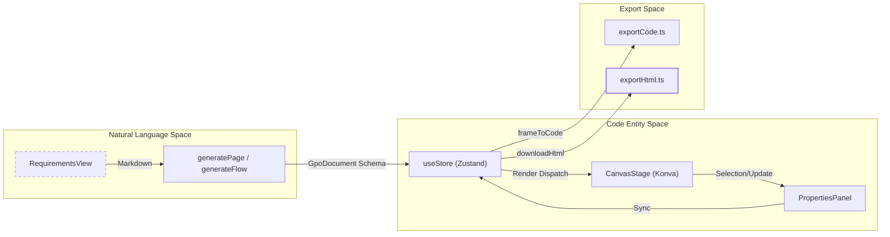
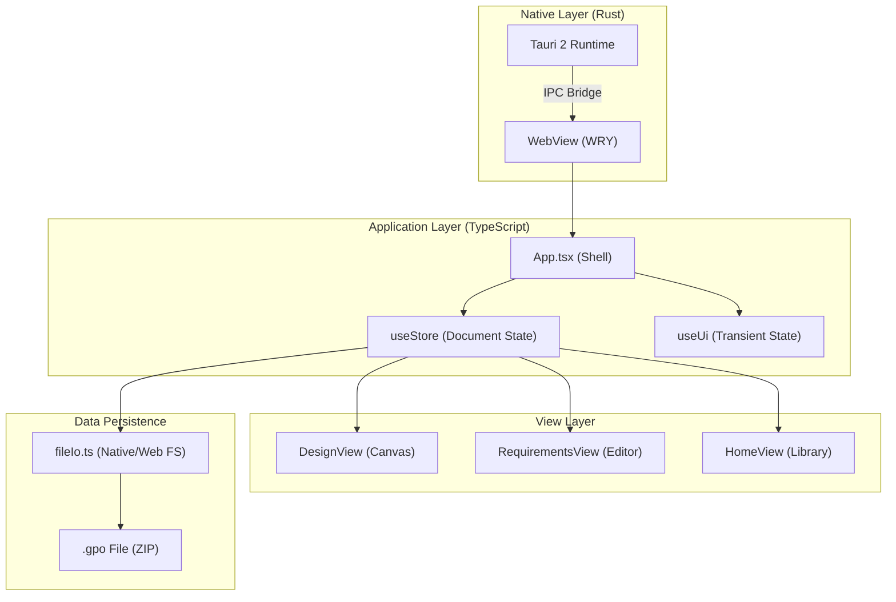

# 1 OpenPrototype Overview

# OpenPrototype Overview

Relevant source files

The following files were used as context for generating this wiki page:

- [README.md](README.md)
- [index.html](index.html)
- [package.json](package.json)
- [src-tauri/Cargo.toml](src-tauri/Cargo.toml)
- [src/App.tsx](src/App.tsx)
- [src/main.tsx](src/main.tsx)
- [src/views/HomeView.tsx](src/views/HomeView.tsx)

OpenPrototype is an AI-driven product prototyping studio that bridges the gap between natural language requirements and structured design entities. Unlike tools that generate static images, OpenPrototype produces editable, structured metadata that resides on an infinite canvas, allowing for manual refinement, interaction wiring, and production-ready code export.

## Core Workflow

The system follows a linear progression from abstract concepts to interactive prototypes:

1.  **Requirements**: Users draft or manage product requirements in Markdown. AI assistance can polish, expand, or summarize these drafts [README.md:13-14]().
2.  **AI Generation**: The AI interprets requirements to generate structured page metadata (frames, nodes, and auto-layout settings) [README.md:10-11]().
3.  **Canvas Editing**: Users refine the generated UI on a `react-konva` powered canvas, adjusting properties, layers, and design tokens [README.md:15-16]().
4.  **Flow & Export**: Screens are linked via interactions to create a "Flow," which can then be exported as a self-contained HTML prototype or individual code components (React, Vue, Tailwind) [README.md:17-19]().

### Workflow Logic to Code Mapping

The following diagram illustrates how the conceptual workflow is mapped to specific subsystems and files within the codebase.

**System Workflow Mapping**

**Sources:** [README.md:10-20](), [src/App.tsx:25-31](), [src/store/useStore.ts:1-10]()

---

## Technology Stack

OpenPrototype is built as a modern web application with a desktop-first capability via Tauri.

*   **Frontend Framework**: React 18 + TypeScript [package.json:24-30]().
*   **Rendering Engine**: `react-konva` for high-performance 2D canvas operations [package.json:26]().
*   **State Management**: `zustand` with `zundo` for temporal (undo/redo) document state [package.json:29-30]().
*   **Desktop Shell**: Tauri 2 (Rust) providing native file system access and dialogs [src-tauri/Cargo.toml:14-17]().
*   **Persistence**: `.gpo` file format, a ZIP container containing `document.json` and assets [README.md:44-53]().

**Architecture Hierarchy**

**Sources:** [package.json:7-15](), [src-tauri/Cargo.toml:1-20](), [src/App.tsx:1-35](), [src/file/fileIo.ts:1-10]()

---

## Major Subsystems

### 1. Application Shell & View Routing
The `App.tsx` component acts as the primary orchestrator, managing the top-level layout and the `ViewMode` state machine [src/App.tsx:2-3](). It handles navigation between the Home screen, Requirements editor, and the Design canvas.
*   For details, see [Application Shell & View Routing](#1.2).

### 2. Document State & Storage
State is centralized in `useStore.ts`, which manages the `GpoDocument` object—the source of truth for all pages, frames, and nodes [src/App.tsx:51-53](). Persistence is handled by `fileIo.ts` (platform-adaptive for Tauri or Browser) and a local `library.ts` for recent files [src/App.tsx:4-21]().
*   For details, see [Getting Started & Project Setup](#1.1).

### 3. Canvas & Properties
The design environment consists of the `CanvasStage` (rendering), `LayersPanel` (hierarchy), and `PropertiesPanel` (node attributes) [README.md:15-16](). It supports vector editing, auto-layout, and design system token application.

### 4. AI & Requirements
The AI subsystem integrates with various LLM providers (OpenAI, Anthropic, DeepSeek) and includes local heuristic fallbacks [README.md:14](). It transforms Markdown from `RequirementsView` into structured UI components within the document.

### 5. Export Engine
OpenPrototype provides extensive export options via the `ExportMenu` in `App.tsx`, including interactive HTML prototypes, PNG/SVG/PDF assets, and production-ready React/Vue/Tailwind code [src/App.tsx:49-143]().

**Sources:** [src/App.tsx:1-35](), [src/views/HomeView.tsx:36-49](), [README.md:57-70](), [package.json:1-31]()

---
