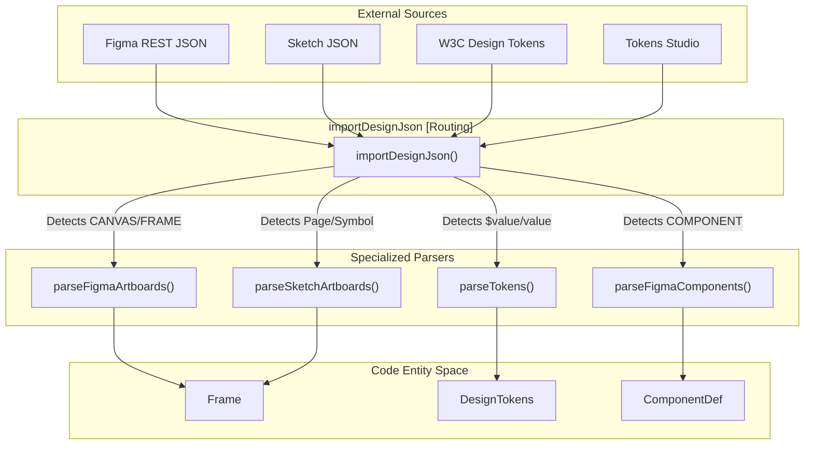
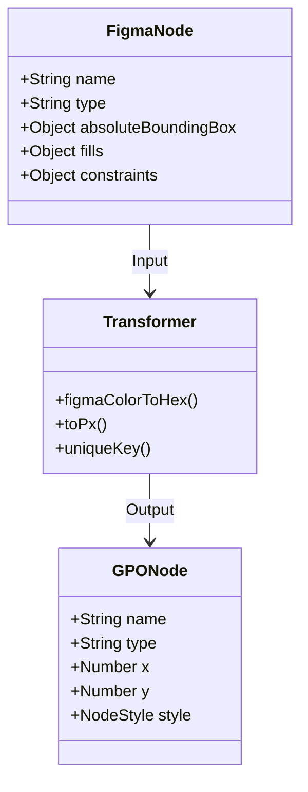

# 10 Design Interop & Import

# Design Interop & Import

Relevant source files

The following files were used as context for generating this wiki page:

- [src/App.tsx](src/App.tsx)
- [src/__tests__/core.test.ts](src/__tests__/core.test.ts)
- [src/interop/importDesign.ts](src/interop/importDesign.ts)
- [src/schema/layout.ts](src/schema/layout.ts)
- [src/views/HomeView.tsx](src/views/HomeView.tsx)

The Design Interop layer provides a bridge between the OpenPrototype `.gpo` format and industry-standard design tools. It enables the extraction of design tokens, artboards, and reusable components from JSON exports (Figma REST API, Sketch JSON, and W3C Design Tokens) and maps them into the GPO document model.

## Implementation Overview

The interop logic is centered in `src/interop/importDesign.ts`. It follows a pattern of **auto-detection and routing**: the system receives a raw JSON object and attempts to parse it as tokens, Figma artboards, or Sketch symbols based on structural heuristics [src/interop/importDesign.ts:101-207]().

### Data Flow: Import Pipeline

The following diagram illustrates how external design data is transformed into internal `GpoDocument` entities.

**Import Routing & Transformation**

Sources: [src/interop/importDesign.ts:209-225](), [src/interop/importDesign.ts:244-247]().

## Design Token Parsing

The `parseTokens` function handles multiple formats including the W3C Design Tokens Community Group specification (`$value`/`$type`), Tokens Studio/Figma Tokens (`value`/`type`), and Style Dictionary [src/interop/importDesign.ts:8-13]().

### Normalization Heuristics
1.  **Category Detection**: Since token trees are often nested, the parser uses `categoryFromType` (checking the `$type` field) and falls back to `categoryFromPath` (regex-matching path segments like `color`, `spacing`, `radius`) [src/interop/importDesign.ts:64-82]().
2.  **Unit Conversion**: The `toPx` utility converts `rem` and `em` values to pixels (assuming a 16px base) and strips unit strings [src/interop/importDesign.ts:51-62]().
3.  **Color Normalization**: Figma's internal `0..1` float representation for RGBA is converted to standard hex strings via `figmaColorToHex` [src/interop/importDesign.ts:41-48]().
4.  **Key Disambiguation**: To flatten nested trees into the GPO flat token structure, `uniqueKey` generates names by joining path segments (e.g., `brand.primary.main` becomes `brand-primary-main`) [src/interop/importDesign.ts:84-98]().

| Feature | Logic |
| :--- | :--- |
| **W3C Format** | Detects `$value` and `$type` fields [src/interop/importDesign.ts:144-145](). |
| **Tokens Studio** | Detects `value` and `type` fields [src/interop/importDesign.ts:144-145](). |
| **Unit Scaling** | `rem` / `em` multiplied by 16 [src/interop/importDesign.ts:59-59](). |
| **Deduplication** | Appends numeric suffixes if keys collide [src/interop/importDesign.ts:94-97](). |

Sources: [src/interop/importDesign.ts:15-100](), [src/__tests__/core.test.ts:180-206]().

## Frame & Artboard Extraction

Artboard extraction involves mapping deeply nested scene graphs into the flattened `Frame` and `Node` structure used by the OpenPrototype canvas.

### Figma Artboards
The `parseFigmaArtboards` function traverses a Figma document tree. It specifically targets nodes of type `FRAME` or `INSTANCE` located within a `CANVAS` (Page). It maps `absoluteBoundingBox` coordinates to the GPO coordinate system and attempts to preserve hierarchy by recursing through children [src/interop/importDesign.ts:195-207]().

### Sketch Symbols
`parseSketchSymbols` extracts Sketch `symbolMaster` and `artboard` layers. It maps Sketch's `frame` (x, y, width, height) and `backgroundColor` into the GPO `Frame` schema [src/interop/importDesign.ts:24-25]().

Sources: [src/interop/importDesign.ts:23-29](), [src/__tests__/core.test.ts:208-220]().

## INTEROP.md Field Mapping

The interop layer follows a strict mapping specification defined in the project's `INTEROP.md` (documented within the schema logic). This ensures that attributes like `opacity`, `fills`, and `constraints` are translated accurately.

**Field Mapping Logic**

Sources: [src/interop/importDesign.ts:12-13](), [src/interop/importDesign.ts:41-62]().

## Integration with UI

The import functionality is exposed via the `importDesignJson` function, which is triggered from the "More" menu in the application shell [src/App.tsx:178-178]().

1.  **User Action**: User selects "Import Figma / Sketch" in the UI [src/App.tsx:178-178]().
2.  **File Loading**: The application reads the JSON file content.
3.  **Auto-Detection**: `importDesignJson` determines if the content is a Token set, a Figma tree, or a Sketch document [src/interop/importDesign.ts:4-13]().
4.  **Store Update**: Validated frames and components are pushed into the `useStore` document state.

Sources: [src/App.tsx:23-23](), [src/interop/importDesign.ts:23-29]().

---
