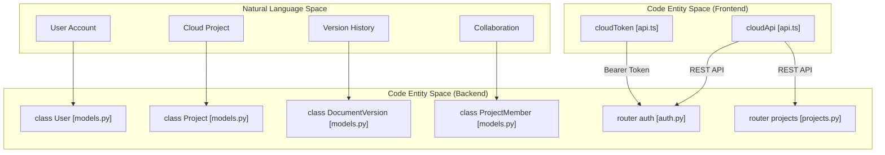
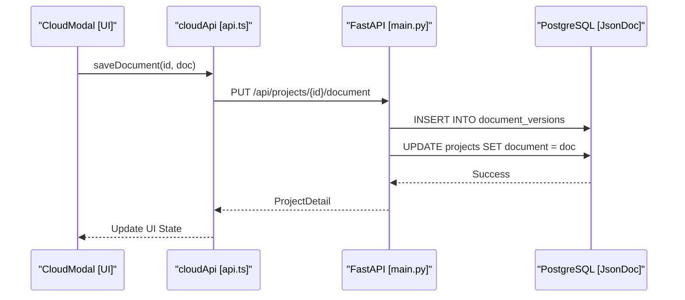

# 11 Cloud Backend & Collaboration

# Cloud Backend & Collaboration

Relevant source files

The following files were used as context for generating this wiki page:

- [server/README.md](server/README.md)
- [server/app/__init__.py](server/app/__init__.py)
- [server/app/main.py](server/app/main.py)
- [server/app/models.py](server/app/models.py)
- [server/app/schemas.py](server/app/schemas.py)
- [server/pyproject.toml](server/pyproject.toml)
- [src/cloud/api.ts](src/cloud/api.ts)

OpenPrototype includes an optional SaaS backend designed to extend the local-first experience with cloud-based persistence, version history, and team collaboration. The backend is built with **FastAPI** and **PostgreSQL**, while the frontend integrates via a dedicated TypeScript client and UI modals.

## Overview

The cloud subsystem transitions the application from a single-user local tool to a collaborative platform. It supports:
- **Identity Management**: JWT-based authentication with bcrypt password hashing [server/README.md:10-10]().
- **Document Persistence**: Storing `.gpo` documents as `JSONB` in PostgreSQL [server/app/models.py:18-18]().
- **Collaboration**: Role-Based Access Control (RBAC) with `owner`, `editor`, and `viewer` roles [server/app/schemas.py:6-6]().
- **Version Control**: Automatic snapshotting of document states on every save [server/README.md:58-59]().

### System Architecture
The following diagram illustrates the relationship between the FastAPI backend entities and the frontend integration layer.

**Cloud System Mapping**

Sources: [server/app/models.py:25-90](), [src/cloud/api.ts:44-109](), [server/app/main.py:35-37]()

## Backend API (FastAPI Server)

The backend is a Python-based service located in the `/server` directory. It uses **SQLAlchemy 2.0** for ORM and **Pydantic** for data validation [server/pyproject.toml:9-10]().

The server orchestrates the lifecycle of a design project through several key routers:
- **Auth**: Handles registration and login, returning JWT tokens for session management [server/app/schemas.py:21-23]().
- **Projects**: Manages the CRUD operations for design files. Documents are stored in the `Project` model's `document` field [server/app/models.py:45-45]().
- **Members**: Implements RBAC, allowing owners to invite others via email [server/app/schemas.py:65-68]().

For technical details on the server architecture, database models, and API endpoints, see [Backend API (FastAPI Server)](#11.1).

Sources: [server/pyproject.toml:1-17](), [server/app/main.py:1-38](), [server/app/models.py:1-90]()

## Frontend Cloud Integration

The frontend communicates with the backend through the `cloudApi` client [src/cloud/api.ts:74-109](). This client abstracts the `fetch` logic, including the automatic attachment of the `Authorization: Bearer` header retrieved from `localStorage` [src/cloud/api.ts:55-56]().

### Integration Flow
When a user opens a cloud project, the frontend fetches the `ProjectDetail` which contains the `GpoDocument` JSON [src/cloud/api.ts:20-22](). This JSON is then loaded into the centralized Zustand store for editing.

**Document Synchronization Flow**

Sources: [src/cloud/api.ts:94-98](), [server/app/models.py:75-87](), [server/README.md:50-52]()

The user interface for these features is primarily contained within the `CloudModal`, which provides screens for project browsing, version selection, and member management.

For details on the TypeScript client and UI implementation, see [Frontend Cloud Integration](#11.2).

Sources: [src/cloud/api.ts:38-72](), [src/cloud/api.ts:74-109]()

## Data Persistence & Roles

The system uses a flexible schema to handle different environments. While production uses **PostgreSQL** with `JSONB` for efficient document querying, the test suite utilizes **SQLite** with a standard `JSON` variant [server/app/models.py:17-18]().

| Role | Permissions |
| :--- | :--- |
| **Owner** | Full control: delete project, manage members, edit document. |
| **Editor** | Write access: save new document versions, rename project. |
| **Viewer** | Read access: view document, list version history, list members. |

Sources: [server/app/schemas.py:6-6](), [server/README.md:39-55](), [server/app/models.py:59-73]()

---
