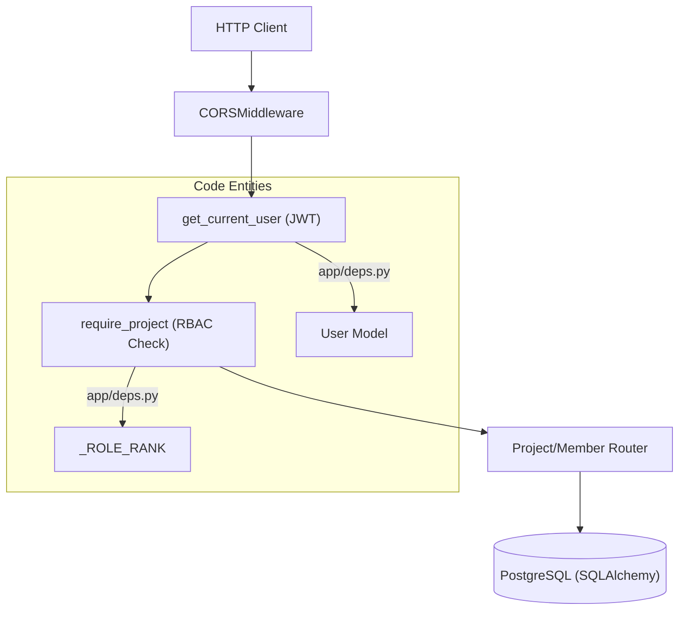
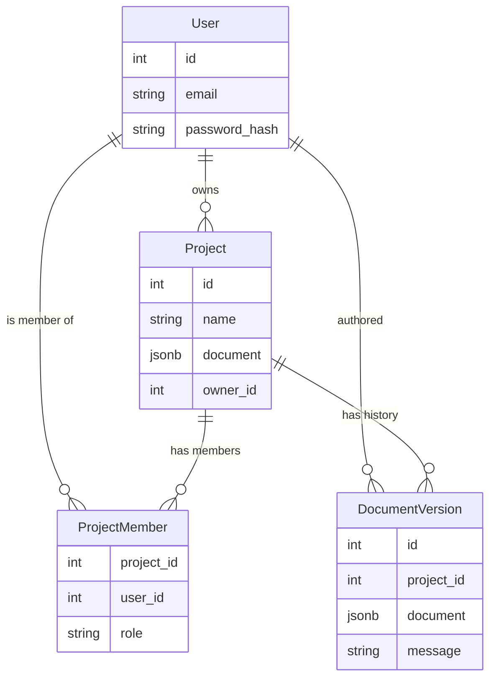

# 11.1 Backend API (FastAPI Server)

# Backend API (FastAPI Server)

Relevant source files

The following files were used as context for generating this wiki page:

- [server/README.md](server/README.md)
- [server/app/__init__.py](server/app/__init__.py)
- [server/app/database.py](server/app/database.py)
- [server/app/deps.py](server/app/deps.py)
- [server/app/main.py](server/app/main.py)
- [server/app/routers/auth.py](server/app/routers/auth.py)
- [server/app/routers/members.py](server/app/routers/members.py)
- [server/app/routers/projects.py](server/app/routers/projects.py)
- [server/app/security.py](server/app/security.py)
- [server/pyproject.toml](server/pyproject.toml)
- [server/tests/conftest.py](server/tests/conftest.py)
- [server/tests/test_auth.py](server/tests/test_auth.py)
- [server/tests/test_collab.py](server/tests/test_collab.py)
- [server/tests/test_projects.py](server/tests/test_projects.py)

The OpenPrototype backend is a SaaS-oriented cloud service that provides centralized storage, authentication, and collaboration features. It is built using **FastAPI** and **SQLAlchemy 2.0**, utilizing **PostgreSQL** with `JSONB` for storing the core design documents.

## Server Architecture

The server follows a modular router-based architecture where the application entry point initializes the database and middleware before mounting functional routers.

### App Entrypoint and Lifecycle
The application is defined in `server/app/main.py`. It uses a `lifespan` context manager to initialize the database schema via `init_db()` when the server starts [server/app/main.py:13-16](). It also configures `CORSMiddleware` to allow cross-origin requests from the frontend, governed by `settings.cors_origin_list` [server/app/main.py:21-27]().

### Dependencies and Authorization
Authorization is handled via FastAPI dependencies in `server/app/deps.py`. The system implements a Role-Based Access Control (RBAC) hierarchy defined by `_ROLE_RANK` [server/app/deps.py:14]().

| Function | Purpose |
| :--- | :--- |
| `get_current_user` | Extracts JWT from `Authorization: Bearer` header and retrieves the `User` from DB [server/app/deps.py:17-29](). |
| `role_for` | Determines if a user is the `owner` or a `ProjectMember` (editor/viewer) [server/app/deps.py:32-41](). |
| `require_project` | Validates that a project exists and the user has at least the `min_role` required [server/app/deps.py:44-56](). |

### Request Flow Diagram
The following diagram illustrates how a request passes through the middleware and dependencies to reach a router.

**Diagram: Backend Request Pipeline**

Sources: [server/app/main.py:19-38](), [server/app/deps.py:11-56]()

## Data Models & Schema

The backend uses SQLAlchemy 2.0 models to map Python classes to database tables. The core design data is stored as a blob in a JSON-compatible column.

### Key Models
*   **User**: Stores identity and hashed passwords [server/app/models.py]().
*   **Project**: The root entity for a design. Contains the current `document` (JSONB) [server/app/routers/projects.py:50]().
*   **ProjectMember**: A junction table linking `User` and `Project` with a specific `role` (editor, viewer) [server/app/models.py]().
*   **DocumentVersion**: An immutable snapshot of the document created every time a user saves. It includes a `message` and an `author_id` [server/app/routers/projects.py:110-117]().

### Entity Relationship Diagram
This diagram maps the code-level models to their relationships in the database.

**Diagram: Backend Data Relationships**

Sources: [server/app/models.py](), [server/app/routers/projects.py:101-127]()

## API Routers

### Auth Router (`/api/auth`)
Handles user lifecycle and session management.
*   `POST /register`: Hashes passwords using `bcrypt` and returns a JWT [server/app/routers/auth.py:14-24]().
*   `POST /login`: Validates credentials and returns a JWT [server/app/routers/auth.py:27-32]().
*   `GET /me`: Returns the current user's profile [server/app/routers/auth.py:35-37]().

### Projects Router (`/api/projects`)
Manages the design documents and their versioning.
*   **CRUD**: Standard Create, Read, Update (rename), and Delete operations [server/app/routers/projects.py:46-98]().
*   **Document Save**: `PUT /{id}/document` updates the project's main document and simultaneously appends a new entry to `DocumentVersion` [server/app/routers/projects.py:101-118]().
*   **Version History**: `GET /{id}/versions` lists all snapshots [server/app/routers/projects.py:130-141]().
*   **Restore**: `POST /{id}/versions/{vid}/restore` replaces the current project document with a specific historical snapshot [server/app/routers/projects.py:144-164]().

### Members Router (`/api/projects/{id}/members`)
Handles collaboration and RBAC.
*   **Invite**: `POST` adds a user to a project by email. Only the `owner` can perform this [server/app/routers/members.py:38-45]().
*   **Role Management**: If a user is already a member, the invite endpoint updates their role [server/app/routers/members.py:58-59]().
*   **Remove**: `DELETE` removes a member's access [server/app/routers/members.py:66-82]().

## Implementation Details

### Versioning Logic
Unlike frontend undo/redo which is transient, the backend versioning is persistent. Every save creates a `DocumentVersion` record [server/app/routers/projects.py:110-117](). This allows the system to provide a "Version History" UI where users can see who changed what and when, and revert the entire project to a previous state [server/app/routers/projects.py:155-162]().

### Security and Hashing
Passwords are never stored in plain text. The `hash_password` and `verify_password` utilities in `app.security` use `bcrypt` for computationally expensive hashing [server/app/routers/auth.py:9](). JWT tokens are signed using a secret key and contain the `user_id` as the subject [server/app/security.py]().

### Development and Testing
The backend includes a comprehensive test suite in the `server/tests/` directory. Tests use an in-memory SQLite database via `StaticPool` to ensure isolation and speed [server/tests/conftest.py:13-17]().
*   `test_project_crud_and_document_versions`: Verifies the full lifecycle of project creation, saving, and restoration [server/tests/test_projects.py:4-53]().
*   `test_invite_roles_and_permissions`: Validates that `viewer` and `editor` roles correctly restrict API access [server/tests/test_collab.py:4-81]().

Sources: [server/app/routers/projects.py](), [server/app/routers/auth.py](), [server/app/routers/members.py](), [server/tests/conftest.py]()

---
