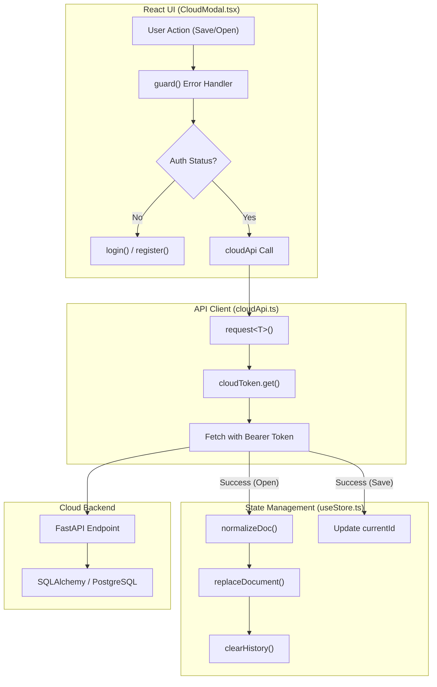

# 11.2 Frontend Cloud Integration

# Frontend Cloud Integration

Relevant source files

The following files were used as context for generating this wiki page:

- [server/.env.example](server/.env.example)
- [server/app/models.py](server/app/models.py)
- [server/app/schemas.py](server/app/schemas.py)
- [server/docker-compose.yml](server/docker-compose.yml)
- [src/cloud/api.ts](src/cloud/api.ts)
- [src/components/CloudModal.tsx](src/components/CloudModal.tsx)
- [src/components/DesignSystemModal.tsx](src/components/DesignSystemModal.tsx)
- [src/views/canvas/PropertiesPanel.tsx](src/views/canvas/PropertiesPanel.tsx)

The Frontend Cloud Integration system enables optional SaaS-based collaboration features for OpenPrototype. It provides a TypeScript client for interacting with the FastAPI backend, handles JWT-based authentication, manages project persistence, and provides a multi-user collaboration UI.

## Cloud API Client

The `cloudApi` is a centralized TypeScript client that wraps standard `fetch` requests to the backend. It handles JSON serialization, error normalization, and automatic injection of the Bearer token for authenticated routes.

### Configuration & Token Management
The API base URL is determined by the `VITE_CLOUD_API` environment variable, defaulting to `http://localhost:8008/api` [src/cloud/api.ts:38-40](). JWT tokens are managed via the `cloudToken` utility, which persists the string to the browser's `localStorage` under the key `op_cloud_token` [src/cloud/api.ts:42-48]().

### Core Functions
The `cloudApi` object exposes methods for the full project lifecycle:
*   **Auth**: `register`, `login`, and `me` (fetch current user profile) [src/cloud/api.ts:76-86]().
*   **Project CRUD**: `listProjects`, `createProject`, `getProject`, and `deleteProject` [src/cloud/api.ts:87-93, 99]().
*   **Document Operations**: `saveDocument` (creates a new version) and `listVersions` [src/cloud/api.ts:94-98, 108]().
*   **Collaboration**: `listMembers`, `inviteMember`, and `removeMember` [src/cloud/api.ts:100-107]().

**Sources:** [src/cloud/api.ts:38-109]()

## Data Flow: Document Normalization

When a project is fetched from the cloud, it undergoes a normalization process before being loaded into the `useStore`. This ensures that documents created on older versions of the schema are compatible with the current frontend runtime.

### The "Open Project" Sequence
1.  `cloudApi.getProject(id)` is called to fetch the `ProjectDetail` [src/components/CloudModal.tsx:100]().
2.  The retrieved `GpoDocument` is passed through `normalizeDoc` [src/components/CloudModal.tsx:101]().
3.  `replaceDocument` updates the Zustand store with the sanitized document [src/components/CloudModal.tsx:101]().
4.  `clearHistory` resets the undo/redo stack to prevent history corruption across different projects [src/components/CloudModal.tsx:102]().

### Entity Association Diagram
This diagram maps frontend TypeScript interfaces to the corresponding Pydantic schemas and SQLAlchemy models used in the backend.

| Layer | User Entity | Project Entity | Document Entity |
| :--- | :--- | :--- | :--- |
| **Frontend (TS)** | `CloudUser` | `ProjectSummary` | `GpoDocument` |
| **API Schema (Py)** | `UserOut` | `ProjectSummary` | `DocumentUpdate` |
| **Database (SQL)** | `User` | `Project` | `DocumentVersion` |

**Sources:** [src/cloud/api.ts:5-36](), [server/app/schemas.py:26-84](), [server/app/models.py:25-90](), [src/components/CloudModal.tsx:98-105]()

## CloudModal UI Component

The `CloudModal` serves as the primary interface for users to interact with cloud features. It manages internal state for authentication modes and project listings while bridging to the global application state.

### Authentication States
The modal toggles between `login` and `register` modes [src/components/CloudModal.tsx:23](). Upon successful authentication, the `access_token` is stored via `cloudToken.set()` and the user profile is fetched using `cloudApi.me()` [src/components/CloudModal.tsx:63-74]().

### Project & Member Management
*   **Project List**: Displays projects where the user has a `Role` (`owner`, `editor`, or `viewer`) [src/components/CloudModal.tsx:29]().
*   **Save Logic**: If a project is already associated (`currentId`), it calls `saveDocument`; otherwise, it triggers `createProject` to initialize a new cloud entry [src/components/CloudModal.tsx:85-96]().
*   **Member Management**: Owners and editors can invite new members by email and assign roles [src/components/CloudModal.tsx:122-128](). It uses a nested list view to show existing `Member` entities and provides a `kick` function to remove them [src/components/CloudModal.tsx:130-135]().

**Sources:** [src/components/CloudModal.tsx:17-137]()

## Implementation Architecture

The following diagram illustrates the interaction between the React UI, the Zustand store, and the Cloud API layer.

### Frontend Cloud Interaction Flow
Title: Cloud Sync and Collaboration Flow

**Sources:** [src/cloud/api.ts:50-72](), [src/components/CloudModal.tsx:52-114](), [src/store/useStore.ts:19-20]()

## Key Interfaces and Types

| Name | Type | Purpose |
| :--- | :--- | :--- |
| `Role` | `Union` | Defines access levels: `owner`, `editor`, `viewer` [src/cloud/api.ts:3](). |
| `ProjectSummary` | `Interface` | Lightweight project metadata for listing views [src/cloud/api.ts:12-18](). |
| `ProjectDetail` | `Interface` | Full project data including the `GpoDocument` [src/cloud/api.ts:20-22](). |
| `Member` | `Interface` | Represents a user's membership and role within a specific project [src/cloud/api.ts:24-29](). |
| `VersionInfo` | `Interface` | Metadata for document history snapshots [src/cloud/api.ts:31-36](). |

**Sources:** [src/cloud/api.ts:3-36]()

---
