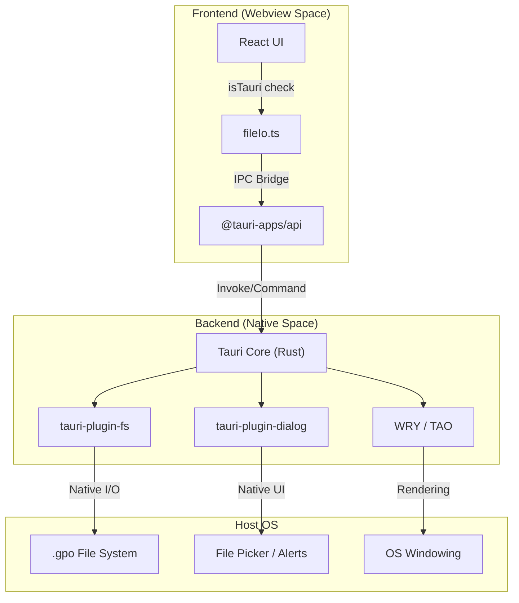
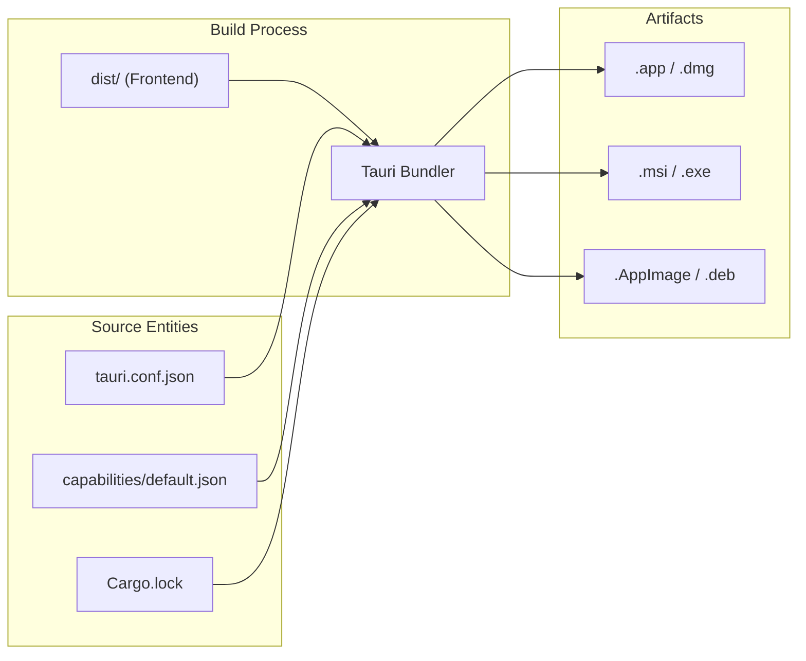

# 12 Desktop Application (Tauri)

# Desktop Application (Tauri)

Relevant source files

The following files were used as context for generating this wiki page:

- [src-tauri/Cargo.lock](src-tauri/Cargo.lock)
- [src-tauri/capabilities/default.json](src-tauri/capabilities/default.json)
- [src-tauri/tauri.conf.json](src-tauri/tauri.conf.json)

OpenPrototype uses **Tauri 2** as its desktop application framework. This architecture allows the application to leverage a high-performance Rust backend for native system access while maintaining a lightweight web-based frontend. By utilizing the host system's native webview (WebView2 on Windows, WebKit on macOS/Linux), the application minimizes binary size and memory overhead compared to traditional Electron-based solutions.

## Architecture Overview

The desktop shell acts as a bridge between the React-based design canvas and the host operating system. It manages window lifecycles, native file system access for `.gpo` files, and the distribution pipeline.

### System Stack

The following diagram illustrates the relationship between the web frontend and the native Rust backend:

**Desktop Bridge Architecture**

Sources: [src-tauri/tauri.conf.json:1-41](), [src-tauri/capabilities/default.json:1-13]()

## Native Integration & Runtime

The application utilizes several Tauri plugins to provide a seamless desktop experience that exceeds browser capabilities.

*   **Native File I/O**: Unlike the browser's limited `showOpenFilePicker`, the desktop version uses `tauri-plugin-fs` and `tauri-plugin-dialog` to handle the complex ZIP-based `.gpo` format directly on the disk.
*   **Platform Detection**: The frontend uses a platform-adaptive I/O layer. The `isTauri` check determines whether to use standard web downloads or native Rust commands for saving and loading documents.
*   **Window Management**: The main application window is configured with specific dimensions (1440x900) and constraints to ensure the complex multi-panel design editor remains usable [src-tauri/tauri.conf.json:13-21]().

For details on IPC, windowing, and native plugins, see **[Tauri Runtime & Native Integration](#12.1)**.

## Configuration & Release Pipeline

The build system is managed through a combination of Rust's `cargo` and the `tauri-cli`.

### Application Metadata
The `tauri.conf.json` file defines the application's identity, including its bundle identifier (`app.openprototype`) and the assets used for icons across different platforms [src-tauri/tauri.conf.json:3-5](), [src-tauri/tauri.conf.json:29-35]().

### Permission Model
OpenPrototype follows a "Capability-based" security model. The `default.json` capability file explicitly grants the frontend permission to access the file system and dialog modules [src-tauri/capabilities/default.json:6-12]().

**Build & Release Mapping**

### Dependency Management
The project maintains a complex set of native dependencies (such as `atk`, `cairo`, and `glib` for Linux support) managed via `Cargo.lock` [src-tauri/Cargo.lock:51-71](), [src-tauri/Cargo.lock:203-225]().

For details on the security model, build configurations, and CI/CD packaging, see **[Tauri Configuration & Desktop Release](#12.2)**.

Sources: [src-tauri/tauri.conf.json:1-41](), [src-tauri/capabilities/default.json:1-13](), [src-tauri/Cargo.lock:1-250]()

---
