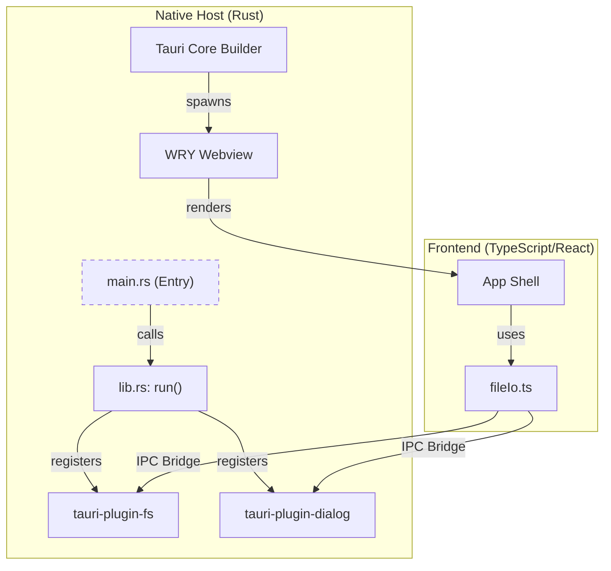
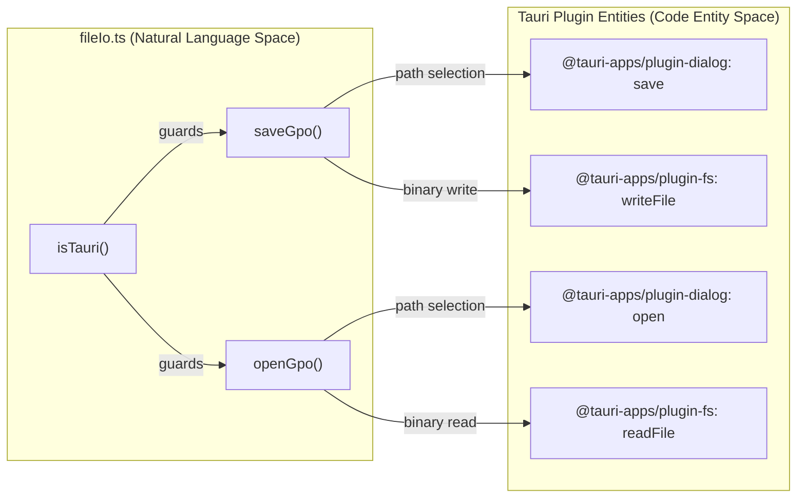

# 12.1 Tauri Runtime & Native Integration

# Tauri Runtime & Native Integration

Relevant source files

The following files were used as context for generating this wiki page:

- [src-tauri/Cargo.lock](src-tauri/Cargo.lock)
- [src-tauri/build.rs](src-tauri/build.rs)
- [src-tauri/src/lib.rs](src-tauri/src/lib.rs)
- [src-tauri/src/main.rs](src-tauri/src/main.rs)
- [src/file/fileIo.ts](src/file/fileIo.ts)
- [src/file/library.ts](src/file/library.ts)
- [src/file/persist.ts](src/file/persist.ts)
- [src/schema/gpoFile.ts](src/schema/gpoFile.ts)

OpenPrototype utilizes the **Tauri 2** desktop framework to provide a high-performance, native-feeling experience across Windows, macOS, and Linux. The application leverages a Rust-based backend for system-level operations while maintaining a lightweight web-based frontend for the design canvas.

## Tauri Runtime Stack

The application's runtime is built upon the Tauri architecture, which separates the UI (Frontend) from the system access (Backend/Core) through a secure Inter-Process Communication (IPC) bridge.

### Core Components
*   **Windowing (TAO):** Handles cross-platform window creation and management.
*   **Webview (WRY):** Provides the rendering engine. It uses **WebView2** (Edge/Chromium) on Windows, **WebKit** (AppKit) on macOS, and **webkit2gtk** (GTK) on Linux.
*   **Rust Backend:** The entry point of the application is defined in `src-tauri/src/main.rs`, which invokes the core logic in the library crate [src-tauri/src/main.rs:4-6]().
*   **Build Pipeline:** The `tauri_build` crate orchestrates the compilation of Rust assets and the embedding of frontend resources during the build process [src-tauri/build.rs:1-3]().

### Application Lifecycle
The application initialization is managed in `src-tauri/src/lib.rs`. This file configures the Tauri Builder and initializes essential plugins for native functionality [src-tauri/src/lib.rs:1-7]().

**Runtime Data Flow**
"The diagram below illustrates the relationship between the Rust core and the TypeScript frontend."

Sources: [src-tauri/src/main.rs:1-7](), [src-tauri/src/lib.rs:1-8](), [src/file/fileIo.ts:10-15]()

## Native Integration & File I/O

OpenPrototype implements a platform-adaptive I/O layer in `src/file/fileIo.ts`. This layer detects if the application is running within the Tauri shell and chooses between native OS dialogs or browser-based file downloads.

### Platform Detection
The `isTauri` function determines the environment by checking for the existence of the `__TAURI__` object on the global `window` [src/file/fileIo.ts:4-10]().

### Native File Operations
When `isTauri()` returns true, the application uses dynamic imports to load Tauri plugins. This prevents the web build from failing due to missing desktop-only packages [src/file/fileIo.ts:12-15]().

1.  **Saving Files (`saveGpo`):**
    *   Invokes `@tauri-apps/plugin-dialog`'s `save` function to open a native "Save As" dialog [src/file/fileIo.ts:23-25]().
    *   Applies filters for the `.gpo` extension [src/file/fileIo.ts:27]().
    *   Uses `@tauri-apps/plugin-fs`'s `writeFile` to persist the binary data to the selected path [src/file/fileIo.ts:24-31]().

2.  **Opening Files (`openGpo`):**
    *   Invokes `@tauri-apps/plugin-dialog`'s `open` function to show a native file picker [src/file/fileIo.ts:46-48]().
    *   Uses `@tauri-apps/plugin-fs`'s `readFile` to load the file into a buffer [src/file/fileIo.ts:47-53]().
    *   Passes the buffer to `deserializeGpo` for document reconstruction [src/file/fileIo.ts:54]().

**File I/O Implementation Bridge**
"This diagram maps the high-level file operations to the specific code entities in both the Frontend and the Tauri Plugin space."

Sources: [src/file/fileIo.ts:17-55](), [src-tauri/src/lib.rs:3-4]()

## Persistence Strategy

The application employs a tiered persistence strategy depending on the user's workflow and platform.

| Tier | Mechanism | File/Code Entity | Purpose |
| :--- | :--- | :--- | :--- |
| **Native Export** | ZIP Container (`.gpo`) | `serializeGpo` / `deserializeGpo` | Portable, interoperable file format for sharing. |
| **Local Library** | LocalStorage (Map) | `src/file/library.ts` | Home screen file management (list, rename, delete). |
| **Autosave** | LocalStorage (Key) | `src/file/persist.ts` | Recovery of the active document after crash/refresh. |
| **Recents** | LocalStorage (List) | `pushRecent` | Quick access to recently edited file names. |

### The .gpo Format
The `.gpo` (Generative Prototype Object) format is a ZIP-compressed container. It includes `manifest.json` for versioning, `document.json` for the node tree, and an `INTEROP.md` file to assist third-party tools in parsing the schema [src/schema/gpoFile.ts:5-21]().

*   **Serialization:** Uses `jszip` to bundle the JSON and optional thumbnails [src/schema/gpoFile.ts:52-66]().
*   **Normalization:** Upon loading, the document is passed through `normalizeDoc` to ensure compatibility with the current schema version [src/schema/gpoFile.ts:77](), [src/file/library.ts:68]().

Sources: [src/schema/gpoFile.ts:1-78](), [src/file/library.ts:1-84](), [src/file/persist.ts:1-55]()

---
