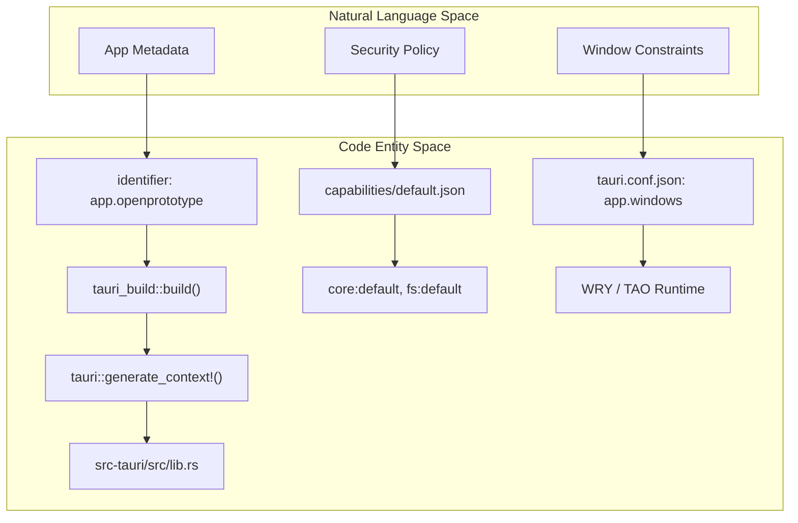
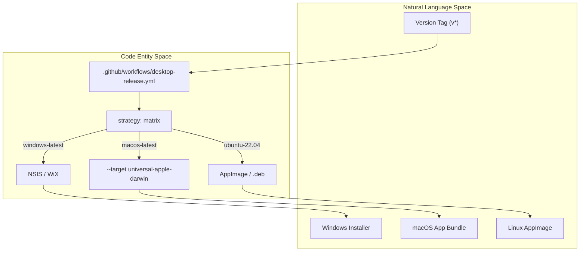

# 12.2 Tauri Configuration & Desktop Release

# Tauri Configuration & Desktop Release

Relevant source files

The following files were used as context for generating this wiki page:

- [.github/workflows/desktop-release.yml](.github/workflows/desktop-release.yml)
- [src-tauri/build.rs](src-tauri/build.rs)
- [src-tauri/capabilities/default.json](src-tauri/capabilities/default.json)
- [src-tauri/src/lib.rs](src-tauri/src/lib.rs)
- [src-tauri/tauri.conf.json](src-tauri/tauri.conf.json)

This page details the configuration and build pipeline for the OpenPrototype desktop application. The application utilizes **Tauri 2.0** to bridge a React-based frontend with a Rust-based backend, providing native performance, secure file system access, and cross-platform distribution.

## Tauri Application Configuration

The core of the desktop application is defined in `tauri.conf.json`. This file orchestrates the relationship between the frontend build artifacts and the native windowing system.

### Core Identity & Build Hooks
The application is identified as `app.openprototype` [[src-tauri/tauri.conf.json:5-5]()] with a default version of `0.1.0` [[src-tauri/tauri.conf.json:4-4]()]. The build pipeline is configured to use `pnpm` for both development and production builds:
*   **Frontend Distribution**: The production web assets are expected in `../dist` [[src-tauri/tauri.conf.json:7-7]()].
*   **Build Lifecycle**: Before the native binary is compiled, `pnpm build` is executed to generate the static frontend [[src-tauri/tauri.conf.json:10-10]()].

### Window Specifications
The main application window is configured with a default resolution of 1440x900 [[src-tauri/tauri.conf.json:16-17]()] and a minimum constraint of 1024x700 [[src-tauri/tauri.conf.json:18-19]()] to ensure the multi-pane Canvas UI remains functional.

### Asset Embedding & Icons
Tauri bundles platform-specific icons from the `icons/` directory, including `.icns` for macOS, `.ico` for Windows, and various PNG sizes for Linux/Web [[src-tauri/tauri.conf.json:29-35]()].

**Sources:**
*   [src-tauri/tauri.conf.json:1-41]()

---

## Permission Model & Capabilities

OpenPrototype utilizes Tauri's granular permission system to restrict access to system resources. These are defined in the `capabilities/default.json` file.

### Default Permissions
The application grants the following capabilities to the `main` window:
*   **`core:default`**: Basic Tauri runtime functionality [[src-tauri/capabilities/default.json:7-7]()].
*   **`dialog:default`**: Access to native system file pickers (Open/Save dialogs) [[src-tauri/capabilities/default.json:8-8]()].
*   **`fs:default`**: General file system access permissions [[src-tauri/capabilities/default.json:9-9]()].
*   **`fs:allow-read-file` & `fs:allow-write-file`**: Explicit permissions required for the `.gpo` file persistence layer [[src-tauri/capabilities/default.json:10-11]()].

### Plugin Initialization
The Rust entry point in `src/lib.rs` initializes these plugins to make them available to the frontend:
*   `tauri_plugin_dialog::init()` [[src-tauri/src/lib.rs:3-3]()]
*   `tauri_plugin_fs::init()` [[src-tauri/src/lib.rs:4-4]()]

**Sources:**
*   [src-tauri/capabilities/default.json:1-14]()
*   [src-tauri/src/lib.rs:1-8]()

---

## Compilation Pipeline (`build.rs`)

The Rust compilation process includes a custom build script (`build.rs`) that executes before the main crate is compiled.

### The Build Script Workflow
The script invokes `tauri_build::build()` [[src-tauri/build.rs:2-2]()]. This function performs several critical tasks:
1.  **Context Generation**: It prepares the `tauri::generate_context!()` macro used in `lib.rs` [[src-tauri/src/lib.rs:5-5]()].
2.  **Resource Embedding**: It compresses and embeds the frontend assets (from `dist/`) and icons into the final binary.
3.  **Config Validation**: It ensures `tauri.conf.json` matches the required schema.

### Configuration to Binary Flow

Title: "Build Configuration to Native Binary Mapping"

**Sources:**
*   [src-tauri/build.rs:1-4]()
*   [src-tauri/src/lib.rs:1-8]()
*   [src-tauri/tauri.conf.json:1-41]()

---

## Desktop Release Workflow

The project uses GitHub Actions (`desktop-release.yml`) to automate cross-platform binary packaging. The workflow is triggered by version tags (e.g., `v0.1.0`) [[.github/workflows/desktop-release.yml:8-10]()].

### Cross-Platform Matrix
The workflow runs a build matrix across three platforms:
1.  **macOS**: Builds a universal binary supporting both Apple Silicon (`aarch64`) and Intel (`x86_64`) [[.github/workflows/desktop-release.yml:21-23]()].
2.  **Windows**: Generates `.exe` (NSIS) and `.msi` (WiX) installers [[.github/workflows/desktop-release.yml:24-26]()].
3.  **Linux**: Produces AppImage, `.deb`, and `.rpm` packages on Ubuntu 22.04 [[.github/workflows/desktop-release.yml:27-29]()].

### System Dependencies (Linux)
The Linux build requires specific native libraries for the WebKit2GTK webview and system tray support, including `libwebkit2gtk-4.1-dev`, `libappindicator3-dev`, and `librsvg2-dev` [[.github/workflows/desktop-release.yml:38-46]()].

### Release Automation
The workflow utilizes `tauri-apps/tauri-action` to:
1.  Run `pnpm install` and `pnpm build` [[.github/workflows/desktop-release.yml:70-72]()].
2.  Compile the Rust binary via `cargo` [[.github/workflows/desktop-release.yml:73-73]()].
3.  Upload the resulting installers to a GitHub Release draft [[.github/workflows/desktop-release.yml:80-80]()].

### Release Pipeline Mapping

Title: "CI/CD Pipeline to Distribution Artifacts"

**Sources:**
*   [.github/workflows/desktop-release.yml:1-83]()
*   [src-tauri/tauri.conf.json:26-39]()

---
