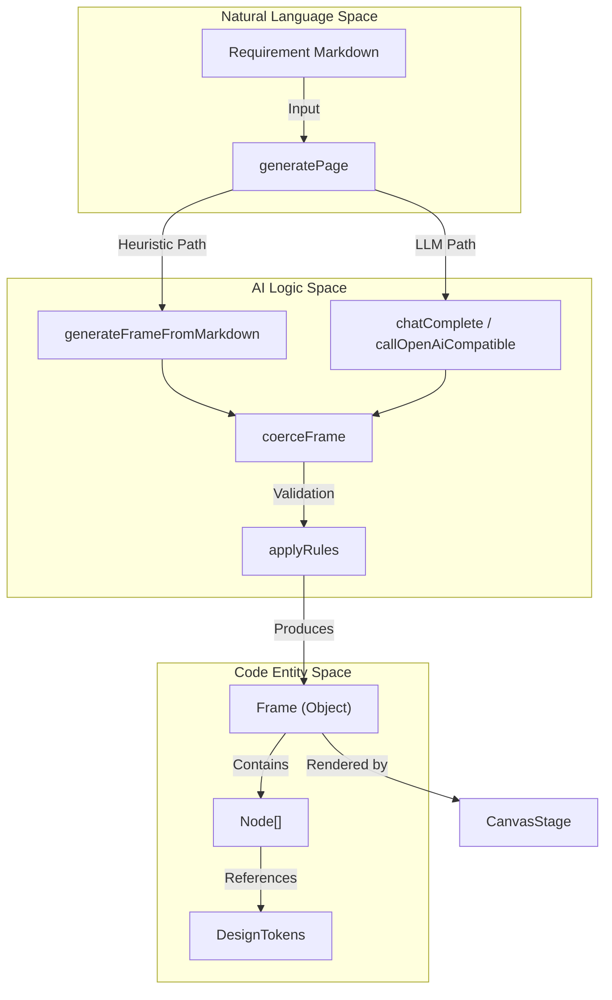
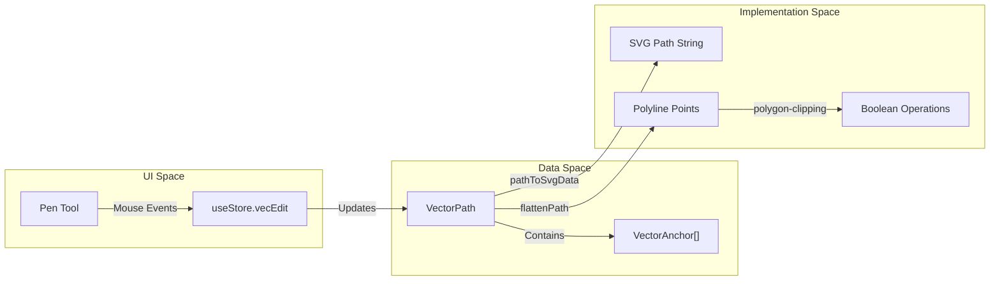

# 13 Glossary

# Glossary

Relevant source files

The following files were used as context for generating this wiki page:

- [docs/PLUGIN_SPEC.md](docs/PLUGIN_SPEC.md)
- [server/app/routers/projects.py](server/app/routers/projects.py)
- [server/tests/test_projects.py](server/tests/test_projects.py)
- [src-tauri/Cargo.lock](src-tauri/Cargo.lock)
- [src/__tests__/core.test.ts](src/__tests__/core.test.ts)
- [src/ai/flow.ts](src/ai/flow.ts)
- [src/ai/generate.ts](src/ai/generate.ts)
- [src/ai/localGenerator.ts](src/ai/localGenerator.ts)
- [src/file/fileIo.ts](src/file/fileIo.ts)
- [src/file/library.ts](src/file/library.ts)
- [src/file/persist.ts](src/file/persist.ts)
- [src/interop/importDesign.ts](src/interop/importDesign.ts)
- [src/journey/journey.ts](src/journey/journey.ts)
- [src/market/catalog.ts](src/market/catalog.ts)
- [src/schema/defaults.ts](src/schema/defaults.ts)
- [src/schema/gpoFile.ts](src/schema/gpoFile.ts)
- [src/schema/layout.ts](src/schema/layout.ts)
- [src/schema/types.ts](src/schema/types.ts)
- [src/vector/geometry.test.ts](src/vector/geometry.test.ts)
- [src/vector/geometry.ts](src/vector/geometry.ts)
- [src/views/JourneyView.tsx](src/views/JourneyView.tsx)
- [src/views/MarketView.tsx](src/views/MarketView.tsx)

This glossary defines the technical terms, domain concepts, and architectural jargon used within the OpenPrototype codebase. It serves as a reference for onboarding engineers to map abstract concepts to concrete code entities.

## Core Domain Terms

### .gpo (GPO Document)
The proprietary file format for OpenPrototype. It is a ZIP container containing a `document.json` (the serialized `GpoDocument`), a `manifest.json`, and an `assets/` folder for binary data like images.
*   **Implementation:** [src/schema/gpoFile.ts:1-20]()
*   **Schema Definition:** `GpoDocument` in [src/schema/types.ts:241-270]()
*   **Serialization:** `serializeGpo` and `deserializeGpo` in [src/schema/gpoFile.ts]()

### Auto Layout
A flexbox-inspired layout engine that controls the positioning and sizing of child nodes within a frame or group. It supports vertical/horizontal stacking, padding, gaps, and alignment.
*   **Data Structure:** `AutoLayout` interface in [src/schema/types.ts:99-104]()
*   **Engine Logic:** `applyAutoLayout` in [src/schema/layout.ts]()

### Canvas Stage
The primary 2D rendering area where the design is manipulated. It uses `react-konva` (a wrapper for Konva.js) to render the document tree.
*   **Rendering Entry:** `CanvasStage` component in [src/render/CanvasStage.tsx]()
*   **Node Dispatcher:** `renderNode` in [src/render/renderNode.tsx]()

### Component & Instance
A **Component** is a reusable template definition (`ComponentDef`). An **Instance** is a `Node` that references a component via `componentRef`. Instances can have "overrides" (local modifications) which are tracked to allow resetting or pushing changes back to the main component.
*   **Definition:** `ComponentDef` in [src/schema/types.ts:212-217]()
*   **Reference:** `Node.componentRef` in [src/schema/types.ts:160-160]()
*   **Override Logic:** `isInstanceModified` in [src/schema/nodeOps.ts:47-50]()

### Design Token
The smallest unit of a design system (e.g., a specific hex color or pixel spacing). Tokens are referenced by name throughout the document to ensure visual consistency.
*   **Structure:** `DesignTokens` in [src/schema/types.ts:202-209]()
*   **Default Values:** `defaultDesignSystem` in [src/schema/defaults.ts:115-172]()

### Fidelity (Wireframe vs. HiFi)
A property of a `Frame` that determines its visual style. **Wireframe** uses grayscale and placeholders, while **HiFi** (High Fidelity) applies the full design system tokens.
*   **Type:** `fidelity: "wireframe" | "hifi"` in [src/schema/types.ts:179-179]()
*   **AI Generation Logic:** `buildSystemPrompt` uses this to toggle LLM instructions in [src/ai/generate.ts:18-28]()

### Interaction & Flow
An **Interaction** is a trigger (click/hover) on a node that navigates to a `targetFrameId`. A collection of these interactions across multiple frames constitutes a **Flow** (prototype).
*   **Definition:** `Interaction` in [src/schema/types.ts:109-116]()
*   **Flow Planner:** `generateFlowFromBrief` in [src/ai/flow.ts:28-30]()

### User Journey Map
A matrix-based visualization of a user's experience over time, consisting of stages, actions, thoughts, and an emotion curve.
*   **Schema:** `JourneyMap` and `JourneyStage` in [src/schema/types.ts]()
*   **Logic:** [src/journey/journey.ts:1-11]()
*   **Visuals:** `EmotionCurve` in [src/views/JourneyView.tsx:126-172]()

---

## Technical Concepts & Code Entities

### Natural Language to Code Entity Mapping

The following diagram illustrates how user-provided requirements (Natural Language Space) are transformed into structured data and rendered on screen (Code Entity Space).

**AI Generation Pipeline**

**Sources:** [src/ai/generate.ts:171-191](), [src/ai/localGenerator.ts:30-35](), [src/schema/types.ts:140-183]()

---

**Vector Graphics Data Flow**

**Sources:** [src/vector/geometry.ts:29-49](), [src/vector/geometry.ts:64-84](), [src/schema/types.ts:83-96]()

---

## Detailed Glossary Table

| Term | Implementation / File Pointer | Description |
| :--- | :--- | :--- |
| **BooleanOp** | [src/vector/geometry.ts:122-122]() | Types of vector operations: `union`, `subtract`, `intersect`, `exclude`. |
| **CellList** | [src/views/JourneyView.tsx:25-76]() | React component for editing list-based rows (Actions, Pains) in Journey Maps. |
| **DesignRule** | [src/schema/types.ts:220-226]() | Machine-checkable constraints like `min-tap-target` or `primary-button-token`. |
| **GpoDocument** | [src/schema/types.ts:241-270]() | The root object containing meta, pages, design system, and requirements. |
| **HConstraint** | [src/schema/types.ts:130-130]() | Horizontal resize behavior: `left`, `right`, `center`, `scale`, `left-right`. |
| **Local Heuristic** | [src/ai/localGenerator.ts:10-15]() | Offline logic that generates UI by parsing keywords in Markdown without LLMs. |
| **PluginContext** | [src/market/catalog.ts:33-36]() | The API object passed to plugins to allow document manipulation. |
| **RuleViolation** | [src/designsystem/rules.ts]() | An object returned by the audit engine when a node breaks a `DesignRule`. |
| **Slash Command** | [src/requirements/slashCommands.ts:40-45]() | UI pattern in the requirement editor to trigger AI or insert templates. |
| **Zundo** | [src/store/useStore.ts]() | Middleware used with Zustand to provide undo/redo history for the document. |

---

## System Architecture Summary

### State Management Separation
OpenPrototype maintains a strict separation between **Document State** and **UI State**:

1.  **useStore (Document State):**
    *   **Role:** Manages the `GpoDocument` tree.
    *   **Features:** Persistent, supports Undo/Redo via `zundo`.
    *   **Key Actions:** `addFrame`, `updateNode`, `createComponentFromSelection`.
    *   **Source:** [src/store/useStore.ts]()

2.  **useUi (Transient State):**
    *   **Role:** Manages the editor's visual state.
    *   **Features:** Non-persistent (mostly), ephemeral.
    *   **Key Properties:** `activeTool`, `zoom`, `showGrid`, `selectionMarquee`.
    *   **Source:** [src/store/useUi.ts]()

### AI Generation dual-path
The system is designed to work both online and offline:
*   **LLM Path:** Uses `AiSettings` to call providers (OpenAI, Anthropic, DeepSeek). It constructs a detailed prompt including `DesignTokens` and `DesignRules` to ensure the model outputs valid `Frame` JSON. [src/ai/generate.ts:193-200]()
*   **Heuristic Path:** A fallback that uses regex-based classification ([src/ai/localGenerator.ts:17-24]()) to identify UI elements (buttons, inputs) from Markdown bullets and place them in a `Frame` using standard spacing. [src/ai/localGenerator.ts:82-187]()

### Vector Engine
The vector engine ([src/vector/geometry.ts]()) handles the conversion of `VectorPath` data into renderable formats. It uses `polygon-clipping` for boolean operations by first flattening Bézier curves into polylines ([src/vector/geometry.ts:64-84]()) and then reconstructing the resulting shapes.

**Sources:**
*   [src/schema/types.ts:1-270]()
*   [src/ai/generate.ts:1-200]()
*   [src/ai/localGenerator.ts:1-191]()
*   [src/vector/geometry.ts:1-210]()
*   [src/journey/journey.ts:1-150]()
*   [src/views/JourneyView.tsx:1-200]()
