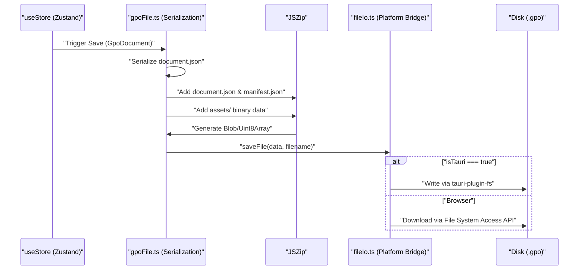

# 1.1 Getting Started & Project Setup

# Getting Started & Project Setup

<details>
<summary>Relevant source files</summary>

The following files were used as context for generating this wiki page:

- [.eslintrc.cjs](.eslintrc.cjs)
- [README.md](README.md)
- [index.html](index.html)
- [package.json](package.json)
- [src-tauri/Cargo.toml](src-tauri/Cargo.toml)
- [src/main.tsx](src/main.tsx)
- [src/vite-env.d.ts](src/vite-env.d.ts)
- [tsconfig.json](tsconfig.json)
- [vite.config.ts](vite.config.ts)

</details>


This page provides a technical overview of the development environment, build processes, and the structural foundation of the OpenPrototype codebase. It covers the transition from source code to executable artifacts (web and desktop) and introduces the `.gpo` file format used for persistence.

## Development Environment & Build Commands

OpenPrototype is built using **React 18**, **TypeScript**, and **Vite** [README.md:24-24](). It utilizes `pnpm` as the primary package manager. The project supports both a browser-based execution environment and a native desktop experience via **Tauri 2** [README.md:24-24]().

### Standard Scripts
The following commands are defined in the `package.json` for standard development tasks:

| Command | Action | File Reference |
| :--- | :--- | :--- |
| `pnpm dev` | Starts the Vite development server at `http://localhost:5173` | [package.json:8-8]() |
| `pnpm build` | Compiles TypeScript and builds the production-ready static site in `dist/` | [package.json:9-9]() |
| `pnpm typecheck` | Runs the TypeScript compiler (`tsc`) in `noEmit` mode to verify types | [package.json:11-11]() |
| `pnpm lint` | Executes ESLint across `.ts` and `.tsx` files | [package.json:12-12]() |
| `pnpm test` | Runs unit tests using Vitest | [package.json:13-13]() |

### Desktop (Tauri) Commands
For desktop development, the project leverages the `@tauri-apps/cli` [package.json:33-33]().

*   **Development**: `pnpm tauri dev` starts the application in a native window with hot-reloading [README.md:40-40]().
*   **Production**: `pnpm tauri build` packages the application into native installers for Windows, macOS, or Linux [README.md:41-41]().

**Sources:** [README.md:24-42](), [package.json:7-15](), [vite.config.ts:1-21]()

---

## Project Directory Structure

The source code is organized by functional domain to separate concerns between data modeling, AI logic, and rendering.

```mermaid
graph TD
    subgraph "Root"
        "src/"["src/"]
        "src-tauri/"["src-tauri/"]
    end

    subgraph "src/ Directory Structure"
        "src/" --> "schema/"["schema/ (.gpo Schema & Serialization)"]
        "src/" --> "store/"["store/ (Zustand State Management)"]
        "src/" --> "ai/"["ai/ (LLM Providers & Heuristics)"]
        "src/" --> "render/"["render/ (Token Parsing & Visuals)"]
        "src/" --> "views/"["views/ (Canvas, Requirements, Preview)"]
        "src/" --> "file/"["file/ (Platform I/O: Tauri vs Browser)"]
    end

    subgraph "Desktop Shell"
        "src-tauri/" --> "Cargo.toml"["Cargo.toml (Rust Dependencies)"]
        "src-tauri/" --> "tauri.conf.json"["tauri.conf.json (App Config)"]
    end
```

### Key Directories
*   `src/schema/`: Defines the `GpoDocument` structure and handles ZIP serialization [README.md:61-61]().
*   `src/store/`: Contains Zustand stores for document state, selection, and UI settings [README.md:62-62]().
*   `src/ai/`: Manages the AI gateway (OpenAI/Anthropic) and local generation logic [README.md:63-63]().
*   `src/views/`: Contains the primary application views: Requirements, Design (Canvas), and Prototype [README.md:68-68]().
*   `src/file/`: Abstracts file system operations, switching between the browser File System Access API and Tauri's native `tauri-plugin-fs` [README.md:67-67]().

**Sources:** [README.md:57-70](), [src-tauri/Cargo.toml:1-20]()

---

## The .gpo File Format

The `.gpo` (Generative Prototype Object) file is the native persistence format for OpenPrototype [README.md:5-5](). It is a **ZIP container** designed for both human readability and interoperability with other design tools [README.md:44-46]().

### Container Structure
A `.gpo` file contains the following internal structure:

| File | Description |
| :--- | :--- |
| `manifest.json` | Metadata including the schema version [README.md:49-49](). |
| `document.json` | The full document tree, including pages, frames, and nodes [README.md:50-50](). |
| `INTEROP.md` | Mapping specifications for fields compatible with Figma/Sketch [README.md:51-51](). |
| `assets/` | Directory containing binary assets like images and embedded fonts [README.md:52-52](). |

### Implementation Flow: Code to Disk
The following diagram illustrates how the system transitions from the in-memory `useStore` to the `.gpo` file on disk.



**Sources:** [README.md:44-55](), [package.json:20-20](), [src/main.tsx:1-10]()

---

## System Initialization & Entry Point

The application initializes through `src/main.tsx`, which mounts the `App` component within a `React.StrictMode` wrapper [src/main.tsx:6-10]().

### Configuration & Environment
*   **Vite Configuration**: Defines the `@` alias for the `src/` directory to simplify imports [vite.config.ts:9-11]().
*   **TypeScript Configuration**: Uses `Bundler` module resolution and targets `ES2020` [tsconfig.json:3-8]().
*   **Environment Variables**: The `VITE_CLOUD_API` variable is used to configure the optional SaaS backend endpoint [src/vite-env.d.ts:3-5]().

**Sources:** [src/main.tsx:1-11](), [vite.config.ts:1-21](), [tsconfig.json:1-25](), [src/vite-env.d.ts:1-10]()

---
