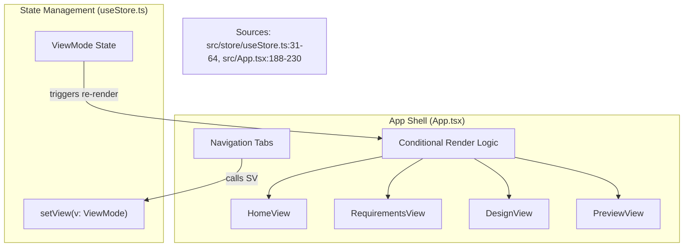
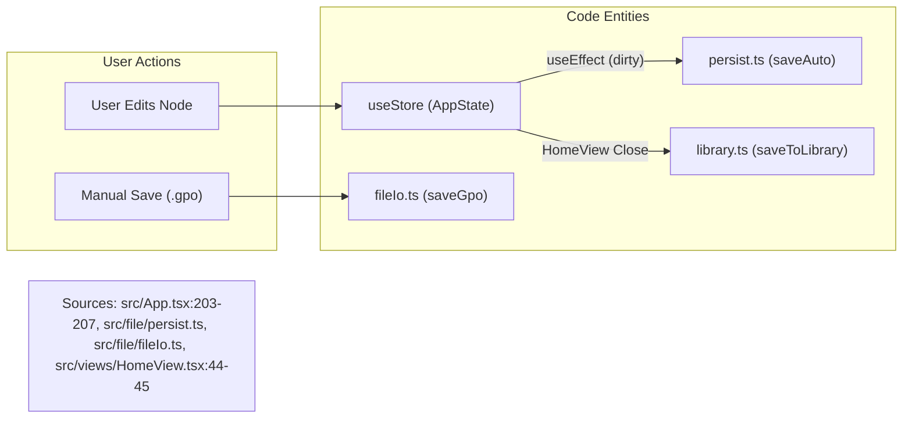

# 1.2 Application Shell & View Routing

# Application Shell & View Routing

Relevant source files

The following files were used as context for generating this wiki page:

- [src/App.tsx](src/App.tsx)
- [src/ai/chat.ts](src/ai/chat.ts)
- [src/ai/settings.ts](src/ai/settings.ts)
- [src/components/AiSettingsModal.tsx](src/components/AiSettingsModal.tsx)
- [src/hooks/useShortcuts.ts](src/hooks/useShortcuts.ts)
- [src/store/useStore.ts](src/store/useStore.ts)
- [src/store/useUi.ts](src/store/useUi.ts)
- [src/views/HomeView.tsx](src/views/HomeView.tsx)

The Application Shell acts as the root orchestrator for OpenPrototype, managing the top-level layout, navigation between distinct product lifecycle views, global event handling, and persistence lifecycles.

## View Orchestration & State Machine

The application's navigation is governed by the `ViewMode` state machine, managed within the `useStore` Zustand store [src/store/useStore.ts:31-38](). The `App.tsx` component serves as the primary router, conditionally rendering views based on the `view` state [src/App.tsx:210-230]().

### View Modes
| Mode | Component | Purpose |
| :--- | :--- | :--- |
| `home` | `HomeView` | File management, templates, and library browsing [src/views/HomeView.tsx:29-169](). |
| `requirements` | `RequirementsView` | Markdown-based PRD editing and AI-assisted drafting. |
| `design` | `DesignView` | Core canvas editor for frames, nodes, and components. |
| `flows` | `FlowsView` | Visual graph of prototype interactions and screen connections. |
| `journey` | `JourneyView` | User journey mapping and emotional curve tracking. |
| `preview` | `PreviewView` | Interactive prototype player for testing flows. |
| `market` | `MarketView` | Component package and plugin installation. |

### Data Flow: View Routing
The following diagram illustrates how the `useStore` state drives the UI composition in `App.tsx`.

**View Routing Architecture**

## Persistence & Auto-Save Lifecycle

OpenPrototype implements a multi-tier persistence strategy to ensure data integrity across sessions.

1.  **Memory Store**: Active document state is held in the `useStore` [src/store/useStore.ts:203]().
2.  **Local Library (IndexedDB/Storage)**: Files are listed and loaded from a local library via `listLibrary` and `loadFromLibrary` [src/views/HomeView.tsx:39-56]().
3.  **Auto-Save**: The `App` component triggers a background save to local storage whenever the document is marked as `dirty` [src/App.tsx:203-207]().
4.  **Manual Export**: Users can export the document as a `.gpo` file (a zipped JSON bundle) using `saveGpo` [src/App.tsx:4-4]().

**Persistence Data Flow**

## Keyboard Shortcuts

Global keyboard interaction is handled by the `useShortcuts` hook [src/hooks/useShortcuts.ts:17-111](). This hook listens for keydown events and dispatches actions to `useStore` or `useUi`.

*   **Standard Modifiers**: `Cmd/Ctrl` is detected via `e.metaKey || e.ctrlKey` [src/hooks/useShortcuts.ts:27]().
*   **Tool Switching**: Keys `v`, `r`, `o`, `l`, `t`, `b`, `i` map to specific canvas tools in `useUi` [src/hooks/useShortcuts.ts:6-14]().
*   **Selection & History**: 
    *   `Cmd+Z` / `Cmd+Shift+Z`: Undo/Redo via `zundo` temporal middleware [src/hooks/useShortcuts.ts:29-34]().
    *   `Cmd+D`: Duplicate selection [src/hooks/useShortcuts.ts:45-49]().
    *   `Cmd+G`: Group/Ungroup selection [src/hooks/useShortcuts.ts:58-63]().
*   **Z-Order**: `Cmd + ]` (forward) and `Cmd + [` (backward) manage node layering [src/hooks/useShortcuts.ts:66-75]().

## Modal & Menu Management

The Application Shell manages several global modals and context-sensitive menus:

### Global Modals
*   **AI Settings**: `AiSettingsModal` allows configuration of LLM providers (OpenAI, Anthropic, DeepSeek, or Local Heuristic) [src/components/AiSettingsModal.tsx:25-74](). Settings are persisted to `localStorage` via `saveAiSettings` [src/ai/settings.ts:50-52]().
*   **Design System**: `DesignSystemModal` for editing global tokens and variables [src/App.tsx:33]().
*   **Cloud Collaboration**: `CloudModal` for remote project management [src/App.tsx:34]().

### Export Menu
The `ExportMenu` in `App.tsx` provides access to various code and asset generators [src/App.tsx:49-144]():
*   **Prototypes**: `downloadHtml` for self-contained interactive prototypes [src/App.tsx:81-84]().
*   **Assets**: `downloadFramePng`, `frameToSvg`, and `downloadFramePdf` [src/App.tsx:85-99]().
*   **Code Components**: Generators for React, Vue, and Tailwind [src/App.tsx:115-129]().

Sources: `src/App.tsx`, `src/store/useStore.ts`, `src/hooks/useShortcuts.ts`, `src/ai/settings.ts`, `src/views/HomeView.tsx`.

---
