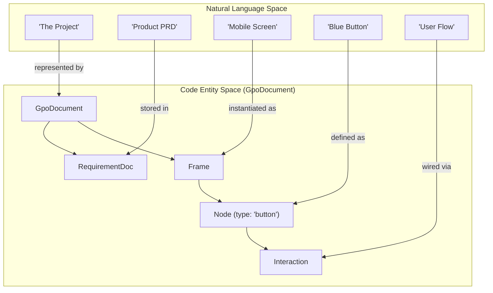
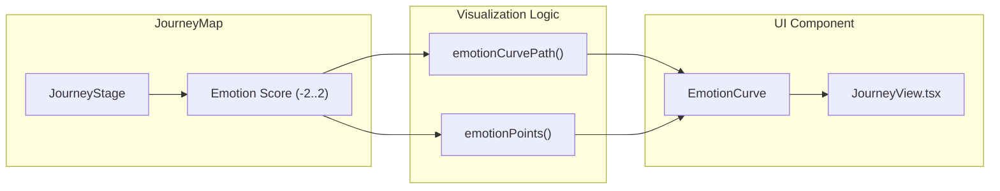

# 2 Core Data Model & Schema

# Core Data Model & Schema

Relevant source files

The following files were used as context for generating this wiki page:

- [src/__tests__/core.test.ts](src/__tests__/core.test.ts)
- [src/interop/importDesign.ts](src/interop/importDesign.ts)
- [src/journey/journey.ts](src/journey/journey.ts)
- [src/schema/layout.ts](src/schema/layout.ts)
- [src/schema/types.ts](src/schema/types.ts)
- [src/views/JourneyView.tsx](src/views/JourneyView.tsx)

The OpenPrototype data model is designed to bridge the gap between structured design data and AI-driven generation. The core philosophy is that every entity—from a high-level product requirement to a low-level vector anchor—is represented in a single, unified TypeScript schema called `GpoDocument`. This structure ensures that AI-generated content remains fully editable on the canvas and can be exported to production-ready code.

## The GpoDocument Hierarchy

The `GpoDocument` is the root container for all project data. It follows a hierarchical tree structure where pages contain frames, and frames contain a recursive tree of nodes.

### Document Composition
- **Metadata**: Tracks app version (`GPO_SCHEMA_VERSION`), project name, and creation timestamps [src/schema/types.ts:11-12]().
- **Requirements**: Markdown-based `RequirementDoc` objects that serve as the source of truth for AI generation [src/schema/types.ts:192-199]().
- **Pages & Frames**: A document contains multiple `Page` objects, each hosting a collection of `Frame` objects (screens/artboards) [src/schema/types.ts:170-189]().
- **Design System**: Centralized `DesignTokens`, `ComponentDef` library, and `DesignRule` sets that govern the look and feel [src/schema/types.ts:202-226]().

### Visual & Logical Entities

The following diagram illustrates how natural language concepts map to specific code entities within the `GpoDocument` schema.

**Diagram: Conceptual Mapping to Code Entities**

Sources: [src/schema/types.ts:1-240]()

## Key Data Structures

### Node & NodeStyle
The `Node` is the fundamental unit of the canvas. It can represent primitive shapes (`rect`, `ellipse`), complex types (`vector`, `text`), or UI components (`button`, `input`) [src/schema/types.ts:69-80](). 
- **Style**: Every node has a `NodeStyle` containing `Fill`, `Stroke`, `Shadow`, and `BlendMode` [src/schema/types.ts:117-127]().
- **Fills**: Fills can be solid colors, gradients, images, or references to design system `token` or `variable` IDs [src/schema/types.ts:19-25]().

### User Journey Mapping
The `JourneyMap` structure captures the user experience over time. It consists of `JourneyStage` objects, each tracking user actions, thoughts, and an emotion score (-2 to 2) [src/journey/journey.ts:5-11](). The `emotionCurvePath` function uses these scores to generate SVG paths for visualization [src/journey/journey.ts:89-111]().

**Diagram: Journey Data Flow**

Sources: [src/journey/journey.ts:1-131](), [src/views/JourneyView.tsx:126-172]()

## Subsystem Overviews

### GpoDocument Schema & Types
The schema defines the strict contract for all data. It includes support for Figma-style constraints (`HConstraint`, `VConstraint`) and advanced properties like `clipContent` for frames.
For details, see [GpoDocument Schema & Types](#2.1).

### Auto Layout & Constraints Engine
The layout engine implements a flexbox-like system. The `applyAutoLayout` function recomputes child positions based on `gap`, `padding`, and `align` settings, supporting both "vertical" and "horizontal" stacks [src/schema/layout.ts:21-86]().
For details, see [Auto Layout & Constraints Engine](#2.2).

### File Persistence & .gpo Format
The `.gpo` file is a ZIP container. It uses `serializeGpo` and `deserializeGpo` to handle the transition between the in-memory `GpoDocument` and the disk format, which includes a `document.json` and an `assets/` folder [src/__tests__/core.test.ts:150-167]().
For details, see [File Persistence & .gpo Format](#2.3).

### Design Interop
The `importDesignJson` and `parseTokens` utilities allow the system to ingest external formats like W3C Design Tokens or Figma REST API exports, mapping them into the native `GpoDocument` structure [src/interop/importDesign.ts:101-191]().
Sources: [src/interop/importDesign.ts:1-191](), [src/__tests__/core.test.ts:180-207]()

---
