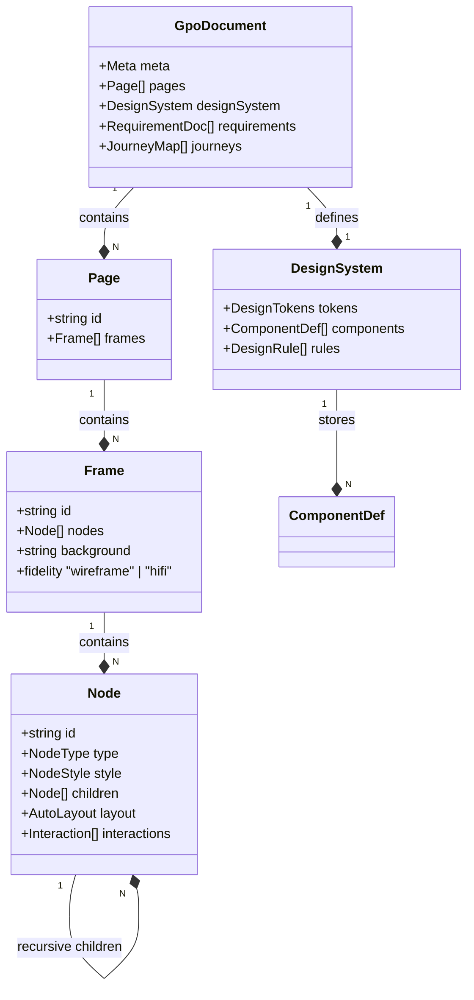
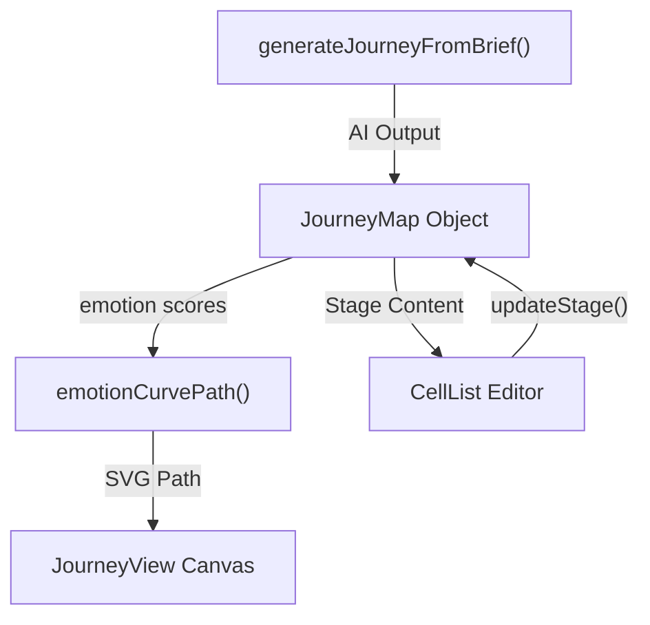

# 2.1 GpoDocument Schema & Types

# GpoDocument Schema & Types

Relevant source files

The following files were used as context for generating this wiki page:

- [src/__tests__/core.test.ts](src/__tests__/core.test.ts)
- [src/interop/importDesign.ts](src/interop/importDesign.ts)
- [src/journey/journey.ts](src/journey/journey.ts)
- [src/schema/layout.ts](src/schema/layout.ts)
- [src/schema/nodeOps.ts](src/schema/nodeOps.ts)
- [src/schema/types.ts](src/schema/types.ts)
- [src/views/JourneyView.tsx](src/views/JourneyView.tsx)

This page provides a detailed technical reference for the **OpenPrototype** data model. The entire application — including the AI generation engine, the canvas renderer, and the persistence layer — operates on a unified, structured tree defined by the `GpoDocument` schema.

## Overview & Versioning

The core schema is designed to be fully editable. Unlike tools that generate static images, OpenPrototype's AI emits structured JSON that maps directly to canvas entities.

*   **Schema Version**: The current contract is defined as `GPO_SCHEMA_VERSION = "1.0.0"` [src/schema/types.ts:11-11]().
*   **Data Flow**: State is managed in a centralized Zustand store. When the document is saved, it is serialized into a `.gpo` zip container containing `document.json` [src/schema/types.ts:8-9]().

### Document Hierarchy
The following diagram illustrates the relationship between the high-level document structure and the code entities defined in `src/schema/types.ts`.

**Entity Relationship Diagram**

Sources: [src/schema/types.ts:140-237](), [src/schema/types.ts:245-255]()

---

## Core Node Schema

The `Node` is the atomic unit of the design canvas. It represents everything from a simple rectangle to a complex AI-generated component instance.

### Node Definition
A `Node` [src/schema/types.ts:140-167]() contains spatial properties (`x`, `y`, `width`, `height`, `rotation`), visual styles, and structural metadata.

| Property | Type | Description |
| :--- | :--- | :--- |
| `type` | `NodeType` | `rect`, `ellipse`, `text`, `button`, `input`, `vector`, etc. [src/schema/types.ts:69-80]() |
| `style` | `NodeStyle` | Fill, stroke, radius, shadow, and blend modes. [src/schema/types.ts:117-127]() |
| `layout` | `AutoLayout` | Flexbox-like positioning for children. [src/schema/types.ts:99-104]() |
| `constraints`| `Constraints`| Resize behavior (e.g., "left-right", "scale"). [src/schema/types.ts:135-138]() |
| `componentRef`| `string` | ID of a `ComponentDef` if this is an instance. [src/schema/types.ts:160-160]() |

### Vector Geometry
For nodes of type `vector`, the `path` property defines complex shapes using a list of `VectorAnchor` points [src/schema/types.ts:83-96](). Each anchor supports Bézier handles (`hIn`, `hOut`) for curved segments.

Sources: [src/schema/types.ts:69-96](), [src/schema/types.ts:140-167]()

---

## Styling & Fills

The `Fill` type supports various modes, enabling the transition from low-fidelity wireframes to high-fidelity designs.

*   **Solid**: Simple hex color [src/schema/types.ts:20-20]().
*   **Gradients**: Linear and radial stops [src/schema/types.ts:21-22]().
*   **Image**: External or embedded asset references [src/schema/types.ts:23-23]().
*   **Token/Variable**: Semantic references to the Design System [src/schema/types.ts:24-25]().

### Visual Compositing
Nodes support `BlendMode` values that map directly to standard Canvas `globalCompositeOperation` types, such as `multiply`, `screen`, and `overlay` [src/schema/types.ts:31-43]().

Sources: [src/schema/types.ts:19-57]()

---

## Design System & Tokens

The `DesignSystem` object [src/schema/types.ts:245-255]() acts as the "source of truth" for the AI and the UI.

### DesignTokens
Tokens define the primitive values used across the document [src/schema/types.ts:202-209]():
*   **Colors**: Named hex strings (e.g., `primary`, `surface`).
*   **Radii & Spacing**: Pixel values for layout consistency.
*   **Typography**: Font families and size scales.

### Design Rules
The `DesignRule` [src/schema/types.ts:220-226]() interface allows the system to enforce constraints on AI output. For example, a `min-tap-target` rule ensures that buttons are at least 40px tall [src/__tests__/core.test.ts:99-99]().

### Variables
`Variable` objects [src/schema/types.ts:233-237]() function similarly to Figma Variables, allowing properties to be bound to named values that can be updated globally.

Sources: [src/schema/types.ts:201-237](), [src/designsystem/rules.ts:1-17]()

---

## Layout & Prototyping

### AutoLayout Engine
The `AutoLayout` system [src/schema/types.ts:99-104]() implements a subset of Flexbox. The function `applyAutoLayout` [src/schema/layout.ts:21-86]() recomputes child positions based on:
1.  **Mode**: `vertical` or `horizontal`.
2.  **Gap**: Space between elements.
3.  **Padding**: Internal offsets.
4.  **Align**: `start`, `center`, `end`, or `stretch`.

### Interactions
The `Interaction` type [src/schema/types.ts:109-115]() defines the prototype's behavior. It links a trigger (`click`, `hover`) to a `targetFrameId`, enabling multi-screen flow navigation.

Sources: [src/schema/layout.ts:21-86](), [src/schema/types.ts:99-115]()

---

## User Journey Schema

OpenPrototype treats User Journeys as first-class data entities rather than just drawings.

### JourneyMap Structure
A `JourneyMap` [src/schema/types.ts:257-265]() consists of a `persona` and a sequence of `JourneyStage` objects. Each stage tracks:
*   **Emotion**: A score from -2 to 2 [src/journey/journey.ts:36-50]().
*   **Lists**: Actions, touchpoints, thoughts, pains, and opportunities [src/journey/journey.ts:14-22]().

### Logic & Visualization
The `emotionCurvePath` function [src/journey/journey.ts:89-111]() calculates a smooth Catmull-Rom spline to render the emotional arc in the `JourneyView` [src/views/JourneyView.tsx:126-172]().

**Journey Data Flow**

Sources: [src/journey/journey.ts:1-111](), [src/views/JourneyView.tsx:126-172]()

---

## Interoperability & Import

The system includes a dedicated interop layer in `src/interop/importDesign.ts` to convert external formats into the `GpoDocument` schema.

*   **Token Parsing**: `parseTokens` [src/interop/importDesign.ts:101-191]() handles W3C Design Tokens (`$value`), Tokens Studio, and Figma Tokens.
*   **Normalization**: It includes utilities like `figmaColorToHex` [src/interop/importDesign.ts:41-48]() and `toPx` [src/interop/importDesign.ts:51-62]() to ensure unit consistency (e.g., converting `rem` to `px`).

Sources: [src/interop/importDesign.ts:1-191]()

---
