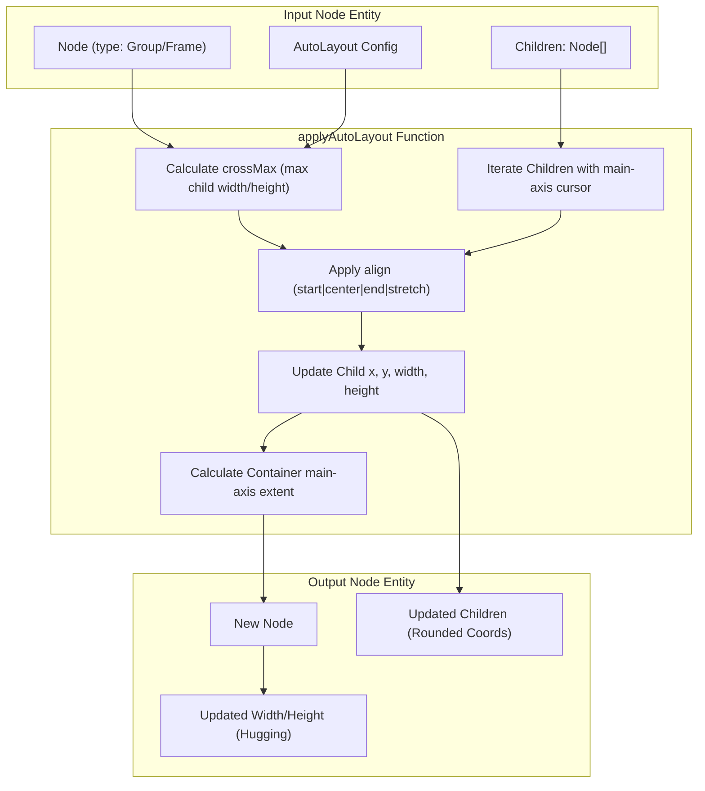
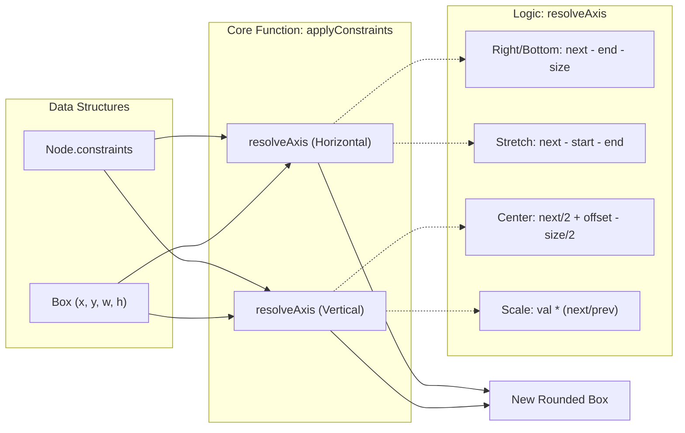

# 2.2 Auto Layout & Constraints Engine

# Auto Layout & Constraints Engine

Relevant source files

The following files were used as context for generating this wiki page:

- [src/__tests__/core.test.ts](src/__tests__/core.test.ts)
- [src/interop/importDesign.ts](src/interop/importDesign.ts)
- [src/schema/constraints.test.ts](src/schema/constraints.test.ts)
- [src/schema/constraints.ts](src/schema/constraints.ts)
- [src/schema/layout.ts](src/schema/layout.ts)

The Auto Layout and Constraints engines are responsible for the spatial orchestration of nodes within the OpenPrototype canvas. They implement a Figma-like layout model that allows for both content-driven stacking (Auto Layout) and container-driven responsive resizing (Constraints).

## Auto Layout Engine

The Auto Layout engine, implemented in `applyAutoLayout`, provides a flexbox-like system for arranging child nodes within a container. It supports vertical and horizontal stacking, configurable gaps, internal padding, and alignment strategies (including "stretch").

### Core Implementation
The engine operates as a pure function that takes a `Node` and returns a new `Node` with recalculated child positions and container dimensions [src/schema/layout.ts:21-25]().

1.  **Axis Determination**: The engine identifies the primary axis (main-axis) and cross-axis based on the `layout.mode` ("vertical" or "horizontal") [src/schema/layout.ts:26-28]().
2.  **Cross-Axis Extent**: It calculates the maximum dimension of children on the cross-axis to determine the container's cross-size or to align children [src/schema/layout.ts:31-34]().
3.  **Cursor-Based Positioning**: A `cursor` tracks the current position along the main-axis, starting from the padding (top for vertical, left for horizontal) [src/schema/layout.ts:36-36]().
4.  **Alignment & Stretching**:
    *   **Start/Center/End**: Positions children relative to the padding and available cross-axis space [src/schema/layout.ts:44-46]().
    *   **Stretch**: If alignment is not start/center/end, the child is forced to match the `crossMax` dimension [src/schema/layout.ts:49-49]().
5.  **Hugging (Sizing)**: The container's width and height are recalculated to "hug" the content main-axis (total children size + gaps) and cross-axis (max child size + padding) [src/schema/layout.ts:72-78]().

### Auto Layout Data Flow
The following diagram illustrates how the `applyAutoLayout` function transforms node properties.

**Auto Layout Transformation Logic**

Sources: [src/schema/layout.ts:21-86](), [src/schema/types.ts:1-10]()

### Configuration Defaults
When a container is first enabled for auto-layout, it uses `DEFAULT_AUTOLAYOUT`:
*   **Mode**: `vertical`
*   **Gap**: `12px`
*   **Padding**: `16px` (all sides)
*   **Align**: `start`
Sources: [src/schema/layout.ts:4-9]()

---

## Constraints Engine

The Constraints engine handles how nodes behave when their parent frame is manually resized. This allows for responsive behaviors like pinning elements to corners, centering them, or scaling them proportionally.

### Constraint Modes
The engine supports horizontal (`HConstraint`) and vertical (`VConstraint`) settings [src/schema/types.ts:1-10]().

| Mode | Behavior | Implementation Logic |
| :--- | :--- | :--- |
| `left` / `top` | Pin to near edge | Maintains original `x` or `y` [src/schema/constraints.ts:37-39]() |
| `right` / `bottom` | Pin to far edge | Maintains constant distance from parent's `prev` edge [src/schema/constraints.ts:22-24]() |
| `left-right` / `top-bottom` | Stretch | Maintains distance from both edges, changing `size` [src/schema/constraints.ts:25-27]() |
| `center` | Maintain relative center | Offsets the node center based on the parent's center change [src/schema/constraints.ts:28-31]() |
| `scale` | Proportional resize | Multiplies `start` and `size` by the parent's growth ratio [src/schema/constraints.ts:32-35]() |

### Implementation: applyConstraints
The function `applyConstraints` is called when a parent's dimensions change from `prev` to `next` [src/schema/constraints.ts:47-51](). It delegates the calculation to `resolveAxis`, which computes the new `start` (coordinate) and `size` (dimension) for a single axis [src/schema/constraints.ts:13-19]().

### Constraints Logic Mapping
This diagram maps the logical constraints to the code entities that execute the resizing.

**Constraint Execution Pipeline**

Sources: [src/schema/constraints.ts:13-61](), [src/schema/constraints.test.ts:7-49]()

### Pure Function Characteristics
*   **Rounding**: Both engines use `Math.round` on all final coordinates and dimensions to ensure nodes stay on the pixel grid [src/schema/layout.ts:65-84](), [src/schema/constraints.ts:56-59]().
*   **Immutability**: Neither engine mutates the original node; they return new objects with updated properties [src/schema/layout.ts:13-14](), [src/schema/constraints.ts:44-46]().
*   **Default Behavior**: If no constraints are provided, the system defaults to `left/top` pinning, which matches industry standards like Figma [src/schema/constraints.ts:10-10](), [src/schema/constraints.ts:52-52]().

---
