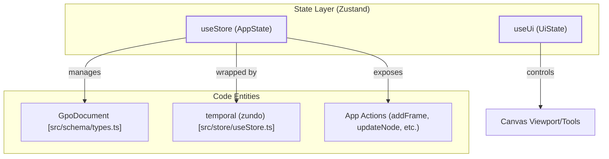
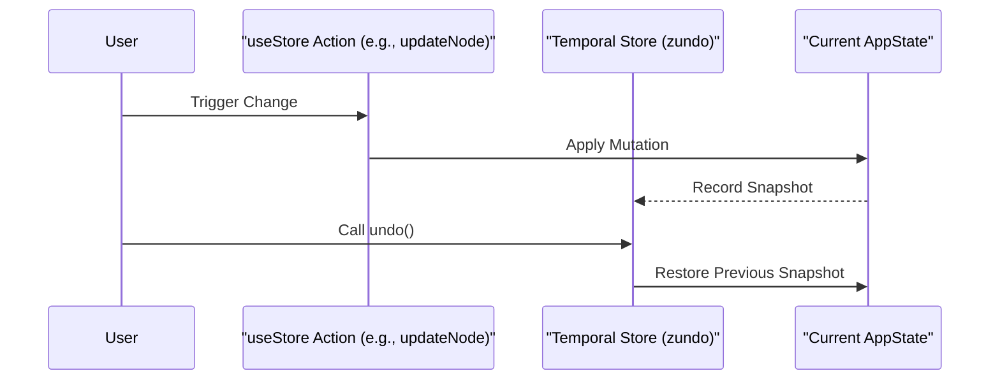

# 3 State Management

# State Management

Relevant source files

The following files were used as context for generating this wiki page:

- [src/store/history.ts](src/store/history.ts)
- [src/store/useStore.ts](src/store/useStore.ts)

OpenPrototype utilizes a centralized state management architecture based on **Zustand**. The system maintains a strict separation between the persistent document data (the project being edited) and transient UI state (editor settings, active tools, and ephemeral interface flags). 

The primary state container, `useStore`, is wrapped with the `zundo` middleware to provide a robust undo/redo history system for all document-level modifications.

## Store Architecture

The application state is split into two primary stores to optimize for performance and persistence logic. 

| Store | Purpose | Persistence | History (Undo/Redo) |
| :--- | :--- | :--- | :--- |
| `useStore` | Holds the `GpoDocument`, selection state, and active navigation IDs. | Saved to `.gpo` files. | Enabled via `temporal` middleware. |
| `useUi` | Holds ephemeral state like `activeTool`, `zoom`, `showGrid`, and `devMode`. | Partially synced to `localStorage`. | Disabled. |

### System Mapping: Store to Entity

The following diagram illustrates how the Zustand stores interact with the core application logic and the document schema.

**Sources:** [src/store/useStore.ts:49-153](), [src/store/useStore.ts:203-206]()

---

## Document & Selection State (useStore)

`useStore` is the "Source of Truth" for the design project. It manages the `GpoDocument` object [src/store/useStore.ts:50](), which contains all pages, frames, nodes, and design system tokens. 

Key responsibilities include:
*   **Document CRUD:** Actions for manipulating the node tree, such as `addFrame` [src/store/useStore.ts:78](), `updateNode` [src/store/useStore.ts:85](), and `deleteSelection` [src/store/useStore.ts:89]().
*   **Selection Management:** Tracking which nodes are currently active via `selectedNodeIds` [src/store/useStore.ts:54]().
*   **Complex Operations:** High-level design logic including `groupSelection` [src/store/useStore.ts:98](), `booleanSelection` [src/store/useStore.ts:109](), and component instantiation [src/store/useStore.ts:116]().

For a deep dive into document actions and the component system, see **[useStore: Document & Selection State](#3.1)**.

**Sources:** [src/store/useStore.ts:49-153]()

---

## Transient UI State (useUi)

The `useUi` store handles state that does not belong in the saved project file. This includes the state of the editor interface itself, such as:
*   **Editor Configuration:** `showGrid`, `snapEnabled`, and `devMode`.
*   **Active Interaction:** The currently selected drawing tool (e.g., rect, ellipse, pen).
*   **Notifications:** Managing the toast notification queue.
*   **AI Settings:** API keys and provider configurations (persisted to `localStorage`).

For details on ephemeral interface state, see **[useUi: Transient UI State](#3.2)**.

---

## Undo/Redo History System

OpenPrototype implements a temporal state history using the `zundo` middleware for `useStore`. This tracks changes to the `doc` and other design-related fields, allowing users to revert mistakes.

The history system is exposed via a simplified API in `src/store/history.ts`:
*   `undo()`: Reverts the store to the previous state [src/store/history.ts:3]().
*   `redo()`: Advances the store to the next state in the history stack [src/store/history.ts:4]().
*   `clearHistory()`: Wipes the temporal stack, typically called when loading a new document [src/store/history.ts:5]().

### History Flow

**Sources:** [src/store/useStore.ts:204](), [src/store/history.ts:1-6]()

---
