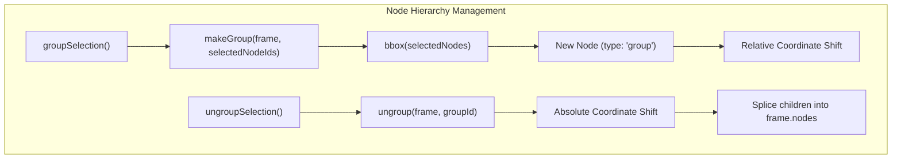
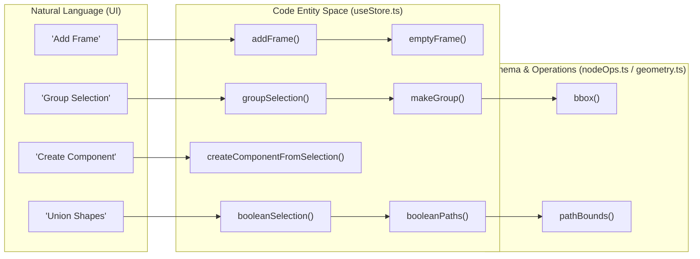

# 3.1 useStore: Document & Selection State

# useStore: Document & Selection State

Relevant source files

The following files were used as context for generating this wiki page:

- [src/schema/nodeOps.ts](src/schema/nodeOps.ts)
- [src/store/useStore.ts](src/store/useStore.ts)

The `useStore` hook is the central state management hub for OpenPrototype, built using **Zustand** and augmented with the **zundo** temporal middleware for undo/redo history [src/store/useStore.ts:1-203](). It manages the `GpoDocument` schema, selection state, viewport navigation, and complex design operations like component instantiation and vector path manipulation.

## Store Architecture & Middleware

The store is defined as an `AppState` interface [src/store/useStore.ts:49-153](). It separates persistent document data (`doc`) from transient session state such as `selectedNodeIds`, `view` mode, and `clipboard` [src/store/useStore.ts:50-59]().

### Temporal State (Undo/Redo)
By wrapping the store in `temporal()`, the system automatically tracks changes to the document. This allows for standard design tool shortcuts (Cmd+Z / Cmd+Shift+Z) to traverse the history of `GpoDocument` mutations.

### Document Mutation Pattern
The store utilizes helper functions like `touch` to update the `meta.updatedAt` timestamp on every change [src/store/useStore.ts:159-161]() and `mapPages` to immutably update nested page structures [src/store/useStore.ts:163-168]().

| State Key | Type | Description |
| :--- | :--- | :--- |
| `doc` | `GpoDocument` | The full serializable document tree. |
| `view` | `ViewMode` | The current application view (design, requirements, journey, etc.). |
| `selectedNodeIds`| `string[]` | IDs of nodes currently selected on the canvas. |
| `activeFrameId` | `string \| null` | The frame currently being edited. |
| `commentMode` | `boolean` | When true, canvas interactions drop `FrameComment` objects. |

**Sources:** [src/store/useStore.ts:49-62](), [src/store/useStore.ts:159-168](), [src/store/useStore.ts:203-206]()

---

## Document & Node CRUD

CRUD operations are performed via actions that modify the `doc` object. Many of these actions delegate logic to `src/schema/nodeOps.ts` for structural changes.

### Frame and Node Lifecycle
- **`addFrame`**: Creates a new `Frame` using `emptyFrame()` and appends it to the active page [src/store/useStore.ts:78]().
- **`updateNode`**: Applies a partial patch to a specific node within a frame. If the node has constraints, `applyConstraints` is triggered [src/store/useStore.ts:85]().
- **`deleteSelection`**: Filters the `nodes` array of the active frame to remove all IDs present in `selectedNodeIds` [src/store/useStore.ts:89]().

### Grouping and Z-Index
Grouping is handled by `makeGroup`, which calculates a bounding box (`bbox`) for selected nodes, creates a new `group` type node, and transforms child coordinates to be relative to the group's top-left [src/schema/nodeOps.ts:25-42]().

**Sources:** [src/store/useStore.ts:78-100](), [src/schema/nodeOps.ts:5-42](), [src/schema/nodeOps.ts:89-100]()

---

## Component System

The component system allows users to create reusable `ComponentDef` templates and instantiate them across the document.

### Creation and Instantiation
- **`createComponentFromSelection`**: Takes selected nodes, clones them into a `ComponentDef`, and adds it to `doc.designSystem.components` [src/store/useStore.ts:115]().
- **`instantiateComponent`**: Creates a `Node` where `componentRef` points to the `ComponentDef.id`. It clones the master template's children into the instance [src/store/useStore.ts:116]().

### Overrides and Syncing
- **`pushInstanceToComponent`**: Takes the current state of an instance (including overrides) and updates the master `ComponentDef`. It then iterates through all other instances in the document to sync their structures while preserving their unique IDs and positions [src/store/useStore.ts:121]().
- **`resetInstance`**: Reverts an instance to the master template by re-cloning the `ComponentDef` children [src/store/useStore.ts:119]().
- **`isInstanceModified`**: A utility that compares a normalized version of an instance (stripping IDs/positions) against the template to detect local overrides [src/schema/nodeOps.ts:82-87]().

**Sources:** [src/store/useStore.ts:113-124](), [src/schema/nodeOps.ts:65-87]()

---

## Vector Operations & Geometry

The store manages complex vector paths and boolean operations using utility functions from `src/vector/geometry.ts`.

### Boolean Operations
The `booleanSelection` action combines multiple nodes into a single vector node using operations like `union`, `subtract`, `intersect`, or `exclude` [src/store/useStore.ts:108-109]().
1. Nodes are converted to `VectorPath` objects in frame coordinates via `nodeToFramePath` [src/store/useStore.ts:181-191]().
2. The `booleanPaths` utility processes the paths [src/vector/geometry.ts:24]().
3. A new `vector` node is created, and its bounds are normalized using `pathBounds` [src/vector/geometry.ts:26]().

### Outline Stroke
`outlineStroke` converts a node's stroke property into a filled vector shape [src/store/useStore.ts:111](). This is essential for creating complex icons or preparing shapes for boolean operations.

**Sources:** [src/store/useStore.ts:106-111](), [src/store/useStore.ts:171-191](), [src/vector/geometry.ts:22-29]()

---

## Journey & Requirement Management

Beyond canvas nodes, `useStore` manages high-level product artifacts.

### Requirements CRUD
The store manages a collection of `RequirementDoc` objects [src/store/useStore.ts:130-132](). These documents drive the AI generation engine.
- `addRequirement`: Initializes a new doc with a default template [src/store/useStore.ts:130]().
- `updateRequirement`: Patches the markdown content or metadata [src/store/useStore.ts:131]().

### Journey Mapping
The Journey Map is a matrix of `JourneyStage` objects [src/store/useStore.ts:145-152]().
- **`addStage`**: Inserts a new stage (column) into the journey map [src/store/useStore.ts:149]().
- **`updateStage`**: Modifies stage properties like `emotion` (-2 to 2 scale) or `description` [src/store/useStore.ts:150]().
- **`moveStage`**: Changes the order of stages within the `JourneyMap` array [src/store/useStore.ts:152]().

**Sources:** [src/store/useStore.ts:130-132](), [src/store/useStore.ts:145-152](), [src/schema/types.ts:9-13]()

---

## System Integration Diagram

This diagram maps the natural language actions used in the UI to the underlying code entities in the `useStore` and `nodeOps` systems.

**Sources:** [src/store/useStore.ts:78](), [src/store/useStore.ts:98](), [src/store/useStore.ts:109](), [src/store/useStore.ts:115](), [src/schema/nodeOps.ts:5-42](), [src/vector/geometry.ts:24-26]()

---
