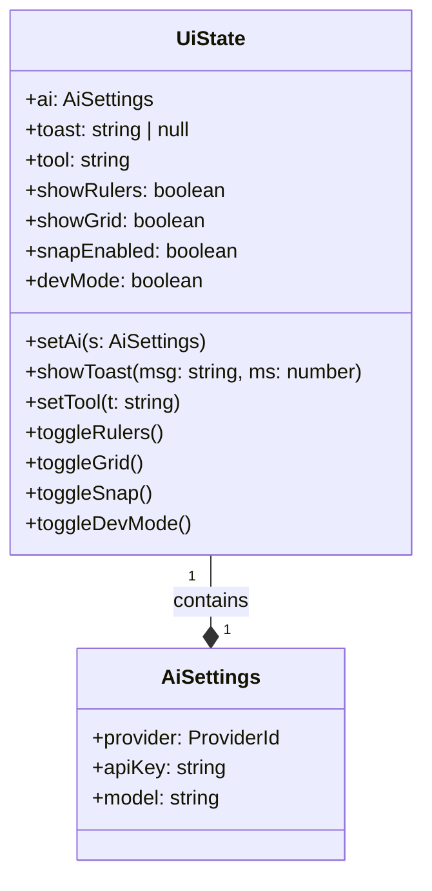

# 3.2 useUi: Transient UI State

# useUi: Transient UI State

<details>
<summary>Relevant source files</summary>

The following files were used as context for generating this wiki page:

- [src/ai/chat.ts](src/ai/chat.ts)
- [src/ai/settings.ts](src/ai/settings.ts)
- [src/components/AiSettingsModal.tsx](src/components/AiSettingsModal.tsx)
- [src/store/history.ts](src/store/history.ts)
- [src/store/useUi.ts](src/store/useUi.ts)

</details>


The `useUi` store manages ephemeral interface state that does not persist within the `.gpo` document file. This includes active editor tools, canvas visibility toggles (grids, rulers), developer inspection modes, and global notification (toast) states. Additionally, it serves as the bridge for persisting AI configuration to the browser's `localStorage`.

### Store Definition and Purpose

Unlike `useStore`, which handles the document's structural data and selection state, `useUi` is built using a standard Zustand `create` call without temporal (undo/redo) middleware [src/store/useUi.ts:26-48](). This ensures that UI actions—like toggling the grid or showing a notification—do not clutter the document's history stack [src/store/history.ts:1-6]().

**Transient State Flow**

The following diagram illustrates how the `useUi` store interacts with UI components and external storage.

Title: useUi State Interaction Diagram
```mermaid
graph TD
    subgraph "Local Storage Space"
        ["gpo.ai.settings"]
    end

    subgraph "useUi Zustand Store"
        ["UiState"]
        ["setAi()"]
        ["showToast()"]
        ["setTool()"]
    end

    subgraph "UI Components"
        ["AiSettingsModal"]
        ["CanvasStage"]
        ["AppShell"]
    end

    ["AiSettingsModal"] -- "Calls setAi()" --> ["setAi()"]
    ["setAi()"] -- "Saves to" --> ["gpo.ai.settings"]
    ["gpo.ai.settings"] -- "loadAiSettings()" --> ["UiState"]
    
    ["CanvasStage"] -- "Reads tool/showGrid" --> ["UiState"]
    ["AppShell"] -- "Subscribes to toast" --> ["UiState"]
```

**Sources:** [src/store/useUi.ts:26-48](), [src/ai/settings.ts:38-52]().

---

### AI Settings Persistence

The `ai` state within `useUi` stores the current LLM provider, API keys, and model selections [src/store/useUi.ts:5-6](). Because these settings are user-specific and sensitive, they are persisted via `localStorage` rather than the document JSON [src/ai/settings.ts:38-52]().

#### Data Structures

The `AiSettings` interface and `PROVIDERS` registry define the available generation engines:

| Provider ID | Label | Default Model | Needs Key |
| :--- | :--- | :--- | :--- |
| `local` | 本地启发式生成器 | `heuristic-v1` | No |
| `openai` | OpenAI | `gpt-4o-mini` | Yes |
| `anthropic` | Anthropic (Claude) | `claude-3-5-sonnet-latest` | Yes |
| `deepseek` | DeepSeek | `deepseek-chat` | Yes |

**Sources:** [src/ai/settings.ts:1-36]().

#### Implementation Details

1.  **Initialization**: Upon store creation, `useUi` calls `loadAiSettings()`, which attempts to parse the `gpo.ai.settings` key from `localStorage`. If missing, it defaults to the `local` heuristic provider [src/ai/settings.ts:40-48]().
2.  **Updating**: The `setAi` action in `useUi` performs a dual-write: it updates the in-memory Zustand state and triggers `saveAiSettings()` to sync with `localStorage` [src/store/useUi.ts:28-31]().
3.  **Consumption**: The `chatComplete` utility reads these settings to determine the correct API endpoint and authorization headers (e.g., `x-api-key` for Anthropic or `Authorization: Bearer` for OpenAI) [src/ai/chat.ts:14-54]().

**Sources:** [src/store/useUi.ts:26-31](), [src/ai/settings.ts:40-52](), [src/ai/chat.ts:9-54]().

---

### Canvas and Tool Management

The store manages the active interaction mode and canvas visibility helpers.

*   **Active Tool**: Managed via `tool` (string). Common values include `select`, `rect`, `text`, `frame`, and `flow` [src/store/useUi.ts:9-11]().
*   **Visibility Toggles**: Boolean flags for `showRulers`, `showGrid`, and `snapEnabled`. These are toggled via dedicated functions that flip the current boolean state [src/store/useUi.ts:13-18]().
*   **Dev Mode**: The `devMode` flag toggles a read-only inspector mode used for developer handoff, measurements, and code generation [src/store/useUi.ts:20-21]().

Title: UI State Logic Mapping


**Sources:** [src/store/useUi.ts:4-22]().

---

### Toast Notification System

The `showToast` function provides a global mechanism for non-blocking user feedback.

1.  **Trigger**: When `showToast(msg, ms)` is called, it sets the `toast` string [src/store/useUi.ts:33-34]().
2.  **Auto-Dismiss**: It utilizes a module-level variable `toastTimer` to manage the lifecycle of the notification. If a new toast is triggered before the previous one expires, the existing timer is cleared (`clearTimeout`) to prevent premature dismissal [src/store/useUi.ts:24-37]().
3.  **Cleanup**: After the specified duration (defaulting to 3200ms), the `toast` state is set back to `null` [src/store/useUi.ts:36]().

**Sources:** [src/store/useUi.ts:24-37]().

---

### UI Integration: AiSettingsModal

The `AiSettingsModal` component provides the interface for modifying the `ai` state. It uses local React state to track changes before they are committed to the `useUi` store.

*   **Provider Change**: When a user selects a different provider, the `onProviderChange` handler automatically updates the `model` field to the provider's `defaultModel` [src/components/AiSettingsModal.tsx:14-17]().
*   **Commitment**: Clicking "Save" triggers `setAi`, which updates both the store and `localStorage`, followed by a success toast [src/components/AiSettingsModal.tsx:19-23]().
*   **Security**: API keys are rendered using `type="password"` and are explicitly documented as being stored only in the local browser [src/components/AiSettingsModal.tsx:48-55]().

**Sources:** [src/components/AiSettingsModal.tsx:5-74]().

---
