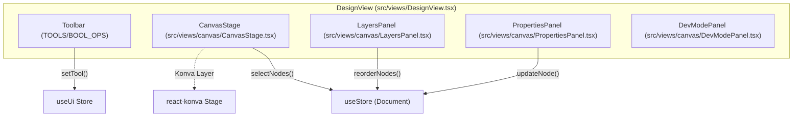
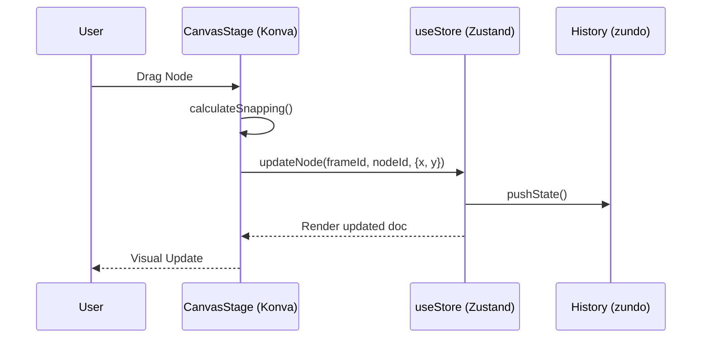

# 4 Canvas & Design Editor

# Canvas & Design Editor

Relevant source files

The following files were used as context for generating this wiki page:

- [src/views/DesignView.tsx](src/views/DesignView.tsx)
- [src/views/canvas/CanvasStage.tsx](src/views/canvas/CanvasStage.tsx)

The **Canvas & Design Editor** is the central visual workspace of OpenPrototype. It provides a multi-panel environment for layout, vector editing, and component management, powered by a high-performance 2D rendering engine.

## Overview

The design editor is orchestrated by the `DesignView` component [src/views/DesignView.tsx:35-95](), which manages the layout of the toolbars and sidebars. The workspace is divided into several specialized regions that interact via the centralized `useStore` and `useUi` Zustand stores.

### Editor Layout & Panel Orchestration

The editor uses a classic three-column layout:
*   **Left Sidebar**: Contains the `LayersPanel` for hierarchy navigation and the `AssetsPanel` for component library access [src/views/DesignView.tsx:97-175]().
*   **Center Workspace**: The `CanvasStage` acts as the primary viewport for direct manipulation [src/views/DesignView.tsx:185-187]().
*   **Right Sidebar**: Switches between the `PropertiesPanel` for visual styling and the `DevModePanel` for inspection and code export [src/views/DesignView.tsx:189-191]().

### System Architecture: Code to UI Mapping

The following diagram shows how UI components in the Design View map to their respective logic in the codebase.

**Design View Component Map**

Sources: [src/views/DesignView.tsx:8-14](), [src/views/DesignView.tsx:97-192]()

---

## Core Subsystems

### [CanvasStage: Konva Rendering Engine](#4.1)
The `CanvasStage` component [src/views/canvas/CanvasStage.tsx:90]() utilizes `react-konva` to render the `GpoDocument` schema. It handles the complex math of viewport management (zoom/pan), coordinate transforms between screen and world space, and provides the visual feedback for snapping and distance guides [src/views/canvas/CanvasStage.tsx:15-26]().

*   **Key Function**: `strokeRectGeometry` [src/views/canvas/CanvasStage.tsx:36-55]() handles Figma-style inside/outside stroke alignment.
*   **Interaction**: Manages the `Transformer` for resizing and the marquee selection logic [src/views/canvas/CanvasStage.tsx:159-162]().

For details, see [CanvasStage: Konva Rendering Engine](#4.1).

### [Vector Editing & Boolean Operations](#4.2)
OpenPrototype supports advanced vector workflows including a Pen tool for Bézier path creation and boolean operations (Union, Subtract, Intersect, Exclude) [src/views/DesignView.tsx:28-33](). 

*   **Logic**: Vector math is handled in `@/vector/geometry`, while `setNodePath` and `booleanSelection` actions in `useStore` persist the changes [src/views/DesignView.tsx:59-60]().
*   **Modes**: The editor supports a dedicated `vecEdit` mode for anchor manipulation [src/views/canvas/CanvasStage.tsx:110]().

For details, see [Vector Editing & Boolean Operations](#4.2).

### [Properties Panel & Node Inspection](#4.3)
The `PropertiesPanel` [src/views/canvas/PropertiesPanel.tsx]() allows users to modify the `Node` schema directly. This includes styling (fills, strokes, shadows), Auto Layout settings, and Interaction wiring. When `devMode` is toggled [src/views/DesignView.tsx:40-41](), the panel switches to `DevModePanel`, providing CSS/React code snippets and precise measurement tools for developers.

For details, see [Properties Panel & Node Inspection](#4.3).

### [Canvas Panels: Layers, Assets, Comments & Context Menu](#4.4)
The workspace includes several auxiliary panels to manage document complexity:
*   **LayersPanel**: A tree view of the `Page` and `Frame` hierarchy [src/views/canvas/LayersPanel.tsx]().
*   **AssetsPanel**: Browsing and dragging components from the `DesignSystem` [src/views/canvas/AssetsPanel.tsx]().
*   **CommentsPanel**: Managing feedback threads via `commentMode` [src/views/DesignView.tsx:159-168]().
*   **ContextMenu**: Right-click actions like Group (Ctrl+G), Ungroup, and Reordering [src/views/canvas/ContextMenu.tsx]().

For details, see [Canvas Panels: Layers, Assets, Comments & Context Menu](#4.4).

---

## Editor State Flow

The Design Editor bridges user input on the Canvas with the underlying `GpoDocument` data structure.

**Input Handling Flow**

Sources: [src/views/canvas/CanvasStage.tsx:121-122](), [src/views/DesignView.tsx:5-6]()

### Summary Table: Tools & Actions

| Category | Tools / Actions | File Reference |
| :--- | :--- | :--- |
| **Creation** | Rect, Ellipse, Line, Text, Pen | [src/views/DesignView.tsx:17-26]() |
| **Arrangement** | Group, Ungroup, Reorder | [src/views/DesignView.tsx:117-118]() |
| **Boolean** | Union, Subtract, Intersect, Exclude | [src/views/DesignView.tsx:28-33]() |
| **Components** | Create Component, Instantiate | [src/views/DesignView.tsx:58-155]() |
| **Collaboration** | Comment Mode, Resolve Threads | [src/views/DesignView.tsx:159-168]() |

Sources: [src/views/DesignView.tsx:17-168](), [src/views/canvas/CanvasStage.tsx:102-135]()

---
