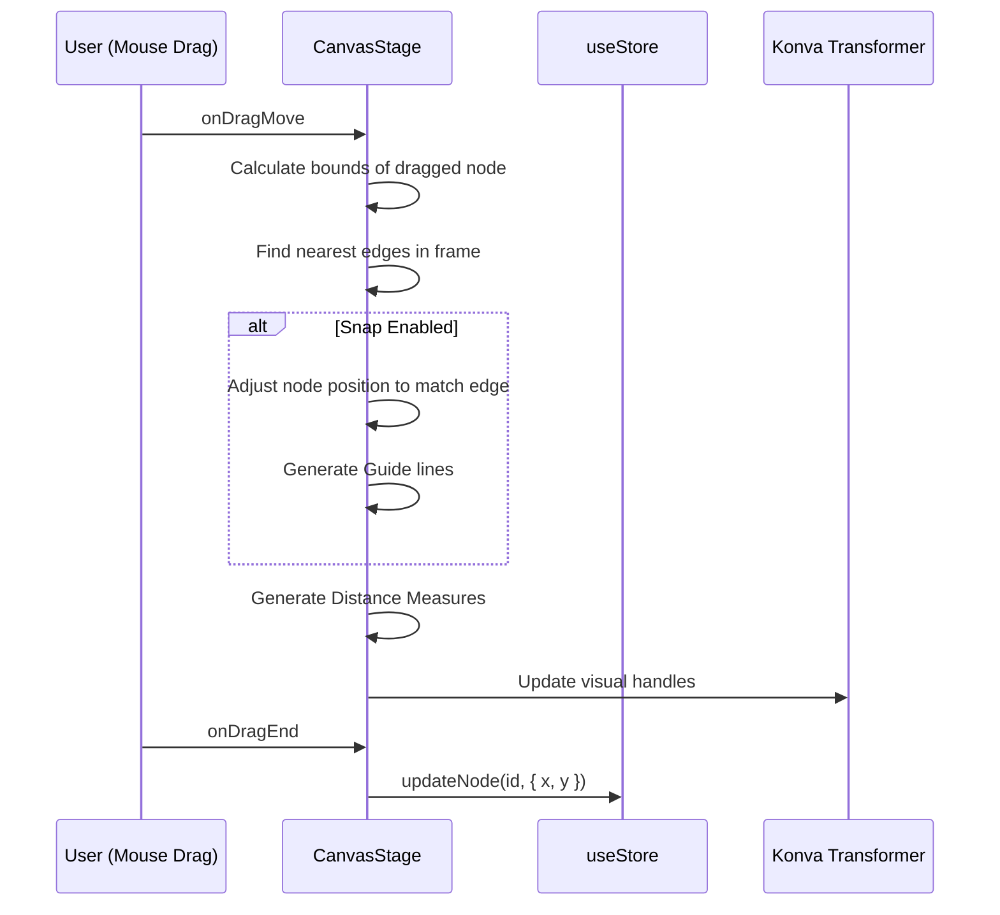

# 4.1 CanvasStage: Konva Rendering Engine

# CanvasStage: Konva Rendering Engine

<details>
<summary>Relevant source files</summary>

The following files were used as context for generating this wiki page:

- [src/render/resolve.ts](src/render/resolve.ts)
- [src/styles.css](src/styles.css)
- [src/views/canvas/CanvasStage.tsx](src/views/canvas/CanvasStage.tsx)

</details>


The `CanvasStage` component is the primary 2D rendering engine of OpenPrototype. It leverages `react-konva` (a React wrapper for the Konva.js HTML5 Canvas library) to provide a high-performance, interactive design environment. It handles complex operations such as viewport manipulation, coordinate transformations between screen and world space, snapping logic, and specialized node rendering for various design primitives.

## Viewport & Coordinate Management

`CanvasStage` maintains its own viewport state, including `scale` (zoom level) and `pos` (panning offset) [src/views/canvas/CanvasStage.tsx:93-94]().

### Coordinate Systems
The engine manages two primary coordinate systems:
1.  **Screen Space**: The raw pixel coordinates relative to the browser window or the stage container.
2.  **World Space**: The document coordinates where frames and nodes are positioned.

To convert between these, `CanvasStage` uses the stage's transform matrix. For example, finding the world-space coordinate of the mouse cursor is achieved by applying the inverse of the stage's transformation to the pointer position [src/views/canvas/CanvasStage.tsx:327-331]().

### Viewport Operations
*   **Panning**: Handled via the middle mouse button or the Spacebar + Left Click drag [src/views/canvas/CanvasStage.tsx:342-351]().
*   **Zooming**: Implemented via the mouse wheel (with `Ctrl` modifier) or trackpad pinch gestures [src/views/canvas/CanvasStage.tsx:300-324]().
*   **Fit to Screen**: Calculated by comparing the bounding box of all frames against the current stage dimensions [src/views/canvas/CanvasStage.tsx:184-206]().

### Viewport State Flow
The following diagram illustrates how user interactions are transformed into viewport updates.

**Viewport Transformation Pipeline**
```mermaid
graph TD
    subgraph "User_Input"
        "Wheel_Event"["Wheel Event"]
        "Drag_Event"["Drag Event"]
    end

    subgraph "CanvasStage_Logic"
        "onWheel"["onWheel handler [300]"]
        "onMouseMove"["onMouseMove handler [339]"]
        "setPos"["setPos (State Update)"]
        "setScale"["setScale (State Update)"]
    end

    subgraph "Konva_Stage"
        "Stage_Node"["Stage Node"]
        "Layer_Node"["Layer Node"]
    end

    "Wheel_Event" --> "onWheel"
    "Drag_Event" --> "onMouseMove"
    "onWheel" --> "setScale"
    "onWheel" --> "setPos"
    "onMouseMove" --> "setPos"
    "setScale" --> "Stage_Node"
    "setPos" --> "Stage_Node"
    "Stage_Node" --> "Layer_Node"
```
Sources: [src/views/canvas/CanvasStage.tsx:90-351]()

## Rendering Pipeline

The rendering process is a recursive dispatch starting from the `Page` down to individual `Node` objects.

### renderFrame
The stage iterates through the frames of the active page. Each frame is rendered as a `Group` containing a background `Rect` and its child nodes [src/views/canvas/CanvasStage.tsx:550-578]().

### renderNode Dispatch
A dispatcher function maps the abstract `Node` schema to specific Konva components based on `node.type` [src/views/canvas/CanvasStage.tsx:430-538]().

| Node Type | Konva Implementation | Key Logic / Helper |
| :--- | :--- | :--- |
| `rect` | `Rect` | `strokeRectGeometry` for inside/outside stroke [src/views/canvas/CanvasStage.tsx:36-55]() |
| `ellipse` | `Ellipse` | Centered on width/height [src/views/canvas/CanvasStage.tsx:484-493]() |
| `text` | `Text` | Font resolution and vertical alignment [src/views/canvas/CanvasStage.tsx:455-475]() |
| `vector` | `Path` | Uses `pathToSvgData` for Bezier path strings [src/views/canvas/CanvasStage.tsx:501-512]() |
| `image` | `NodeImage` | Asynchronous `HTMLImageElement` loading and `fillPattern` scaling [src/views/canvas/CanvasStage.tsx:59-88]() |
| `group` | `Group` | Recursive call to `renderNode` for children [src/views/canvas/CanvasStage.tsx:527-537]() |

### Fill & Stroke Resolution
Fills are resolved via `nodeFill` and `resolveFill`, which check for solid colors, design system tokens, or variables [src/render/resolve.ts:3-35](). Stroke alignment (inside vs. outside) is simulated by adjusting the geometry because Konva only supports centered strokes natively [src/views/canvas/CanvasStage.tsx:36-55]().

**Node Rendering Architecture**
```mermaid
graph TD
    "Page_State"["Page State (useStore)"] --> "Frame_Map"["frames.map()"]
    "Frame_Map" --> "renderFrame"["renderFrame [550]"]
    "renderFrame" --> "Node_Map"["nodes.map()"]
    "Node_Map" --> "renderNode"["renderNode (Dispatcher) [430]"]

    subgraph "Primitive_Components"
        "renderNode" --> "NodeRect"["Rect Component"]
        "renderNode" --> "NodeText"["Text Component"]
        "renderNode" --> "NodeImage"["NodeImage Component [59]"]
        "renderNode" --> "NodeVector"["Path Component"]
    end

    subgraph "Style_Resolution"
        "NodeRect" --> "nodeFill"["nodeFill() [src/render/resolve.ts]"]
        "NodeRect" --> "strokeRectGeometry"["strokeRectGeometry() [36]"]
    end
```
Sources: [src/views/canvas/CanvasStage.tsx:430-578](), [src/render/resolve.ts:1-35]()

## Interaction Engine

### Selection & Marquee
*   **Single/Multi Select**: Clicking a node updates `selectedNodeIds` in the store. `Shift` key toggles selection [src/views/canvas/CanvasStage.tsx:360-376]().
*   **Marquee**: Dragging on the empty canvas creates a selection rectangle. On `mouseup`, the engine calculates which nodes' bounding boxes intersect the marquee area [src/views/canvas/CanvasStage.tsx:391-414]().

### Transformer
The `Transformer` is a special Konva component used to provide resize and rotation handles for selected nodes [src/views/canvas/CanvasStage.tsx:590-610]().
*   It attaches to nodes via `trRef.current.nodes()`.
*   On transform end, it calculates the new dimensions and positions, then calls `updateNode` in the store [src/views/canvas/CanvasStage.tsx:613-633]().

### Snapping & Guides
When a node is moved, `CanvasStage` calculates potential snap points against other nodes in the same frame or the frame boundaries.
*   **Guides**: Vertical or horizontal lines drawn when a node aligns with another [src/views/canvas/CanvasStage.tsx:15-17]().
*   **Distance Guides (Measures)**: Red labels showing the pixel distance between the dragged node and its neighbors [src/views/canvas/CanvasStage.tsx:21-26]().

### Snapping Logic Implementation

Sources: [src/views/canvas/CanvasStage.tsx:15-26](), [src/views/canvas/CanvasStage.tsx:154-157](), [src/views/canvas/CanvasStage.tsx:613-633]()

## Advanced Canvas Features

### Rulers & Grid
The canvas provides optional visual aids for precision:
*   **Rulers**: Drawn at the top and left of the stage, showing coordinates in world space. They update dynamically as the user pans and zooms [src/views/canvas/CanvasStage.tsx:152-155]().
*   **Grid**: A background pattern (defaulting to 8px increments) that facilitates visual alignment [src/views/canvas/CanvasStage.tsx:28]().

### Context Menu
A custom `ContextMenu` is triggered on right-click, providing access to operations like grouping, reordering, and component creation [src/views/canvas/CanvasStage.tsx:12-13](). It calculates its position in screen space to ensure it appears correctly over the canvas [src/views/canvas/CanvasStage.tsx:378-385]().

### Export Integration
`CanvasStage` registers its underlying Konva stage instance with the `exportPng` module using `registerStage`. This allows the application to capture high-resolution screenshots of the design directly from the rendering buffer [src/views/canvas/CanvasStage.tsx:11](), [src/views/canvas/CanvasStage.tsx:164-166]().

Sources: [src/views/canvas/CanvasStage.tsx:1-650](), [src/render/resolve.ts:1-36]()

---
