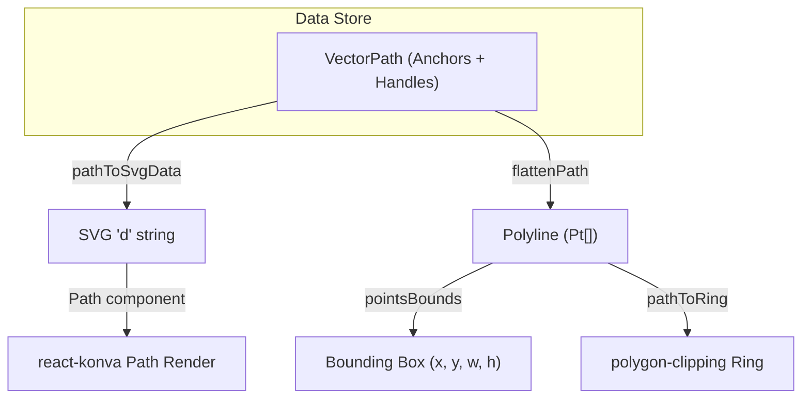
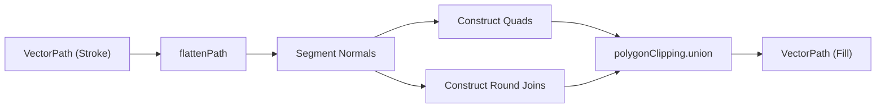

# 4.2 Vector Editing & Boolean Operations

# Vector Editing & Boolean Operations

Relevant source files

The following files were used as context for generating this wiki page:

- [src/vector/geometry.test.ts](src/vector/geometry.test.ts)
- [src/vector/geometry.ts](src/vector/geometry.ts)
- [src/views/DesignView.tsx](src/views/DesignView.tsx)
- [src/views/canvas/CanvasStage.tsx](src/views/canvas/CanvasStage.tsx)

The vector engine in OpenPrototype provides a comprehensive suite for path manipulation, ranging from low-level Bézier anchor editing to high-level constructive solid geometry (CSG) operations. It supports a "vecEdit" mode for fine-grained control and a Pen tool for path creation.

## Vector Data Structures

The system represents vector data through a hierarchical structure defined in the schema. Paths are essentially collections of anchors, where each anchor can optionally define Bézier control points.

| Entity | Description |
| :--- | :--- |
| `VectorPath` | A collection of `VectorAnchor` objects and a `closed` boolean flag. [src/schema/types.ts:11-11]() |
| `VectorAnchor` | A point `(x, y)` with optional `hIn` and `hOut` (incoming/outgoing) Bézier handles. [src/schema/types.ts:11-11]() |
| `hIn` / `hOut` | Relative offsets from the anchor's `(x, y)` position representing Bézier control points. [src/vector/geometry.ts:37-38]() |

### Coordinate Mapping
Vector anchors are stored in **node-local coordinates**. When rendering or performing boolean operations, these are often transformed to a shared coordinate space (e.g., frame-local) to ensure spatial consistency. [src/vector/geometry.ts:5-8]()

Sources: [src/schema/types.ts:1-100](), [src/vector/geometry.ts:1-40]()

## Path Serialization & Geometry

The `geometry.ts` utility handles the conversion between internal data structures and renderable formats like SVG or polylines.

### Key Functions
*   **`pathToSvgData(path)`**: Serializes a `VectorPath` into an SVG `d` string. It uses `M` (MoveTo), `L` (LineTo), and `C` (Cubic Bézier) commands based on the presence of `hIn`/`hOut` handles. [src/vector/geometry.ts:29-49]()
*   **`flattenPath(path, samples)`**: Converts a curved path into a polyline (array of points). It samples Bézier curves at a default rate (usually 16 samples per segment) using the `cubicPoint` helper. [src/vector/geometry.ts:64-84]()
*   **`pathBounds(path)`**: Calculates the bounding box of a path by first flattening it and then finding the min/max extents of the resulting points. [src/vector/geometry.ts:86-89]()

### Geometry Data Flow
The following diagram illustrates how a `VectorPath` is transformed for different system requirements:

**Path Transformation Pipeline**

Sources: [src/vector/geometry.ts:29-109](), [src/views/canvas/CanvasStage.tsx:2-7]()

## Vector Editing (vecEdit) & Pen Tool

Vector editing is managed through two primary modes in `CanvasStage`: a creation mode (Pen tool) and a modification mode (`vecEdit`).

### Pen Tool Workflow
1.  **Activation**: Triggered when `tool === 'pen'`. [src/views/canvas/CanvasStage.tsx:103-107]()
2.  **Anchor Placement**: On `mousedown`, a new `VectorAnchor` is added to the active frame's local coordinates.
3.  **Real-time Preview**: The `pen` state stores the current anchors and the cursor position to draw a "live" segment before the next click. [src/views/canvas/CanvasStage.tsx:103-107]()

### vecEdit Mode
This mode allows users to select and move individual anchors or handles of an existing `VectorNode`.
*   **State**: Tracked via `vecEdit` which stores the `frameId` and `nodeId`. [src/views/canvas/CanvasStage.tsx:110-110]()
*   **Interactions**: Users can drag `(x, y)` anchors or adjust the relative `hIn`/`hOut` offsets to change curve curvature.

Sources: [src/views/canvas/CanvasStage.tsx:90-160](), [src/views/DesignView.tsx:22-22]()

## Boolean Operations

OpenPrototype supports constructive area geometry using the `polygon-clipping` library. These operations require paths to be closed and flattened into polygons.

### Operations Supported
The `booleanPaths` function acts as a dispatcher for the following operations:
*   **Union**: Merges multiple shapes into one. [src/vector/geometry.ts:139-141]()
*   **Subtract**: Removes the area of overlapping "clip" shapes from the "base" shape. [src/vector/geometry.ts:142-144]()
*   **Intersect**: Keeps only the area where all shapes overlap. [src/vector/geometry.ts:145-147]()
*   **Exclude (XOR)**: Keeps areas that do not overlap. [src/vector/geometry.ts:148-150]()

### Implementation Detail
Since `polygon-clipping` operates on discrete points, the system flattens all curves before processing. The resulting rings are then converted back into `VectorAnchor` sets. Note that in the current implementation, internal holes in polygons are ignored during the conversion back to `VectorPath`. [src/vector/geometry.ts:153-156]()

Sources: [src/vector/geometry.ts:122-165](), [src/views/DesignView.tsx:28-33]()

## Stroke to Outline

The `strokeToOutline` feature converts a path with a stroke width into a filled shape representing the stroke's geometry.

1.  **Segment Generation**: For every segment in the path, it calculates the normal vector. [src/vector/geometry.ts:167-172]()
2.  **Quad Construction**: It creates a rectangular quad for each segment, offset by `width / 2` in both directions along the normal. [src/vector/geometry.ts:201-206]()
3.  **Joins and Caps**: It generates circular rings at anchor points to simulate round joins. [src/vector/geometry.ts:174-181]()
4.  **Union**: All generated quads and join-circles are unioned together using `polygonClipping.union` to produce the final outline. [src/vector/geometry.ts:188-195]()

**Stroke to Outline Logic**

Sources: [src/vector/geometry.ts:188-210](), [src/store/useStore.ts:1-100]() (implied by `outlineStroke` action)

## Integration with Canvas Stage

The `CanvasStage` component acts as the bridge between the geometry logic and the Konva rendering engine.

| Function | Role in Vector Operations |
| :--- | :--- |
| `strokeRectGeometry` | Adjusts rectangle bounds to simulate "inside" or "outside" stroke alignment, as Konva default strokes are centered. [src/views/canvas/CanvasStage.tsx:36-55]() |
| `registerStage` | Captures the stage for SVG/PNG export, ensuring vector paths are correctly serialized. [src/views/canvas/CanvasStage.tsx:164-166]() |
| `updateNode` | Used by vector tools to persist anchor changes back to the Zustand store. [src/views/canvas/CanvasStage.tsx:121-121]() |

Sources: [src/views/canvas/CanvasStage.tsx:36-166](), [src/vector/geometry.ts:1-100]()

---
