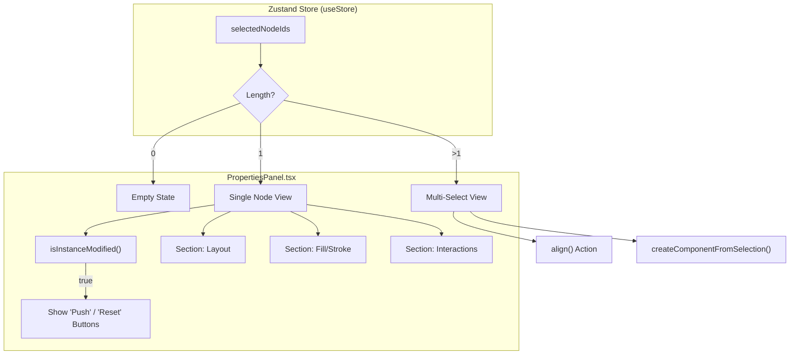
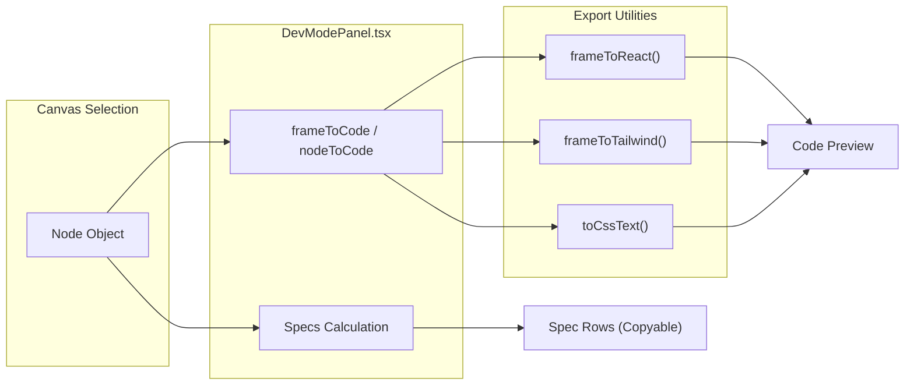

# 4.3 Properties Panel & Node Inspection

# Properties Panel & Node Inspection

Relevant source files

The following files were used as context for generating this wiki page:

- [src/components/CloudModal.tsx](src/components/CloudModal.tsx)
- [src/components/DesignSystemModal.tsx](src/components/DesignSystemModal.tsx)
- [src/views/canvas/DevModePanel.tsx](src/views/canvas/DevModePanel.tsx)
- [src/views/canvas/LayersPanel.tsx](src/views/canvas/LayersPanel.tsx)
- [src/views/canvas/PropertiesPanel.tsx](src/views/canvas/PropertiesPanel.tsx)

The **Properties Panel** and **DevMode Panel** serve as the primary interfaces for manipulating node attributes and inspecting design specifications for handoff. While the `PropertiesPanel` focuses on state modification (CRUD operations on nodes), the `DevModePanel` provides a read-only, measurement-centric view with automated code generation.

## Properties Panel Architecture

The `PropertiesPanel` is a reactive component that synchronizes with the `useStore` Zustand store. it dynamically adjusts its interface based on whether a frame, a single node, or multiple nodes are selected.

### Multi-Selection & Alignment
When multiple nodes are selected (`selectedNodeIds.length > 1`), the panel switches to a specialized view for bulk actions:
*   **Alignment & Distribution**: Triggers the `align` action in the store [src/views/canvas/PropertiesPanel.tsx:117-140]().
*   **Component Creation**: Allows grouping the selection into a new component via `createComponentFromSelection` [src/views/canvas/PropertiesPanel.tsx:142-150]().

### Node Property Editing
For a single selected node, the panel exposes granular controls for the `Node` schema:
*   **Layout & Constraints**: Editing `x`, `y`, `width`, `height`, and `rotation`. It also manages `Constraints` (Horizontal: Left/Right/Center/Scale; Vertical: Top/Bottom/Center/Scale) [src/views/canvas/PropertiesPanel.tsx:216-281]().
*   **Auto Layout**: Controls for `flex-direction` (direction), `gap`, `padding`, and alignment (`itemAlignment`) [src/views/canvas/PropertiesPanel.tsx:283-334]().
*   **Appearance**: Fill (solid/gradient/image), Stroke (width/color/position), Corner Radius, and Opacity [src/views/canvas/PropertiesPanel.tsx:355-460]().
*   **Interactions**: Management of `Interaction` objects, defining triggers (e.g., `onClick`) and actions (e.g., `navigate` to a specific `targetFrameId`) [src/views/canvas/PropertiesPanel.tsx:505-555]().

### Instance Override Management
The panel handles the lifecycle of component instances. It detects if an instance has diverged from its master template using `isInstanceModified` [src/views/canvas/PropertiesPanel.tsx:103-104]().
*   **Push to Component**: Merges local overrides back into the master `ComponentDef` using `pushInstanceToComponent` [src/views/canvas/PropertiesPanel.tsx:199-201]().
*   **Reset Instance**: Reverts all local overrides to match the master template via `resetInstance` [src/views/canvas/PropertiesPanel.tsx:202-204]().

**Data Flow: Selection to UI**
Title: Property Panel Selection Logic

Sources: [src/views/canvas/PropertiesPanel.tsx:69-113](), [src/schema/nodeOps.ts:1-20]()

---

## DevMode & Handoff Inspection

The `DevModePanel` is toggled via `useUi().devMode` and provides a developer-centric view of the canvas [src/views/canvas/DevModePanel.tsx:23-30]().

### Measurements and Specs
The panel calculates and displays key CSS-like properties for the selected node:
*   **Dimensions**: Absolute position and size [src/views/canvas/DevModePanel.tsx:65-66]().
*   **Visuals**: Resolved fill colors via `nodeFill`, stroke details, and shadow parameters [src/views/canvas/DevModePanel.tsx:68-78]().
*   **Typography**: Font family, weight, size, and line height [src/views/canvas/DevModePanel.tsx:79-83]().

### Automated Code Generation
The panel uses a dispatcher to convert internal node structures into code snippets across multiple frameworks:
*   **Dispatchers**: `nodeToCode` and `frameToCode` handle the conversion [src/views/canvas/DevModePanel.tsx:46-49]().
*   **Supported Languages**: CSS, React (Tailwind/Inline), HTML, and Vue [src/export/exportCode.ts:1-10]().
*   **Design Token Integration**: Code generation references the `DesignSystem` tokens to ensure output matches the defined variables (e.g., using `var(--primary)` instead of hardcoded hex values) [src/views/canvas/DevModePanel.tsx:48]().

### Asset Export
Developers can export assets directly from the inspection panel:
*   **Single Node/Frame**: Export as SVG, PNG, or PDF [src/views/canvas/DevModePanel.tsx:135-162]().
*   **Batch Export**: `downloadFramesZip` generates a ZIP file containing all frames at @2x scale [src/views/canvas/DevModePanel.tsx:165-172]().

**Handoff Data Flow**
Title: DevMode Inspection and Code Generation

Sources: [src/views/canvas/DevModePanel.tsx:46-49](), [src/export/exportCode.ts:5-15]()

---

## Component Overrides and Design System Sync

The interaction between the `PropertiesPanel` and the `DesignSystem` is critical for maintaining consistency.

| Feature | Implementation Detail | Source |
| :--- | :--- | :--- |
| **Variable Binding** | Nodes can bind colors/numbers to `DesignSystem.variables`. | [src/components/DesignSystemModal.tsx:31-32]() |
| **Audit Integration** | The panel alerts if a node violates `DesignRule` (e.g., non-token color). | [src/designsystem/audit.ts:5-15]() |
| **Fill Resolution** | `resolveFill` converts internal `Fill` objects to canvas-ready strings. | [src/render/resolve.ts:5-10]() |
| **Instance Tracking** | `componentRef` links a node to its `ComponentDef` in the Design System. | [src/views/canvas/PropertiesPanel.tsx:100-102]() |

### Implementation of `isInstanceModified`
This function performs a deep comparison between the current `node` and its `template` from the `DesignSystem`. It checks for changes in:
1.  **Style**: Differences in fills, strokes, or effects.
2.  **Layout**: Changes in size or internal auto-layout settings.
3.  **Content**: Text content changes in text-type nodes.

If differences are detected, the `PropertiesPanel` displays the "Modified" status, enabling the "Push to Main" or "Reset" workflows [src/views/canvas/PropertiesPanel.tsx:103-104]().

Sources: [src/views/canvas/PropertiesPanel.tsx:1-113](), [src/views/canvas/DevModePanel.tsx:1-177](), [src/components/DesignSystemModal.tsx:1-54]()

---
