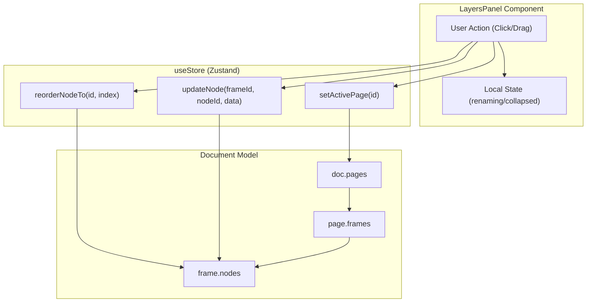
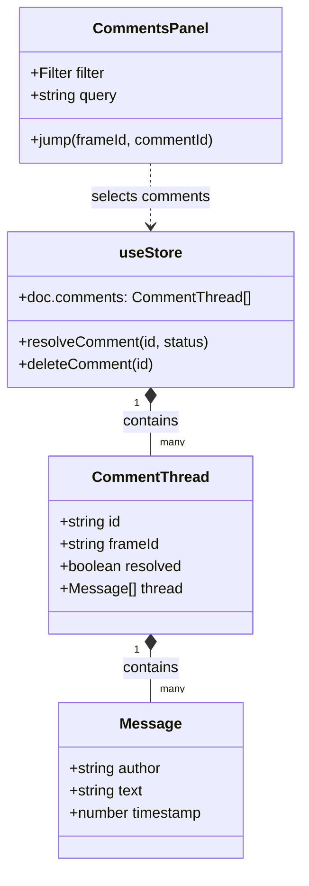
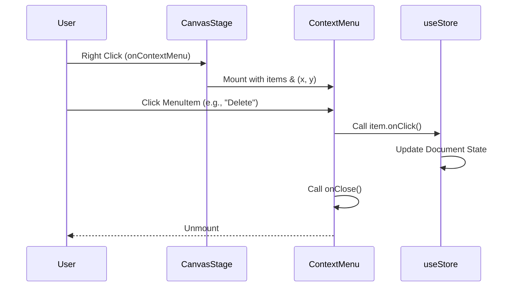

# 4.4 Canvas Panels: Layers, Assets, Comments & Context Menu

# Canvas Panels: Layers, Assets, Comments & Context Menu

Relevant source files

The following files were used as context for generating this wiki page:

- [src/views/canvas/AssetsPanel.tsx](src/views/canvas/AssetsPanel.tsx)
- [src/views/canvas/CommentsPanel.tsx](src/views/canvas/CommentsPanel.tsx)
- [src/views/canvas/ContextMenu.tsx](src/views/canvas/ContextMenu.tsx)
- [src/views/canvas/LayersPanel.tsx](src/views/canvas/LayersPanel.tsx)

The Canvas View incorporates several specialized panels and overlays that facilitate document navigation, component management, and collaboration. These panels interact directly with the centralized `useStore` to manipulate the `GpoDocument` hierarchy and metadata.

## Layers Panel: Hierarchy & Navigation

The `LayersPanel` provides a structural tree view of the document. It allows users to manage pages, frames, and individual nodes within those frames.

### Page and Frame Management
*   **Page Switching**: Users select active pages via a dropdown, which updates `activePageId` in the store [src/views/canvas/LayersPanel.tsx:45-55]().
*   **Frame Controls**: Frames are listed as top-level collapsible containers. Clicking a frame sets it as the `activeFrameId` [src/views/canvas/LayersPanel.tsx:75-76]().
*   **Expansion State**: The panel maintains local state for collapsed/expanded frames, defaulting the active frame to an expanded state [src/views/canvas/LayersPanel.tsx:26-34]().

### Node Manipulation
The panel renders nodes in reverse order (top-most node first) to match the visual stacking on the canvas [src/views/canvas/LayersPanel.tsx:71]().
*   **Selection**: Supports single-click selection and Shift-click for multi-selection via `toggleSelect` [src/views/canvas/LayersPanel.tsx:158-160]().
*   **Visibility & Locking**: Nodes can be toggled between hidden/visible and locked/unlocked states [src/views/canvas/LayersPanel.tsx:19-20]().
*   **Reordering**: Implements drag-and-drop reordering. Dropping a node triggers `reorderNodeTo`, which modifies the node's index within its parent frame's `nodes` array [src/views/canvas/LayersPanel.tsx:136-153]().

### Layers Data Flow
Title: Layers Panel Interaction Flow

Sources: [src/views/canvas/LayersPanel.tsx:5-36](), [src/views/canvas/LayersPanel.tsx:145-153]()

---

## Assets Panel: Component Library

The `AssetsPanel` serves as a catalog for components defined in the `DesignSystem`. It enables users to browse and instantiate reusable elements.

*   **De-duplication**: The panel groups components by name, showing a count if multiple definitions share the same name [src/views/canvas/AssetsPanel.tsx:18-28]().
*   **Instantiation**: Clicking an asset card calls `instantiateComponent(id)`, which creates a new node instance in the `activeFrameId` [src/views/canvas/AssetsPanel.tsx:30-37]().
*   **Management**: Provides inline actions to `renameComponent` or `deleteComponent` [src/views/canvas/AssetsPanel.tsx:68-87]().

Sources: [src/views/canvas/AssetsPanel.tsx:8-37](), [src/views/canvas/AssetsPanel.tsx:58-91]()

---

## Comments Panel: Review & Feedback

The `CommentsPanel` aggregates all review threads across the document into a searchable list. This is distinct from the `FrameComment` component which renders the actual pins on the canvas.

### Thread Management
*   **Filtering**: Users can filter comments by status: `all`, `open`, or `resolved` [src/views/canvas/CommentsPanel.tsx:45-49]().
*   **Search**: Supports full-text search across message content, authors, and frame names [src/views/canvas/CommentsPanel.tsx:27-38]().
*   **Navigation**: Clicking a comment item triggers `jump(frameId, commentId)`, which focuses the specific frame and opens the thread UI on the canvas [src/views/canvas/CommentsPanel.tsx:40-43]().
*   **Resolution**: Comments can be toggled between resolved and open states via `resolveComment` [src/views/canvas/CommentsPanel.tsx:102-111]().

### Comment System Architecture
Title: Comment System Entity Mapping

Sources: [src/views/canvas/CommentsPanel.tsx:9-14](), [src/views/canvas/CommentsPanel.tsx:84-123]()

---

## Context Menu

The `ContextMenu` is a transient UI component that provides access to context-sensitive actions based on the current selection or click target.

*   **Positioning**: Accepts `x` and `y` coordinates (typically from a `onContextMenu` event) and renders an absolute-positioned overlay [src/views/canvas/ContextMenu.tsx:14-24]().
*   **Item Configuration**: Each `MenuItem` supports labels, icons, keyboard shortcuts, and a `danger` flag for destructive actions like deletion [src/views/canvas/ContextMenu.tsx:4-12]().
*   **Dismissal Logic**: Automatically closes when clicking outside the menu or pressing the `Escape` key [src/views/canvas/ContextMenu.tsx:27-42]().

### Context Menu Implementation
Title: Context Menu Lifecycle

Sources: [src/views/canvas/ContextMenu.tsx:47-70]()

---
