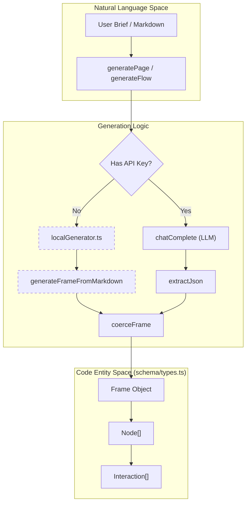
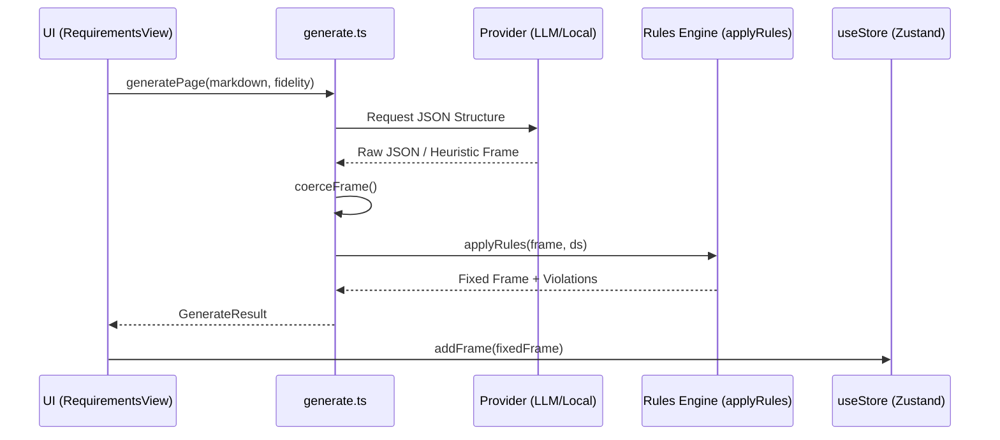

# 5 AI Generation System

# AI Generation System

Relevant source files

The following files were used as context for generating this wiki page:

- [src/ai/chat.ts](src/ai/chat.ts)
- [src/ai/flow.ts](src/ai/flow.ts)
- [src/ai/generate.ts](src/ai/generate.ts)
- [src/ai/localGenerator.ts](src/ai/localGenerator.ts)
- [src/ai/settings.ts](src/ai/settings.ts)
- [src/components/AiSettingsModal.tsx](src/components/AiSettingsModal.tsx)
- [src/store/useUi.ts](src/store/useUi.ts)

The AI Generation System in OpenPrototype provides a seamless transition from natural language requirements to functional, editable design entities. It utilizes a **dual-path architecture** that balances sophisticated Large Language Model (LLM) capabilities with a zero-config, offline heuristic fallback. This system powers the generation of individual pages, multi-screen interactive prototypes, and the refinement of existing design nodes.

### System Architecture

The generation pipeline is designed to be provider-agnostic. It abstracts the complexities of different LLM APIs (OpenAI, Anthropic, DeepSeek) while maintaining a local path that requires no internet connection or API keys [src/ai/settings.ts:1-36]().

#### Logic Flow: Requirements to Canvas
The following diagram illustrates how the system bridges the gap between natural language descriptions and the internal `GpoDocument` schema.

**Natural Language to Code Entity Mapping**

**Sources:** [src/ai/generate.ts:171-210](), [src/ai/localGenerator.ts:30-42](), [src/ai/flow.ts:151-176]()

---

### Core Generation Paths

The system categorizes generation into two primary modes based on the availability of external AI providers.

#### 1. LLM Path (Remote)
When a provider like OpenAI or Anthropic is configured, the system uses `buildSystemPrompt` to inject the current `DesignSystem` tokens and rules into the model's context [src/ai/generate.ts:18-28](). This ensures the generated JSON strictly follows the `Frame` and `Node` schema while adhering to brand-specific spacing and colors [src/ai/generate.ts:22-23]().

#### 2. Heuristic Path (Local)
The `localGenerator.ts` provides an offline fallback. It uses keyword classification (e.g., "button", "input") to map markdown lines to specific `NodeType` values [src/ai/localGenerator.ts:17-24](). While less "creative" than an LLM, it guarantees that users can always generate a starting point for their designs without a setup process.

**Provider Comparison**
| Feature | Local Heuristic | LLM (OpenAI/Anthropic) |
| :--- | :--- | :--- |
| **Connectivity** | Offline | Online |
| **Logic Source** | `classify()` regex [src/ai/localGenerator.ts:17-24]() | `chatComplete` [src/ai/chat.ts:9-13]() |
| **Design Fidelity** | Template-based | Prompt-driven `Fidelity` [src/ai/generate.ts:18-28]() |
| **Speed** | Instant | 2-10 seconds |

---

### Domain-Specific Generation

The generation system is segmented into three primary domains, each handled by specialized logic:

#### [Page & Flow Generation](#5.1)
Handles the creation of `Frame` objects. Single pages are generated via `generatePage`, while `generateFlowFromBrief` creates multiple frames and "auto-wires" them by injecting `Interaction` objects into buttons to create a clickable prototype [src/ai/flow.ts:151-174]().
*   **For details, see [Page & Flow Generation](#5.1)**

#### [Requirements AI Assistance](#5.2)
Focuses on the text-based phase of product development. It uses the `assistRequirement` function to polish, expand, or summarize markdown content within the Requirements View, utilizing `REQUIREMENT_TEMPLATES` for structure.
*   **For details, see [Requirements AI Assistance](#5.2)**

#### [AI Settings & LLM Provider Integration](#5.3)
Manages the configuration and execution of API calls. This includes the `AiSettings` interface, the `chatComplete` pipeline, and the `AiSettingsModal` UI for managing keys and model selection [src/ai/settings.ts:3-7]().
*   **For details, see [AI Settings & LLM Provider Integration](#5.3)**

---

### Post-Processing & Normalization

Regardless of the source (Local or LLM), all generated content passes through a normalization layer:

1.  **`coerceFrame`**: Ensures the raw JSON from an LLM matches the TypeScript `Frame` interface, providing defaults for missing dimensions or invalid types [src/ai/generate.ts:40-68]().
2.  **`applyRules`**: Runs the design system's rules engine against the generated frame to fix token violations or spacing inconsistencies [src/ai/generate.ts:181-182]().

**Generation Execution Flow**

**Sources:** [src/ai/generate.ts:9-14](), [src/ai/generate.ts:171-191](), [src/designsystem/rules.ts:2-3]()

---
