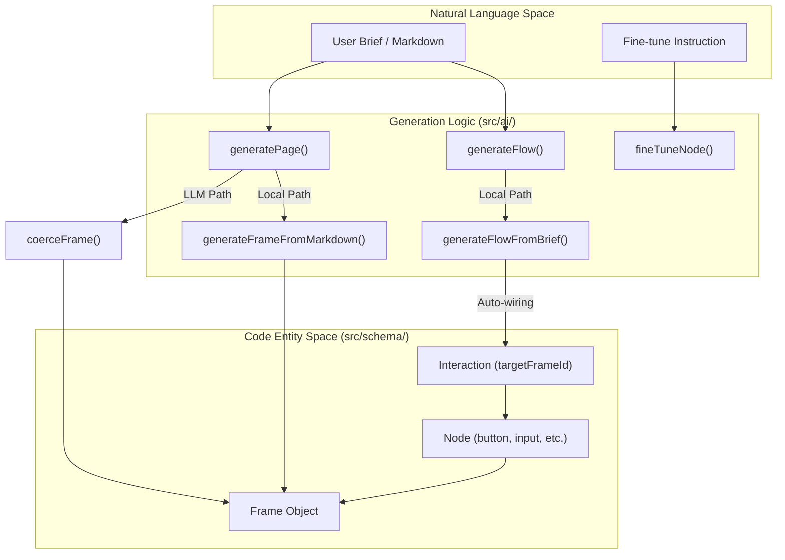
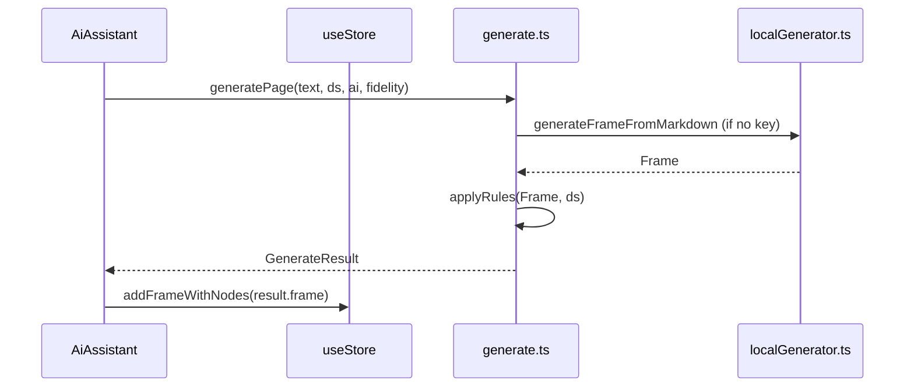

# 5.1 Page & Flow Generation

# Page & Flow Generation

Relevant source files

The following files were used as context for generating this wiki page:

- [src/ai/flow.ts](src/ai/flow.ts)
- [src/ai/frameName.ts](src/ai/frameName.ts)
- [src/ai/generate.ts](src/ai/generate.ts)
- [src/ai/localGenerator.ts](src/ai/localGenerator.ts)
- [src/views/canvas/AiAssistant.tsx](src/views/canvas/AiAssistant.tsx)

OpenPrototype features a dual-path generation system that converts natural language requirements into editable design frames. This system supports both single-page generation and multi-page interactive flows, utilizing either a remote Large Language Model (LLM) or a local heuristic engine for offline use.

## Generation Pipeline Overview

The generation process follows a structured pipeline that transforms a text brief into a normalized `Frame` object compatible with the canvas.

### Data Flow: Requirements to Canvas
The following diagram illustrates how natural language is processed through the generation system into the internal data model.

**Natural Language to Code Entity Mapping**

Sources: [src/ai/generate.ts:171-180](), [src/ai/flow.ts:151-176](), [src/ai/localGenerator.ts:30-35]()

## Single Page Generation (`generatePage`)

The `generatePage` function in `src/ai/generate.ts` is the primary entry point for creating a single screen. It detects the availability of an AI provider and routes the request accordingly.

1.  **Local Path**: If no API key is provided or the provider is set to "local", it invokes `generateFrameFromMarkdown` [src/ai/generate.ts:179-180]().
2.  **LLM Path**: If a provider (OpenAI, Anthropic, etc.) is configured, it constructs a `systemPrompt` containing the `DesignSystem` tokens and rules [src/ai/generate.ts:19-27]().
3.  **Normalization**: Results from the LLM are passed through `coerceFrame` to ensure type safety and provide defaults for missing fields [src/ai/generate.ts:40-68]().
4.  **Post-processing**: The generated frame is passed through `applyRules` to ensure compliance with the active design system (e.g., primary buttons using the correct token) [src/ai/generate.ts:181]().

Sources: [src/ai/generate.ts:171-191](), [src/ai/generate.ts:40-68]()

## Multi-Screen Flow Generation (`generateFlow`)

Flow generation creates multiple screens and automatically links them with `Interaction` objects to create a functional prototype.

### Flow Planning
The `generateFlowFromBrief` function uses `planScreens` to select a `FlowPlan` based on keywords in the user's brief [src/ai/flow.ts:29-32](). 

| Flow Category | Keywords | Typical Screens |
| :--- | :--- | :--- |
| **E-Commerce** | shop, cart, commerce | List, Detail, Cart, Checkout |
| **Auth** | login, register, signin | Login, Home, Settings |
| **Social** | feed, chat, message | Feed, Detail |
| **Generic** | (fallback) | Home, Detail, Success |

Sources: [src/ai/flow.ts:33-119]()

### Prototype Auto-Wiring
After generating frames for each `ScreenSpec`, the system "wires" them together:
1.  It iterates through the generated frames [src/ai/flow.ts:162]().
2.  It identifies a "forward" node (usually the primary button) using `pickForwardNode` and an optional `forwardHint` [src/ai/flow.ts:127-136]().
3.  It injects an `Interaction` object into that node, setting the `targetFrameId` to the subsequent frame's ID [src/ai/flow.ts:165-171]().

Sources: [src/ai/flow.ts:151-176]()

## Local Heuristic Generator

The `localGenerator.ts` provides an offline fallback that parses Markdown via simple heuristics. It classifies lines into `NodeType` based on regex patterns:

*   **Classification**: Lines containing "button" or "提交" (submit) become `button` nodes; "input" or "输入框" become `input` nodes [src/ai/localGenerator.ts:17-24]().
*   **Layout**: It calculates a vertical stack (Y-axis) based on the design system's spacing tokens (`ds.tokens.spacing.lg`) [src/ai/localGenerator.ts:49-51]().
*   **Styling**: It applies different fills based on the requested `fidelity`. For "hifi", it maps nodes to specific tokens like `primary` for buttons [src/ai/localGenerator.ts:124]().

Sources: [src/ai/localGenerator.ts:30-191]()

## Implementation Details

### Frame Normalization (`coerceFrame`)
LLMs often return inconsistent JSON. `coerceFrame` serves as a validator that:
*   Ensures `width` and `height` are numbers [src/ai/generate.ts:47-48]().
*   Filters `type` against the valid `NodeType` enum [src/ai/generate.ts:53-57]().
*   Generates unique IDs using `id()` for every node to prevent collisions [src/ai/generate.ts:52]().

### AI Assistant Integration
The `AiAssistant` component provides the UI for these operations. It maintains a message history and triggers either `send` (single page/fine-tune) or `sendFlow` (multi-page) [src/views/canvas/AiAssistant.tsx:34-96]().

**Interaction Logic in AiAssistant**

Sources: [src/views/canvas/AiAssistant.tsx:54-63](), [src/ai/generate.ts:171-191]()

### Fine-Tuning Nodes
When a single node is selected, the AI Assistant switches to "fine-tune" mode.
*   **Local Fine-tune**: Supports instructions like "make it bigger", "center it", or "use primary color" via regex mapping in `localFineTune` [src/ai/generate.ts:121-146]().
*   **LLM Fine-tune**: Sends the current node's JSON and the instruction to the model to return a patched JSON object [src/ai/generate.ts:157-160]().

Sources: [src/ai/generate.ts:148-169]()

---
