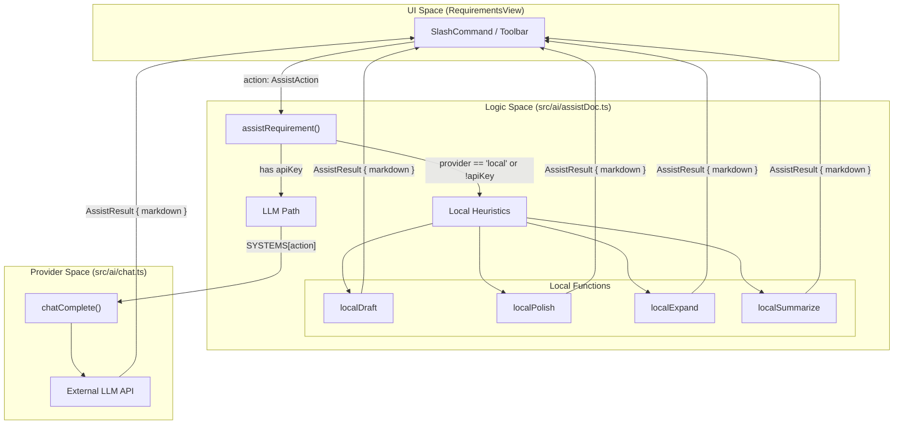
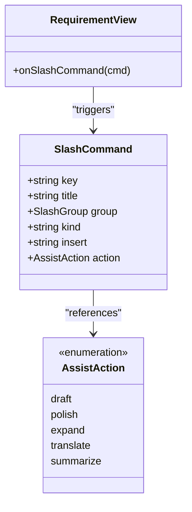

# 5.2 Requirements AI Assistance

# Requirements AI Assistance

Relevant source files

The following files were used as context for generating this wiki page:

- [src/ai/assistDoc.ts](src/ai/assistDoc.ts)
- [src/ai/chat.ts](src/ai/chat.ts)
- [src/ai/settings.ts](src/ai/settings.ts)
- [src/components/AiSettingsModal.tsx](src/components/AiSettingsModal.tsx)
- [src/requirements/slashCommands.ts](src/requirements/slashCommands.ts)
- [src/store/useUi.ts](src/store/useUi.ts)
- [src/templates/requirementTemplates.ts](src/templates/requirementTemplates.ts)
- [src/templates/starters.ts](src/templates/starters.ts)

The Requirements AI Assistance system provides a comprehensive suite of tools for drafting, refining, and structured expansion of product documentation within the Requirements View. It utilizes a dual-path execution strategy, offering immediate **local heuristic fallbacks** for offline use and **LLM-powered completions** (via OpenAI, Anthropic, or DeepSeek) for high-fidelity document generation.

## AI Assistance Architecture

The core logic resides in the `assistRequirement` function, which acts as a dispatcher between local algorithms and remote Large Language Models.

### Execution Flow
The system evaluates the user's `AiSettings` to determine the execution path. If the provider is set to `local` or the `apiKey` is missing, it invokes heuristic functions; otherwise, it routes the request through the `chatComplete` pipeline.

1.  **Trigger**: User selects an `AssistAction` (Draft, Polish, Expand, Translate, Summarize).
2.  **Dispatch**: `assistRequirement` checks `settings.provider` [src/ai/assistDoc.ts:163-163]().
3.  **Path A (Local)**: Executes deterministic string manipulation (e.g., `localDraft`, `localPolish`) [src/ai/assistDoc.ts:164-171]().
4.  **Path B (LLM)**: Retrieves the system prompt for the action from `SYSTEMS` [src/ai/assistDoc.ts:140-156](), calls `chatComplete` [src/ai/chat.ts:9-54](), and cleans the resulting Markdown [src/ai/assistDoc.ts:178-181]().
5.  **Return**: Returns an `AssistResult` containing the new Markdown and the source flag [src/ai/assistDoc.ts:18-21]().

### Data Flow Diagram: Requirement Assistance
This diagram illustrates how a requirement document is processed from the UI through the AI dispatch logic.

Sources: [src/ai/assistDoc.ts:158-182](), [src/ai/chat.ts:9-13](), [src/requirements/slashCommands.ts:15-26]()

## Assist Actions & Local Heuristics

Every AI action has a corresponding local fallback to ensure the application remains functional without an internet connection or API keys.

| Action | Local Implementation (`src/ai/assistDoc.ts`) | Description |
| :--- | :--- | :--- |
| `draft` | `localDraft(brief)` | Creates a full PRD scaffold from a short title or idea [41-78](). |
| `polish` | `localPolish(md)` | Normalizes bullet markers to `-`, trims whitespace, and collapses blank lines [81-95](). |
| `expand` | `localExpand(md)` | Appends missing standard sections defined in `STANDARD_SECTIONS` [127-138](). |
| `summarize`| `localSummarize(md)` | Extracts headings and the first line of each section to create a TL;DR [98-119](). |
| `translate`| `localTranslate(md)`| Returns a placeholder message stating that translation requires an LLM key [122-124](). |

Sources: [src/ai/assistDoc.ts:11-33](), [src/ai/assistDoc.ts:41-138]()

## Templates and Starters

OpenPrototype provides predefined structures to help users move from "blank page" to "structured requirement" quickly.

### Requirement Templates
Defined in `REQUIREMENT_TEMPLATES`, these are industry-standard Markdown structures used for initial document creation.
*   **PRD**: Comprehensive document including Background, User Stories, and Functional Requirements [src/templates/requirementTemplates.ts:16-59]().
*   **Feature Spec**: Focused on single-feature behaviors and boundary cases [src/templates/requirementTemplates.ts:61-86]().
*   **User Stories**: Agile-style stories with Given/When/Then acceptance criteria [src/templates/requirementTemplates.ts:88-105]().

### Starter Templates
Starters, found in `STARTER_TEMPLATES`, initialize an entire `GpoDocument`. They combine a `RequirementDoc` with a pre-configured Canvas `Frame` (e.g., Web 1440x1024 or Mobile 390x844) [src/templates/starters.ts:62-113]().

Sources: [src/templates/requirementTemplates.ts:15-128](), [src/templates/starters.ts:1-113]()

## Slash Commands

The requirements editor features a "slash command" palette (`/`) that allows users to insert Markdown blocks or trigger AI actions directly at the cursor position.

### Command Categories
Commands are organized into `SLASH_GROUPS` [src/requirements/slashCommands.ts:29-34]():
*   **basic**: Standard Markdown blocks like headings, lists, and code fences [38-145]().
*   **doc**: Product-specific sections like "User Story", "Acceptance Criteria", and "Milestones" [148-220]().
*   **data**: Structured data blocks like Tables, Data Models, and API definitions [223-261]().
*   **ai**: Triggers for the `AssistAction` suite [264-309]().

### Interaction with Code Entities
The `SlashCommand` interface bridges the UI selection to either a static string insertion (`insert` property) or a functional AI call (`action` property).

Sources: [src/requirements/slashCommands.ts:15-26](), [src/ai/assistDoc.ts:11-16]()

## LLM Integration & Settings

The system supports multiple providers via the `AiSettings` interface, managed by the `useUi` store.

### Provider Configuration
The `PROVIDERS` registry defines the capabilities and endpoints for each service:
*   **OpenAI**: `https://api.openai.com/v1/chat/completions` [src/ai/settings.ts:18-23]().
*   **Anthropic**: `https://api.anthropic.com/v1/messages` (Requires `anthropic-version` header) [src/ai/settings.ts:24-29]().
*   **DeepSeek**: `https://api.deepseek.com/v1/chat/completions` [src/ai/settings.ts:31-36]().

### State Management
*   **Persistence**: Settings are stored in `localStorage` under the key `gpo.ai.settings` [src/ai/settings.ts:38-52]().
*   **Store**: The `useUi` store provides `ai` state and the `setAi` action to update and persist settings across sessions [src/store/useUi.ts:27-31]().
*   **UI**: `AiSettingsModal` provides the interface for users to select providers and input API keys securely [src/components/AiSettingsModal.tsx:5-74]().

Sources: [src/ai/settings.ts:1-52](), [src/store/useUi.ts:4-31](), [src/components/AiSettingsModal.tsx:1-75]()

---
