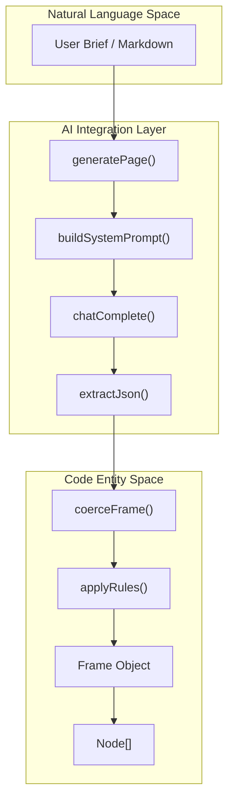
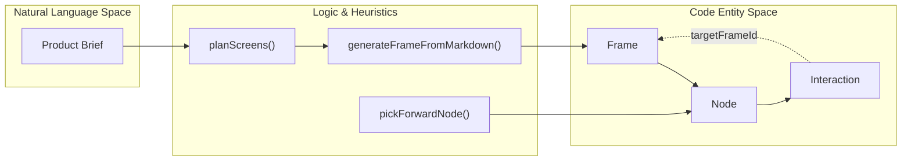

# 5.3 AI Settings & LLM Provider Integration

# AI Settings & LLM Provider Integration

Relevant source files

The following files were used as context for generating this wiki page:

- [src/ai/chat.ts](src/ai/chat.ts)
- [src/ai/flow.ts](src/ai/flow.ts)
- [src/ai/generate.ts](src/ai/generate.ts)
- [src/ai/localGenerator.ts](src/ai/localGenerator.ts)
- [src/ai/settings.ts](src/ai/settings.ts)
- [src/components/AiSettingsModal.tsx](src/components/AiSettingsModal.tsx)
- [src/store/useUi.ts](src/store/useUi.ts)

OpenPrototype utilizes a multi-provider AI architecture that bridges natural language requirements with structured design entities. The system supports major LLM providers (OpenAI, Anthropic, DeepSeek) alongside a robust local heuristic generator that functions without network connectivity or API keys.

## AI Configuration & Persistence

The `AiSettings` interface defines the configuration required for AI operations, including the active provider, authentication keys, and specific model identifiers [src/ai/settings.ts:3-7]().

### Supported Providers
The system maintains a registry of providers in the `PROVIDERS` constant [src/ai/settings.ts:9-36]():

| Provider | Label | Default Model | Endpoint Type |
| :--- | :--- | :--- | :--- |
| `local` | 本地启发式生成器 | `heuristic-v1` | N/A (Offline) |
| `openai` | OpenAI | `gpt-4o-mini` | OpenAI Compatible |
| `anthropic` | Anthropic (Claude) | `claude-3-5-sonnet-latest` | Anthropic Custom |
| `deepseek` | DeepSeek | `deepseek-chat` | OpenAI Compatible |

### Persistence Mechanism
Settings are persisted in the browser's `localStorage` under the key `gpo.ai.settings` [src/ai/settings.ts:38](). The `useUi` store initializes its `ai` state by calling `loadAiSettings()` and provides a `setAi` action that synchronizes updates back to `localStorage` [src/store/useUi.ts:27-31]().

## AI Execution Pipeline

The execution pipeline handles the transformation of user prompts into valid `Frame` and `Node` objects. It employs a "Local-First" strategy: if no API key is provided or the provider is set to `local`, the system falls back to `localGenerator.ts` [src/ai/generate.ts:179-191]().

### chatComplete Logic
The `chatComplete` function acts as a provider-agnostic wrapper for text generation [src/ai/chat.ts:9-13](). It branches logic based on the provider's API shape:
1.  **Anthropic Path**: Uses `x-api-key` headers and a top-level `system` field in the request body [src/ai/chat.ts:14-32]().
2.  **OpenAI/DeepSeek Path**: Uses `Authorization: Bearer` headers and a `messages` array containing both `system` and `user` roles [src/ai/chat.ts:34-53]().

### Prompt Engineering & Schema Enforcement
The system generates a strict system prompt via `buildSystemPrompt` [src/ai/generate.ts:18-28](). This prompt injects:
-   The current `DesignSystem` tokens (colors, spacing, etc.) [src/ai/generate.ts:22]().
-   Design rules/constraints [src/ai/generate.ts:23]().
-   A TypeScript-like JSON schema for the expected `Frame` object [src/ai/generate.ts:25]().

### Data Flow: Text to Code Entity
The following diagram illustrates how natural language requirements are transformed into code-level `Frame` and `Node` objects through the AI pipeline.

**AI Generation Data Flow**

Sources: [src/ai/generate.ts:171-205](), [src/ai/chat.ts:9-54](), [src/designsystem/rules.ts:2]().

## Local Heuristic Generator

When offline or unconfigured, `generateFrameFromMarkdown` implements a rule-based parser [src/ai/localGenerator.ts:30-35]().

1.  **Classification**: The `classify` function uses Regex to map line content to `NodeType` (e.g., "button", "input", "image") [src/ai/localGenerator.ts:17-24]().
2.  **Layout**: Elements are stacked vertically with Y-coordinate increments based on design system spacing tokens [src/ai/localGenerator.ts:112-185]().
3.  **Styling**: The generator applies tokens from the `DesignSystem` (e.g., `ds.tokens.colors.primary`) to ensure visual consistency even in heuristic mode [src/ai/localGenerator.ts:124-133]().

## Flow Generation & Auto-Wiring

For multi-screen generation, `generateFlowFromBrief` coordinates the creation of multiple linked frames [src/ai/flow.ts:151-155]().

1.  **Planning**: `planScreens` analyzes the brief for keywords (e.g., "ecommerce", "login") to select a `FlowPlan` [src/ai/flow.ts:29-120]().
2.  **Interaction Wiring**: The `pickForwardNode` function identifies the primary CTA in a generated frame [src/ai/flow.ts:127-136]().
3.  **Interaction Injection**: A new `Interaction` object is pushed to the node's `interactions` array, targeting the next `frame.id` [src/ai/flow.ts:165-171]().

**Flow Generation Architecture**

Sources: [src/ai/flow.ts:151-176](), [src/schema/types.ts:1]().

## User Interface: AiSettingsModal

The `AiSettingsModal` provides the UI for managing these integrations [src/components/AiSettingsModal.tsx:5]().

-   **Provider Selection**: Updates the available model list and toggles the visibility of the API Key field [src/components/AiSettingsModal.tsx:14-17]().
-   **Security**: API Keys are handled via `type="password"` inputs and are never sent to the OpenPrototype backend; they reside only in the user's local browser storage [src/components/AiSettingsModal.tsx:48-55]().
-   **Validation**: The `save` function triggers a toast notification via `showToast` and updates the `useUi` store [src/components/AiSettingsModal.tsx:19-23]().

Sources: [src/components/AiSettingsModal.tsx:1-75](), [src/store/useUi.ts:28-37]().

---
