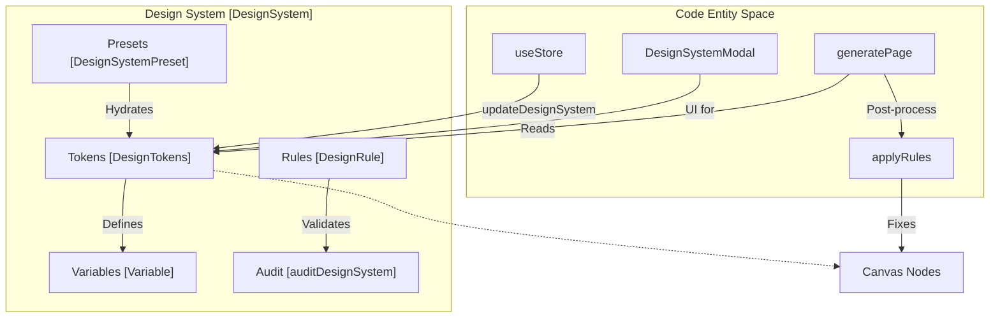
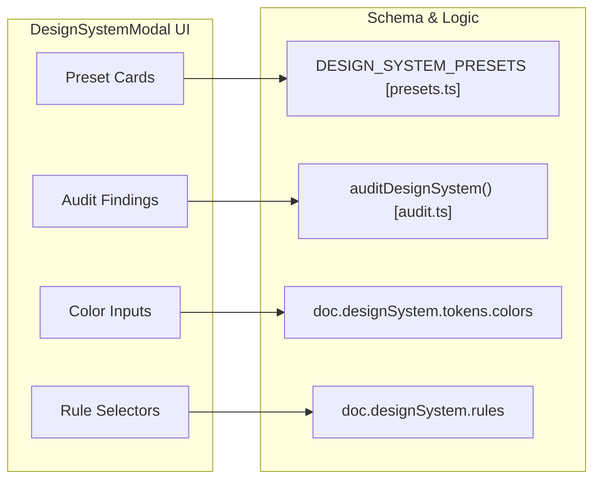

# 6 Design System

# Design System

Relevant source files

The following files were used as context for generating this wiki page:

- [src/components/CloudModal.tsx](src/components/CloudModal.tsx)
- [src/components/DesignSystemModal.tsx](src/components/DesignSystemModal.tsx)
- [src/designsystem/presets.ts](src/designsystem/presets.ts)
- [src/market/elementPlus.ts](src/market/elementPlus.ts)
- [src/views/canvas/PropertiesPanel.tsx](src/views/canvas/PropertiesPanel.tsx)

The Design System subsystem in OpenPrototype provides a structured framework for managing visual consistency across prototypes. It moves beyond static styles by implementing a "Tokens-Variables-Rules" architecture, allowing the AI generation engine to adhere to specific brand guidelines and enabling automated quality audits.

The system is encapsulated within the `DesignSystem` object in the document schema [src/schema/types.ts:210-221](), which includes tokens, variables, components, and a set of automated design rules.

## System Architecture

The Design System acts as the "Source of Truth" for the canvas and the AI generation pipeline. It bridges the gap between abstract design tokens (like "primary color") and concrete node properties.

### Design System Data Flow
"This diagram illustrates how Design System entities interact with the Document and AI pipeline."

Sources: [src/schema/types.ts:210-221](), [src/components/DesignSystemModal.tsx:46-54](), [src/designsystem/presets.ts:11-18]()

## Core Components

### Design Tokens, Variables & Presets
Design Tokens represent the atomic values of the design system, such as color palettes, spacing scales, and typography [src/schema/types.ts:223-231](). Variables extend this by allowing Figma-style binding of named values (e.g., `brand/primary`) to specific properties [src/schema/types.ts:241-247]().

The system includes several industry-standard presets:
*   **Ant Design**: 2px radii and "Daybreak Blue" palette [src/designsystem/presets.ts:84-112]().
*   **Material 3**: Large 12px-24px radii and "Roboto" typography [src/designsystem/presets.ts:53-82]().
*   **Element Plus**: 4px radii and specialized component colors [src/designsystem/presets.ts:114-142]().

For details, see [Design Tokens, Variables & Presets](#6.1).

### Design Rules Engine & Audit
The Design System includes an active enforcement layer. `DesignRule` objects define constraints such as "primary buttons must use the primary token" or "minimum tap target must be 44px" [src/components/DesignSystemModal.tsx:8-13]().

The `auditDesignSystem` function performs a heuristic analysis of the current system, checking for:
*   **WCAG Contrast**: Ensuring text is readable against backgrounds [src/components/DesignSystemModal.tsx:116-125]().
*   **Semantic Completeness**: Verifying that all required tokens (success, danger, etc.) are defined.
*   **Scale Consistency**: Checking for outliers in spacing or font size increments.

For details, see [Design Rules Engine & Audit](#6.2).

## Design System UI

The `DesignSystemModal` provides a comprehensive interface for managing these concerns. It allows users to:
1.  **Switch Presets**: Instantly swap the entire visual identity of the project [src/components/DesignSystemModal.tsx:33-44]().
2.  **Edit Tokens**: Fine-tune specific hex codes, pixel values for radii, and spacing [src/components/DesignSystemModal.tsx:133-152]().
3.  **Manage Variables**: Create and bind custom variables to the document [src/components/DesignSystemModal.tsx:56-68]().
4.  **Configure AI Constraints**: Edit the `systemPrompt` which is injected into LLM requests to guide AI generation toward the specific design system [src/components/DesignSystemModal.tsx:160-166]().

### UI to Code Mapping
"This diagram maps the DesignSystemModal UI sections to their underlying code structures."

Sources: [src/components/DesignSystemModal.tsx:99-112](), [src/components/DesignSystemModal.tsx:116-125](), [src/components/DesignSystemModal.tsx:133-148](), [src/components/DesignSystemModal.tsx:168-198]()

## Integration with Marketplace
The Design System also serves as the host for installed components. When a package from the **Component Marketplace** (e.g., `EP` for Element Plus) is installed, its definitions are stored within `designSystem.components` [src/market/elementPlus.ts:12-27](), allowing them to be instantiated on the canvas while maintaining their original design system logic.

Sources: [src/market/elementPlus.ts:99-122](), [src/schema/types.ts:215]()

---
