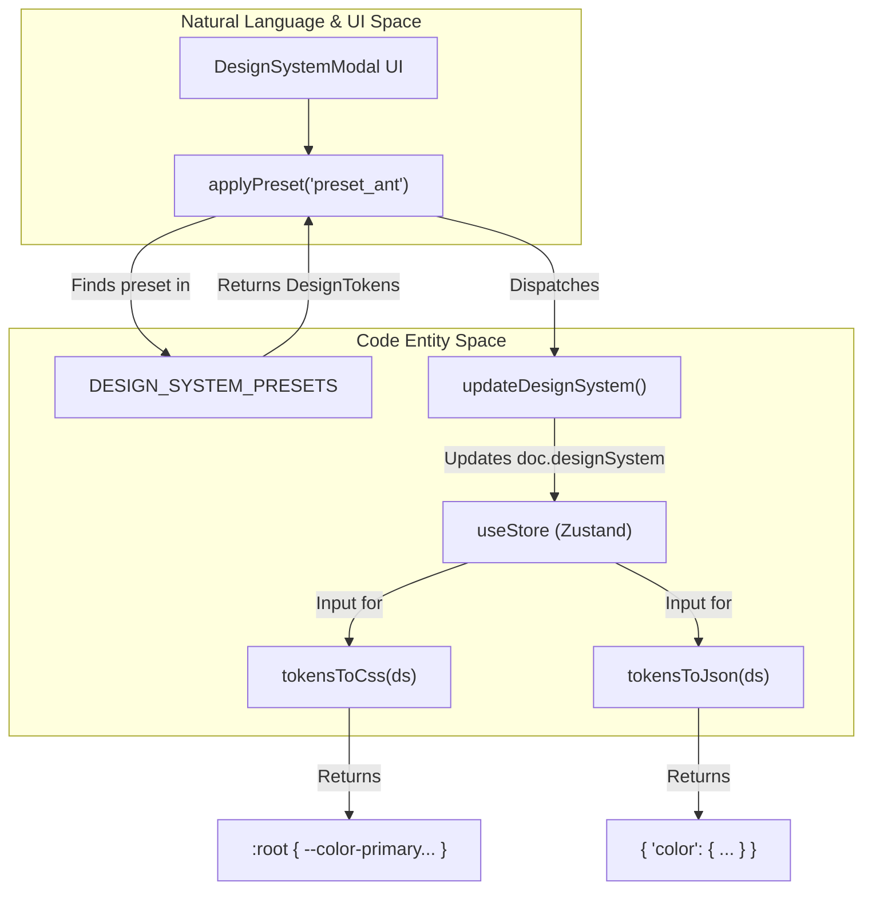
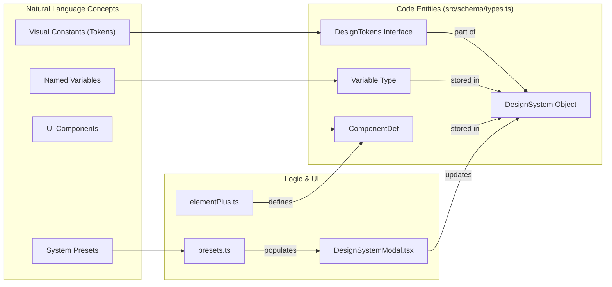

# 6.1 Design Tokens, Variables & Presets

# Design Tokens, Variables & Presets

Relevant source files

The following files were used as context for generating this wiki page:

- [src/components/CloudModal.tsx](src/components/CloudModal.tsx)
- [src/components/DesignSystemModal.tsx](src/components/DesignSystemModal.tsx)
- [src/designsystem/presets.ts](src/designsystem/presets.ts)
- [src/export/exportTokens.ts](src/export/exportTokens.ts)
- [src/market/elementPlus.ts](src/market/elementPlus.ts)
- [src/views/canvas/PropertiesPanel.tsx](src/views/canvas/PropertiesPanel.tsx)

OpenPrototype utilizes a multi-layered design system architecture that bridges high-level design tokens with low-level CSS/JSON exports and reusable UI presets. The system is designed to ensure visual consistency across AI-generated screens while providing Figma-like flexibility for manual overrides and variable binding.

## DesignTokens Structure

The `DesignTokens` interface defines the core visual constants of a project. These tokens are stored within the `DesignSystem` object of a `GpoDocument` [src/schema/types.ts]().

| Category | Description | Data Structure |
| :--- | :--- | :--- |
| **Colors** | Semantic color mappings (primary, bg, text, etc.) | `Record<string, string>` (Hex codes) |
| **Radii** | Corner radius scales (sm, md, lg, full) | `Record<string, number>` (Pixels) |
| **Spacing** | Layout padding and gap scales (xs, sm, md, lg, xl) | `Record<string, number>` (Pixels) |
| **Fonts** | Font family and type scale (sizes: xs to 2xl) | `{ family: string, sizes: Record<string, number> }` |
| **Elevation** | Box shadow definitions for depth | `Record<string, Shadow>` (x, y, blur, color) |

Sources: [src/designsystem/presets.ts:11-18](), [src/designsystem/presets.ts:27-47]()

## Named Variables

Beyond standard tokens, the system supports **Variables**. These are named entities that can be bound to node properties, similar to Figma Variables. Variables are categorized into `color` or `number` types and organized into collections.

### Variable Lifecycle
1.  **Creation**: Users add variables via the `DesignSystemModal` [src/components/DesignSystemModal.tsx:58-68]().
2.  **Storage**: Variables are stored in the `ds.variables` array [src/components/DesignSystemModal.tsx:31]().
3.  **Binding**: Variables can be applied to node styles (e.g., fill color or corner radius) to maintain global sync.

Sources: [src/components/DesignSystemModal.tsx:3-4](), [src/components/DesignSystemModal.tsx:56-68]()

## Design System Presets

OpenPrototype includes several built-in presets that allow users to jumpstart projects with industry-standard design languages. The `DESIGN_SYSTEM_PRESETS` registry contains configurations for:

*   **OpenPrototype Default**: A neutral, indigo-based system [src/designsystem/presets.ts:23-52]().
*   **Material 3**: Google's design language with large radii and purple primary colors [src/designsystem/presets.ts:53-82]().
*   **Ant Design**: Enterprise-focused with small radii and "Sunrise Blue" [src/designsystem/presets.ts:83-112]().
*   **Element Plus**: A Vue-ecosystem standard with 4px radii and "Vitality Blue" [src/designsystem/presets.ts:114-142]().

### Preset Implementation
Presets are applied using the `applyPreset` function in the UI, which updates the local state of the `DesignSystemModal` before committing to the global store [src/components/DesignSystemModal.tsx:33-44]().

### Component Marketplace Integration
Specific libraries like **Element Plus** also provide high-fidelity component packages (`EP`) that use fixed color palettes to ensure visual fidelity with the original framework [src/market/elementPlus.ts:12-27]().

Sources: [src/designsystem/presets.ts:22-143](), [src/market/elementPlus.ts:5-11]()

## Token Export Mechanisms

Design systems can be exported into developer-friendly formats using the `exportTokens.ts` utilities.

### CSS Custom Properties
The `tokensToCss` function iterates through colors, radii, spacing, and font sizes to generate a `:root` block [src/export/exportTokens.ts:4-18]().
*   **Prefixes**: `--color-`, `--radius-`, `--space-`, `--font-`.
*   **Units**: Numbers are automatically suffixed with `px` where appropriate [src/export/exportTokens.ts:9-15]().

### JSON (W3C Format)
The `tokensToJson` function serializes the tokens into a structured JSON object, following a format compatible with many design-to-code pipelines [src/export/exportTokens.ts:21-33]().

Sources: [src/export/exportTokens.ts:1-34]()

## System Architecture Diagrams

### Token Data Flow: From Preset to Export
This diagram illustrates how data flows from the static `DESIGN_SYSTEM_PRESETS` into the application state and eventually to external formats.

**Preset Data Flow**

Sources: [src/components/DesignSystemModal.tsx:33-54](), [src/export/exportTokens.ts:4-33]()

### Variable and Component Mapping
This diagram bridges the conceptual "Design System" with the specific code entities that manage them.

**Design System Entity Mapping**

Sources: [src/schema/types.ts](), [src/components/DesignSystemModal.tsx:16-31](), [src/designsystem/presets.ts:11-18](), [src/market/elementPlus.ts:99-105]()

## DesignSystemModal UI

The `DesignSystemModal` provides a comprehensive interface for managing the design system [src/components/DesignSystemModal.tsx:15]().

### Key Features
*   **Preset Grid**: Visual cards for one-click application of standard systems [src/components/DesignSystemModal.tsx:99-112]().
*   **Audit List**: Real-time feedback from `auditDesignSystem` highlighting accessibility (WCAG) and consistency issues [src/components/DesignSystemModal.tsx:116-125]().
*   **Token Editors**: Grid-based inputs for colors, radii, spacing, and font sizes [src/components/DesignSystemModal.tsx:133-152]().
*   **Variable Management**: Interface for adding and patching named variables [src/components/DesignSystemModal.tsx:56-68]().
*   **System Prompt**: A textarea for defining "System Level Prompts" that are injected into AI generation requests to enforce design rules [src/components/DesignSystemModal.tsx:160-165]().

Sources: [src/components/DesignSystemModal.tsx:1-165](), [src/designsystem/audit.ts]()

---
