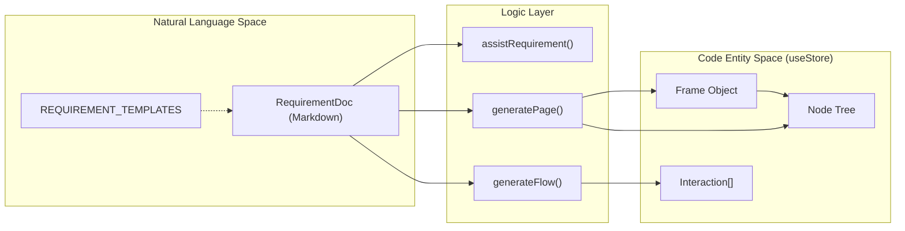
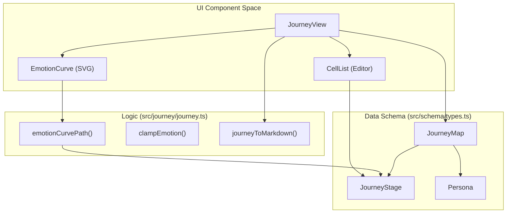

# 7 Requirements & Journey Mapping

# Requirements & Journey Mapping

Relevant source files

The following files were used as context for generating this wiki page:

- [src/journey/journey.ts](src/journey/journey.ts)
- [src/schema/types.ts](src/schema/types.ts)
- [src/views/JourneyView.tsx](src/views/JourneyView.tsx)
- [src/views/RequirementsView.tsx](src/views/RequirementsView.tsx)

OpenPrototype provides a dedicated product management suite that bridges the gap between high-level product strategy and low-level design entities. This is achieved through two primary views: the **Requirements View**, where natural language documentation is transformed into editable UI components, and the **User Journey Map**, which visualizes the user experience lifecycle and links specific stages to design frames.

## Requirements View

The `RequirementsView` is the entry point for product-driven design. It functions as a Markdown-based editor where users define product specs, which are then used as context for AI-driven page and flow generation.

*   **Editor & Live Preview**: Uses `react-markdown` [src/views/RequirementsView.tsx:2]() and `remarkGfm` [src/views/RequirementsView.tsx:3]() to provide a rich text experience for editing `RequirementDoc` entities [src/schema/types.ts:192-199]().
*   **AI Orchestration**: The view triggers `generatePage` [src/views/RequirementsView.tsx:82]() and `generateFlow` [src/views/RequirementsView.tsx:161]() to convert text into `Frame` and `Node` objects on the canvas.
*   **Slash Commands**: A command palette implemented via `detectSlash` [src/views/RequirementsView.tsx:137]() allows for rapid template insertion and AI assistance actions like "Polish" or "Summarize".

For implementation details on Markdown processing and AI triggers, see [Requirements View](#7.1).

### Document to Canvas Mapping
The following diagram illustrates how natural language requirements are processed into structured design data.

**Requirements Transformation Flow**

Sources: [src/views/RequirementsView.tsx:6-14](), [src/schema/types.ts:192-199](), [src/store/useStore.ts:47-56]()

---

## User Journey Map

The `JourneyView` provides a matrix-style visualization of the user experience. It allows product managers to map out personas, scenarios, and emotional arcs, directly linking user stages to specific prototype screens.

*   **Journey Matrix**: Organizes data into specific rows defined in `JOURNEY_ROWS` (actions, touchpoints, thoughts, emotion, pains, and opportunities) [src/journey/journey.ts:14-22]().
*   **Emotion Curve**: A specialized `EmotionCurve` component [src/views/JourneyView.tsx:126]() uses `emotionCurvePath` [src/journey/journey.ts:89]() to generate an SVG path using Catmull-Rom interpolation based on `JourneyEmotion` scores (-2 to 2) [src/journey/journey.ts:36-50]().
*   **Canvas Integration**: Stages can be linked to `frameId` [src/schema/types.ts:113](), allowing users to jump from a journey step directly to the corresponding design in the `design` view [src/views/JourneyView.tsx:185-187]().

For details on the SVG rendering and normalization heuristics, see [User Journey Map](#7.2).

### Journey Entity Architecture
This diagram maps the visual components of the Journey Map to the underlying data structures and rendering logic.

**Journey Mapping Architecture**

Sources: [src/journey/journey.ts:1-22](), [src/views/JourneyView.tsx:126-172](), [src/schema/types.ts:170-183]()

---

## View Relations

| Feature | Requirements View | Journey Map |
| :--- | :--- | :--- |
| **Primary State** | `doc.requirements` [src/views/RequirementsView.tsx:47]() | `doc.journeys` [src/views/JourneyView.tsx:190]() |
| **AI Generation** | Generates UI Frames/Flows [src/views/RequirementsView.tsx:78]() | Generates Journey Stages [src/views/JourneyView.tsx:223]() |
| **Data Format** | Markdown [src/schema/types.ts:195]() | Structured Matrix [src/journey/journey.ts:14]() |
| **Canvas Link** | `generatedFrameIds` [src/schema/types.ts:198]() | `frameId` per stage [src/views/JourneyView.tsx:187]() |
| **Export Options** | Markdown | Markdown, CSV [src/journey/journey.ts:161-182]() |

Sources: [src/views/RequirementsView.tsx:47-56](), [src/views/JourneyView.tsx:174-190](), [src/journey/journey.ts:161-182]()

---
