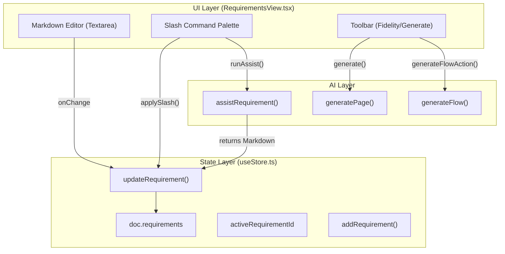
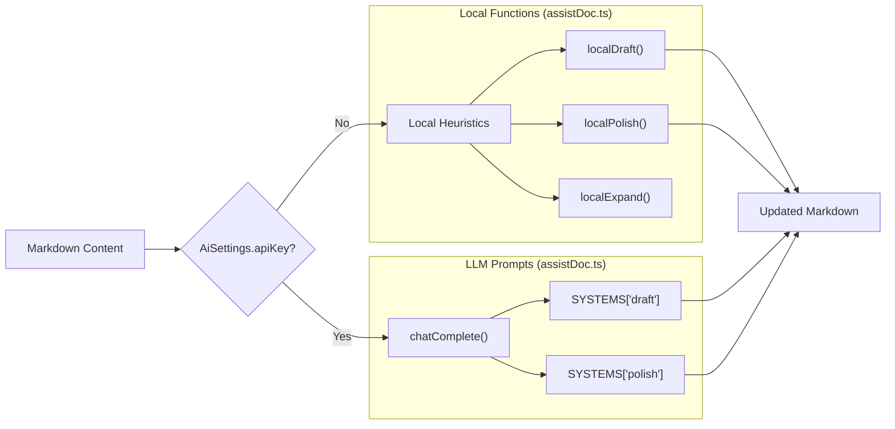

# 7.1 Requirements View

# Requirements View

Relevant source files

The following files were used as context for generating this wiki page:

- [src/ai/assistDoc.ts](src/ai/assistDoc.ts)
- [src/requirements/slashCommands.ts](src/requirements/slashCommands.ts)
- [src/templates/requirementTemplates.ts](src/templates/requirementTemplates.ts)
- [src/templates/starters.ts](src/templates/starters.ts)
- [src/views/RequirementsView.tsx](src/views/RequirementsView.tsx)

The `RequirementsView` component serves as the primary interface for product definition within OpenPrototype. It bridges the gap between natural language product specifications and visual design by providing a Markdown-based editor integrated with AI generation triggers. It allows users to manage multiple requirement documents, apply industry-standard templates, and use a slash command palette for rapid document construction.

### Core Architecture and Data Flow

The `RequirementsView` interacts directly with the `useStore` Zustand store to persist `RequirementDoc` entities within the `GpoDocument`. Changes in the editor trigger immediate updates to the document state, which are then used as context for AI generation tasks.

#### Requirements Data Flow Diagram

Title: Requirements Data Flow

Sources: [src/views/RequirementsView.tsx:46-56](), [src/views/RequirementsView.tsx:140-154](), [src/views/RequirementsView.tsx:156-172]()

### Component Implementation

The `RequirementsView` is split into a sidebar for navigation between different requirement sets and a main editing area.

#### Key Functions and State
- **Fidelity Selection**: Users can toggle between `wireframe` and `hifi` modes [src/views/RequirementsView.tsx:61](). This state is passed to the AI generators to determine the visual complexity of the output.
- **Requirement CRUD**:
    - `addRequirement`: Creates a new blank document [src/views/RequirementsView.tsx:51]().
    - `updateRequirement`: Updates the title or markdown content [src/views/RequirementsView.tsx:52]().
    - `deleteRequirement`: Removes the requirement from the document [src/views/RequirementsView.tsx:53]().
- **AI Generation Triggers**:
    - `generate()`: Calls `generatePage` to create a single canvas frame based on the current markdown [src/views/RequirementsView.tsx:78-102]().
    - `generateFlowAction()`: Calls `generateFlow` to generate multiple interconnected frames [src/views/RequirementsView.tsx:156-172]().

Sources: [src/views/RequirementsView.tsx:46-102](), [src/views/RequirementsView.tsx:156-172]()

### Slash Command Palette

The editor implements a "Slash Command" system triggered by typing `/`. This allows for rapid insertion of Markdown blocks or triggering AI-assisted document transformations.

| Group | Purpose | Examples |
| :--- | :--- | :--- |
| **Basic** | Standard Markdown blocks | H1-H3, Lists, Code blocks, Dividers [src/requirements/slashCommands.ts:38-145]() |
| **Doc** | PRD-specific sections | User Stories, Acceptance Criteria, Goals [src/requirements/slashCommands.ts:147-220]() |
| **Data** | Technical definitions | Data Models, API definitions, State Enums [src/requirements/slashCommands.ts:222-261]() |
| **AI** | Intelligent transformations | Draft PRD, Polish, Expand, Summarize [src/requirements/slashCommands.ts:263-309]() |

#### Slash Command Logic
The system uses `detectSlash` to identify the query string after the `/` character [src/views/RequirementsView.tsx:134-138](). When a command is selected via `applySlash`, it either performs a string insertion (for `insert` kind) or invokes `runAssist` (for `ai` kind) [src/views/RequirementsView.tsx:140-154]().

Sources: [src/requirements/slashCommands.ts:15-26](), [src/views/RequirementsView.tsx:134-154]()

### AI Assistance (assistRequirement)

The `assistRequirement` function handles document-level AI tasks. It features a dual-path execution strategy:
1. **LLM Path**: If an API key is configured in `AiSettings`, it calls `chatComplete` with specific system prompts defined in the `SYSTEMS` registry [src/ai/assistDoc.ts:140-156]().
2. **Local Heuristic Path**: If offline or no key is provided, it uses local functions like `localDraft`, `localPolish`, and `localSummarize` to provide basic structural assistance [src/ai/assistDoc.ts:163-172]().

Title: AI Assistance Strategy

Sources: [src/ai/assistDoc.ts:11-21](), [src/ai/assistDoc.ts:158-182]()

### Templates and Starters

To prevent the "blank page" problem, the system provides two levels of templates:
- **Requirement Templates**: Standardized structures for PRDs, Feature Specs, and User Stories [src/templates/requirementTemplates.ts:15-128]().
- **Starter Templates**: High-level document presets (e.g., "Mobile App", "Web Admin") that initialize both a requirement document and a correctly sized canvas frame [src/templates/starters.ts:62-113]().

Sources: [src/templates/requirementTemplates.ts:15-128](), [src/templates/starters.ts:62-113]()

---
