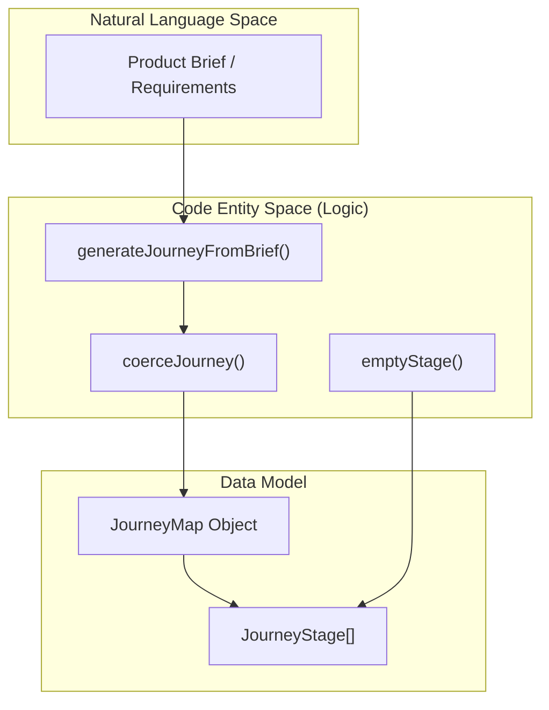
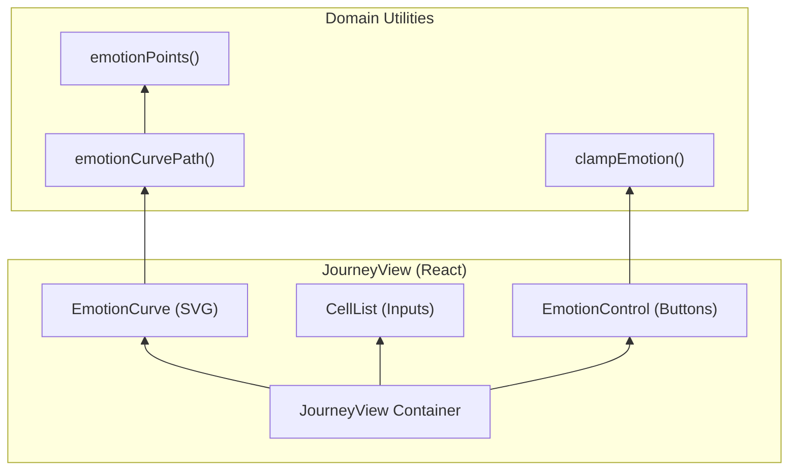

# 7.2 User Journey Map

# User Journey Map

Relevant source files

The following files were used as context for generating this wiki page:

- [src/ai/flow.ts](src/ai/flow.ts)
- [src/ai/generate.ts](src/ai/generate.ts)
- [src/ai/localGenerator.ts](src/ai/localGenerator.ts)
- [src/journey/journey.ts](src/journey/journey.ts)
- [src/schema/types.ts](src/schema/types.ts)
- [src/views/JourneyView.tsx](src/views/JourneyView.tsx)

The User Journey Map is a product management artifact within OpenPrototype that visualizes a persona's experience over time. It represents the "Product Management" layer of the application, bridging high-level requirements with specific design frames. The system supports manual creation, AI-assisted generation, and interactive visualization of emotion curves.

## Journey Map Schema

The data structure for a journey map is defined within the `GpoDocument` and resides in `src/schema/types.ts`. It is composed of a persona, a scenario, and an ordered list of stages.

### Core Types

*   **`JourneyMap`**: The root entity containing metadata, persona details, and a collection of `JourneyStage` objects `[src/schema/types.ts:241-250]()`.
*   **`JourneyStage`**: A discrete step in the user journey. It contains arrays for qualitative data and a numeric `JourneyEmotion` score `[src/schema/types.ts:252-262]()`.
*   **`JourneyEmotion`**: A scale from `-2` (Very Frustrated) to `2` (Very Satisfied) `[src/schema/types.ts:264-264]()`.
*   **`JourneyRow`**: Dimensions of the journey matrix: `actions`, `touchpoints`, `thoughts`, `emotion`, `pains`, and `opportunities` `[src/journey/journey.ts:14-22]()`.

### Frame Linking
A `JourneyStage` can optionally include a `frameId` `[src/schema/types.ts:261-261]()`. This links the stage to a specific `Frame` on the canvas, allowing users to jump from the journey map directly to the corresponding UI design `[src/views/JourneyView.tsx:187-187]()`.

## Data Flow: Generation & Normalization

Journey maps can be generated via LLM providers or a local heuristic. Because AI outputs can be inconsistent, the system uses a "coerce" pattern to ensure data integrity.

### Generation Heuristics
The `generateJourneyFromBrief` function (and its LLM counterparts) takes a text brief and returns a `JourneyMap`. If no API key is provided, the system falls back to a local generator that parses the brief for keywords to construct a logical sequence of stages `[src/ai/generate.ts:218-223]()`.

### Normalization (Coerce)
The `coerceJourney` function ensures that any object (typically from an LLM) matches the expected schema. It validates that `emotion` scores are within the `-2..2` range and that all required arrays (actions, pains, etc.) exist `[src/journey/journey.ts:5-11]()`.

### System Logic Diagram

This diagram shows the relationship between natural language input and the generated code entities.

Sources: `src/journey/journey.ts`, `src/ai/generate.ts`, `src/schema/types.ts`

## JourneyView Matrix UI

The `JourneyView` component renders the map as a matrix where columns represent `JourneyStage` units and rows represent `JourneyRow` dimensions `[src/views/JourneyView.tsx:174-216]()`.

### EmotionCurve SVG
The "heart" of the journey map is the `EmotionCurve` component. It uses an SVG to render a continuous line representing user sentiment across stages.
*   **Interpolation**: It uses **Catmull-Rom to Bézier** conversion via `emotionCurvePath` to create a smooth, non-linear curve between discrete emotion points `[src/journey/journey.ts:89-111]()`.
*   **Coordinate Mapping**: The `emotionPoints` function maps the `-2..2` score to the vertical `y` coordinate and the stage index to the horizontal `x` coordinate based on the container width `[src/journey/journey.ts:114-131]()`.

### CellList Editing
Qualitative rows (e.g., Pains, Actions) are managed by the `CellList` component. It provides an inline-editing experience for arrays of strings, supporting "Enter to add" and "Click to remove" behaviors `[src/views/JourneyView.tsx:25-76]()`.

### UI Component Architecture

Sources: `src/views/JourneyView.tsx`, `src/journey/journey.ts`

## Export and Interop

The journey map can be exported to external formats for documentation and stakeholder review.

| Function | Format | Description |
| :--- | :--- | :--- |
| `journeyToMarkdown` | `.md` | Generates a hierarchical document with emojis representing emotion levels `[src/journey/journey.ts:161-179]()`. |
| `journeyToCsv` | `.csv` | Generates a matrix where rows are dimensions and columns are stages, suitable for Excel/Sheets `[src/journey/journey.ts:182-198]()`. |

### Implementation Details
*   **Markdown Export**: Iterates through `stages` and uses `EMOTION_EMOJI` and `EMOTION_LABELS` to provide visual context for the scores `[src/journey/journey.ts:170-170]()`.
*   **CSV Export**: Uses a comma-separated format with escaped quotes to handle multi-line strings within cells (e.g., multiple "Pains" in one stage) `[src/journey/journey.ts:183-184]()`.

Sources: `src/journey/journey.ts`, `src/views/JourneyView.tsx`

---
