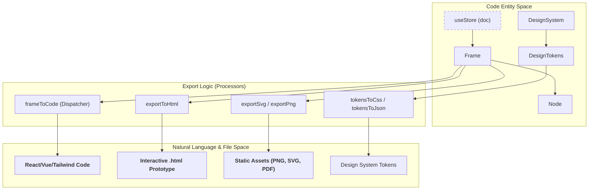
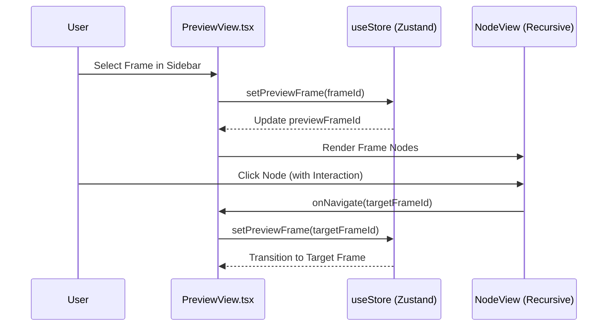

# 8 Export & Preview

# Export & Preview

Relevant source files

The following files were used as context for generating this wiki page:

- [src/App.tsx](src/App.tsx)
- [src/export/exportCode.test.ts](src/export/exportCode.test.ts)
- [src/export/exportCode.ts](src/export/exportCode.ts)
- [src/export/exportHtml.ts](src/export/exportHtml.ts)
- [src/views/HomeView.tsx](src/views/HomeView.tsx)
- [src/views/PreviewView.tsx](src/views/PreviewView.tsx)

OpenPrototype provides a comprehensive suite of export capabilities designed to bridge the gap between design and production. This subsystem handles the transformation of canvas-based `Frame` and `Node` entities into various formats, including production-ready code, interactive HTML prototypes, and standard design assets (PNG, SVG, PDF).

The `ExportMenu` in `App.tsx` serves as the primary entry point for these operations [src/App.tsx:49-144]().

### Export Architecture Overview

The export system is modularized by output type. Each module consumes the `GpoDocument` or specific `Frame` objects and utilizes `resolveFill` or `nodeFill` to translate design tokens and variables into final color values [src/render/resolve.ts:1-20]().

The following diagram illustrates the flow from the internal **Code Entity Space** to the external **Natural Language/File Space**:

**Export Pipeline: Code to Assets**

Sources: [src/App.tsx:49-144](), [src/export/exportCode.ts:1-15](), [src/export/exportHtml.ts:75-122]()

---

## 8.1 Code Export (React, Vue, Tailwind, HTML, CSS)

The code export engine transforms the design hierarchy into structured source code. It supports multiple frameworks and styling methodologies via a central dispatcher.

- **Generators**: Specific functions like `frameToReact`, `frameToVue`, and `frameToTailwind` handle framework-specific syntax [src/export/exportCode.ts:65-170]().
- **Styling Utilities**: Internal helpers like `styleObject` translate node properties into CSS objects [src/export/exportCode.ts:4-35](), while `toCssText` and `toJsxStyle` serialize these objects into string representations [src/export/exportCode.ts:37-51]().
- **Tailwind Integration**: The `tailwindClasses` function maps design properties (spacing, radius, colors) to arbitrary-value utility classes (e.g., `rounded-[8px]`) [src/export/exportCode.ts:172-185]().

For implementation details on language registries and snippet generation, see **[Code Export (React, Vue, Tailwind, HTML, CSS)](#8.1)**.

Sources: [src/export/exportCode.ts:1-185](), [src/export/exportCode.test.ts:93-111]()

---

## 8.2 HTML Prototype Export & Preview Player

OpenPrototype enables the creation of "living" prototypes that can be shared as single, self-contained HTML files or viewed within the internal `PreviewView`.

- **Interactive Runtime**: The `exportToHtml` function generates a document containing a `gotoFrame` JavaScript runtime and CSS animations (`anim-fade`, `anim-slide-left`) to handle transitions [src/export/exportHtml.ts:82-122]().
- **Interaction Wiring**: Nodes with `interactions` are rendered with `data-clickable` attributes and `onclick` handlers that trigger frame navigation [src/export/exportHtml.ts:59-65]().
- **Internal Preview**: The `PreviewView` component provides an in-app player using a recursive `NodeView` renderer [src/views/PreviewView.tsx:6-62](). It uses the `previewFrameId` from `useStore` to manage the current active screen [src/views/PreviewView.tsx:68-75]().

For details on the prototype player and SVG flow graphs, see **[HTML Prototype Export & Preview Player](#8.2)**.

Sources: [src/export/exportHtml.ts:1-134](), [src/views/PreviewView.tsx:1-131]()

---

## 8.3 Image, PDF & SVG Export

For traditional design handoff, the system supports high-fidelity static asset generation.

- **Vector Export**: `frameToSvg` serializes the node tree into standard SVG XML, including `<linearGradient>` definitions for complex fills [src/export/exportSvg.ts:1-50]().
- **Raster Export**: `downloadFramePng` captures the current Konva stage at a specified scale (e.g., @2x) [src/export/exportPng.ts:1-20]().
- **Batch Processing**: `downloadFramesZip` allows users to export all frames in a page as a single compressed archive [src/export/batchExport.ts:1-15]().

For details on stage capturing and PDF serialization, see **[Image, PDF & SVG Export](#8.3)**.

Sources: [src/App.tsx:85-104](), [src/export/exportSvg.ts:1-50](), [src/export/exportPng.ts:1-20]()

---

### System Integration: Preview & Navigation

The preview system bridges the gap between static design and interactive user flows.

**Preview State & Navigation Flow**

Sources: [src/views/PreviewView.tsx:64-131](), [src/store/useStore.ts:1-100]()

---
