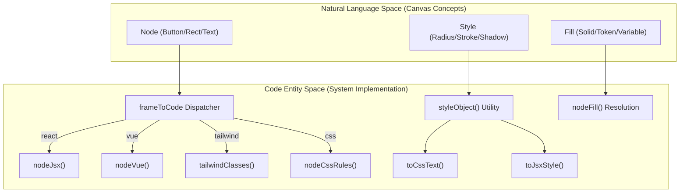
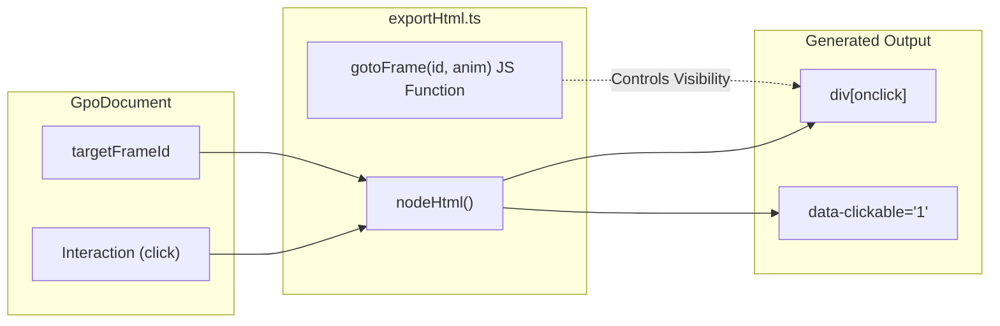

# 8.1 Code Export (React, Vue, Tailwind, HTML, CSS)

# Code Export (React, Vue, Tailwind, HTML, CSS)

Relevant source files

The following files were used as context for generating this wiki page:

- [src/export/exportCode.test.ts](src/export/exportCode.test.ts)
- [src/export/exportCode.ts](src/export/exportCode.ts)
- [src/export/exportHtml.ts](src/export/exportHtml.ts)
- [src/render/resolve.ts](src/render/resolve.ts)
- [src/views/PreviewView.tsx](src/views/PreviewView.tsx)

The Code Export system is responsible for translating the internal `GpoDocument` canvas representation into production-ready code snippets and standalone prototypes. It employs a visitor-like pattern to traverse the node hierarchy and map design properties (positioning, styling, and content) to target-specific syntax.

## Core Dispatcher & Registry

The system uses a centralized dispatcher to route export requests based on the requested language. This is primarily consumed by the **Dev Mode** panel for real-time inspection and the **Export** utilities for file downloads.

| Function | Role | Source |
| :--- | :--- | :--- |
| `frameToCode` | Main entry point for converting a full Frame to a specific language. | [src/export/exportCode.ts:231-244]() |
| `nodeToCode` | Entry point for converting a single Node to a snippet. | [src/export/exportCode.ts:246-259]() |
| `CODE_LANGS` | Registry of supported languages: `react`, `vue`, `tailwind`, `html`, `css`. | [src/export/exportCode.ts:229-229]() |

### Data Flow: Node to Code Entity
The following diagram illustrates how a `Node` object from the `GpoDocument` is transformed into code entities across different frameworks.

**Natural Language Space to Code Entity Space Mapping**

Sources: [src/export/exportCode.ts:4-62](), [src/render/resolve.ts:21-35]()

---

## Styling Utilities

Styling is handled by a shared utility layer that converts `Node` properties into standard CSS-in-JS objects or string representations.

### styleObject
The `styleObject` function [src/export/exportCode.ts:4-35]() is the source of truth for style translation. It maps:
*   **Layout**: `x`, `y`, `width`, `height` to `absolute` positioning [src/export/exportCode.ts:7-12]().
*   **Appearance**: `radius` to `borderRadius`, `stroke` to `border`, and `shadow` to `boxShadow` [src/export/exportCode.ts:14-17]().
*   **Typography**: `text` properties (color, size, weight, family) are mapped to flexbox containers to ensure vertical and horizontal alignment [src/export/exportCode.ts:20-33]().

### toCssText vs toJsxStyle
*   `toCssText`: Converts a style object into a semicolon-delimited string (e.g., `border-radius:8px;`) [src/export/exportCode.ts:37-44]().
*   `toJsxStyle`: Converts a style object into a React-compatible object string (e.g., `{{ borderRadius: 8 }}`) [src/export/exportCode.ts:46-51]().

Sources: [src/export/exportCode.ts:4-51]()

---

## Framework Generators

### React & Vue
Both React and Vue generators perform recursive tree traversal via `nodeJsx` [src/export/exportCode.ts:53-62]() and `nodeVue` [src/export/exportCode.ts:138-145]().
*   **React**: Generates a functional component using `export default function [Name]()`. It uses inline styles for high fidelity to the canvas coordinates [src/export/exportCode.ts:65-77]().
*   **Vue**: Generates a Single File Component (SFC) with a `<template>` and `<script setup>` block. The root frame dimensions are defined as a reactive object in the script section [src/export/exportCode.ts:148-166]().

### Tailwind CSS
The Tailwind generator [src/export/exportCode.ts:172-205]() uses **arbitrary-value utilities** (e.g., `left-[10px]`) to maintain the precision of the design canvas.
*   It iterates through the `styleObject` keys and pushes corresponding Tailwind classes into an array [src/export/exportCode.ts:174-190]().
*   Color tokens are resolved using `nodeFill` and wrapped in `bg-[...]` or `text-[...]` syntax [src/export/exportCode.ts:175-184]().

### HTML/CSS (Class-based)
Unlike the inline-style generators, `frameToCss` creates a structured stylesheet [src/export/exportCode.ts:119-123]().
*   It generates unique class names based on the node name and index (e.g., `.Hero-1`) [src/export/exportCode.ts:107-110]().
*   It uses `nodeCssRules` to recursively build an accumulator of CSS blocks [src/export/exportCode.ts:112-116]().

Sources: [src/export/exportCode.ts:65-205]()

---

## Interaction & Prototype Export

The system supports exporting a fully interactive HTML prototype via `exportToHtml`.

**Interaction Flow: Canvas to Interactive HTML**

Sources: [src/export/exportHtml.ts:59-66](), [src/export/exportHtml.ts:110-119]()

### Key Features of HTML Export:
1.  **Interaction Wiring**: The `nodeHtml` function searches for `click` triggers in `node.interactions` and injects an `onclick` handler calling `gotoFrame` [src/export/exportHtml.ts:59-62]().
2.  **Runtime Script**: A small JavaScript runtime is embedded in the exported HTML to handle frame transitions and animations (`fade`, `slide-left`, `slide-right`) [src/export/exportHtml.ts:110-119]().
3.  **Device Simulation**: The export wraps frames in a `.device` container with centered flexbox layout to simulate a mobile/web viewport [src/export/exportHtml.ts:88-102]().
4.  **Download Utility**: `downloadHtml` creates a `Blob` from the generated string and triggers a browser download using a temporary `<a>` element [src/export/exportHtml.ts:124-133]().

Sources: [src/export/exportHtml.ts:1-134]()

---

## Preview System Implementation

The `PreviewView` component [src/views/PreviewView.tsx:64-130]() provides an in-app version of the exported code. It uses the `NodeView` recursive component [src/views/PreviewView.tsx:6-62]() to render the frame hierarchy.

*   **State Sync**: It retrieves the current document and design system from `useStore` [src/views/PreviewView.tsx:65-66]().
*   **Navigation**: Uses `setPreviewFrame` from the store to update the active view when an interactive node is clicked [src/views/PreviewView.tsx:54-69]().
*   **Styling**: Uses `CSSProperties` to map node styles directly to React elements, mimicking the logic in `styleObject` but for live rendering [src/views/PreviewView.tsx:16-50]().

Sources: [src/views/PreviewView.tsx:6-130]()

---
