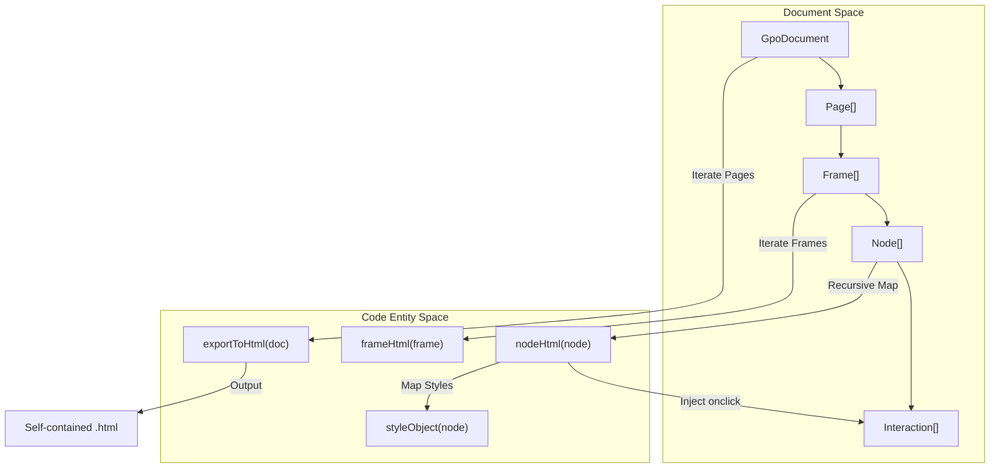
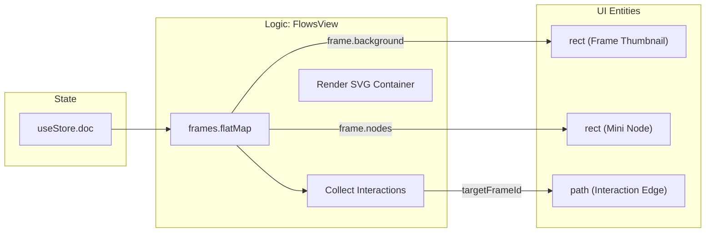

# 8.2 HTML Prototype Export & Preview Player

# HTML Prototype Export & Preview Player

Relevant source files

The following files were used as context for generating this wiki page:

- [src/export/exportCode.test.ts](src/export/exportCode.test.ts)
- [src/export/exportCode.ts](src/export/exportCode.ts)
- [src/export/exportHtml.ts](src/export/exportHtml.ts)
- [src/views/FlowsView.tsx](src/views/FlowsView.tsx)
- [src/views/PreviewView.tsx](src/views/PreviewView.tsx)

The HTML Prototype Export and Preview system provides a mechanism for transforming design documents into interactive, self-contained web applications. This system spans from code generation utilities that produce static HTML/CSS/React/Vue snippets to a dedicated runtime player within the application that simulates user flows.

## HTML Export Pipeline

The export pipeline converts the `GpoDocument` schema into a standalone HTML file. This file includes the CSS layout for every frame, a JavaScript runtime for navigation, and CSS animations for transitions.

### exportToHtml and downloadHtml
The core logic resides in `exportToHtml`, which aggregates all frames across all pages into a single document [src/export/exportHtml.ts:75-122](). It generates a "device" container that hosts frames as absolute-positioned layers [src/export/exportHtml.ts:91-93]().

### Interaction Wiring
Interactive elements are identified by checking the `interactions` array on each `Node`. If a "click" trigger is found, the exporter injects a `data-clickable` attribute and an `onclick` handler that calls the embedded `gotoFrame` runtime function [src/export/exportHtml.ts:59-62]().

### Runtime Script
The exported HTML contains a lightweight vanilla JavaScript runtime to manage state:
- **`gotoFrame(id, anim)`**: Removes active classes from all frames and applies the `active` class to the target frame ID. It also triggers CSS animations (e.g., `anim-fade`, `anim-slide-left`) [src/export/exportHtml.ts:110-119]().

### Data Flow: Document to HTML
The following diagram illustrates how the `GpoDocument` structure is serialized into a flat HTML file.

**Prototype Serialization Flow**

**Sources:** [src/export/exportHtml.ts:1-134](), [src/export/exportCode.ts:4-35]()

---

## Preview Player (PreviewView)

The `PreviewView` component provides an in-app interactive player. Unlike the Canvas, which is for editing, the Preview Player focuses on high-fidelity simulation and navigation.

### PreviewView Component
- **Frame Sidebar**: Lists all frames in the document, allowing manual navigation via `setPreviewFrame` [src/views/PreviewView.tsx:88-103]().
- **Recursive Renderer**: Uses the `NodeView` component to recursively render the node hierarchy using standard React DOM elements and inline styles [src/views/PreviewView.tsx:6-62]().
- **State Integration**: Connects to the `useStore` to track `previewFrameId` [src/views/PreviewView.tsx:68-69]().

### NodeView Implementation
`NodeView` maps `Node` properties to `CSSProperties` [src/views/PreviewView.tsx:16-50](). It handles:
1.  **Fills**: Resolves fills via `nodeFill(node, ds)` [src/views/PreviewView.tsx:31]().
2.  **Typography**: Maps `node.text` properties to flexbox alignment and font styles [src/views/PreviewView.tsx:34-48]().
3.  **Navigation**: If a node has a click interaction, it calls `onNavigate`, which updates the store's `previewFrameId` [src/views/PreviewView.tsx:54]().

**Sources:** [src/views/PreviewView.tsx:1-131](), [src/render/resolve.ts:1-20]()

---

## Prototype Overview (FlowsView)

The `FlowsView` provides a bird's-eye view of the entire prototype, visualizing the connections between frames as an SVG edge graph.

### Edge Generation
The view iterates through every node in every frame. If a node contains an interaction targeting another frame, an edge is created [src/views/FlowsView.tsx:26-34]().

### Layout & Rendering
- **Grid Layout**: Frames are arranged in a multi-column grid using `posOf(index)` [src/views/FlowsView.tsx:19-22]().
- **SVG Edges**: Connections are rendered as SVG paths using cubic Bézier curves (`C` command) [src/views/FlowsView.tsx:71-79]().
- **Mini Previews**: Each frame in the flow view contains a simplified "mini" version of its nodes to aid recognition [src/views/FlowsView.tsx:97-112]().

**FlowsView Mapping Logic**

**Sources:** [src/views/FlowsView.tsx:1-131]()

---

## Code Export Utilities

Beyond the full prototype, individual frames or nodes can be exported into various frontend formats via `exportCode.ts`.

| Format | Function | Description |
| :--- | :--- | :--- |
| **React** | `frameToReact` | Generates a functional component with absolute-positioned divs and inline JSX styles [src/export/exportCode.ts:65-77](). |
| **Vue** | `frameToVue` | Produces a Vue 3 Single File Component (SFC) with `<script setup>` [src/export/exportCode.ts:148-166](). |
| **Tailwind** | `frameToTailwind` | Uses arbitrary-value utility classes (e.g., `left-[10px]`) for styling [src/export/exportCode.ts:182-196](). |
| **CSS** | `frameToCss` | Generates a stylesheet with one class per node and a `.frame` container [src/export/exportCode.ts:119-123](). |

### Style Resolution
All exporters rely on `styleObject(node, ds)`, which normalizes the internal `Node` style schema into a standard JavaScript object representing CSS properties [src/export/exportCode.ts:4-35]().

**Sources:** [src/export/exportCode.ts:1-200](), [src/export/exportCode.test.ts:1-133]()

---
