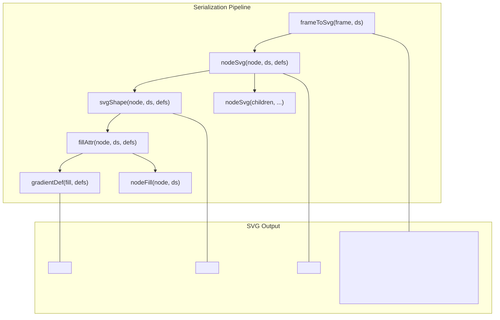
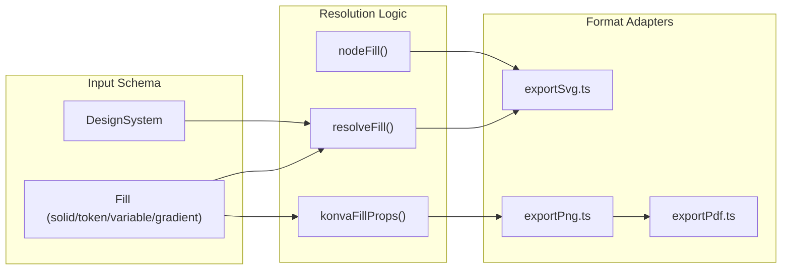

# 8.3 Image, PDF & SVG Export

# Image, PDF & SVG Export

Relevant source files

The following files were used as context for generating this wiki page:

- [src/export/batchExport.ts](src/export/batchExport.ts)
- [src/export/exportPdf.ts](src/export/exportPdf.ts)
- [src/export/exportPng.ts](src/export/exportPng.ts)
- [src/export/exportSvg.ts](src/export/exportSvg.ts)
- [src/render/fill.test.ts](src/render/fill.test.ts)
- [src/render/fill.ts](src/render/fill.ts)
- [src/render/resolve.ts](src/render/resolve.ts)

The Export system provides multi-format serialization and rasterization of canvas frames and nodes. It supports vector-based SVG generation, raster PNG/JPEG capture via the live Konva stage, PDF document generation, and batch ZIP packaging. Central to all export paths is a resolution engine that maps design tokens, variables, and complex fills (gradients/images) into the specific format's requirements.

## SVG Export Implementation

SVG export is implemented as a recursive serialization of the GPO `Node` tree into an XML string. Unlike raster exports, this process is purely data-driven and does not rely on the active browser DOM or Konva stage.

### Serialization Logic
The primary entry point is `frameToSvg` [src/export/exportSvg.ts:122-132](), which initializes a `defs` registry for gradients and iterates through the frame's top-level nodes. The `nodeSvg` function [src/export/exportSvg.ts:60-68]() handles the hierarchy by wrapping each node and its children in a `<g>` element with appropriate `transform` (translation) and `opacity`.

### Shape Mapping
The `svgShape` function [src/export/exportSvg.ts:70-109]() maps GPO node types to SVG primitives:
*   **Ellipse**: Maps to `<ellipse>` [src/export/exportSvg.ts:75-76]().
*   **Vector**: Maps to `<path>` using `pathData` to convert anchor points to SVG path syntax [src/export/exportSvg.ts:86-89]().
*   **Image**: Maps to `<image>` with `preserveAspectRatio="xMidYMid slice"` to emulate "cover" behavior [src/export/exportSvg.ts:82-85]().
*   **Text**: Maps to `<text>` with alignment-based `text-anchor` calculations [src/export/exportSvg.ts:90-96]().
*   **Rect/Group**: Maps to `<rect>` with optional `rx/ry` for rounded corners [src/export/exportSvg.ts:98-107]().

### Gradient Management
Gradients are handled by `gradientDef` [src/export/exportSvg.ts:15-42](). It generates unique IDs for `<linearGradient>` or `<radialGradient>` elements, calculates normalized coordinates based on the fill angle [src/export/exportSvg.ts:18-22](), and pushes them into the `<defs>` block of the final SVG document.

**Export Flow: Node to SVG**
"Natural Language Space" to "Code Entity Space"

Sources: [src/export/exportSvg.ts:1-143](), [src/render/resolve.ts:21-36]()

## Raster Export (PNG & JPEG)

Rasterization utilizes the `Konva.Stage` instance currently rendering the canvas. This ensures that what the user sees is exactly what is exported, including complex filters or blending modes.

### Stage Registration
Because the export utilities reside outside the React tree, the `CanvasStage` component must call `registerStage` [src/export/exportPng.ts:13-15]() to provide a `provider` callback. This callback returns the current `Konva.Stage`, its `scale`, and its `pos` (viewport offset) [src/export/exportPng.ts:4-10]().

### Pixel-Perfect Capture
The `exportFramePng` function [src/export/exportPng.ts:21-37]() calculates the bounding box of a frame within the global stage coordinates. It uses `stage.toDataURL` with a calculated `pixelRatio` [src/export/exportPng.ts:34]() to support high-resolution exports (e.g., 2x or 3x) regardless of the current canvas zoom level.

### Batch Export
`downloadFramesZip` [src/export/batchExport.ts:29-55]() orchestrates multi-frame exports. It iterates through an array of frames, generates PNG data URLs for each, and uses `JSZip` to package them. It includes a `sliceName` utility [src/export/batchExport.ts:6-14]() to sanitize frame names into safe filenames.

Sources: [src/export/exportPng.ts:1-87](), [src/export/batchExport.ts:1-56]()

## PDF Generation

The system generates standard-compliant PDF 1.4 files without external heavy libraries.

### Binary Construction
`jpegToPdf` [src/export/exportPdf.ts:18-58]() manually constructs the PDF binary structure:
1.  **Catalog & Pages**: Defines the document structure (Objects 1 & 2).
2.  **Page Object**: Sets the `MediaBox` to match the frame dimensions (Object 3).
3.  **Image XObject**: Embeds the raw JPEG stream with `/DCTDecode` filter (Object 4) [src/export/exportPdf.ts:41-46]().
4.  **Content Stream**: Applies a transformation matrix `cm` to scale the image to the page size and invokes it via `/Im0 Do` [src/export/exportPdf.ts:48-49]().
5.  **XRef Table**: A byte-accurate cross-reference table is generated to allow PDF readers to seek objects [src/export/exportPdf.ts:51-55]().

### Raster-to-PDF Pipeline
The `downloadFramePdf` function [src/export/exportPdf.ts:61-90]() first rasterizes the frame to a PNG via the Konva stage, draws it onto a temporary HTML5 canvas to ensure a white background (PDFs do not support transparency well), converts it to JPEG, and then passes the bytes to the PDF generator.

Sources: [src/export/exportPdf.ts:1-91]()

## Fill & Color Resolution

All renderers (Canvas, SVG, Code Export) rely on a unified fill resolution logic to handle design tokens and variables.

### Resolve Utilities
*   **`resolveFill`**: Maps a `Fill` object to a CSS-compatible string. It resolves `variable` types by looking up IDs in `ds.variables` and `token` types by looking up keys in `ds.tokens.colors` [src/render/resolve.ts:3-18]().
*   **`nodeFill`**: Provides fallback colors based on node type (e.g., `#ffffff` for inputs, `ds.tokens.colors.primary` for buttons) if no explicit fill is defined [src/render/resolve.ts:21-35]().

### Konva Property Mapping
For the live canvas, `konvaFillProps` [src/render/fill.ts:35-87]() transforms GPO fills into Konva-specific configurations:
*   **Linear Gradients**: Uses `linearGradientEndpoints` [src/render/fill.ts:5-17]() to calculate start/end points based on an angle.
*   **Radial Gradients**: Centers the gradient and sets the radius to the maximum dimension of the node [src/render/fill.ts:54-66]().
*   **Image Fills**: Configures `fillPatternImage` with scaling modes (`fit`, `fill`, `tile`) [src/render/fill.ts:67-85]().

**Fill Resolution System**
"Natural Language Space" to "Code Entity Space"

Sources: [src/render/resolve.ts:1-36](), [src/render/fill.ts:1-87]()

## Export Function Summary

| Function | Output Format | Mechanism | File |
| :--- | :--- | :--- | :--- |
| `frameToSvg` | `string` (XML) | Recursive node serialization | [src/export/exportSvg.ts:122]() |
| `exportFramePng` | `string` (Data URL) | `stage.toDataURL` | [src/export/exportPng.ts:21]() |
| `downloadFramesZip` | `Blob` (ZIP) | `JSZip` + `exportFramePng` | [src/export/batchExport.ts:29]() |
| `downloadFramePdf` | `Blob` (PDF) | Raster → JPEG → PDF Object Stream | [src/export/exportPdf.ts:61]() |
| `konvaFillProps` | `Object` | Konva Property Mapping | [src/render/fill.ts:35]() |

Sources: [src/export/exportSvg.ts:122-132](), [src/export/exportPng.ts:21-37](), [src/export/batchExport.ts:29-55](), [src/export/exportPdf.ts:61-90](), [src/render/fill.ts:35-87]()

---
