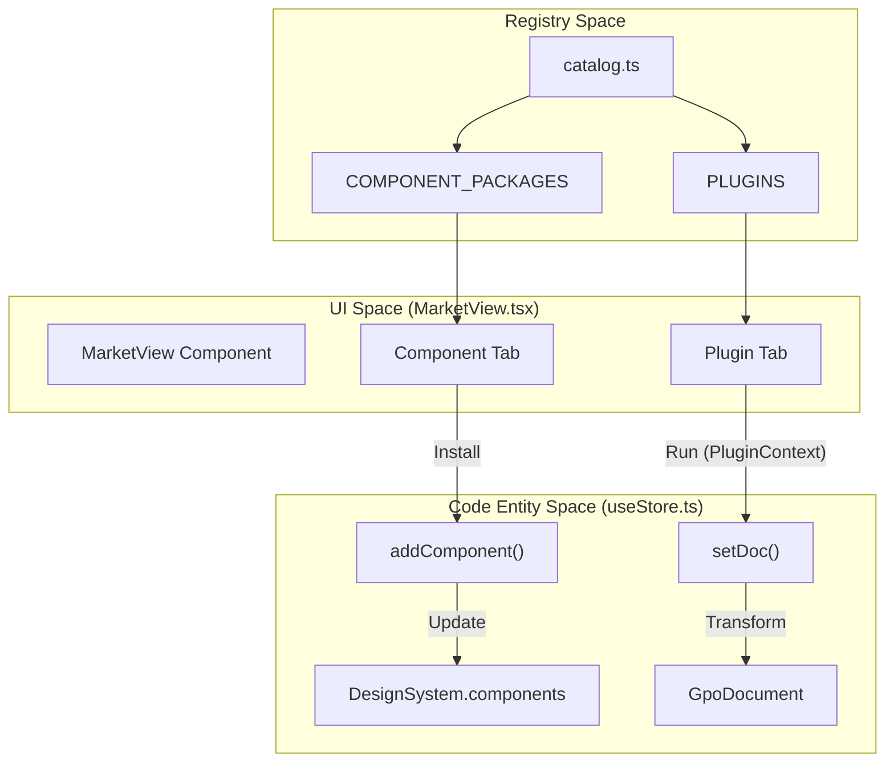
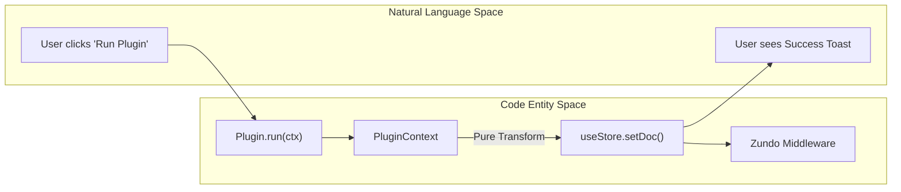

# 9 Component Marketplace & Plugin System

# Component Marketplace & Plugin System

Relevant source files

The following files were used as context for generating this wiki page:

- [docs/PLUGIN_SPEC.md](docs/PLUGIN_SPEC.md)
- [src/market/catalog.ts](src/market/catalog.ts)
- [src/schema/defaults.ts](src/schema/defaults.ts)
- [src/views/DesignView.tsx](src/views/DesignView.tsx)
- [src/views/MarketView.tsx](src/views/MarketView.tsx)

The Component Marketplace and Plugin System provide the extensibility layer for OpenPrototype. This system allows users to expand their design capabilities by installing standardized UI component packages and running automated transformation scripts (plugins) on their documents [docs/PLUGIN_SPEC.md:5-6](). These features are unified within the `MarketView` interface, which acts as the central hub for discovery and installation [src/views/MarketView.tsx:7-8]().

### Marketplace Architecture Overview

The extensibility system bridges the gap between static design definitions and dynamic document manipulation. It is built around a registry pattern where components and plugins are defined in a central catalog and injected into the application state via the `useStore` hook.

The following diagram illustrates the relationship between the Marketplace UI, the Registry, and the Document State:

**Marketplace Data Flow**

**Sources:** [src/market/catalog.ts:1-12](), [src/views/MarketView.tsx:7-17](), [docs/PLUGIN_SPEC.md:41-55]()

---

### Component Marketplace

The Marketplace allows users to browse and install `ComponentPackage` definitions into their local `DesignSystem` [src/views/MarketView.tsx:68-71](). 

*   **Registry:** The `COMPONENT_PACKAGES` array contains pre-defined templates, including basic primitives (Button, Input, Card) and external libraries like Element Plus [src/market/catalog.ts:36-180]().
*   **Factory Pattern:** Each package implements a `build(ds: DesignSystem)` function. This allows the component to dynamically adapt to the current design tokens (e.g., using the system's primary color or default border radius) at the moment of creation [src/market/catalog.ts:11-12]().
*   **Installation:** When a user clicks "Install", the `addComponent` action creates a `ComponentDef` and persists it in `designSystem.components`, making it available for instantiation in the `DesignView` [src/views/MarketView.tsx:69-70]().

For details, see [Component Packages & Marketplace](#9.1).

**Sources:** [src/market/catalog.ts:5-12](), [src/views/MarketView.tsx:58-77](), [src/schema/defaults.ts:19-20]()

---

### Plugin System

The Plugin System provides a mechanism for performing bulk, repeatable, and undoable transformations on a `GpoDocument` [docs/PLUGIN_SPEC.md:5-6]().

*   **Plugin Interface:** A plugin consists of a manifest (ID, name, permissions) and a `run` function [docs/PLUGIN_SPEC.md:11-21]().
*   **PluginContext API:** Plugins do not access the global store directly. Instead, they interact through a restricted `PluginContext` that provides read-only access to the document and specific setters like `updateNode` and `setDoc` [docs/PLUGIN_SPEC.md:47-55]().
*   **Execution:** Plugins are executed within the `MarketView`. Because they use the store's internal actions, every plugin execution is automatically recorded in the undo/redo history [src/views/MarketView.tsx:99-112]().

The following diagram maps the Plugin execution lifecycle from the UI to the underlying Code Entities:

**Plugin Execution Pipeline**

**Sources:** [docs/PLUGIN_SPEC.md:77-90](), [src/views/MarketView.tsx:97-112](), [src/store/useStore.ts:1-20]()

For details, see [Plugin System](#9.2).

---

### User Interface: MarketView

The `MarketView` is a tabbed interface located in the application's main navigation. It serves two primary functions:

| Feature | Description | Key Code Symbols |
| :--- | :--- | :--- |
| **Component Tab** | Filters packages by category (e.g., "Basic", "Navigation") and manages installation state. | `visiblePackages`, `installed` [src/views/MarketView.tsx:25-27]() |
| **Plugin Tab** | Displays available plugins, their authors, and required permissions. | `PLUGINS`, `p.permissions` [src/views/MarketView.tsx:81-96]() |
| **Status Bar** | Shows the total count of installed components in the current document. | `ds.components.length` [src/views/MarketView.tsx:40-41]() |

**Sources:** [src/views/MarketView.tsx:7-44]()

---

### Related Child Pages
*   **[Component Packages & Marketplace](#9.1)** — Details on the `ComponentPackage` interface, `ELEMENT_PLUS_PACKAGES`, and the seed component system.
*   **[Plugin System](#9.2)** — Details on the `PluginContext`, `mapAllNodes` utility, and the `PLUGIN_SPEC.md` requirements.

---
