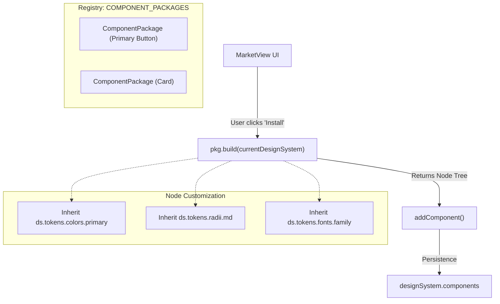
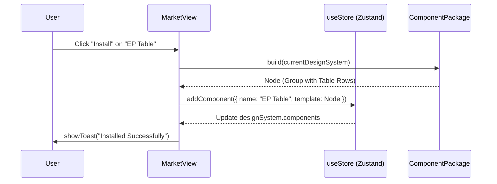

# 9.1 Component Packages & Marketplace

# Component Packages & Marketplace

Relevant source files

The following files were used as context for generating this wiki page:

- [docs/PLUGIN_SPEC.md](docs/PLUGIN_SPEC.md)
- [src/designsystem/presets.ts](src/designsystem/presets.ts)
- [src/market/catalog.ts](src/market/catalog.ts)
- [src/market/elementPlus.ts](src/market/elementPlus.ts)
- [src/schema/defaults.ts](src/schema/defaults.ts)
- [src/views/MarketView.tsx](src/views/MarketView.tsx)

The Component Packages system provides a registry of reusable UI templates that can be installed into a project's `DesignSystem`. These packages range from basic primitive shapes to high-fidelity component libraries like Element Plus. The Marketplace serves as the delivery mechanism for these packages and functional plugins.

## Component Package Architecture

A `ComponentPackage` is a structural template used to generate new `ComponentDef` objects. Unlike static JSON templates, packages use a factory pattern via a `build` function, allowing components to dynamically adapt to the current `DesignSystem` (e.g., inheriting active color tokens or font families).

### Data Structure & Registry

The system defines a standard interface for all installable components:

| Field | Type | Description |
| :--- | :--- | :--- |
| `id` | `string` | Unique identifier for the package (e.g., `pkg_primary_button`). |
| `name` | `string` | Display name in the marketplace UI. |
| `category` | `string` | Grouping for the marketplace (e.g., "Basic", "Navigation"). |
| `description` | `string` | Explanation of the component's purpose and design compliance. |
| `build` | `(ds: DesignSystem) => Node` | Factory function that returns a fresh `Node` tree. |

Sources: `[src/market/catalog.ts:6-12]()`

### Factory Pattern (build)

The `build` function is the core of the package system. It receives the current `DesignSystem` and returns a `Node` (often a `group` type) that serves as the `template` for a new component definition.

Sources: `[src/market/catalog.ts:11-12]()`, `[src/views/MarketView.tsx:68-71]()`

## Seed Components

To ensure immediate usability, every new document is initialized with a set of "Seed Components". These are hardcoded versions of the basic packages, defined in `seedComponents()` to avoid circular dependencies between the schema defaults and the marketplace catalog.

*   **Primary Button**: Uses `primary` color token and `Inter` font `[src/schema/defaults.ts:21-43]()`.
*   **Input Field**: Includes a label and a styled rectangle with a border `[src/schema/defaults.ts:44-66]()`.
*   **Card**: A container with a white fill, 8px radius, and a soft shadow `[src/schema/defaults.ts:67-97]()`.
*   **Avatar**: A simple circular (`ellipse`) placeholder `[src/schema/defaults.ts:98-111]()`.

These are automatically injected into `designSystem.components` upon document creation `[src/schema/defaults.ts:142]()`.

## Element Plus Integration

OpenPrototype includes a high-fidelity implementation of the **Element Plus** design language. Unlike basic packages that use design system tokens, Element Plus components use a fixed palette (`EP` constant) to maintain visual fidelity with the official library.

*   **Palette**: Defines fixed hex codes for `primary` (`#409eff`), `success` (`#67c23a`), and `border` (`#dcdfe6`) `[src/market/elementPlus.ts:12-27]()`.
*   **Components**: Includes complex groups such as:
    *   `ep_button_group`: A layout containing five color variants of EP buttons `[src/market/elementPlus.ts:101-122]()`.
    *   `ep_table`: A multi-node group representing a data table with headers and rows `[src/market/elementPlus.ts:232-257]()`.
    *   `ep_select` & `ep_switch`: Interactive-ready UI elements with specific EP radii and spacing `[src/market/elementPlus.ts:144-183]()`.

Sources: `[src/market/elementPlus.ts:1-257]()`

## Marketplace UI & Installation

The `MarketView` component provides a tabbed interface for browsing and installing both components and plugins.

### Component Installation Flow

1.  **Filtering**: Users filter by `category` (e.g., "Basic", "Element Plus") `[src/views/MarketView.tsx:46-56]()`.
2.  **State Check**: The UI checks if a component with the same name already exists in `ds.components` to prevent duplicates `[src/views/MarketView.tsx:19-19]()`.
3.  **Action**: When "Install" is clicked, `pkg.build(ds)` is called to generate the node template.
4.  **Persistence**: The resulting `ComponentDef` is added to the Zustand store via `addComponent` `[src/views/MarketView.tsx:69-71]()`.

### Plugin Execution

The "Plugins" tab lists functional extensions. Unlike components, which are static templates, plugins are executable logic. The `MarketView` provides a `PluginContext` to the plugin's `run` function, granting controlled access to `updateDesignSystem`, `updateNode`, and `setDoc` `[src/views/MarketView.tsx:100-107]()`.

Sources: `[src/views/MarketView.tsx:58-116]()`, `[docs/PLUGIN_SPEC.md:41-55]()`

## Component Library Registry

The `COMPONENT_PACKAGES` array in `catalog.ts` serves as the single source of truth for the marketplace. It aggregates:
1.  **BASIC_PACKAGES**: Standard UI primitives (Navbar, List Item, Tag, Search Bar) `[src/market/catalog.ts:36-235]()`.
2.  **ELEMENT_PLUS_PACKAGES**: High-fidelity EP components `[src/market/elementPlus.ts:99-257]()`.

Sources: `[src/market/catalog.ts:4-5]()`

---
