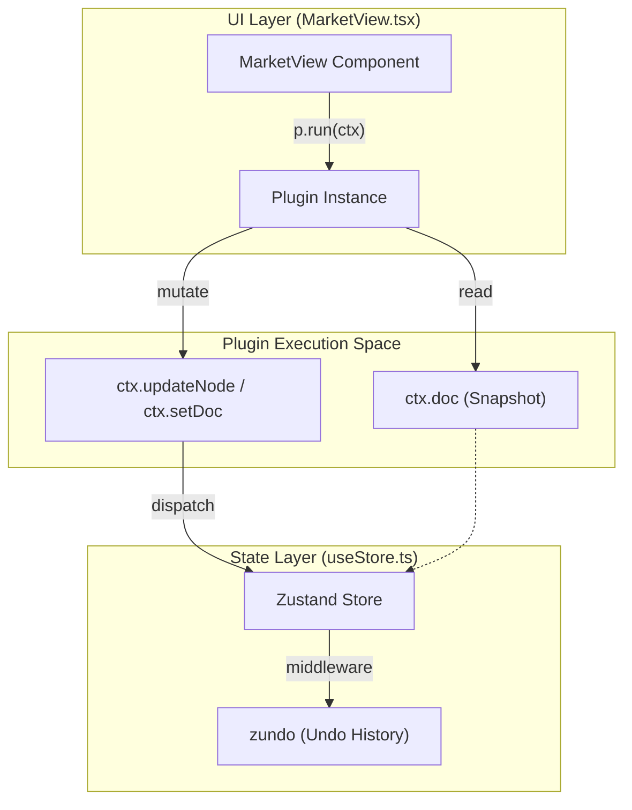
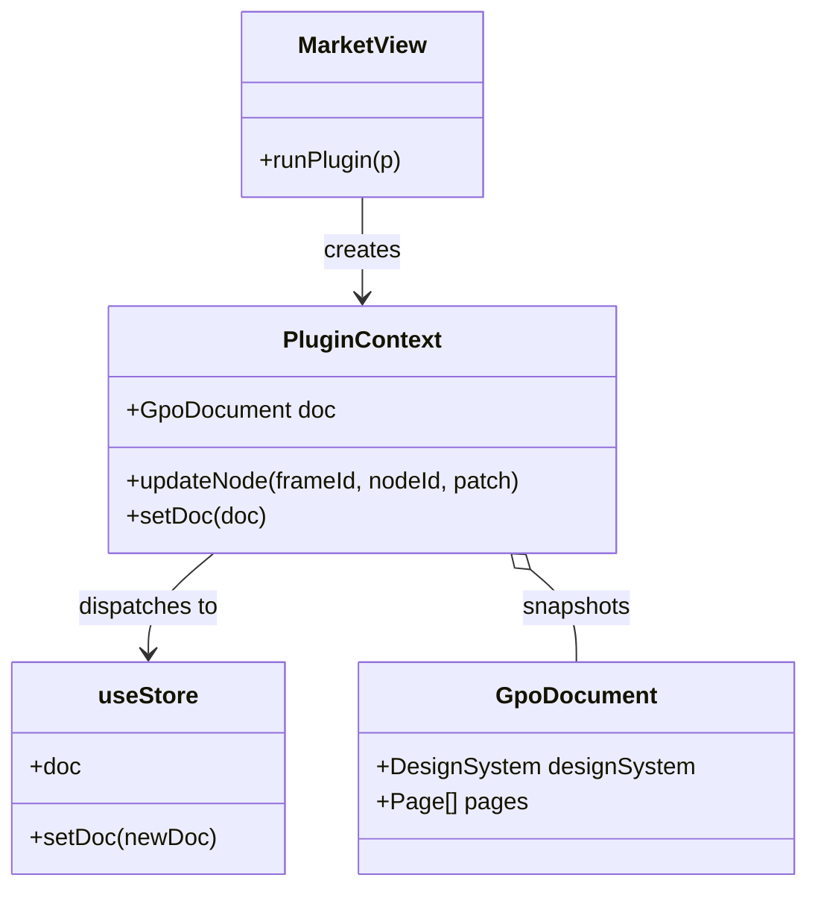

# 9.2 Plugin System

# Plugin System

Relevant source files

The following files were used as context for generating this wiki page:

- [docs/PLUGIN_SPEC.md](docs/PLUGIN_SPEC.md)
- [src/__tests__/core.test.ts](src/__tests__/core.test.ts)
- [src/interop/importDesign.ts](src/interop/importDesign.ts)
- [src/market/catalog.ts](src/market/catalog.ts)
- [src/schema/defaults.ts](src/schema/defaults.ts)
- [src/schema/layout.ts](src/schema/layout.ts)
- [src/views/MarketView.tsx](src/views/MarketView.tsx)

The OpenPrototype Plugin System provides an extensibility layer for performing reusable, undoable, and batch transformations on design documents [docs/PLUGIN_SPEC.md:1-6](). Plugins are designed as pure functions that interact with the document through a restricted context API, ensuring that all modifications remain compatible with the application's state management and undo/redo history [docs/PLUGIN_SPEC.md:41-44]().

### Plugin Architecture Overview

A plugin in OpenPrototype consists of a **Manifest** (metadata) and a **`run` function** [docs/PLUGIN_SPEC.md:6-7]().

#### Data Flow: Plugin Execution
This diagram illustrates how a plugin interacts with the centralized `useStore` through the `PluginContext`.

Sources: [src/views/MarketView.tsx:99-112](), [docs/PLUGIN_SPEC.md:41-44]()

---

### Plugin Specification

#### 1. Manifest Structure
Every plugin must implement the `Plugin` interface, which defines its identity, versioning, and required capabilities [docs/PLUGIN_SPEC.md:10-22]().

| Field | Type | Description |
| :--- | :--- | :--- |
| `id` | `string` | Unique identifier (e.g., `plg_snap_grid`) [docs/PLUGIN_SPEC.md:12](). |
| `name` | `string` | Display name in the Plugin Market [docs/PLUGIN_SPEC.md:13](). |
| `permissions` | `PluginPermission[]` | Declared capabilities (`tokens`, `components`, `nodes`, `document`) [docs/PLUGIN_SPEC.md:30-40](). |
| `apiVersion` | `string` | Target API version. Compatible if major version matches `PLUGIN_API_VERSION` [docs/PLUGIN_SPEC.md:28](). |
| `run` | `Function` | The entry point function that receives `PluginContext` [docs/PLUGIN_SPEC.md:20](). |

#### 2. PluginContext API
The `PluginContext` provides the bridge between the plugin's logic and the application state [src/market/catalog.ts:33]().

*   `doc: GpoDocument`: A read-only snapshot of the current document [docs/PLUGIN_SPEC.md:48]().
*   `updateDesignSystem(patch)`: Modifies design tokens (colors, radii, etc.) [docs/PLUGIN_SPEC.md:50]().
*   `updateNode(frameId, nodeId, patch)`: Updates specific node properties [docs/PLUGIN_SPEC.md:51]().
*   `addComponent(comp)`: Registers a new component definition [docs/PLUGIN_SPEC.md:52]().
*   `setDoc(doc)`: Replaces the entire document for batch transformations [docs/PLUGIN_SPEC.md:53]().

Sources: [docs/PLUGIN_SPEC.md:10-22](), [docs/PLUGIN_SPEC.md:46-55](), [src/market/catalog.ts:30-36]()

---

### Traversal Utilities

To simplify document-wide operations, the system provides utility functions for traversing the `GpoDocument` hierarchy [src/market/catalog.ts:31-32]().

#### `mapAllNodes(doc, fn)`
This utility performs a deep traversal of all pages, frames, and nested child nodes (groups). It applies the provided function `fn` to every node and returns a new transformed document [docs/PLUGIN_SPEC.md:58-59]().

**Implementation Logic:**
1.  Iterates through `doc.pages` [docs/PLUGIN_SPEC.md:79]().
2.  Iterates through `page.frames`.
3.  Recursively visits `frame.nodes` and any nested `node.children`.
4.  Returns a new document with updated node references.

Sources: [docs/PLUGIN_SPEC.md:58-60](), [docs/PLUGIN_SPEC.md:79-85]()

---

### Built-in Plugins

OpenPrototype includes several standard plugins located in the `PLUGINS` registry [src/market/catalog.ts:30]().

| Plugin ID | Name | Functionality |
| :--- | :--- | :--- |
| `plg_snap_grid` | Snap to Grid | Rounds all node `x`, `y`, `width`, and `height` to the nearest 8px increment. |
| `plg_unify_radius` | Unify Radius | Sets all rectangular nodes to use the design system's standard `md` radius [src/__tests__/core.test.ts:104-108](). |
| `plg_localize_en` | Localize to English | Uses a mapping to translate standard UI strings (e.g., "提交" → "Submit"). |

Sources: [src/market/catalog.ts:30-36](), [src/__tests__/core.test.ts:30-36]()

---

### Integration and Market UI

The `MarketView` component handles the discovery and execution of plugins [src/views/MarketView.tsx:4]().

#### Plugin Execution Flow
When a user clicks "Run Plugin" in the UI:
1.  The `MarketView` retrieves the current state from `useStore.getState().doc` [src/views/MarketView.tsx:101]().
2.  It constructs a `PluginContext` using store actions (`updateNode`, `setDoc`, etc.) [src/views/MarketView.tsx:102-106]().
3.  The plugin's `run` function is executed [src/views/MarketView.tsx:100]().
4.  The return string from the plugin is displayed to the user via `showToast` [src/views/MarketView.tsx:108]().

#### Code Entity Mapping

Sources: [src/views/MarketView.tsx:7-17](), [src/views/MarketView.tsx:99-112](), [src/schema/types.ts:1-10]()

---

### Compatibility and Versions

The system enforces version checks to prevent runtime errors from breaking changes in the Plugin API [docs/PLUGIN_SPEC.md:26-28]().

*   **`PLUGIN_API_VERSION`**: Currently `1.0.0` [src/market/catalog.ts:35]().
*   **Compatibility Rule**: The host application checks the major version of the plugin's `apiVersion`. If the major version matches the host's `PLUGIN_API_VERSION`, the plugin is allowed to load [docs/PLUGIN_SPEC.md:28]().

Sources: [src/market/catalog.ts:35-36](), [docs/PLUGIN_SPEC.md:3-4](), [docs/PLUGIN_SPEC.md:26-29]()

---
